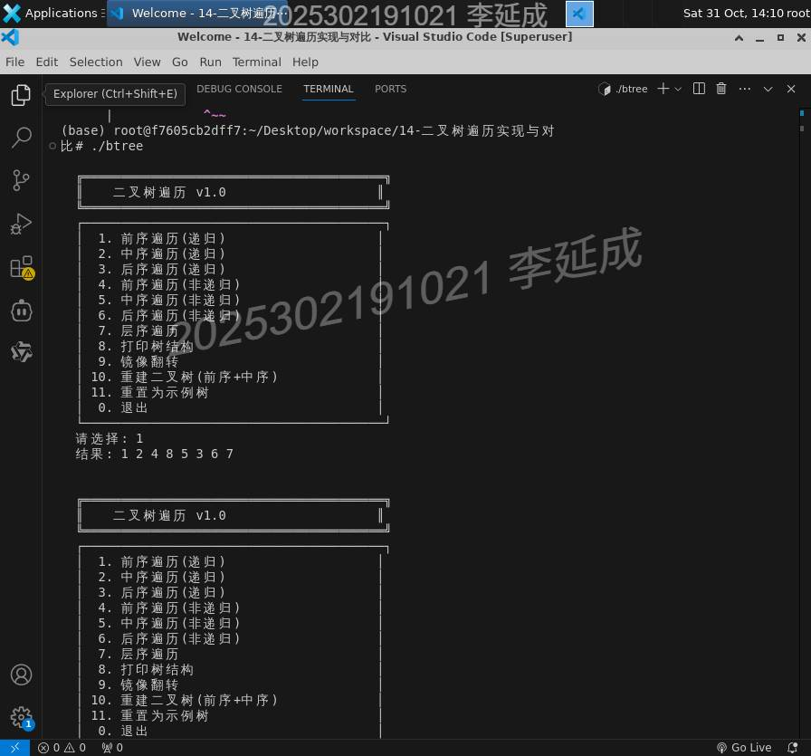
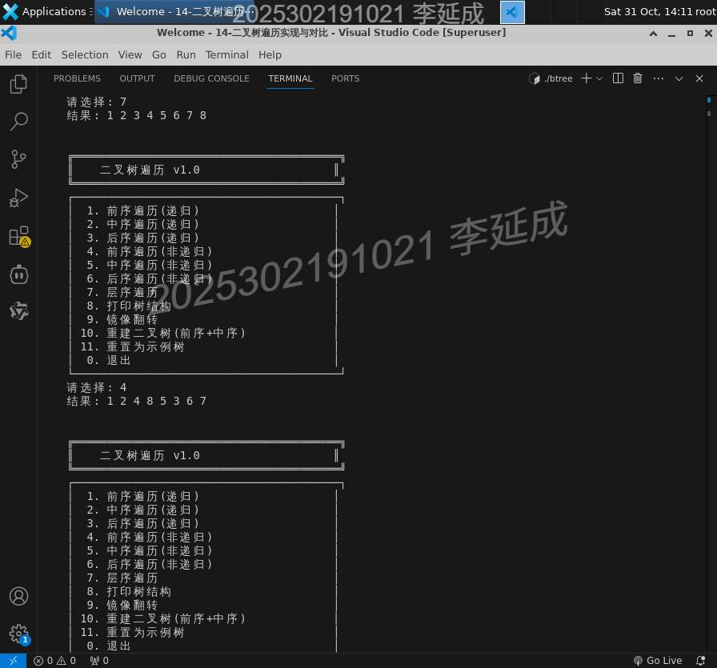
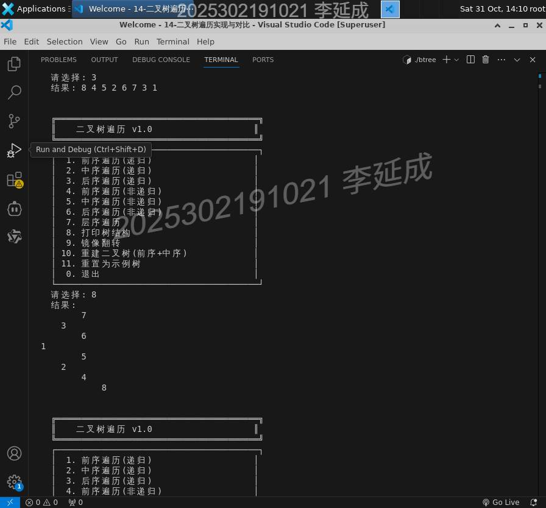
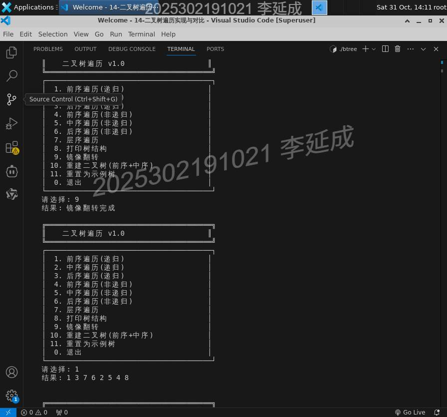

# 实验六　二叉树遍历实现与对比 —— 实验报告

- **姓名 / 学号**：李延成 / 2025302191021

遍历的所有功能都只依赖「数据 + 左右指针」三件套，所以结点结构刻意做得很小；树的构造和访问全部通过指针完成，不引入数组存储。

```c
typedef struct Node {
    int data;              /* 结点值 */
    struct Node *left;     /* 左子 */
    struct Node *right;    /* 右子 */
} Node;

Node* createNode(int data) {
    Node *n = (Node*)malloc(sizeof(Node));
    n->data = data;
    n->left = n->right = NULL;   /* 叶子先按叶子建，再由上层挂接 */
    return n;
}

Node* buildSample(void) {        /* 手写挂接，构造上图那棵树 */
    Node *r = createNode(1);
    r->left  = createNode(2); r->right      = createNode(3);
    r->left->left = createNode(4); r->left->right = createNode(5);
    r->right->left = createNode(6); r->right->right = createNode(7);
    r->left->left->left = createNode(8);
    return r;
}
```

主控就是一个 `while(1)` 菜单循环，用 `fgets` + `atoi` 读选项再 `switch` 分派，好处是多余输入不会把 `scanf` 的缓冲区搞坏；`case 9`、`case 10` 会改写根指针，所以写的是 `root = mirror(root)`。

---

## 二、关键步骤 1：三种递归遍历 —— 一套骨架，三处 `printf`

前序、中序、后序的递归骨架完全相同，**只有「访问根」这一句的位置不同**：放在两次递归之前是前序，夹在中间是中序，挪到最后是后序。

```c
void preR(Node *r) {                  /* 根 → 左 → 右 */
    if (!r) return;                   /* 空指针即递归出口 */
    printf("%d ", r->data);           /* ← 访问在递归之前 */
    preR(r->left);
    preR(r->right);
}

void inR(Node *r) {                   /* 左 → 根 → 右 */
    if (!r) return;
    inR(r->left);
    printf("%d ", r->data);           /* ← 访问在两次递归之间 */
    inR(r->right);
}

void postR(Node *r) {                 /* 左 → 右 → 根 */
    if (!r) return;
    postR(r->left);
    postR(r->right);
    printf("%d ", r->data);           /* ← 访问在递归之后 */
}
```

`if (!r) return;` 是唯一出口：走到叶子再往下一层就是 `NULL`，立刻返回，因此 `printf` 之前不必再判空。三句的位置关系可以用一句口诀固定下来——**「前序先打印后递归、中序递归夹打印、后序递归完再打印」**，写错任何一个，输出就会变成另一种遍历。

**运行结果**（启动程序 → 选 1）：



```
请选择: 1
结果: 1 2 4 8 5 3 6 7
```

对照示例树走一遍：先访问 1；向左到 2、4、8，8 的左右都是 `NULL` 回溯；回到 4 时右子为空；回到 2 走右子 5；再回溯到 1 走右子树 3、6、7。输出 `1 2 4 8 5 3 6 7` 与手推完全一致。

---

## 三、关键步骤 2：非递归遍历 —— 用显式栈替掉调用栈

递归能自动跑，是因为**系统栈替你保存了「回来之后该干什么」**。非递归要做的事就是把这份现场搬到数组栈里，自己管进栈出栈。

### 1）前序：先压右、再压左

```c
void preI(Node *r) {
    Node *stack[100]; int top = -1;      /* 数组模拟栈，top == -1 为空 */
    if (r) stack[++top] = r;

    while (top >= 0) {
        Node *n = stack[top--];          /* 出栈即访问 */
        printf("%d ", n->data);

        if (n->right) stack[++top] = n->right;   /* 右先进 */
        if (n->left)  stack[++top] = n->left;    /* 左后进 */
    }
}
```

栈是后进先出，**后压的左子会先出栈**，于是出栈顺序自然就是「根 → 左 → 右」。如果按「先左后右」压栈，得到的是镜像的前序 `1 3 7 6 2 5 4 8`——这正好是后面镜像翻转后的前序结果，两个错误的巧合很容易掩盖 bug，值得记一笔。

### 2）中序：左链一路入栈，出栈即访问，再转右

```c
void inI(Node *r) {
    Node *stack[100]; int top = -1;
    Node *cur = r;

    while (cur || top >= 0) {                /* 两个条件缺一不可 */
        while (cur) {                        /* 沿左孩子一路压栈 */
            stack[++top] = cur;
            cur = cur->left;
        }
        cur = stack[top--];                  /* 最左的结点先出 */
        printf("%d ", cur->data);
        cur = cur->right;                    /* 右子树重复同一套动作 */
    }
}
```

|                 |   |                                                                                                 |
| --------------- | - | ----------------------------------------------------------------------------------------------- |
| 外层 \`while (cur |   | top >= 0)` 的两个条件分别对应两种「还没完」：`cur` 非空表示还有左链没走完，`top >= 0`表示还有结点等着回溯。少写`top >= 0\` 就会在右子树为空时提前收工。 |

### 3）后序：双栈法 —— 先造「根右左」，再整体逆序

```c
void postI(Node *r) {
    if (!r) return;
    Node *s1[100]; int t1 = -1;
    Node *s2[100]; int t2 = -1;

    s1[++t1] = r;
    while (t1 >= 0) {
        Node *n = s1[t1--];
        s2[++t2] = n;                    /* 出栈顺序存进 s2 */
        if (n->left)  s1[++t1] = n->left;
        if (n->right) s1[++t1] = n->right;   /* 右后进先出 */
    }
    while (t2 >= 0) printf("%d ", s2[t2--]->data);  /* 逆序输出 */
}
```

`s1` 的出栈顺序是「根 → 右 → 左」（因为压栈是左、右，右先出），把它依次压进 `s2`，再把 `s2` 从栈顶倒着打印，得到的正是「左 → 右 → 根」。本质上**后序 = 根右左的逆序**，双栈法就是把「逆序」这件事交给第二个栈完成，绕开了后序递归里「必须等两个孩子都处理完」的判断难题。

**运行结果**（选 7 层序，再选 4 前序非递归）：



```
请选择: 7
结果: 1 2 3 4 5 6 7 8

请选择: 4
结果: 1 2 4 8 5 3 6 7
```

非递归前序与递归前序输出逐位相同，说明栈里保存的「待访问顺序」与系统栈一致，仅是存储介质换了。

---

## 四、关键步骤 3：层序遍历 —— 队列的 FIFO 才是关键

层序不能用栈：它要求「先看到的先处理」，正好是队列的先进先出。这里用数组下标 `front` / `rear` 模拟，`front` 只增不减，队空判据是 `front == rear`。

```c
void levelOrder(Node *r) {
    if (!r) return;
    Node *q[100];
    int front = 0, rear = 0;

    q[rear++] = r;                       /* 根入队 */

    while (front < rear) {               /* 队非空 */
        Node *n = q[front++];            /* 出队 */
        printf("%d ", n->data);

        if (n->left)  q[rear++] = n->left;   /* 先左后右，保证同层从左到右 */
        if (n->right) q[rear++] = n->right;
    }
}
```

父结点出队时把两个孩子依次入队，就实现了「一层处理完再下一层」。若把 `left` / `right` 顺序对调，输出会变成 `1 3 2 7 6 5 4 8`——每层内部左右颠倒，这个错误在只有单层或对称树时看不出来，是层序代码最常见的坑。

队列的变化过程（上图第一段输出即 `请选择: 7`）：

|  步骤 |     出队     | 入队   | 队列（front → rear） |
| :-: | :--------: | :--- | :--------------- |
|  1  |      1     | 2, 3 | `[2, 3]`         |
|  2  |      2     | 4, 5 | `[3, 4, 5]`      |
|  3  |      3     | 6, 7 | `[4, 5, 6, 7]`   |
|  4  |      4     | 8    | `[5, 6, 7, 8]`   |
| 5~8 | 5, 6, 7, 8 | —    | 依次清空             |

---

## 五、关键步骤 4：树形打印 —— 「右 → 根 → 左」加缩进

控制台里没有坐标，用「深度 × 缩进」表达层次。注意遍历顺序是**右子树先打**，这样右子出现在上方、左子出现在下方，横过来看就和人手画的二叉树一致。

```c
void printTree(Node *r, int d) {          /* d = 当前深度 */
    if (!r) return;
    printTree(r->right, d + 1);           /* 先打右子树（显示在上方） */
    for (int i = 0; i < d; i++) printf("    ");
    printf("%d\n", r->data);
    printTree(r->left, d + 1);            /* 后打左子树（显示在下方） */
}
```

**运行结果**（选 3 后序，再选 8 打印树结构）：



```
请选择: 3
结果: 8 4 5 2 6 7 3 1

请选择: 8
结果:
        7
    3
        6
1
        5
    2
        4
            8
```

读这张缩进图要「歪着头看」：根 1 顶格；3 缩进一级在右、2 缩进一级在左；7、6 是 3 的两个孩子，5、4 是 2 的两个孩子，8 缩进三级挂在 4 下面。**层级关系全对**，说明 `buildSample()` 的挂接没有左右错位。这行打印也是后面验证镜像翻转是否正确的唯一依据——光看遍历序列容易误判，看图最直观。

---

## 六、关键步骤 5：镜像翻转与序列重建

镜像就是把每个结点的左右指针互换，然后对两棵子树递归做同样的事；`return r` 只是为了让调用处能写成 `root = mirror(root)`，根指针本身没变。

```c
Node* mirror(Node *r) {
    if (!r) return NULL;

    Node *t = r->left;                   /* 三句交换，顺序不能乱 */
    r->left  = r->right;
    r->right = t;

    mirror(r->left);                     /* 子树同样镜像 */
    mirror(r->right);
    return r;
}
```

**运行结果**（选 9 镜像，再选 1 看前序）：



```
请选择: 9
结果: 镜像翻转完成

请选择: 1
结果: 1 3 7 6 2 5 4 8
```

原前序 `1 2 4 8 5 3 6 7` → 镜像后 `1 3 7 6 2 5 4 8`，左右子树整体对调，且各自内部也翻了一次（`2 4 8 5` 变 `2 5 4 8`、`3 6 7` 变 `3 7 6`），符合「每个结点都交换」的预期。

重建部分用「前序定根、中序划分子树」的分治：前序第一个元素就是当前根，在中序里找到它的位置，左侧是左子树的中序、右侧是右子树的中序，长度对应到前序上即可切分。

```c
int findPos(int *arr, int start, int end, int val) {
    for (int i = start; i <= end; i++)
        if (arr[i] == val) return i;
    return -1;                           /* 序列不合法时会返回 -1 */
}

Node* buildFromPreIn(int *pre, int *in, int start, int end, int *idx) {
    if (start > end) return NULL;        /* 区间空 → 该侧无子树 */

    Node *n = createNode(pre[*idx]);     /* 前序当前元素作根 */
    (*idx)++;                            /* idx 随先序遍历单调前移 */

    if (start == end) return n;          /* 区间只剩一个，必是叶子 */

    int pos = findPos(in, start, end, n->data);
    if (pos < 0) return NULL;            /* 两个序列对不上 */

    n->left  = buildFromPreIn(pre, in, start, pos - 1, idx);
    n->right = buildFromPreIn(pre, in, pos + 1, end, idx);
    return n;
}
```

`idx` 用指针传是为了让所有递归层共享同一个「前序游标」。**游标只能单调前进、不能回退**，所以左子树必须先递归、右子树后递归，顺序一换整棵树就错。`findPos` 是线性扫描，每层都扫一遍，总体 $O(n^2)$；若把中序值预先存进哈希表，可降到 $O(n)$。


---

## 八、总结

1. **三种递归遍历是同一个算法，差别只在一个 `printf` 的位置。** 前序在递归前、中序在递归中间、后序在递归后——这不是记法上的巧合，而是「访问根的时机」在决定序列。理解了这一点，就不需要背三套代码。
2. **非递归的价值不在「不用递归」，而在「把隐藏的系统栈显式化」。** 前序靠「先右后左压栈」凑出左先出，中序靠「左链一次性压满」保存回溯路径，后序靠双栈把「根右左」逆序成「左右根」。三份代码的差别，本质上是**同一棵树在栈里被切分的顺序不同**。递归写法看起来更短，但非递归写法让我第一次真正看清「递归调用时到底存了什么」。
3. **数据结构决定访问次序：栈 → 深度优先，队列 → 广度优先。** 层序遍历用栈是写不出来的（会把同层结点拆散），后序遍历用队列也写不出来。这一点比记住代码更重要：先确定要什么顺序，再选容器。
4. **镜像、打印、重建都建立在「左右可分」之上，写反左右不会崩溃，只会静默出错。** 镜像写反等于白做、`printTree` 先左后右会得到上下颠倒的图、`buildFromPreIn` 里两次递归顺序颠倒会让游标错位。这类 bug 不会段错误，靠肉眼看序列很难发现，所以本次实验里**树形打印是最划算的调试工具**——先把结构打出来确认，再去看序列。
5. **可继续改进的点**：`findPos` 换哈希表把重建降到 $O(n)$；数组栈 / 队列改成 `malloc` 的动态容量，去掉 100 的上限；给 `buildFromPreIn` 增加序列合法性校验（`findPos` 返回 -1 时应整体失败而不是返回 `NULL` 子树）；再加一个「按层打印 + 空位占位」的版本，让不平衡树的结构也能看出空缺。
