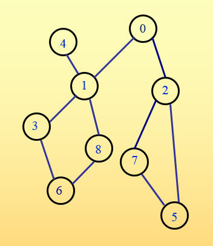

> **作业**：第六章《优先级队列》、第七章《图》（CourseGrading 平台 assignID=3675）
> **时间**：2026-11-23 10:20:00  至 2026-12-11 23:59:00 ，满分 100.00，共 16 题
> **来源**：<http://115.156.107.145/assignment/index.jsp?courseID=186&assignID=3675>，抓取于 2026-11-27
> **说明**：题干为平台原文，`〔已填：X〕` 为已提交答案在题干中的位置。全部 16 题已提交，编程 5 题均为满分（15/15），作业合计 **100 / 100**。末次核对：2026-11-27 17:10。

---

## 多选题（每题 2 分）

### 1. 递归调用问题1

递归调用时系统需要利用一个 **〔已填：D〕** 来实现数据和控制的转移。
A. 队列
B. 优先级队列
C. 双端队列
D. 栈

> **作答**：D（problemID=25221，状态：已提交）

### 2. 强连通图

具有7个顶点的有向图至少应有   **〔已填：B〕** 条边才可能成为一个强连通图。
A. 6             B. 7               C. 8                  D. 12

> **作答**：B（problemID=25413，状态：已提交）

### 3. 求无向图的边数

设无向图的顶点个数为n，则该图最多有（ **〔已填：C〕**  ）条边。
A．n-1       B．n(n+1)/2        C． n(n-1)/2         D．n

> **作答**：C（problemID=25473，状态：已提交）

### 4. 无向图的邻接矩阵

若具有n个顶点的无向连通图采用邻接矩阵表示，则邻接矩阵中至少有 **〔已填：A〕** 个非零元素。
A.2(n-1)        B.n/2        C.n+1        D.n-1

> **作答**：A（problemID=25360，状态：已提交）

### 5. 无向图的邻接边

对含有n条边的无向图而言，其邻接表中边数为 **〔已填：B〕** 。
A.n          B. 2n             C. n/2                D. n×n

> **作答**：B（problemID=25185，状态：已提交）

### 6. 无向图的存储

若具有n个顶点的无向图采用邻接矩阵存储方法，该邻接矩阵一定为一个  **〔已填：B〕** 。
A.一般矩阵        B.对称矩阵        C.对角矩阵        D.稀疏矩阵

> **作答**：B（problemID=25186，状态：已提交）


---

## 填空题（每题 2 分）

### 1. 无向图的顶点数

若一个非连通的无向图最多有28条边，则该无向图至少有 **〔已填：9〕**  个顶点。

> **作答**：空1 = 9（problemID=25188，状态：已提交）

### 2. 有向图邻接矩阵存储

有向图G用邻接矩阵存储，其第i行的所有非无穷大元素之和等于顶点i的 **〔已填：出度〕**

> **作答**：空1 = 出度（problemID=25192，状态：已提交）


---

## 简答题（每题 3 分）

### 1. 7.对一个用二叉堆实现的优先级队列，设其自建立以来共进行了q次操作，当前含有n个

7. 对一个用二叉堆实现的优先级队列（存储为预先分配的定长数组），设其自建立以来共进行了q次操作，当前含有n个元素，试写出以下复杂度（以含有q和n的表达式为结果，必要时按均摊/最坏两种情况分别写出）：（1）空间复杂度；（2）插入一个新元素的时间复杂度；（3）获取堆中最大元素的值的时间复杂度；（4）删除最大元素的时间复杂度。

**作答**：

> (1)  预先分配的空间
> 
> (2)  O(nlogn)
> 
> (3)  均摊O(logn)   最坏 O(nlogn)
> 
> (4)  均摊O(logn)   最坏 O(nlogn)


### 2. 7.设有向图G=，顶点集V={v₀,v₁,v₂,v₃}，边集E={,,,}。若从

7. 设有向图G=(V,E)，顶点集V={v₀,v₁,v₂,v₃}，边集E={<v₀,v₁>,<v₀,v₂>,<v₀,v₃>,<v₁,v₂>}。若从顶点v₀开始对图进行深度优先遍历，则可能得到的不同遍历序列个数是多少？

**作答**：

> 5种，分别是
> 
> v0, v1, v2, v3
> 
> v0, v2, v1, v3
> 
> v0, v2, v3, v1
> 
> v0, v3, v1, v2
> 
> v0, v3, v2, v1


### 3. 8.假设图用邻接矩阵存储，请分别设计深度优先遍历和广度优先遍历算法，并分析其时间

8. 假设图用邻接矩阵存储，请分别设计深度优先遍历和广度优先遍历算法，并分析其时间复杂度。

**作答**：

> const int MAX = 100000;
> 
> bool visits[MAX];
> 
> int matrix[MAX][MAX];
> 
>  
> 
>  
> 
> 深度优先算法是
> 
> void dfs(int root){
> 
>     visits[root] = 1;
> 
>     cout << root << " ";
> 
>     for(int i=0; i<MAX; i++){
> 
>         if(matrix[root][i] && !visits[i]){
> 
>             dfs(i);
> 
>         }
> 
>     }
> 
> }
> 
> 时间复杂度是log(n*n)，每次遍历一整行
> 
>  
> 
> 广度优先算法是
> 
> void bfs(int root){
> 
>     queue<int> q;
> 
>     q.push(root);
> 
>     visits[root] = 1;
> 
>     while(!q.empty()){
> 
>         int now = q.front();
> 
>         q.pop();
> 
>         cout << now << " ";
> 
>         for(int i=0; i<MAX; i++){
> 
>             if(matrix[now][i] && !visits[i]){
> 
>                 visits[i] = 1;
> 
>                 q.push(i);
> 
>             }
> 
>         }
> 
>     }
> 
> }
> 
> 时间复杂度也是log(n*n)，同样每次遍历一整行


---

## 编程题（每题 15 分）

### 1. 图的深度优先遍历DFS

一、问题描述

给定一个无向图，从给定节点开始进行深度优先搜索（DFS），输出遍历顺序。


二、输入形式

第一行输入两个正整数n和m（1 ≤ n ≤ 1000, 1 ≤ m ≤ 10000），表示节点数和边数。

接下来m行，每行两个整数u和v，表示节点u和v之间有一条边。

最后一行输入一个整数s，表示遍历开始的起点。


三、输出形式

输出DFS遍历顺序，节点编号用空格分隔。


四、样例输入

```

6 7

1 2

1 3

2 4

2 5

3 5

4 6

5 6

1

```


五、样例输出

```

1 2 4 6 5 3

```


六、样例说明

图结构：

```

1 -- 2 -- 4 -- 6

|    |    |

3 -- 5 --

```


DFS遍历（从1开始，邻接点按编号升序）：

1. 访问1，标记为已访问

2. 访问1的未访问邻接点中最小编号2

3. 访问2的未访问邻接点中最小编号4

4. 访问4的未访问邻接点中最小编号6

5. 访问6的未访问邻接点中最小编号5（2和4已访问）

6. 访问5的未访问邻接点中最小编号3


七、评分标准

共6个测试用例。


八、类库使用要求

可以使用vector。必须手动实现DFS递归或迭代。

> **判题**：得分 **15.00 / 15**。共 6 组测试数据，结果：完全正确、完全正确、完全正确、完全正确、完全正确、完全正确；最后一次提交时间：2026-11-27 12:13:22。

**编辑器中代码（未提交，仅草稿）**：

```cpp
# include <bits/stdc++.h>
#define endl '\n'
typedef long long int ll;
using namespace std;

int n, m;
bool visited[1005];
vector<vector<int>> chs;

void dfs(int root){
    visited[root] = 1;
    cout << root << " ";
    for(auto a:chs[root]){
        if(!visited[a]){
            dfs(a);
        }
    }
}

void solve(){
    cin >> n >> m;
    chs.resize(n+1);
    for(int i=0; i<m; i++){
        int a, b;
        cin >> a >> b;
        chs[a].push_back(b);
        chs[b].push_back(a);
    }
    int root;
    cin >> root;
    dfs(root);
}

int main(){
    std::ios::sync_with_stdio(false);
    cin.tie(0); cout.tie(0);
    int T = 1;
    while(T--)solve();
    return 0;
}
```

### 2. 图的广度优先遍历BFS

一、问题描述

给定一个无向图，从指定节点s开始进行广度优先搜索（BFS），输出遍历顺序。


二、输入形式

第一行输入两个正整数n和m（1 ≤ n ≤ 1000, 1 ≤ m ≤ 10000），表示节点数和边数。

接下来m行，每行两个整数u和v，表示节点u和v之间有一条边。

最后一行输入一个整数n，表示广度优先遍历的起点。


三、输出形式

输出BFS遍历顺序，节点编号用空格分隔。


四、样例输入

```

6 7

1 2

1 3

2 4

2 5

3 5

4 6

5 6

1

```


五、样例输出

```

1 2 3 4 5 6

```


六、样例说明

图结构：

```

1 -- 2 -- 4 -- 6

|    |    |

3 -- 5 --

```


BFS遍历（从1开始，邻接点按编号升序）：

1. 访问1，队列[1]

2. 弹出1，访问其邻接点2、3，队列[2,3]

3. 弹出2，访问其未访问邻接点4、5，队列[3,4,5]

4. 弹出3，其邻接点1、5都已访问，队列[4,5]

5. 弹出4，访问其未访问邻接点6，队列[5,6]

6. 弹出5，其邻接点都已访问，队列[6]

7. 弹出6


七、评分标准

共6个测试用例。


八、类库使用要求

可以使用vector、queue。必须手动实现BFS。

> **判题**：得分 **15.00 / 15**。共 6 组测试数据，结果：完全正确、完全正确、完全正确、完全正确、完全正确、完全正确；最后一次提交时间：2026-11-27 15:54:59。

**编辑器中代码（未提交，仅草稿）**：

```cpp
# include <bits/stdc++.h>
#define endl '\n'
typedef long long int ll;
using namespace std;

int n, m;
bool visited[1005];
vector<vector<int>> chs;

void bfs(int root){
    visited[root] = 1;
    queue<int> q;
    q.push(root);
    while(!q.empty()){
        int r = q.front();
        cout << r << " ";
        q.pop();
        for(auto a:chs[r]){
            if(!visited[a]){
                visited[a] = 1;
                q.push(a);
            }
        }
    }
}

void solve(){
    cin >> n >> m;
    chs.resize(n+1);
    for(int i=0; i<m; i++){
        int a, b;
        cin >> a >> b;
        chs[a].push_back(b);
        chs[b].push_back(a);
    }
    int root;
    cin >> root;
    bfs(root);
}

int main(){
    std::ios::sync_with_stdio(false);
    cin.tie(0); cout.tie(0);
    int T = 1;
    while(T--)solve();
    return 0;
}
```

### 3. 图的存储-邻接矩阵与邻接表

一、问题描述

给定一个有n个节点、m条边的无向图，分别用邻接矩阵和邻接表存储，并输出两种存储形式。


二、输入形式

第一行输入两个正整数n和m（1 ≤ n ≤ 100, 1 ≤ m ≤ n(n-1)/2），表示节点数和边数。

接下来m行，每行两个整数u和v（1 ≤ u, v ≤ n），表示节点u和v之间有一条边。


三、输出形式

首先输出n行，每行n个整数，表示邻接矩阵（0表示无边，1表示有边）。

然后输出n行，每行格式为"i: v1 v2 ..."，表示节点i的邻接点列表（按升序排列）。


四、样例输入

```

4 4

1 2

1 3

2 4

3 4

```


五、样例输出

```

0 1 1 0

1 0 0 1

1 0 0 1

0 1 1 0

1: 2 3

2: 1 4

3: 1 4

4: 2 3

```


六、评分标准

共6个测试用例。


七、类库使用要求

可以使用vector。

> **判题**：得分 **15.00 / 15**。共 6 组测试数据，结果：完全正确、完全正确、完全正确、完全正确、完全正确、完全正确；最后一次提交时间：2026-11-27 16:03:51。

**已提交代码**：

```cpp
# include <bits/stdc++.h>
#define endl '\n'
typedef long long int ll;
using namespace std;

void solve(){
    int n, m;
    cin >> n >> m;
    vector<vector<int>> matrix(n+1, vector<int> (n+1, 0));
    vector<vector<int>> nodes(n+1);
    for(int i=1; i<=m; i++){
        int u, v;
        cin >> u >> v;
        matrix[u][v] = matrix[v][u] = 1;
        nodes[u].push_back(v);
        nodes[v].push_back(u);
    }
    for(int i=1; i<=n; i++){
        for(int j=1; j<=n; j++){
            cout << matrix[i][j] << " ";
        }
        cout << endl;
    }
    for(int i=1; i<=n; i++){
        cout << i << ": ";
        for(auto a: nodes[i]){
            cout << a << " ";
        }
        cout << endl;
    }
}

int main(){
    std::ios::sync_with_stdio(false);
    cin.tie(0); cout.tie(0);
    int T = 1;
    while(T--)solve();
    return 0;
}
```

### 4. 图的遍历及连通性

【问题描述】
 根据输入的图的邻接矩阵A，判断此图的连通分量的个数。
【输入形式】
 第一行为图的结点个数n，之后的n行为邻接矩阵的内容，每行n个数表示。其中A[i][j]=1表示两个结点邻接，而A[i][j]=0表示两个结点无邻接关系。
【输出形式】
 输出此图连通分量的个数。
【样例输入】

```
5

0 1 1 0 0

1 0 1 0 0

1 1 0 0 0

0 0 0 0 1

0 0 0 1 0
```
【样例输出】

```
2
```
【样例说明】
 邻接矩阵中对角线上的元素都用0表示。(单个独立结点，即与其它结点都没有边连接，也算一个连通分量)
【评分标准】
 要求必须使用图的广度或者深度优先遍历算法，否则不得分。

> **判题**：得分 **15.00 / 15**。共 3 组测试数据，结果：完全正确、完全正确、完全正确；最后一次提交时间：2026-11-27 16:31:00。

**已提交代码**：

```cpp
# include <bits/stdc++.h>
#define endl '\n'
typedef long long int ll;
using namespace std;

vector<int> visited;
vector<vector<int>> li;

void dfs(int root){
        visited[root] = 1;
        for(auto a:li[root]){
            if(!visited[a]){
                visited[a] = 1;
                dfs(a);
            }
        }
    };

void solve(){
    int n;
    cin >> n;
    li.resize(n+1);
    visited.resize(n+1);
    for(int i=1; i<=n; i++){
        for(int j=1; j<=n; j++){
            int tmp;
            cin >> tmp;
            if(tmp) li[i].push_back(j);
        }
    }
    
    int cnt = 0;
    
    for(int i=1; i<=n; i++){
        if(!visited[i]){
            cnt ++;
            dfs(i);
        }
    }
    cout << cnt;
}

int main(){
    std::ios::sync_with_stdio(false);
    cin.tie(0); cout.tie(0);
    int T = 1;
    while(T--)solve();
    return 0;
}
```

### 5. 图遍历（图-基本题）

【问题描述】
给定一个无向图和一个图顶点，编程输出该图删除给定顶点前后按深度优先遍历及广度优先遍历方式遍历的图顶点序列。
给定的无向图和图顶点满足以下要求：
1、无向图的顶点个数n大于等于3，小于等于100，输入时顶点编号用整数0～n-1表示；
2、无向图在删除给定顶点前后都是连通的；
3、无论何种遍历，都是从编号为0的顶点开始遍历，访问相邻顶点时按照编号从小到大的顺序访问；
4、删除的顶点编号不为0。
【输入形式】
先从标准输入中输入图的顶点个数和边的个数，两整数之间以一个空格分隔，然后从下一行开始分行输入每条边的信息（用边两端的顶点编号表示一条边，以一个空格分隔顶点编号，边的输入次序和每条边两端顶点编号的输入次序可以是任意的，但边不会重复输入），最后在新的一行上输入要删除的顶点编号。
【输出形式】
分行输出各遍历顶点序列，顶点编号之间以一个空格分隔。先输出删除给定顶点前的深度优先遍历顶点序列和广度优先遍历顶点序列，再输出删除给定顶点后的深度优先遍历顶点序列和广度优先遍历顶点序列。
【样例输入】

```
9 10
0 1
0 2
1 4
1 3
1 8
8 6
3 6
7 2
7 5
5 2
3
```
【样例输出】

```
0 1 3 6 8 4 2 5 7
0 1 2 3 4 8 5 7 6
0 1 4 8 6 2 5 7
0 1 2 4 8 5 7 6
```
【样例说明】
输入的无向图有9个顶点，10条边（如下图所示），要删除的顶点编号为3。

从顶点0开始，按照深度优先和广度优先遍历的顶点序列分别为：0 1 3 6 8 4 2 5 7和0 1 2 3 4 8 5 7 6。删除编号为3的顶点后，按照深度优先和广度优先遍历的顶点序列分别为：0 1 4 8 6 2 5 7和0 1 2 4 8 5 7 6。
【评分标准】
该题要求按照深度优先和广度优先遍历方式输出删除给定顶点前后的遍历序列。

> **判题**：得分 **15.00 / 15**。共 5 组测试数据，结果：完全正确、完全正确、完全正确、完全正确、完全正确；最后一次提交时间：2026-11-27 17:08:56。

**已提交代码**：

```cpp
# include <bits/stdc++.h>
#define endl '\n'
typedef long long int ll;
using namespace std;

vector<vector<int>> mat;
vector<int> visited;

void empty(){
    for(auto &a:visited){
        a = 0;
    }
}

void dfs(int root){
    if(visited[root]) return;
    visited[root] = 1;
    cout << root << " ";
    for(auto a:mat[root]){
        if(!visited[a]){
            dfs(a);
        }
    }
}

void bfs(int root){
    visited[root] = 1;
    queue<int> q;
    q.push(root);
    cout << root << " ";
    while(!q.empty()){
        int tmp = q.front();
        q.pop();
        for(auto a:mat[tmp]){
            if(!visited[a]){
                cout << a << " ";
                visited[a] = 1;
                q.push(a);
            }
        }
    }
}

void solve(){
    int n, m;
    cin >> n >> m;
    mat.resize(n);
    visited.resize(n);
    for(int i=0; i<m; i++){
        int u, v;
        cin >> u >> v;
        mat[u].push_back(v);
        mat[v].push_back(u);
    }
    int shan;
    cin >> shan;
    for(auto &a:mat){
        sort(a.begin(), a.end());
    }
    dfs(0);
    empty();
    cout << endl;

    bfs(0);
    empty();
    cout << endl;

    visited[shan] = 1;
    dfs(0);
    empty();

    visited[shan] = 1;
    cout << endl;
    bfs(0);
}

int main(){
    std::ios::sync_with_stdio(false);
    cin.tie(0); cout.tie(0);
    int T = 1;
    while(T--)solve();
    return 0;
}
```
