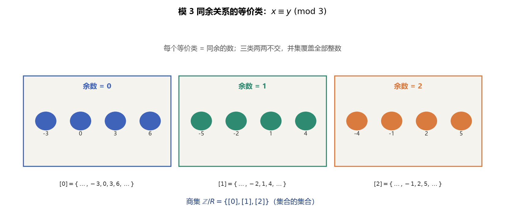
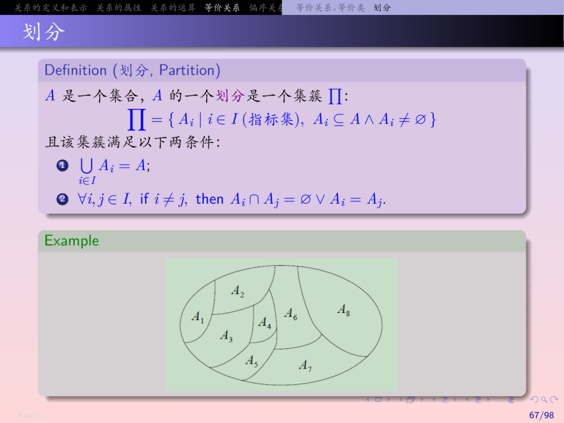
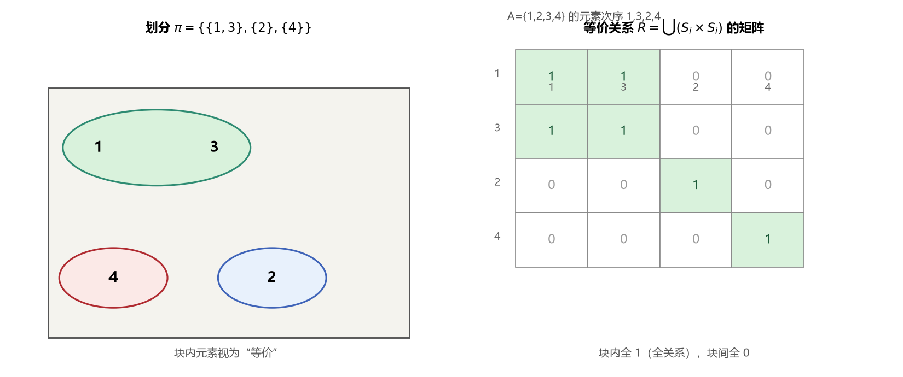
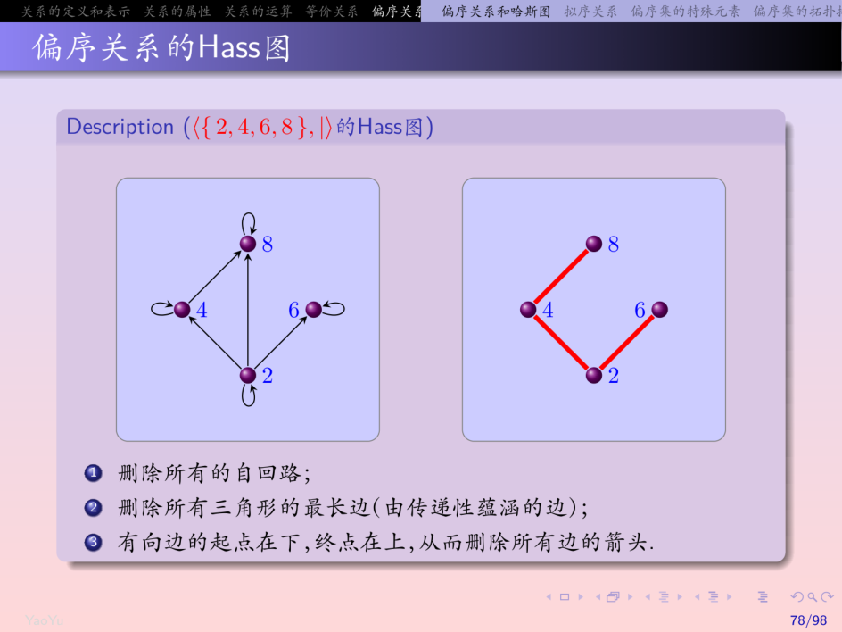
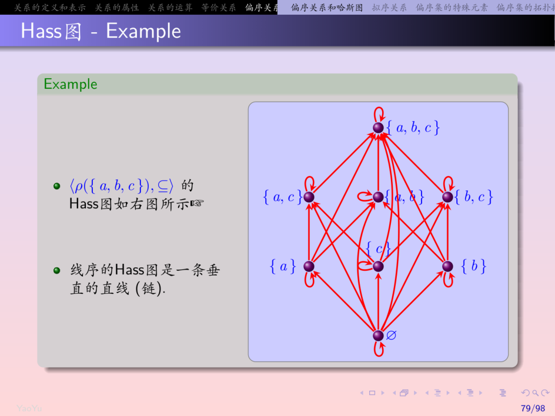
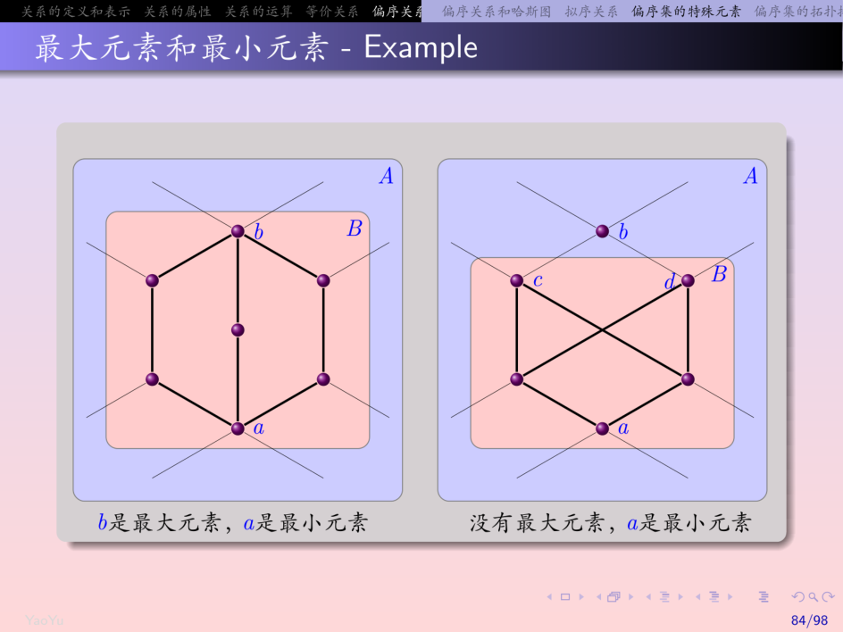
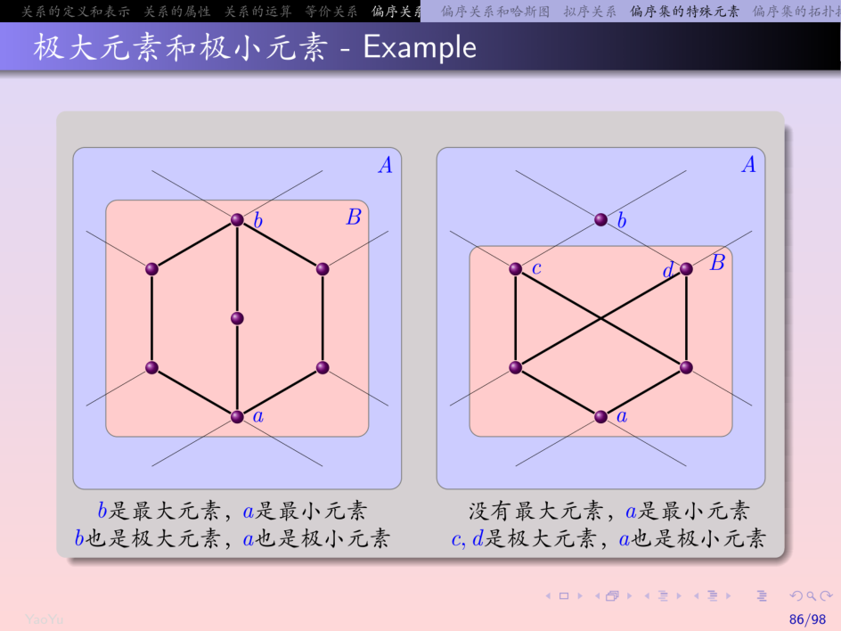
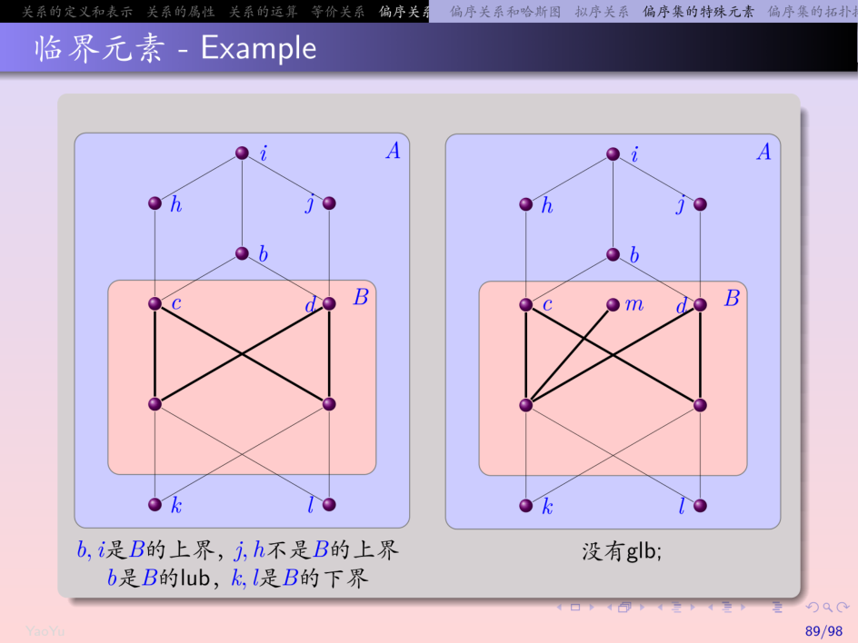
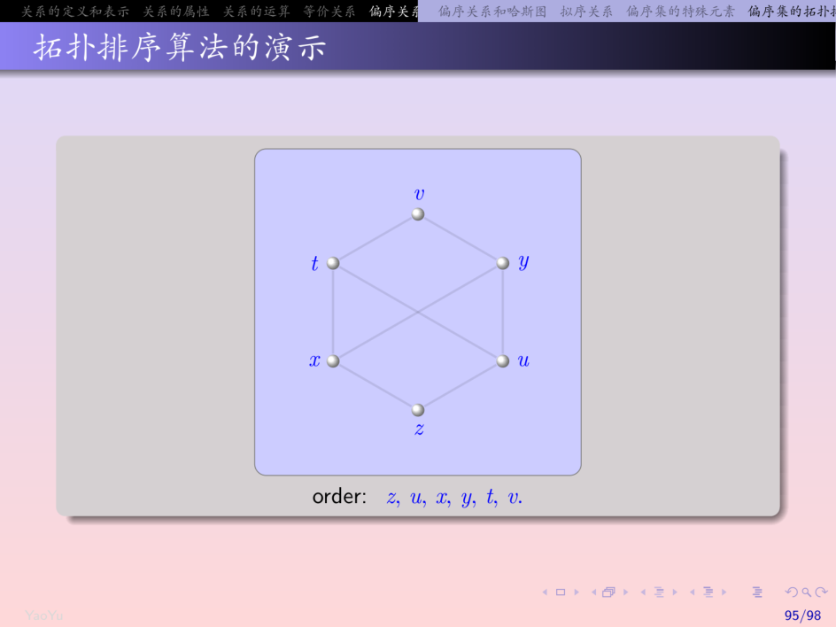

# 第5章 次序关系 - 学习笔记

> **主线**：Kenneth H. Rosen《离散数学及其应用（原书第8版）》9.5 等价关系、9.6 偏序
> **插图与补充**：武汉大学王汉飞《离散数学》讲义（课件 p56–98，其参考书目列于 p98）、电子科技大学《离散数学》（BV16Btc6VEpE）P35–P39
> 凡课件、视频与教材表述不一致处，以教材为准。
>
> 📌 教材 9.5、9.6 只讲等价关系与偏序的主干，课件的价值在于**例子**（等比关系、极限相等、四个确界例子、方程组动机）和**证明**（划分与等价关系的一一对应、拟序与偏序互转），这两块是本次补充的重点。

> **目录**
>
> - [[#1. 等价关系]] · [[#1.4 两个构造性的等价关系（课件补充）|1.4 等比与极限相等]]
> - [[#2. 等价类]]
> - [[#3. 集合的划分]]
> - [[#4. 等价关系与划分的一一对应]] · [[#4.2.1 两个方向的证明|证明]]
> - [[#5. 偏序关系与偏序集]]
> - [[#6. 可比、全序与良序]]
> - [[#7. 字典顺序]]
> - [[#8. 哈斯图]]
> - [[#9. 偏序集中的特殊元素]] · [[#9.4 四个确界例子（课件 p91）|9.4 确界例子]]
> - [[#10. 格]]
> - [[#11. 拓扑排序]] · [[#11.0 动机：为什么需要拓扑排序（课件 p93）|11.0 动机]]
> - [[#12. 拟序关系]]
> - [[#13. 本节重点]]

---

## 1. 等价关系

### 1.1 定义

设 $R$ 是非空集合 $A$ 上的关系，若 $R$ 同时满足**自反性、对称性、传递性**，则称 $R$ 为 $A$ 上的**等价关系**。此时若 $\langle a,b\rangle\in R$，称 $a$ 与 $b$ **等价**，记作 $a\sim b$。

三个性质分别保证：每个元素等价于自身；等价是相互的而非单向的；等价可以沿链条传递。

### 1.2 常见等价关系与非等价关系

| 关系 | 是否等价 | 说明 |
|------|---------|------|
| 实数上的 $=$、集合相等 | 是 | 自反、对称、传递 |
| 模 $m$ 同余 | 是 | 余数相同 |
| 字符串长度相同 | 是 | 长度是函数值 |
| 同姓、同颜色、同专业 | 是 | 按某属性归类 |
| 朋友关系 | 否 | 不传递 |
| 整除、包含 $\subseteq$ | 否 | 不对称 |
| $\lvert x-y\rvert<1$ | 否 | 不传递（见下） |

> 📌 **两个极端的等价关系**（课件 p59）：集合 $A$ 上的**全域关系** $A^2$ 与**恒等关系** $I_A$ 都是等价关系，且分别是最大、最小的那个——
> - $A^2$ 只把 $A$ 分成**一块**（所有元素互相等价，最"粗"的分类）；
> - $I_A$ 把 $A$ 分成 $|A|$ 个**单元素块**（每个元素只等价于自己，最"细"的分类）。
>
> 任何别的等价关系 $R$ 都夹在中间：$I_A\subseteq R\subseteq A^2$。另外课件还列了**逻辑恒等关系**（同一真值表）与**集合相等关系**，前者见 1.3 节。

### 1.3 典型例子

- **模 $m$ 同余**：$R=\{\langle x,y\rangle\mid m\mid(x-y)\}$。自反（$m\mid0$）、对称（$m\mid(x-y)\Rightarrow m\mid(y-x)$）、传递（$m\mid(x-y)$ 且 $m\mid(y-z)\Rightarrow m\mid(x-z)$）。
- **绝对值关系**：$aRb$ 当且仅当 $a=b$ 或 $a=-b$，是等价关系。
- **差为整数**：实数上 $aRb$ 当且仅当 $a-b$ 是整数，是等价关系。
- **前 $n$ 个字符相同**：字符串上 $sR_nt$ 当且仅当 $s=t$，或二者都至少含 $n$ 个字符且前 $n$ 个字符相同，是等价关系。传统 C 编译器据此把前 31 个字符相同的标识符视为同一个。
- **命题公式的逻辑等价**：设 $\mathcal{F}$ 是所有合式公式的集合，令 $P\sim Q$ 当且仅当 $P\leftrightarrow Q$ 是永真式（二者在所有真值指派下同真值），这是 $\mathcal{F}$ 上的等价关系。它与恒等关系不同：恒等关系要求 $P,Q$ 是同一个公式，逻辑等价则允许是不同的公式（如 $P\lor Q$ 与 $Q\lor P$），所以逻辑等价关系严格大于恒等关系，它把彼此等价的公式归为同一类。

**非等价的两个反例**：

- 整除关系自反、传递，但不对称（$2\mid4$ 而 $4\nmid2$），故不是等价关系。
- 实数上 $\lvert x-y\rvert<1$ 自反、对称，但不传递：取 $2.8,1.9,1.1$，有 $\lvert2.8-1.9\rvert=0.9<1$、$\lvert1.9-1.1\rvert=0.8<1$，但 $\lvert2.8-1.1\rvert=1.7>1$。

### 1.4 两个构造性的等价关系（课件补充）

这两个例子说明了等价关系在数学基础里的真正用途：**用来"造出"新的数**。

**等比关系（$\mathbb{Q}$ 的构造）**：设 $\mathbb{Z}$ 为整数集，在 $\mathbb{Z}\times(\mathbb{Z}-\{0\})$ 上定义

$$\langle a,b\rangle\,Q\,\langle c,d\rangle \iff ad=bc$$

直观上 $\langle a,b\rangle$ 就是分数 $\frac{a}{b}$，而 $ad=bc$ 正是"交叉相乘相等"——即两个分数数值相同。所以 $Q$ 是等价关系，它的每个等价类就是**一个有理数**：

- $[\langle 0,1\rangle]_Q=\{\langle0,-1\rangle,\langle0,1\rangle,\langle0,2\rangle,\dots\}$，即有理数 0；
- $[\langle1,2\rangle]_Q=[\langle2,4\rangle]_Q=\{\langle1,2\rangle,\langle2,4\rangle,\dots\}$，即有理数 $\frac12$。

注意 $[\langle1,2\rangle]_Q$ 与 $[\langle-1,2\rangle]_Q$ 是**不同**的等价类（$\frac12\neq-\frac12$），这正是必须验证 $ad=bc$ 而不能只看"样子"的原因。

**极限相等关系（$\mathbb{R}$ 的构造）**：设 $R=\{\langle c_n\rangle\mid\langle c_n\rangle$ 是有理数收敛序列$\}$，在 $R$ 上定义

$$\langle c_n\rangle\,L\,\langle y_n\rangle \iff \lim_{n\to\infty}c_n=\lim_{n\to\infty}y_n$$

则 $L$ 是等价关系（极限相等显然是自反、对称、传递的）。它把"趋于同一个实数的所有有理数序列"归为一类，而**这个类本身就是那个实数**。例如序列 $a=1,1,1,\dots$ 与 $b=0.9,0.99,0.999,\dots$ 有关系 $L$——它们在有理数里没有极限、在有理数范围内也互不相等，但被 $L$ 归为同一类，于是定义了实数 $1$：

$$1=\{\langle c_n\rangle\mid\langle c_n\rangle\,L\,\langle1\rangle\}$$

> 💡 这是实数理论里的 **Cantor 构造**：实数 = 有理数收敛序列的极限相等类。等价关系在这里的作用是"把一堆彼此不同但'应当相等'的东西粘成一个对象"。同理上面 $\mathbb{Q}$ 的构造是"把 $\frac12,\frac24,\frac36$ 粘成一个有理数"。

---

## 2. 等价类

### 2.1 定义

设 $R$ 是 $A$ 上的等价关系，元素 $a$ 的**等价类**定义为

$$[a]_R = \{s\in A\mid \langle a,s\rangle\in R\}$$

$a$ 称为该等价类的**代表元**。等价类中的任何元素都可作为代表元，选择哪一个并无特殊要求。



> **图1** 模 3 同余的等价类：整数被分成余数为 0、1、2 的三个类，两两不交、并集覆盖全部整数。

### 2.2 等价类的性质

设 $R$ 是 $A$ 上的等价关系，则：

1. **非空**：对任意 $a\in A$，$[a]_R\neq\varnothing$（至少含 $a$ 自身）；
2. **要么相等要么不交**：若 $b\in[a]_R$，则 $[a]_R=[b]_R$，否则 $[a]_R\cap[b]_R=\varnothing$；
3. **覆盖全集**：$\displaystyle\bigcup_{a\in A}[a]_R=A$。

课件（p66）把这三条的含义说得更直白，四条一起记：

- 等价类要么**相等**，要么**不相交**（没有"部分重叠"的中间状态）；
- 等价类与**代表元的选取无关**（$[a]=[b]$ 时谁当代表都一样）；
- **同一类内**的元素两两都有关系（类内是全关系）；
- **不同类之间**的元素一定没有关系（类间是空关系）。

前三条对应上面的性质 2、性质 3，最后一条是它的反面说法——正因为"相交即同类"，所以不相交的两类之间绝不可能有关系，否则就相交了。这四条正是"分类"这个词的严格含义。

例如模 4 同余有四个等价类：

$$[0]=\{\dots,-8,-4,0,4,8,\dots\}$$

$$[1]=\{\dots,-7,-3,1,5,9,\dots\}$$

$$[2]=\{\dots,-6,-2,2,6,10,\dots\}$$

$$[3]=\{\dots,-5,-1,3,7,11,\dots\}$$

每个整数恰好属于其中一个类。当只关心一个整数除以 $m$ 的余数时，只需知道它属于哪个类，而不必知道它的具体取值——这正是等价关系“抽象”的意义。

---

## 3. 集合的划分

### 3.1 定义

设 $A$ 为非空集合，若集簇 $\pi=\{A_i\mid i\in I\}$ 满足：

1. 每个 $A_i\subseteq A$ 且 $A_i\neq\varnothing$；
2. 对 $i\neq j$，$A_i\cap A_j=\varnothing$（两两不交）；
3. $\displaystyle\bigcup_{i\in I}A_i=A$（并集为 $A$）；

则称 $\pi$ 为 $A$ 的一个**划分**，$A_i$ 称为划分的**块**（类）。



> **图2** 划分的几何示意：把一个集合（椭圆）用曲线切成若干互不重叠、又恰好覆盖整体的小块 $A_1,\dots,A_8$；每个元素恰好落在一个块中，块与块之间没有公共元素。

划分是处理大规模数据的一种“降维”手段：对象多到无法逐一处理时，先用等价关系把它们分成互不相交的类，再让每个类派一个代表参与后续处理。例如卫生检查不必让全班几十人全部到场，只需每个宿舍派一名代表开会传达，面对的对象就从“几十名学生”降为“十几个宿舍代表”。等价类中任取一个元素都能充当代表，这正是划分与代表元的实际意义。

---

## 4. 等价关系与划分的一一对应

### 4.1 核心定理

**定理**：设 $R$ 是 $A$ 上的等价关系，则下列三个命题等价：

$$aRb \iff [a]_R=[b]_R \iff [a]_R\cap[b]_R\neq\varnothing$$

- $aRb\Rightarrow[a]=[b]$：若 $c\in[a]$，则 $aRc$；由 $aRb$ 及对称性得 $bRa$，再由传递性得 $bRc$，故 $c\in[b]$；反向同理。
- $[a]=[b]\Rightarrow[a]\cap[b]\neq\varnothing$：等价类非空。
- $[a]\cap[b]\neq\varnothing\Rightarrow aRb$：取公共元素 $c$，有 $aRc$、$bRc$，由对称性 $cRb$，再由传递性 $aRb$。

### 4.2 双向对应

- **等价关系 $\to$ 划分**：等价关系的全部等价类构成 $A$ 的一个划分（它们两两不交、并集为 $A$），称为由 $R$ **诱导**的划分，记作 $\pi_R=\{[a]_R\mid a\in A\}$。
- **划分 $\to$ 等价关系**：设 $\pi=\{A_i\}$ 是划分，则

$$R = \bigcup_{i\in I}(A_i\times A_i)$$

是 $A$ 上的等价关系，即两个元素等价当且仅当它们处于同一块中。块内部是全关系，块之间没有关系。

### 4.2.1 两个方向的证明

**① $\pi_R$ 确实是划分**（课件 p68）。验证划分的三个条件：

- **非空**：每个 $[a]_R$ 至少含 $a$，故非空。
- **覆盖**：任取 $b\in A$，由自反性 $bRb$，故 $b\in[b]_R\subseteq\bigcup_{a\in A}[a]_R$，得 $A\subseteq\bigcup[a]_R$；反向 $\bigcup[a]_R\subseteq A$ 显然。故 $\bigcup_{a\in A}[a]_R=A$。
- **不交**：由 4.1 定理，$[a]_R\cap[b]_R\neq\varnothing\Rightarrow[a]_R=[b]_R$，即相交必相等，故不同的类两两不交。

**② $R_\pi$ 确实是等价关系**（课件 p71）。设 $aR_\pi b\iff\exists A_i\in\pi,\ a\in A_i\land b\in A_i$：

- **自反**：$a\in A=\bigcup A_i$，故存在 $A_i\ni a$，于是 $aR_\pi a$。
- **对称**："$a,b$ 同属某块"对 $a,b$ 对称，显然。
- **传递**：设 $aR_\pi b$、$bR_\pi c$，则存在 $A_i,A_j\in\pi$ 使 $a,b\in A_i$、$b,c\in A_j$。于是 $b\in A_i\cap A_j$，故 $A_i\cap A_j\neq\varnothing$，由划分的两两不交性得 $A_i=A_j$。所以 $a,c$ 同属这一块，即 $aR_\pi c$。

> ⚠️ 传递性这一步是整个证明的关键：必须先用 $b$ 同时落在两块里推出 **$A_i\cap A_j\neq\varnothing$**，再用"划分的块两两不交"逼出 $A_i=A_j$。若 $\pi$ 只是普通的覆盖（块可重叠），$R_\pi$ 就**不一定传递**了。

**③ 一来一回正好还原**（课件 p70 定理的第二部分）。设 $R_\pi$ 诱导的划分为 $\pi'=\{[a]_{R_\pi}\mid a\in A\}$，则 $\pi'=\pi$。这是"一一对应"真正需要证的一步（只有它成立，才算严格的一一对应，而不是单向构造）。

核心引理：若 $[a]_{R_\pi}\cap A_i\neq\varnothing$，则 $[a]_{R_\pi}=A_i$。双向包含：

- $\subseteq$：取 $b\in[a]_{R_\pi}\cap A_i$，则 $aR_\pi b$。任取 $c\in[a]_{R_\pi}$，有 $cR_\pi a$；由传递性 $cR_\pi b$。又 $b\in A_i$，而 $c$ 与 $b$ 同属某块 $A_j$，故 $b\in A_i\cap A_j$，得 $A_j=A_i$，于是 $c\in A_i$。故 $[a]_{R_\pi}\subseteq A_i$。
- $\supseteq$：任取 $c\in A_i$，$b\in A_i$ 故 $bR_\pi c$；又 $aR_\pi b$，由传递性 $aR_\pi c$，即 $c\in[a]_{R_\pi}$。故 $A_i\subseteq[a]_{R_\pi}$。

于是 $\pi'\subseteq\pi$（任取 $[a]_{R_\pi}\in\pi'$，有 $a$ 属于某块 $A_i$，故 $[a]_{R_\pi}\cap A_i\neq\varnothing$，由引理 $[a]_{R_\pi}=A_i\in\pi$）；且 $\pi\subseteq\pi'$（任取 $A_i\in\pi$，取 $a\in A_i$，则 $a\in A_i\cap[a]_{R_\pi}$，由引理 $A_i=[a]_{R_\pi}\in\pi'$）。故 $\pi'=\pi$。



> **图3** 划分与其等价关系的矩阵呈“对角分块”结构：块内全为 1、块间全为 0。

### 4.3 商集与秩

等价关系 $R$ 诱导的划分（全部等价类构成的集合）称为**商集**：

$$A/R = \{[a]_R\mid a\in A\}$$

商集是“集合的集合”。若商集有限，其元素个数称为关系 $R$ 的**秩**。例如模 $m$ 同余的商集 $\mathbb{Z}/m\mathbb{Z}$ 有 $m$ 个元素，秩为 $m$。

课件还给了几个商集例子，正好串起前面所有的等价关系：

| 等价关系 | 商集 | 秩 |
|---------|------|-----|
| 模 $m$ 同余 $\equiv_m$ | $\mathbb{Z}/{\equiv_m}=\{[0],[1],\dots,[m-1]\}$ | $m$ |
| 等比关系 $Q$ | $\mathbb{Z}\times(\mathbb{Z}-\{0\})/Q$，即**有理数集** $\mathbb{Q}$ | 无限 |
| 极限相等 $L$ | $\{\langle c_n\rangle\}/L$，即**实数集** $\mathbb{R}$ | 无限 |
| $n$ 元命题公式的逻辑等价 | $P/{\equiv}=\{n$ 元布尔函数$\}$ | $2^{2^n}$ |

最后一行值得留意：$n$ 元命题公式有无穷多个写法，但互不等价的只有 $2^{2^n}$ 个——因为 $n$ 元真值指派共 $2^n$ 行，每行可取真/假，故不同的真值表（即不同的 $n$ 元布尔函数）恰有 $2^{2^n}$ 个。这正好是"用等价关系做抽象"的威力：把无穷多个公式压缩成有限个函数。

### 4.4 加细与等价关系计数

- **加细**：若划分 $P_1$ 中的每个块都是划分 $P_2$ 中某个块的子集，则称 $P_1$ 是 $P_2$ 的**加细**。例如模 6 同余类构成的划分是模 3 同余类划分的加细。
- $n$ 元素集合上不同等价关系的个数等于不同划分的个数，称为**贝尔数**，如 3 个元素有 5 个、4 个元素有 15 个。
- 秩恰为 $m$ 的等价关系个数称为第二类 **Stirling 数**，即把 $n$ 个不同元素放入 $m$ 个相同的非空块中的放法数。

**怎么数：以 $|A|=4$ 为例**（课件 p74）。由于等价关系与划分一一对应，数等价关系就是数划分。按"分成几块、每块多大"分类型枚举：

| 分区数 | 块大小类型 | 计数 | 例子 |
|:---:|:---|:---|:---|
| 1 | 4 | $1$ | $\{\{a,b,c,d\}\}$ |
| 2 | 3+1 | $C_4^1=4$ | $\{\{a,b,c\},\{d\}\}$ |
| 2 | 2+2 | $C_4^2/2=3$ | $\{\{a,b\},\{c,d\}\}$ |
| 3 | 2+1+1 | $C_4^2=6$ | $\{\{a\},\{b\},\{c,d\}\}$ |
| 4 | 1+1+1+1 | $1$ | $\{\{a\},\{b\},\{c\},\{d\}\}$ |

合计 $1+4+3+6+1=15$，与贝尔数一致。

> ⚠️ **2+2 型为什么要除以 2**：$C_4^2=6$ 是先选一块（6 种），剩下的自动成另一块。但 $\{\{a,b\},\{c,d\}\}$ 会被算两次（先选到 $\{a,b\}$ 或先选到 $\{c,d\}$）——两**块大小相同、不可区分**，所以要除以 $2!=2$。而 3+1 型两**块大小不同**，不存在重复，不除。这是这类计数题唯一的坑。

---

## 5. 偏序关系与偏序集

### 5.1 定义

设 $R$ 是集合 $S$ 上的关系，若 $R$ 同时满足**自反性、反对称性、传递性**，则称 $R$ 为 $S$ 上的**偏序**（部分序）。集合 $S$ 与偏序 $R$ 一起称为**偏序集**，记作 $\langle S,\preceq\rangle$。

偏序用于排序，其中记号 $\preceq$ 是任意偏序的通用符号，并不专指数值的“小于等于”。$a\preceq b$ 且 $a\neq b$ 记作 $a\prec b$。

### 5.2 典型偏序

| 偏序集 | 偏序含义 |
|--------|----------|
| $\langle\mathbb{Z},\leq\rangle$、$\langle\mathbb{Z},\geq\rangle$ | 数值大小 |
| $\langle\mathbb{Z}^+,\mid\rangle$ | 整除 |
| $\langle P(S),\subseteq\rangle$ | 集合包含 |

整除关系自反（$a\mid a$）、反对称（$a\mid b$ 且 $b\mid a\Rightarrow a=b$）、传递；包含关系同理。而“年纪大于”关系反对称、传递但不自反，故不是偏序。

**缺反对称的反例**（课件 p76）：命题公式集合 $P$ 上的**永真蕴涵** $\Rightarrow$ 不是偏序关系。它自反（$F\Rightarrow F$ 恒真）、传递（$F\Rightarrow G$、$G\Rightarrow H$ 则 $F\Rightarrow H$），但**不反对称**——$F\Rightarrow G$ 与 $G\Rightarrow F$ 同时成立只说明 $F$ 与 $G$ **逻辑等价**，并不能推出 $F$ 和 $G$ 是同一个公式（例如 $P\lor Q$ 与 $Q\lor P$）。一般地，自反、传递但不要求反对称（也不要求对称）的关系称为**预序**（preorder），公式间的永真蕴涵正是一例；它比偏序弱，取等价类之后才成为偏序。

> 💡 这跟 1.3 节那条正好对上：正因为 $\Rightarrow$ 不反对称，它只能给出**等价关系**（逻辑等价 $\equiv$，即 $F\Rightarrow G$ 且 $G\Rightarrow F$），给不出偏序。要得到偏序必须先把互相等价的公式粘成一类，也就是取商集 $P/{\equiv}$——**先分类、再排序**，这两步的先后不能颠倒。

### 5.3 偏序与等价关系的对比

| 性质 | 等价关系 | 偏序关系 |
|------|---------|---------|
| 自反 | 是 | 是 |
| 对称 | 是 | 否 |
| 反对称 | 否 | 是 |
| 传递 | 是 | 是 |
| 解决的问题 | 分类 | 排序 |

---

## 6. 可比、全序与良序

### 6.1 可比

设 $\langle S,\preceq\rangle$ 为偏序集，若 $x\preceq y$ 或 $y\preceq x$，则称 $x$ 与 $y$ **可比**，否则称**不可比**。

“偏（部分）”字正源于有些元素对不可比。例如整除关系中 $3\mid9$ 故 3 与 9 可比，而 5 与 7 互不整除、不可比；幂集中 $\{1,2\}$ 与 $\{1,3\}$ 互不包含、不可比。

### 6.2 全序

若偏序集中**每一对**元素都可比，则称该偏序为**全序**（线序），相应集合为全序集。

- $\langle\mathbb{Z},\leq\rangle$ 是全序集；
- $\langle\mathbb{Z}^+,\mid\rangle$ 不是全序集（含不可比元素，如 5、7）。

### 6.3 良序

设 $\preceq$ 是全序，若集合 $A$ 的**每个非空子集**都有最小元，则称其为**良序**，相应集合为良序集。

- 正整数集关于 $\leq$ 是良序集；
- 整数集（负整数子集无最小元）、实数集（开区间 $(0,1)$ 无最小元）不是良序集；
- 有限全序集必为良序集。

课件（p96）补了两个容易忽略的例子：

- **$\langle\{1,2,4,8\},\mid\rangle$ 是良序集**：集合只含 4 个元素且整除在其上恰好是线序（$1\mid2\mid4\mid8$ 连成一条链），有限全序必良序。这说明良序**不限于"数值大小"这种序**，整除也可以。
- **$\langle\Sigma^*,\leq\rangle$ 不是良序集**（$\leq$ 为字典序）：子集 $\{\dots,0000001,000001,00001,0001,001,01,1\}$ 没有最小元素——串越长越小，可以无限地"往小走"，形成一条无底的下降链。这个例子很妙：字典序明明是**线序**（每两个串都可比），却不是良序，正好说明"线序 $\not\Rightarrow$ 良序"，良序多要求的那一条（每个非空子集有最小元）是独立于线序的。

### 6.4 良序归纳原理

在良序集上，若对任意元素 $x$，只要所有满足 $y\prec x$ 的元素 $y$ 都使性质 $P$ 成立，就能推出 $P(x)$ 成立，则 $P$ 对所有元素成立。

其有效性可用反证法说明：若结论不成立，则使 $P$ 为假的元素构成非空集合，由良序性它有最小元 $a$；而 $a$ 之前的元素都使 $P$ 成立，由归纳步应推出 $P(a)$ 成立，矛盾。良序归纳不需要单独的基础步骤，它是数学归纳法的推广。

**良序定理**指出任意集合上都可构造一个良序，它等价于集合论中的选择公理，并保证超限归纳法可用。

---

## 7. 字典顺序

### 7.1 笛卡尔积上的字典顺序

在两个偏序集 $\langle A_1,\preceq_1\rangle$、$\langle A_2,\preceq_2\rangle$ 的笛卡尔积上定义字典顺序：

$$\langle a_1,a_2\rangle\prec\langle b_1,b_2\rangle$$

当且仅当 $a_1\prec_1 b_1$，或者 $a_1=b_1$ 且 $a_2\prec_2 b_2$。

即先比较第一分量，第一分量相等时才比较第二分量。该定义可推广到 $n$ 个偏序集的笛卡尔积：在两个 $n$ 元组首次出现不同的位置上，分量较小者整体较小。

### 7.2 字符串上的字典顺序

设字母表 $\Sigma$ 上有线序，$\Sigma^*$ 为所有字符串（含空串 $\varepsilon$）的集合。比较两个字符串时，取二者长度的较小值 $t$，比较前 $t$ 个字符：首个不同位置上字符较小者整体较小；若前 $t$ 个字符全相同，则较短的字符串较小（短串是长串的前缀）。

例如按英文字母表，`discreet` 与 `discrete` 在第 7 位首次不同、$e<t$，故 `discreet < discrete`；`discreet < discreetness`，因为前者是后者的前缀。C 语言的 `strcmp` 即按字典顺序实现。

**严格形式**（课件 p82）：设 $s=a_1a_2\cdots a_m$、$t=b_1b_2\cdots b_n$，则 $s<t$ 当且仅当下列之一成立：

1. $s=\varepsilon$ 且 $t\neq\varepsilon$（空串最小）；
2. 存在 $k$ 满足 $0\leq k<\min\{m,n\}$，使前 $k$ 个字符完全相同、而 $a_{k+1}<b_{k+1}$（逐位比较到最后）；
3. $k=m$ 且 $m<n$，且前 $m$ 个字符全相同（即 $s$ 是 $t$ 的前缀，短串更小）。

> 📌 两点容易混：这里定义的 $<$ 严格来说是**拟序**（反自反、传递），并上 $I_A$ 才是偏序 $\leq$——与 12.2 节的转换完全一致。另外**字典序是线序**（全序）：任意两个不同字符串总能在某一位分出大小，或一个是另一个的前缀，不存在不可比的情形。所以它比一般的偏序强，但**不一定是良序**（见 6.3 节末的反例）。

课件给的例子：$\Sigma=\{a,b\}$、$a<b$ 时 $\varepsilon\leq abb\leq abba\leq abbb\leq abbba\leq abbbabbb$；$\Sigma=\{0,1\}$、$0<1$ 时 $011\leq0110\leq0111\leq01110\leq01111$。

---

## 8. 哈斯图

### 8.1 覆盖关系

设 $\langle S,\preceq\rangle$ 为偏序集，若 $x\prec y$ 且不存在 $z\in S$ 使 $x\prec z\prec y$，则称 $y$ **覆盖** $x$。全部覆盖序偶构成覆盖关系。

### 8.2 哈斯图的画法

从偏序的有向图出发，经三步简化得到**哈斯图**：

1. **去自环**：自反性使每个顶点都有环，省略不画；
2. **去传递边**：若 $x\to y$、$y\to z$ 存在，则 $x\to z$ 由传递性保证，省略。课件的说法是"**删去所有三角形的最长边**"——三个顶点 $x,y,z$ 构成一个"三角形"时，$x\to z$ 这一条是被另外两条蕴含的，也是三条边中"跨得最远"的那条，删它；
3. **向上排列去箭头**：重新安排顶点使每条边起点在下、终点在上，于是可省略箭头。

> 📌 "删三角形最长边"是比"删传递边"更好操作的口诀：拿到一张完整的偏序图，把所有三顶点回路（$x\to y\to z$ 且 $x\to z$）找出来，每个回路里删掉那条一步到位的边即可。注意**只删"一步到位"的那条**，不要误删 $x\to y$ 或 $y\to z$。



> **图4** 以 $\langle\{2,4,6,8\},\mid\rangle$ 为例，左为含自环和传递边的完整关系图，右为哈斯图：删去自环、删去被传递性隐含的最长边，再把边排成下小上大、省去箭头，保留下来的恰好是覆盖关系。

哈斯图保留的边恰好对应覆盖关系。反过来，偏序集就是其覆盖关系的传递闭包的自反闭包，因此可从哈斯图恢复完整偏序。



> **图5** 幂集 $\langle P(\{a,b,c\}),\subseteq\rangle$ 的哈斯图，呈立方体结构：空集在底，全集在顶，每上升一层恰好多一个元素。全序集的哈斯图则是一条竖直的“链”。

---

## 9. 偏序集中的特殊元素

设 $\langle A,\preceq\rangle$ 为偏序集，$B\subseteq A$。



> **图6** 最大元与最小元的哈斯图示例：左图中 $b$ 比所有元素都大、$a$ 比所有元素都小，故 $b$ 是最大元、$a$ 是最小元；右图中没有任何元素能与所有元素可比，故最大元不存在，但 $a$ 仍是最小元。

### 9.1 最大元、最小元与极大元、极小元

- **最大元**：$b\in B$ 且对所有 $x\in B$ 有 $x\preceq b$；**最小元**方向相反。最大（小）元若存在则唯一。
- **极大元**：$b\in B$，且不存在 $x\in B$ 使 $b\prec x$；**极小元**方向相反。极大元允许存在不可比元素，有限偏序集必有极大、极小元，但可以有多个。

最大元一定是极大元；有限集合一定存在极大、极小元（可通过不断比较求得）。

**有限集求极小元的算法**（课件 p87）。设 $B=\{b_1,b_2,\dots,b_n\}$：

```text
min := b₁;  k := 2
while k ≤ n:
    if b_k ≺ min then min := b_k
    k := k + 1
输出 min
```

它同时也证明了"有限集必有极小元"：每次遇到更小的就替换，扫完 $n$ 个元素后过程必然终止；而终止时 `min` 不被任何元素小于，否则最后一次比较就会把它换掉，故 `min` 是极小元。**注意它求的是极小元，不是最小元**——当 $B$ 中存在与 `min` 不可比的元素时（比较失败、不替换），结果依赖于 $b_1$ 的选取，换一个起点可能得到另一个极小元。把 $\prec$ 换成 $\succ$ 即得极大元。



> **图7** 极大元与极小元示例：左图中 $b$ 同时是最大元和极大元、$a$ 同时是最小元和极小元；右图中 $c$、$d$ 之上都没有更大的可比元素，二者都是极大元，$a$ 是极小元。极大元可以有多个，且不要求与其他元素可比。

### 9.2 上界、下界与确界

- **上界**：$u\in A$ 且对所有 $x\in B$ 有 $x\preceq u$；**下界**方向相反。界可能有多个，且不要求属于 $B$。
- **最小上界**（上确界 $\operatorname{lub}$）：上界中最小者；**最大下界**（下确界 $\operatorname{glb}$）：下界中最大者。确界若存在则唯一。



> **图8** 上界、下界与确界：左图中 $b$、$i$ 是子集 $B$ 的上界（$j$、$h$ 不是），$b$ 是最小上界，$k$、$l$ 是下界；右图中子集内加入了元素 $m$，几个下界互不包含，因而没有最大下界（$\operatorname{glb}$）。

### 9.3 特殊元素总结

| 元素 | 是否一定存在 | 是否唯一 | 是否属于 $B$ | 关系 |
|------|-------------|---------|-------------|------|
| 最大元 | 否 | 是 | 是 | 最大元是极大元、是上界、是 lub |
| 极大元 | 有限集存在 | 否 | 是 | — |
| 上界 | 否 | 否 | 否 | — |
| 最小上界 | 否 | 是 | 否 | — |
| 最小元 | 否 | 是 | 是 | 最小元是极小元、是下界、是 glb |
| 极小元 | 有限集存在 | 否 | 是 | — |
| 下界 | 否 | 否 | 否 | — |
| 最大下界 | 否 | 是 | 否 | — |

需特别注意：**有上界不一定有上确界**。若若干上界之间不可比，就不存在最小的上界；下界同理。在整除偏序中，lub 对应最小公倍数、glb 对应最大公约数。

### 9.4 四个确界例子（课件 p91）

这四个例子分别演示了确界的四种典型"意外"，值得逐个过一遍。

**① $\langle\mathbb{R},\leq\rangle$**，$B=\{-1,-\tfrac12,-\tfrac13,\dots\}$：$\operatorname{lub}(B)=0$，而 $0\notin B$。

这说明**上确界可以不属于子集本身**。$B$ 中没有任何最大元（对每个 $-\frac1n$ 都有更大的 $-\frac1{n+1}$），但 $0$ 是它的最小上界。这也是分析学里"上确界"这个词存在的原因——有界数集未必有最大值，但实数集保证有上确界（确界原理）。

**② 函数空间** $\mathbb{R}^\mathbb{R}=\{f\mid f:\mathbb{R}\to\mathbb{R}\}$，逐点定义 $f\prec g\iff\forall x\in\mathbb{R},\ f(x)\leq g(x)$，则 $\langle\mathbb{R}^\mathbb{R},\preceq\rangle$ 是偏序集。取 $B=\{f_n\mid f_n(x)=\sin(nx)\}$，其 $\operatorname{lub}$ 是分段函数

$$g(x)=\begin{cases}1, & x\neq 0\\ 0, & x=0\end{cases}$$

即逐点取上确界：除 $x=0$（所有 $\sin(n\cdot0)=0$）外，$\{\sin(nx)\}$ 的上确界都是 $1$。这说明偏序不一定是"数"的序，**函数之间也能排序**，确界是逐点算出来的。

**③ $\langle P(A),\subseteq\rangle$**，$B\subseteq P(A)$：

$$\operatorname{lub}(B)=\bigcup_{C\in B}C,\qquad \operatorname{glb}(B)=\bigcap_{C\in B}C$$

即幂集偏序下的确界就是并和交——这也是为什么幂集是格（见第 10 节）。注意由此可推出 $P(A)$ **总有**确界，与 ①中 $\mathbb{R}$ 靠"确界原理"这种外部定理才保证不同，这里的确界是构造性给出的。

**④ $\langle\{a,b\}^*,\preceq\rangle$**（字符串前缀字典序），$B=\{ab,aab,aaab,\dots\}$：

- $\operatorname{lub}(B)=\text{“}ab\text{”}$（因为 $a^n b$ 随 $n$ 增大而变小，$ab$ 是其中最大的，也自然是上确界）；
- 下界集合是 $\{a^n\mid n\in\mathbb{N}\}$，但其中**没有最大者**（$a,a^2,a^3,\dots$ 逐次变大，永不到头），所以 **$\operatorname{glb}(B)$ 不存在**。

这个例子同时演示了两件事：上确界可以**就是** $B$ 的元素（$ab\in B$），且有下界未必有下确界。

---

## 10. 格

### 10.1 定义

若偏序集中**每一对**元素都有最小上界和最大下界，则称该偏序集为**格**。

### 10.2 典型格与非格

- $\langle\mathbb{Z}^+,\mid\rangle$ 是格：两数的 lub 是最小公倍数、glb 是最大公约数。
- $\langle P(S),\subseteq\rangle$ 是格：两子集的 lub 是并集、glb 是交集。
- 全序集都是格：两元素的 lub 是较大者、glb 是较小者。
- 若一对元素有若干互不可比的上界（无最小上界），则不是格。

### 10.3 信息流的格模型

格可用于建模多级安全中的信息流。安全类用序对 $\langle A,C\rangle$ 表示，其中 $A$ 是权限级别（如不保密 0、秘密 1、机密 2、绝密 3），$C$ 是种类集合（涉及的项目）的子集。规定

$$\langle A_1,C_1\rangle\preceq\langle A_2,C_2\rangle \iff A_1\leq A_2 \text{ 且 } C_1\subseteq C_2$$

信息允许从类 $\langle A_1,C_1\rangle$ 流向 $\langle A_2,C_2\rangle$ 当且仅当上述关系成立。两个安全类的 lub 为 $\langle\max(A_1,A_2),C_1\cup C_2\rangle$、glb 为 $\langle\min(A_1,A_2),C_1\cap C_2\rangle$，故全体安全类构成一个格。

---

## 11. 拓扑排序

### 11.0 动机：为什么需要拓扑排序（课件 p93）

考虑这样一个方程组，变量间存在计算依赖：

$$z=3,\qquad x=5t+2,\qquad u=6-2,\qquad v=t+u+2w,\qquad y=u\cdot2+c,\qquad w=t+y\cdot3$$

在 $\{t,u,v,w,y,z\}$ 上定义关系：$a\prec b\iff$ **$b$ 的计算依赖于 $a$**。例如 $v$ 依赖 $t,u,w$，所以 $t\prec v$、$u\prec v$、$w\prec v$。

只要方程组**没有循环依赖**，$a\prec b$ 与 $b\prec a$ 就不可能同时成立，这个依赖关系就一定是**偏序**（严格说是拟序，加上 $I_A$ 成偏序）。而我们真正需要的，是把这个偏序排成一个**线性的求解次序**——先算谁、再算谁，保证算某个变量时它依赖的量都已经算出来了。上面那组方程的一个可行次序是 $z,u,x,y,t,v$ 或 $z,u,x,y,t,w$。

> 💡 这就是拓扑排序的全部动机：**偏序描述"谁必须排在谁前面"，拓扑排序把它落实成一条具体的执行序列**。教材里偏序是抽象的，课件这页把它落到了"解方程/排任务"上，是理解这一节最好的入口。课程先修顺序、编译时的模块依赖、电子表格单元格重算、Makefile 的目标依赖，全是同一个问题。

### 11.1 相容与拓扑排序

若全序 $\preceq'$ 与偏序 $\preceq$ 满足：只要 $a\preceq b$ 就有 $a\preceq' b$，则称全序与偏序**相容**。从偏序构造相容全序的过程称为**拓扑排序**（数学上称偏序的线性化）。

用方程组的话说：求出的序列 $\preceq'$ 必须满足 $a\prec b\Rightarrow a\preceq' b$（依赖关系在前，被依赖者不能排到依赖者前面），正对应上面"$\forall a,b,\ a\prec b\Rightarrow a\leq b$"这个相容条件。

### 11.2 算法

有限非空偏序集必有极小元。算法反复执行：在当前剩余集合中选取一个极小元并将其移出，直到取尽。由此得到的序列就是一个相容全序。

```text
S := A
while S 非空:
    选取 S 的一个极小元 m 并输出
    S := S - {m}
```



> **图9** 拓扑排序算法演示：从哈斯图出发，每次取一个极小元并把它从图中删去，直到取完全部顶点，得到一个拓扑序（如图中 $z,u,x,y,t,v$）。同时存在多个极小元时任选其一，因此一个偏序可对应多个拓扑序。

当存在多个极小元时，可任选其一，因此一个偏序可能对应多个不同的拓扑排序。该算法广泛用于安排项目任务、课程先修顺序、电子表格单元格重算等。

---

## 12. 拟序关系

### 12.1 定义

设 $R$ 是 $A$ 上的关系，若 $R$ 满足**反自反性**和**传递性**，则称 $R$ 为**拟序**（严格偏序），记作 $\prec$。

拟序的反对称性不必单独假设，可由反自反性与传递性推出：若 $x\prec y$ 且 $y\prec x$，由传递性得 $x\prec x$，与反自反矛盾。

> ⚠️ **课件（p80）列了三个条件**——反自反、传递、**反对称**——和这里的两个条件不一致，别以为漏了什么。第三条是**冗余**的，课件自己在 Remark 里也说明了它可以由前两条推出（推出过程就是上面那行）。两个条件的表述更精简，记两个即可。

### 12.2 拟序与偏序的转换

- 偏序去掉恒等部分得到拟序：$\prec\ =\ \preceq - I_A$；
- 拟序并上恒等关系得到偏序：$\preceq\ =\ \prec\cup I_A$。

典型拟序有实数上的严格小于 $<$、集合间的真包含 $\subset$。

**证明**（课件 p81）。先证 $\prec\ =\ \preceq-I_A$ 是拟序：

- **反自反**：$I_A$ 被整个减掉了，显然。
- **传递**：设 $x\prec y$、$y\prec z$，则 $x\preceq y$、$y\preceq z$，由偏序传递性 $x\preceq z$。还要说明 $x\neq z$——若 $x=z$，则 $x\preceq y$ 且 $y\preceq x$，由**偏序的反对称性**得 $x=y$，与 $x\prec y$（要求 $x\neq y$）矛盾。故 $x\prec z$。

再证 $\preceq\ =\ \prec\cup I_A$ 是偏序：

- **自反**：$I_A$ 并进来了，显然。
- **传递**：设 $x\preceq y$、$y\preceq z$，按是否取等分三种情形：① 两者都来自 $\prec$，由拟序传递性得 $x\prec z$；② 一个是等号（如 $x=y$），则 $x\preceq z$ 直接由 $y\preceq z$ 得到；③ 两个都是等号，则 $x=y=z$，得 $x\preceq z$。
- **反对称**：若 $x\preceq y$ 且 $y\preceq x$ 且 $x\neq y$，则两处都只能来自 $\prec$，即 $x\prec y$、$y\prec x$，由拟序传递性得 $x\prec x$，与反自反矛盾。故 $x=y$。

> 💡 两边证明里都有一个"**还要说明 $\neq$**"的小尾巴，别漏：偏序 $\to$ 拟序那步要排除 $x=z$（靠偏序的反对称），拟序 $\to$ 偏序那步要分等号情形讨论。这正是两个方向不能随手一带而过的原因。

---

## 13. 本节重点

> **本节重点**：
>
> - **等价关系**：自反、对称、传递，用于分类；模 $m$ 同余是典型代表。$\lvert x-y\rvert<1$ 因不传递而不是等价关系。两个极端：$A^2$ 分成一块、$I_A$ 分成单元素块，任何 $R$ 夹在中间。
> - **等价类** $[a]_R$ 非空、两两要么相等要么不交、并集覆盖全集；同一类内是全关系、不同类间是空关系。
> - **划分**：不相交非空块并集为全集。等价关系与划分一一对应：划分 $\{A_i\}$ 导出 $R=\bigcup(A_i\times A_i)$，且一来一回严格还原（$\pi'=\pi$）；商集 $A/R$ 即划分，其大小称为秩。
> - **构造性例子**：等比关系 $ad=bc$ 的等价类就是有理数；有理数收敛序列的极限相等类的等价类就是实数（Cantor 构造）；$n$ 元公式按逻辑等价分类得 $2^{2^n}$ 个布尔函数。
> - **计数**：$|A|=4$ 上有 15 个等价关系，按分区类型枚举（$1+4+3+6+1$）；**2+2 型要除以 $2!$**（两块大小相同、不可区分）。
> - **偏序**：自反、反对称、传递，用于排序；与等价关系的关键差别是反对称 vs 对称。永真蕴涵 $\Rightarrow$ **不是**偏序（缺反对称，只给出逻辑等价）。
> - **可比、全序、良序**：全序要求每对元素可比（哈斯图是一条链）；良序要求每个非空子集有最小元。良序归纳是数学归纳的推广。**线序 $\not\Rightarrow$ 良序**（$\Sigma^*$ 上字典序有线序但无良序，存在无限下降链）。
> - **字典顺序**：先比较前分量，相等才比较后分量；字符串前缀较短者较小、空串最小。严格定义先得拟序 $<$、加 $I_A$ 得偏序 $\leq$，且字典序是**线序**。
> - **哈斯图**：去自环、去传递边（口诀"删三角形最长边"）、向上排列去箭头，保留的边是覆盖关系；偏序可由覆盖关系的自反传递闭包恢复。
> - **特殊元素**：最大/最小、极大/极小在 $B$ 中找，上/下界与确界在 $A$ 中找；最大元、确界存在则唯一，极大元、界可有多个；有上界不一定有上确界。有限集求极小元可线性扫描，但**求到的是极小元而非最小元**。
> - **确界例子**：$\{-1,-\frac12,-\frac13,\dots\}$ 的 lub 是 $0\notin B$；幂集上 $\operatorname{lub}=\bigcup$、$\operatorname{glb}=\bigcap$；$\{a^nb\}$ 在 $\{a,b\}^*$ 上 lub 为 $ab$、但无 glb。
> - **格**：每对元素都有 lub 与 glb；整除（lcm/gcd）、包含（并/交）是典型格；信息流安全类构成格。
> - **拓扑排序**：动机是方程组/任务的依赖关系（无循环依赖 $\Rightarrow$ 偏序）；反复选取极小元，得到与偏序相容的全序。
> - **拟序**：反自反、传递（反对称可推出，课件列三条属冗余）；偏序去 $I_A$ 得拟序，拟序加 $I_A$ 得偏序，两个方向的证明都要处理"$\neq$"。
> - **包含关系**：良序 $\subset$ 全序 $\subset$ 偏序；有限全序集必为良序集。
