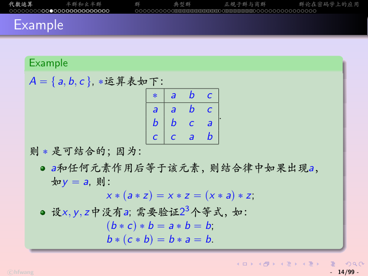
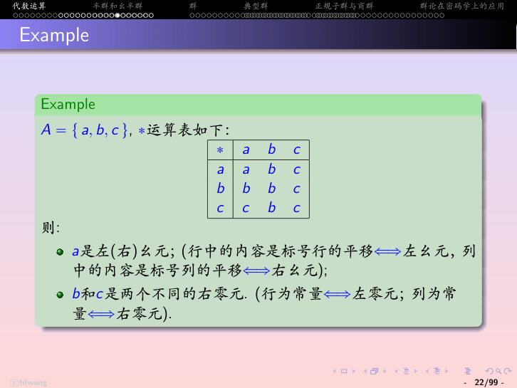
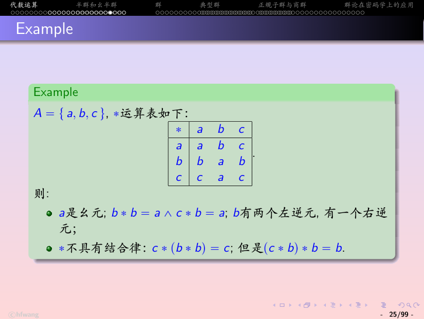

# 第7章 代数系统 - 学习笔记

> 本笔记以刘玉珍《离散数学》第七章“代数系统”、第八章“半群和群”为主线，辅以武汉大学《代数运算》课件（06-group，99 页）与课堂录音整理稿《代数运算相关知识讲解》。第 1–9 章对应教材第七章、课件 p1–p39；第 10 章对应教材 §8.2–§8.4.1、课件 p41–p59。Rosen《离散数学及其应用（原书第8版）》没有独立的代数结构/群章节，故不列为主线。
> 凡课件、录音与教材表述不一致处，以教材为准：教材称“单位元／独异点”，课件与本笔记称“幺元／幺半群”；定理编号采用教材编号，课件页码在正文中另行标注。

> **目录**
>
> - [[#1. 代数系统的引入]]
> - [[#2. 运算]]
> - [[#3. 代数定律与代入规则]]
> - [[#4. 结合律]]
> - [[#5. 交换律]]
> - [[#6. 幺元和零元]]
> - [[#7. 逆元]]
> - [[#8. 消去律]]
> - [[#9. 半群和幺半群]]
> - [[#10. 群]]
> - [[#11. 本章小结]]

---

## 1. 代数系统的引入

### 1.1 三种熟悉的运算

在前面的章节中，我们已经多次遇到“把两个对象合成一个新对象”的运算。它们作用在不同的对象上，却表现出完全相同的规律。

**函数的合成**。设 $X^X$ 是集合 $X$ 到自身的所有函数构成的集合，函数合成

$$\circ:X^X\times X^X\to X^X,\qquad \langle g,f\rangle\mapsto g\circ f$$

把两个函数合成为一个新函数，结果仍然是 $X$ 到 $X$ 的函数，没有离开集合 $X^X$。它满足：

- 结合律：$h\circ(g\circ f)=(h\circ g)\circ f$；
- 特殊元素恒等函数 $1_X$：$1_X\circ f=f\circ 1_X=f$；
- 乘幂：$f^m\circ f^n=f^{m+n}$，$(f^m)^n=f^{mn}$。

恒等函数在合成运算中扮演的角色，很像自然数乘法中的 $1$：任何数乘 $1$ 都不变，任何函数与恒等函数合成也都不变。

**关系的合成**。设 $\mathcal P(A\times A)$ 是集合 $A$ 上所有二元关系的全体（即 $A\times A$ 的幂集），关系合成

$$\circ:\mathcal P(A\times A)\times\mathcal P(A\times A)\to\mathcal P(A\times A),\qquad \langle R,S\rangle\mapsto R\circ S$$

同样满足：

- 结合律：$R\circ(S\circ T)=(R\circ S)\circ T$；
- 特殊元素恒等关系 $1_A$：$1_A\circ R=R\circ 1_A=R$；
- 乘幂：$R^m\circ R^n=R^{m+n}$，$(R^m)^n=R^{mn}$。

**矩阵的乘法**。设 $M_n$ 是所有 $n$ 阶方阵构成的集合，矩阵乘法

$$\cdot:M_n\times M_n\to M_n,\qquad \langle M,N\rangle\mapsto M\cdot N$$

满足：

- 结合律：$L\cdot(M\cdot N)=(L\cdot M)\cdot N$；
- 特殊元素单位矩阵 $1$：$1\cdot M=M\cdot 1=M$；
- 乘幂：$M^i\cdot M^j=M^{i+j}$，$(M^i)^j=M^{ij}$。

此外，字母表 $\Sigma$ 上所有字符串的集合 $\Sigma^*$ 中，字符串联结（concatenation）运算与空串 $\varepsilon$ 也满足同样的规律：联结可结合，空串是单位元素，字符串重复联结形成幂。

### 1.2 结构的抽象

这四种运算的对象（函数、关系、矩阵、字符串）各不相同，但把它们放在一起比较，会发现规律完全一致：都有一个把两个对象合成一个对象的二元运算，该运算都满足结合律，都存在一个起“单位”作用的元素，都可以据此定义幂。既然如此，就没有必要对每种对象分别研究，可以把这些共同特征抽取出来，统一研究一个抽象的结构。

设 $A$ 是一个抽象集合（它可以是函数的集合、关系的集合，也可以是数的集合），设

$$*:A\times A\to A,\qquad (x,y)\mapsto x*y$$

是 $A$ 上的一个二元运算。设 $*$ 满足下面两个条件：

1. 结合律：$\forall x,y,z\in A,\ (x*y)*z=x*(y*z)$；
2. 单位元：$\exists e\in A,\ \forall x\in A,\ e*x=x*e=x$。

在这个抽象结构中，元素的幂（power）递归定义为

$$x^0=e$$

$$x^{n+1}=x^n*x$$

即以单位元为零次幂，每多运算一次就把幂次加一。

由此可以证明幂的两条运算规律：

$$x^m*x^n=x^{m+n}$$

$$(x^m)^n=x^{mn}$$

先证第一式，对 $n$ 作归纳。当 $n=0$ 时，$x^m*x^0=x^m*e=x^m=x^{m+0}$，结论成立。假设 $n=k$ 时等式成立，即 $x^m*x^k=x^{m+k}$，则当 $n=k+1$ 时，

$$\begin{aligned} x^m*x^{k+1}&=x^m*(x^k*x) &&\text{（幂的定义）}\\ &=(x^m*x^k)*x &&\text{（结合律）}\\ &=x^{m+k}*x &&\text{（归纳假设）}\\ &=x^{m+k+1} &&\text{（幂的定义）}\end{aligned}$$

故第一式对所有 $n$ 成立。第二式 $(x^m)^n=x^{mn}$ 同样可由归纳法证明，也可由 4.4 节的广义结合律直接得到。

### 1.3 代数系统的研究方法与定义

回顾上面的过程，研究这类抽象结构遵循一条固定的路径：先从具体结构中找出运算的共同特征，再利用这些共同特征定义一个抽象的结构，然后在抽象结构中演绎运算的相关性质，最后得到一个强有力的结论——任何满足抽象结构条件的具体结构，都自动满足抽象结构中演绎出的全部性质。其中，从具体运算归纳出抽象结构是一个归纳（泛化）的过程，从抽象结构推出具体结论则是一个演绎的过程。

抽象集合、抽象运算、抽象的特殊元素三者合在一起，就构成了一个抽象的代数结构。对这种抽象结构的研究就是代数学。

一个被赋予一组运算和一些特殊元素、并且这些运算满足一定运算规律的抽象结构，称为**代数系统**（Algebra）。例如上面讨论的结构就记作

$$\langle A,*,e\rangle$$

其中 $A$ 是抽象集合，$*$ 是二元运算，$e$ 是单位元。

---

## 2. 运算

### 2.1 n 元运算的定义

设 $A$ 是一个集合，函数

$$f:A^n\to A,\qquad \langle x_1,x_2,\ldots,x_n\rangle\mapsto f(x_1,x_2,\ldots,x_n)$$

称为集合 $A$ 上的一个 **n 元运算**（n-ary operation），集合 $A$ 称为该运算的**载体**（Carrier）。

当 $n=0$ 时，运算没有自变量，退化为 $A$ 中的一个常量；$n=1$ 时是一元运算，$n=2$ 时是二元运算。代数学通常只研究一元运算和二元运算。

二元运算一般采用**中缀表示法**，即把运算符号写在两个运算对象之间，常用符号有 $+$、$*$、$\cdot$、$\circ$、$\star$ 等，例如

$$*:\langle x,y\rangle\mapsto x*y$$

### 2.2 运算的两个属性：处处有定义与封闭性

运算本质上是一个函数，因此必须具备两个属性：

1. **处处有定义**：定义域中的每一点都有函数值，即对任意一组自变量，运算都能给出结果；
2. **封闭性**（closed）：运算的值域一定包含在载体 $A$ 中，即运算结果仍然是 $A$ 中的元素。

封闭性在把某个运算限制到一个子集合上时尤其容易被忽略：一个在大集合上封闭的运算，放到小集合上未必封闭。

### 2.3 运算的例子

前面讨论的四种运算都满足封闭性：

- 函数合成 $\circ:X^X\times X^X\to X^X$，载体是 $X^X$；
- 关系合成 $\circ:\mathcal P(A\times A)^2\to\mathcal P(A\times A)$，载体是 $\mathcal P(A\times A)$；
- 矩阵乘法 $\cdot:M_n^2\to M_n$，载体是 $M_n$；
- 字符串联结 $\cdot:\Sigma^*\times\Sigma^*\to\Sigma^*$，载体是 $\Sigma^*$。

下面两个例子说明，同一个运算在一个集合上可能是运算，在另一个集合上却不是。

减法 $\langle x,y\rangle\mapsto x-y$ 是整数集 $\mathbb Z$ 上的二元运算，但不是自然数集 $\mathbb N$ 上的运算，因为两个自然数相减可能得到负数，结果不再属于 $\mathbb N$，不满足封闭性。

求逆 $f\mapsto f^{-1}$ 是集合 $\mathcal B(X,X)=\{X$ 上的所有双射函数$\}$ 上的一元运算，因为双射函数的逆仍然是双射；但它不是 $X^X$ 上的运算，因为一个普通的（非双射的）函数未必有逆。

---

## 3. 代数定律与代入规则

代数定律通常写成下面的一般形式：

$$\forall x\,\forall y\,\forall z,\qquad \exp_1(x,y,z)=\exp_2(x,y,z)$$

其中 $\exp_1$ 和 $\exp_2$ 是由运算和变量构成的表达式。

由于定律使用了全称量词，它要求等式对变量的**所有**取值都成立，因此每一条代数定律都是一个非常强的条件。也正是因为全称量词，在证明中可以把任意具体的表达式代入变量，得到相应的等式——这种**代入规则**是代数恒等变换的核心，也是代数推理的基本手段。

接下来各节讨论的结合律、交换律等，都是这种一般形式的具体定律。

---

## 4. 结合律

### 4.1 结合律的定义

设 $\langle A,*\rangle$ 是一个代数系统。如果二元运算 $*$ 满足

$$\forall x\,\forall y\,\forall z,\qquad (x*y)*z=x*(y*z)$$

则称 $*$ 具有**结合律**，或称 $*$ 是可结合的（associative）。

前面讨论的函数合成、关系合成、矩阵乘法、字符串联结都是可结合的。

### 4.2 用运算表验证结合律

有限集合上的二元运算可以用**运算表**（operation table，也称 Cayley 表）给出：表的第 $i$ 行第 $j$ 列填写第 $i$ 个元素与第 $j$ 个元素运算的结果。

> **图1** 集合 $A=\{a,b,c\}$ 上的运算表（本质上是模 $3$ 加法，$a=0,b=1,c=2$）。$a$ 是单位元：$a$ 行、$a$ 列都与表头相同。

验证该运算可结合时，先利用单位元简化：只要三个元素中出现 $a$，结合律就自动成立，例如取 $y=a$ 时，

$$x*(a*z)=x*z=(x*a)*z$$

再设 $x,y,z$ 中都不含 $a$，只需逐一验证 $b,c$ 的组合，例如

$$(b*c)*b=a*b=b$$

$$b*(c*b)=b*a=b$$

两者相等。其余组合同样验证，即可确认运算可结合。

### 4.3 左结合约定

在满足结合律的前提下，省略括号时默认按**左结合**理解，即

$$x_1*x_2*\cdots*x_n\triangleq(\cdots((x_1*x_2)*x_3)*\cdots)*x_n\triangleq\prod_{i=1}^n x_i$$

同一个元素连续运算 $n$ 次记作它的幂：

$$\underbrace{x*x*\cdots*x}_{n\text{ 个 }x}\triangleq x^n$$

当运算写成加法时，相应地有 $x_1+\cdots+x_n=\sum_{i=1}^n x_i$，而 $\underbrace{x+\cdots+x}_{n\text{ 个 }x}\triangleq nx$。

### 4.4 广义结合律定理

结合律只保证三个元素时两种括号方式结果相同，但仅凭这一条，就可以推出任意多个元素按任意方式分段连乘，结果都相同。

**定理**：设 $\langle A,*\rangle$ 满足结合律，$x_1,x_2,\ldots,x_m\in A$。若把这 $m$ 个元素任意分成若干段，

$$y_1=x_1*x_2*\cdots*x_{p_1}$$

$$y_2=x_{p_1+1}*\cdots*x_{p_2}$$

$$\cdots$$

$$y_n=x_{p_{n-1}+1}*\cdots*x_m$$

则

$$x_1*x_2*\cdots*x_m=y_1*y_2*\cdots*y_n$$

约定 $p_0=0$、$p_n=m$，各段内部按左结合理解。也就是说，分段的位置与段数都不影响最终结果。

**证明**：对 $m$ 作归纳，归纳假设取为“结论对 $m-1$ 个元素的任意分段（任意段数、任意分割点）成立”。$m=1$ 时只能 $n=1$、$y_1=x_1$，结论显然成立。设 $m\ge 2$，按最后一段 $y_n=x_{p_{n-1}+1}*\cdots*x_m$ 所含因子的个数分两种情形。

若 $p_{n-1}=m-1$，则 $y_n=x_m$ 只含一个因子，而 $y_1,\ldots,y_{n-1}$ 是 $m-1$ 个元素的一个分段（段数为 $n-1$）。由归纳假设与左结合定义，

$$x_1*\cdots*x_m=(y_1*\cdots*y_{n-1})*x_m=y_1*\cdots*y_{n-1}*y_n$$

若 $p_{n-1}\le m-2$，则最后一段至少含两个因子。令 $y_n'=x_{p_{n-1}+1}*\cdots*x_{m-1}$，按左结合定义有 $y_n=y_n'*x_m$，而 $y_1,\ldots,y_{n-1},y_n'$ 是 $m-1$ 个元素的一个分段。由归纳假设，

$$\begin{aligned} x_1*\cdots*x_m&=(y_1*\cdots*y_{n-1}*y_n')*x_m &&\text{（归纳假设）}\\ &=((y_1*\cdots*y_{n-1})*y_n')*x_m &&\text{（定义）}\\ &=(y_1*\cdots*y_{n-1})*(y_n'*x_m) &&\text{（结合律）}\\ &=(y_1*\cdots*y_{n-1})*y_n &&\text{（定义，}y_n=y_n'*x_m\text{）}\\ &=y_1*\cdots*y_n &&\text{（定义）}\end{aligned}$$

两种情形穷尽，归纳完成。证毕。

需要注意，上述定理覆盖的是“分段后各段内部按左结合理解”这一类括号化。像 $x_1*(x_2*(x_3*x_4))$ 这样的右嵌套，需按最外层拆成 $U*V$ 再对括号树归纳，结论仍成立，但那是另一步论证。

**推论**：

$$x^m*x^n=x^{m+n}$$

$$(x^m)^n=x^{mn}\qquad (m\ge 1,\ n\ge 1)$$

后一式是因为 $(x^m)^n$ 为 $n$ 个 $x^m$ 相乘，把每个 $x^m$ 看成一段，一共 $mn$ 个 $x$；由广义结合律去掉中间的括号，就是 $x^{mn}$。

---

## 5. 交换律

### 5.1 交换律的定义

设 $\langle A,*\rangle$ 是代数系统。如果二元运算满足

$$\forall x\,\forall y,\qquad x*y=y*x$$

则称 $*$ 具有**交换律**，或称 $*$ 是可交换的（commutative）。

在运算表中，可交换体现为表格关于主对角线对称：第 $i$ 行第 $j$ 列与第 $j$ 行第 $i$ 列的元素相同。

### 5.2 可交换与不可交换的例子

集合运算中，$\langle\mathcal P(A),\cap,\cup\rangle$ 的交并运算既可结合又可交换。

而前面讨论的四种“合成”类运算虽然可结合，却一般不可交换：

- 函数合成 $\langle X^X,\circ\rangle$：一般 $g\circ f\ne f\circ g$；
- 关系合成 $\langle\mathcal P(A\times A),\circ\rangle$：一般 $R\circ S\ne S\circ R$；
- 矩阵乘法 $\langle M_n,\cdot\rangle$：一般 $M\cdot N\ne N\cdot M$；
- 字符串联结 $\langle\Sigma^*,\cdot\rangle$：$s\cdot t$ 与 $t\cdot s$ 一般不同。

需要特别说明命题逻辑中的合取与析取。$\wedge$、$\vee$ 在**逻辑等价**意义下既可结合又可交换，这是命题逻辑的基本等值式。课件中“在相等意义下不可结合、不可交换”的说法，是把“相等”理解为**语法上的恒等**：$(p\wedge q)\wedge r$ 与 $p\wedge(q\wedge r)$ 作为符号串（或公式树）并不完全相同，它们之间是逻辑等价而非字面相等。这是“相等”与“等价”两个概念的区分，并不是说合取真的不满足结合律。

### 5.3 交换律定理

**定理**：设 $\langle A,*\rangle$ 同时满足结合律和交换律，$x_1,\ldots,x_m\in A$。若 $(i,j,k,\ldots,n)$ 是 $(1,2,\ldots,m)$ 的任意一个置换，则

$$x_1*x_2*\cdots*x_m=x_i*x_j*x_k*\cdots*x_n$$

也就是说，在可结合、可交换的运算中，任意调换元素的先后顺序都不改变结果。

**证明**：对 $m$ 作归纳。$m=1$ 时成立。设 $m-1$ 时成立，记

$$\mathcal X=x_1*\cdots*x_{n-1},\qquad \mathcal Y=x_{n+1}*\cdots*x_m$$

则由归纳假设与结合律，$\mathcal X*\mathcal Y=x_i*x_j*\cdots*x_p$。于是 $m$ 时，

$$\begin{aligned} x_i*x_j*\cdots*x_p*x_n&=(\mathcal X*\mathcal Y)*x_n &&\text{（定义）}\\ &=\mathcal X*(\mathcal Y*x_n) &&\text{（结合律）}\\ &=\mathcal X*(x_n*\mathcal Y) &&\text{（交换律）}\\ &=\mathcal X*x_n*\mathcal Y &&\text{（结合律）}\\ &=x_1*x_2*\cdots*x_m &&\text{（结合律与定义）}\end{aligned}$$

证毕。

---

## 6. 幺元和零元

### 6.1 幺元和零元的定义

设 $\langle A,*\rangle$ 是代数系统。

若元素 $1_l\in A$ 满足

$$\forall x\in A,\qquad 1_l*x=x$$

则称 $1_l$ 为**左幺元**（左单位元，Left identity）；若元素 $1_r\in A$ 满足

$$\forall x\in A,\qquad x*1_r=x$$

则称 $1_r$ 为**右幺元**（Right identity）。

类似地，若元素 $O_l\in A$ 满足

$$\forall x\in A,\qquad O_l*x=O_l$$

则称 $O_l$ 为**左零元**（Left zero）；若元素 $O_r\in A$ 满足

$$\forall x\in A,\qquad x*O_r=O_r$$

则称 $O_r$ 为**右零元**（Right zero）。

### 6.2 常见系统中的幺元与零元

> **图2** 集合 $A=\{a,b,c\}$ 上的运算表。$a$ 行、$a$ 列都是表头的平移，故 $a$ 是左、右幺元；$b$ 列、$c$ 列分别是常量 $b$、$c$，故 $b$、$c$ 是两个不同的右零元。

在前面熟悉的系统中，幺元与零元如下：

- 集合运算 $\langle\mathcal P(A),\cap,\cup\rangle$：全集 $A$ 是 $\cap$ 的幺元、$\cup$ 的零元（$A\cap X=X$，$A\cup X=A$）；空集 $\varnothing$ 是 $\cup$ 的幺元、$\cap$ 的零元（$\varnothing\cup X=X$，$\varnothing\cap X=\varnothing$）。
- 函数合成 $\langle X^X,\circ\rangle$：恒等函数 $1_X$ 是幺元，没有零元。
- 关系合成 $\langle\mathcal P(A\times A),\circ\rangle$：恒等关系 $1_A$ 是幺元，空关系 $\varnothing$ 是零元。
- 矩阵乘法 $\langle M_n,\cdot\rangle$：单位矩阵 $1$ 是幺元，零矩阵 $O$ 是零元。
- 字符串联结 $\langle\Sigma^*,\cdot\rangle$：空串 $\varepsilon$ 是幺元，没有零元。

从运算表上识别幺元、零元有直观的规律：某一行是表头行的平移，对应元素是左幺元；某一列是表头列的平移，对应元素是右幺元；某一行是常量，对应元素是左零元；某一列是常量，对应元素是右零元。

### 6.3 幺元、零元的唯一性

**定理**：在代数系统 $\langle A,*\rangle$ 中，如果左幺元和右幺元同时存在，则二者必定相等，称为**幺元**，一般记作 $1$ 或 $e$，该系统记作 $\langle A,*,1\rangle$。

证明：设左、右幺元分别为 $1_l$、$1_r$。一方面，由 $1_r$ 是右幺元，$1_l*1_r=1_l$；另一方面，由 $1_l$ 是左幺元，$1_l*1_r=1_r$。故 $1_l=1_r$。

**定理**：同理，如果左零元和右零元同时存在，则二者相等，称为**零元**，一般记作 $0$，该系统记作 $\langle A,*,0\rangle$。

证明：设左、右零元为 $O_l$、$O_r$。由左零元性质 $O_l*O_r=O_l$，由右零元性质 $O_l*O_r=O_r$，故 $O_l=O_r$。

需要注意，幺元、零元的唯一性以左、右两侧同时存在为前提。正如图 2 所示，只有右零元而没有左零元时，右零元可以不唯一（$b$、$c$ 都是右零元）。

---

## 7. 逆元

### 7.1 逆元的定义

设 $\langle A,*,1\rangle$ 是带有幺元 $1$ 的代数系统。如果

$$x*y=1$$

则称 $x$ 是 $y$ 的**左逆元**（$y$ 左可逆），称 $y$ 是 $x$ 的**右逆元**（$x$ 右可逆）。若元素同时存在左、右逆元，则称该元素可逆。

### 7.2 常见系统中的逆

幺元的逆元是它自己，因为 $1*1=1$。

在常见系统中：

- 集合运算 $\langle\mathcal P(A),\cap,\cup\rangle$：$\cap$ 的幺元是 $A$，只有 $A$ 有逆元（$A\cap A=A$）；$\cup$ 的幺元是 $\varnothing$，只有 $\varnothing$ 有逆元（$\varnothing\cup\varnothing=\varnothing$）。
- 函数合成 $\langle X^X,\circ,1_X\rangle$：函数 $f$ 有右逆元当且仅当 $f$ 是满射，$f$ 有左逆元当且仅当 $f$ 是单射。这与第 6 章中“满射有右逆、单射有左逆”的结论一致。
- 矩阵乘法 $\langle M_n,\cdot\rangle$：矩阵 $M$ 可逆当且仅当 $\det(M)\ne 0$。
- 字符串联结 $\langle\Sigma^*,\cdot\rangle$：只有空串 $\varepsilon$ 有逆元，且逆元就是它自己。

### 7.3 逆元不唯一的例子

> **图3** 集合 $A=\{a,b,c\}$ 上的运算表，$a$ 是幺元。由 $b*b=a$、$c*b=a$，元素 $b$ 有两个左逆元（$b$ 和 $c$）、一个右逆元（$b$）。

这个运算不满足结合律，例如

$$c*(b*b)=c*a=c$$

$$(c*b)*b=a*b=b$$

两者不相等。正是因为缺少结合律，逆元才可能不唯一。

### 7.4 逆元的唯一性

**定理**：设 $\langle A,*,1\rangle$ 是可结合的代数系统。对任意元素 $x$，如果它的左逆元和右逆元同时存在，则二者相等并且唯一，称为 $x$ 的**逆元**，记作 $x^{-1}$，并称 $x$ 是可逆的。在加法记号下，逆元记作 $-x$。

证明：设 $x$ 的左、右逆元分别为 $l$、$r$，即 $l*x=1$、$x*r=1$。则

$$\begin{aligned} l&=l*1 &&\text{（幺元）}\\ &=l*(x*r) &&\text{（}r\text{ 是右逆）}\\ &=(l*x)*r &&\text{（结合律）}\\ &=1*r &&\text{（}l\text{ 是左逆）}\\ &=r &&\text{（幺元）}\end{aligned}$$

故左、右逆元相等。同理，若 $x$ 有两个逆元，它们也相等，因此逆元唯一。

**推论**：若 $a$ 有逆元 $a^{-1}$，则

$$(a^{-1})^{-1}=a$$

因为 $a^{-1}*a=1$ 且 $a*a^{-1}=1$，所以 $a$ 就是 $a^{-1}$ 的逆元。

### 7.5 运算下求逆：穿脱原则

**定理**：设 $\langle A,*,1\rangle$ 可结合，$a,b$ 都可逆，则 $a*b$ 也可逆，且其逆元为

$$(a*b)^{-1}=b^{-1}*a^{-1}$$

证明：

$$(b^{-1}*a^{-1})*(a*b)=b^{-1}*(a^{-1}*a)*b=b^{-1}*1*b=b^{-1}*b=1$$

同理可得 $(a*b)*(b^{-1}*a^{-1})=1$，故 $b^{-1}*a^{-1}$ 是 $a*b$ 的逆元。

这一结论称为**穿脱原则**（socks and shoes）：先穿袜子后穿鞋，脱的时候要先脱鞋后脱袜，顺序恰好反过来。

---

## 8. 消去律

**定理（消去律）**：设 $\langle A,*,1\rangle$ 是可结合的代数系统，元素 $a$ 可逆。若

$$a*x=a*y$$

则 $x=y$。

证明：在等式两侧同时用 $a^{-1}$ 从左侧运算，

$$\begin{aligned} a*x&=a*y\\ a^{-1}*(a*x)&=a^{-1}*(a*y)\\ (a^{-1}*a)*x&=(a^{-1}*a)*y\\ 1*x&=1*y\\ x&=y\end{aligned}$$

这称为左消去律。可逆元素之所以能“消去”，本质上是因为它带有逆元，可以通过逆元把它从等式中移除。在不要求每个元素都可逆的系统中，消去律需要单独作为一条性质来讨论。

---

## 9. 半群和幺半群

### 9.1 置换复习

在进入具体结构之前，先回顾函数章已经建立的置换概念。集合 $A$ 上的一个双射函数 $\sigma:A\to A$ 称为 $A$ 的一个**置换**（permutation）。当 $A=\{1,2,\ldots,m\}$ 是有限集时，置换可以用两行表示法写出：上一行按顺序列出原像，下一行列出对应的函数值，例如规则 $1\mapsto 2,\ 2\mapsto 1$ 就确定了一个置换。

集合 $X$ 上所有置换（双射函数）的集合记为 $S_X$，有限集 $\{1,2,\ldots,n\}$ 上则记为 $S_n$。由于双射函数的逆仍然是双射，每个置换 $\sigma$ 都有逆置换 $\sigma^{-1}$。一个置换还可以分解成若干个互不相交的轮换（cycle）的乘积，而这些轮换的书写顺序可以任意调整，不影响结果。

置换集合在函数合成运算下封闭并且可结合，这正是后面研究对称群的基础。这里先从双射函数的角度建立直观，对称群与置换群的正式定义将在后面典型群中给出。

### 9.2 半群和幺半群的定义

在所有运算中，二元运算最基本、也最常见。一个 n 元运算本质上可以看作二元运算逐层叠加的结果：把 $n$ 个自变量的运算一层一层归并，每一层只合并两个对象，最终归结为一连串二元运算。因此，研究具体代数结构时从二元运算入手。

**定义**：设 $\langle S,*\rangle$ 是一个代数系统。

- 若二元运算 $*$ 封闭并且具有结合律，则称 $\langle S,*\rangle$ 为一个**半群**（Semigroup）；
- 若 $*$ 不仅可结合，还存在幺元 $e$，则称 $\langle S,*,e\rangle$ 为一个**幺半群**（Monoid，也称独异点或含幺半群）。

也就是说，半群只要求“封闭 + 可结合”这一个条件；幺半群在半群的基础上再加上幺元。

下面是几个典型的例子。

- $\langle\Sigma^+,\cdot\rangle$ 是最典型的半群，其中 $\Sigma^+$ 是字母表 $\Sigma$ 上所有非空字符串的集合；除结合律外它没有其他性质，也没有幺元。
- $\langle\Sigma^*,\cdot,\varepsilon\rangle$ 是最典型的幺半群，其中 $\Sigma^*$ 包含空串，空串 $\varepsilon$ 是幺元；除结合律和幺元外没有其他性质。
- $\langle\mathbb N,+,0\rangle$ 是幺半群，加法还具有交换律。
- $\langle X^X,\circ,1_X\rangle$ 是幺半群，没有交换律，只有部分元素（双射函数）有逆元。
- $\langle\mathcal M_n,\cdot,\mathbb 1\rangle$ 是幺半群，没有交换律，只有部分元素（行列式非零的矩阵）有逆元。

这里要注意 $\Sigma^+$ 与 $\Sigma^*$ 的区别：$\Sigma^+$ 由长度不小于 $1$ 的字符串组成，不含空串，因此没有幺元，只能构成半群；$\Sigma^*$ 多了一个空串，便构成幺半群。

### 9.3 子半群和子幺半群

**定义**：设 $\langle S,*\rangle$ 是半群，$T\subseteq S$。若 $T$ 在运算 $*$ 下封闭，即

$$\forall x,y\in T,\qquad x*y\in T$$

则 $\langle T,*\rangle$ 继承 $S$ 的运算也构成一个半群，称为 $S$ 的**子半群**（Subsemigroup），记作 $T\le S$。若 $S$ 是有幺元 $e$ 的幺半群，并且 $e\in T$，则 $T$ 称为 $S$ 的**子幺半群**（submonoid）。

更一般地，对一个带有 n 元运算的代数系统 $S$，如果子集 $T$ 对 $S$ 的每一个运算都封闭，即 $T$ 中任意 $n$ 个元素的运算结果仍落在 $T$ 中，那么 $T$ 本身也是一个代数系统，称为 $S$ 的**子代数**。半群情形下的子半群、幺半群情形下的子幺半群，都是子代数的特例。封闭性始终是讨论子结构的前提。

下面通过例子说明。

- 在 $\langle\Sigma^*,\cdot,\varepsilon\rangle$ 中，取字母表的子集 $A\subseteq\Sigma$，则 $A^*\le\Sigma^*$，并且因为包含空串，它是子幺半群。
- 同样在 $\langle\Sigma^*,\cdot,\varepsilon\rangle$ 中，取 $T=\{s\mid |s|>10\}$，则 $T$ 是子半群，但不是子幺半群，因为空串长度为 $0$、不属于 $T$。
- 在 $\langle\mathbb N,+,0\rangle$ 中，取 $n\mathbb N=\{nm\mid m\in\mathbb N\}$，则 $n\mathbb N\le\mathbb N$，并且是子幺半群。
- 在 $\langle X^X,\circ,1_X\rangle$ 中，单射集合 $\mathcal I(X,X)$、满射集合 $\mathcal S(X,X)$、双射集合 $\mathcal B(X,X)$ 都是 $X^X$ 的子幺半群，并且 $\mathcal B(X,X)\le\mathcal I(X,X)$。
- 在 $\langle\mathcal M_n,\cdot,\mathbb 1\rangle$ 中，取 $L=\{M\mid\det(M)\ne 0\}$，则 $L\le\mathcal M_n$，并且是子幺半群。
- 在任意幺半群 $\langle S,*,\mathbb 1\rangle$ 中，取 $\langle a\rangle=\{a^n\mid n\in\mathbb N\}$，则 $\langle a\rangle$ 是 $S$ 的子幺半群，称为**循环幺半群**。

**例子**：设 $\langle S,*,\mathbb 1\rangle$ 是交换幺半群，令

$$T=\{a\mid a\in S\wedge a^2=\mathbb 1\}$$

则 $T$ 是 $S$ 的子幺半群。

证明：首先，$\mathbb 1^2=\mathbb 1*\mathbb 1=\mathbb 1$，所以 $\mathbb 1\in T$。再设 $a,b\in T$，则 $a^2=\mathbb 1$、$b^2=\mathbb 1$，又因为 $*$ 可交换，

$$(a*b)^2=a^2*b^2=\mathbb 1*\mathbb 1=\mathbb 1$$

所以 $a*b\in T$，$T$ 对运算封闭，故 $T$ 是子幺半群。

**例子**：设 $\langle S,*\rangle$ 是半群，若存在元素 $a\in S$，使得对任意 $x\in S$，都能找到 $u,v\in S$ 满足

$$u*a=a*v=x$$

即 $a$ 可以充当任意元素的左、右因子（factor），则 $S$ 必有幺元。

证明：先在条件中取 $x=a$，则存在 $l,r\in S$，使 $l*a=a*r=a$。下面证明 $l$、$r$ 分别是左、右幺元。对任意 $x\in S$，由条件存在 $u,v$ 使 $u*a=a*v=x$，于是

$$l*x=l*(a*v)=(l*a)*v=a*v=x$$

故 $l$ 是左幺元；又有

$$x*r=(u*a)*r=u*(a*r)=u*a=x$$

故 $r$ 是右幺元。左、右幺元同时存在，二者相等且就是幺元。

### 9.4 半群的同态

**定义**：设 $\langle S,*,\mathbb 1\rangle$ 和 $\langle T,\cdot,e\rangle$ 是两个幺半群，函数 $h:S\to T$ 如果满足

$$\forall a,b\in S,\qquad h(a*b)=h(a)\cdot h(b)$$

$$h(\mathbb 1)=e$$

则称 $h$ 为从 $S$ 到 $T$ 的**同态**（Homomorphism）。第一条说明运算在函数作用下保持不变，第二条说明幺元映到幺元。

去掉第二个条件，就得到一般半群之间的同态。根据函数的性质还可以进一步分类：

- $h$ 是单射，称为**单同态**（monomorphism）；
- $h$ 是满射，称为**满同态**（epimorphism）；
- $h$ 是双射，称为**同构**（isomorphism），此时两个结构在运算意义下完全相同；
- $h$ 的陪域与定义域相同，称为**自同态**（endomorphism）；
- 自同态同时是双射，称为**自同构**（automorphism）。

同态的意义可以从一个简单例子看出。设 $\mathbb N^*=\mathbb N-\{0\}$，在半群中取定元素 $a$，令 $T=\{a^n\mid n\in\mathbb N^*\}$，定义

$$f:\mathbb N^*\to T,\qquad n\mapsto a^n$$

则 $f$ 是满射，并且

$$f(m+n)=a^{m+n}=a^m*a^n=f(m)*f(n)$$

运算在函数下保持，这使得 $\mathbb N^*$ 与 $T$ 在结构上相似，尽管它们的元素表面上完全不同。

**例子（字符串替换自同态）**：设 $\Sigma=\{a,b\}$，在 $\langle\Sigma^*,\cdot,\varepsilon\rangle$ 上递归定义函数 $h:\Sigma^*\to\Sigma^*$：

$$h(\varepsilon)=\varepsilon$$

$$h(a\cdot s)=ab\cdot h(s),\qquad h(b\cdot s)=ba\cdot h(s)$$

则 $h$ 是 $\Sigma^*$ 上的自同态。

证明：先有 $h(\varepsilon)=\varepsilon$。再对 $s$ 归纳，证明对任意 $t\in\Sigma^*$ 都有 $h(s\cdot t)=h(s)\cdot h(t)$。当 $s=\varepsilon$ 时，

$$h(\varepsilon\cdot t)=h(t)=\varepsilon\cdot h(t)=h(\varepsilon)\cdot h(t)$$

假设对 $s$ 成立，则当 $s'=a\cdot s$ 时，

$$\begin{aligned} h(s'\cdot t)&=h(a\cdot(s\cdot t)) &&\text{（结合律）}\\ &=ab\cdot h(s\cdot t) &&\text{（定义）}\\ &=ab\cdot(h(s)\cdot h(t)) &&\text{（归纳假设）}\\ &=(ab\cdot h(s))\cdot h(t) &&\text{（结合律）}\\ &=h(a\cdot s)\cdot h(t) &&\text{（定义）}\\ &=h(s')\cdot h(t) &&\text{（定义）}\end{aligned}$$

$s'=b\cdot s$ 的情形同理，故同态关系成立。由此，对任意字符串 $x_1x_2\cdots x_n$，

$$h(x_1x_2\cdots x_n)=h(x_1)h(x_2)\cdots h(x_n)$$

也就是说，同态 $h$ 完全由 $h(a)$ 和 $h(b)$ 这两个值唯一确定。

**例子（变换函数同态）**：设 $\langle S,*,e\rangle$ 是幺半群，对每个 $s\in S$ 定义变换函数

$$T_s:S\to S,\qquad x\mapsto s*x$$

再定义函数

$$\varphi_S:S\to S^S,\qquad s\mapsto T_s$$

则 $\varphi_S$ 是 $\langle S,*,e\rangle$ 到 $\langle S^S,\circ,\mathbb 1_S\rangle$ 的同态。

证明：首先，

$$(\varphi_S(e))(x)=T_e(x)=e*x=x$$

故 $\varphi_S(e)=\mathbb 1_S$。又对任意 $x$，

$$(\varphi_S(s*t))(x)=T_{s*t}(x)=s*t*x$$

$$(\varphi_S(s)\circ\varphi_S(t))(x)=T_s(T_t(x))=T_s(t*x)=s*t*x$$

二者相等，故 $\varphi_S(s*t)=\varphi_S(s)\circ\varphi_S(t)$，同态成立。

### 9.5 同态象定理

**定理**：设 $h$ 是 $\langle S,*,\mathbb 1\rangle$ 到 $\langle T,\cdot,e\rangle$ 的同态，则：

1. 若 $A\le S$，则 $h(A)\le T$，特别地 $h(S)\le T$；
2. 若 $B\le T$，则 $h^{-1}(B)\le S$，特别地 $h^{-1}(\{e\})\le S$。

证明第一式：因为 $h(\mathbb 1)=e$，所以 $e\in h(A)$。任取 $a,b\in A$，则 $a*b\in A$，且 $h(a),h(b)\in h(A)$，由同态性质，

$$h(a)\cdot h(b)=h(a*b)\in h(A)$$

故 $h(A)$ 对运算封闭，是 $T$ 的子幺半群。

证明第二式：因为 $h(\mathbb 1)=e\in B$，所以 $\mathbb 1\in h^{-1}(B)$。任取 $a,b\in h^{-1}(B)$，则 $h(a),h(b)\in B$，于是

$$h(a*b)=h(a)\cdot h(b)\in B$$

即 $a*b\in h^{-1}(B)$，故 $h^{-1}(B)$ 对运算封闭，是 $S$ 的子幺半群。

---

## 10. 群

从代数系统到半群、幺半群、群，约束是一层一层加上去的：半群只要求运算可结合，幺半群再加幺元，群再要求每个元素都有逆元。因此群一定是幺半群，幺半群一定是半群，反之都不成立。

### 10.1 群的定义

**定义 8.2.1（教材）**：设 $\langle G,*\rangle$ 是幺半群。若 $G$ 中每个元素关于 $*$ 都可逆，则称 $\langle G,*\rangle$ 为**群**。

教材把前三条（封闭、结合律、幺元）打包在“幺半群”里；课件 p41 把群展开成四条列出，两者等价。只含一个元素的代数系统也是群，称为**平凡群**。

**定义 8.2.2**：群中运算可交换时称**可交换群**（阿贝尔群，Abelian group）。用加法符号书写群时，记号要相应调整：$-a$ 表示 $a$ 的逆元，$na$ 表示 $n$ 个 $a$ 相加。从抽象代数的角度，不宜依赖 $na$ 这类依附具体运算的记号，用运算形式书写更稳妥。

$G$ 是有限集合时称**有限群**，$\lvert G\rvert$ 称为**群的阶**（课件称“阶数”）。注意群的阶是集合的元素个数，元素的阶是使 $a^n=e$ 的最小正整数，两者不是一回事。

### 10.2 群的例子与非例子

| 结构 | 是否为群 | 原因 |
|------|---------|------|
| $\langle\mathbb N,+,0\rangle$ | 否 | 正整数 $n$ 的逆元 $-n\notin\mathbb N$ |
| $\langle\mathbb Z,+,0\rangle$ | 是，交换群 | $-n$ 存在 |
| $\langle\mathbb N_k,+_k\rangle$（模 $k$ 加法） | 是，交换群 | $i\ne 0$ 的逆元是 $k-i$，$0$ 的逆元是自身 |
| $\langle\mathbb Q-\{0\},\cdot,1\rangle$ | 是，交换群 | $p/q$ 的逆元是 $q/p$ |
| $\langle\mathbb Q,\cdot,1\rangle$ | 否 | $0$ 没有逆元 |
| 行列式非零的 $n$ 阶方阵关于乘法 | 是，非交换 | 逆矩阵存在，但矩阵乘法不交换 |
| 双射函数关于合成 | 是，非交换 | 反函数存在，但合成不交换 |

**模加法与计算机整数**（课件 p43）。$\mathbb N_4=\{0,1,2,3\}$ 上定义 $m+_4n=(m+n)\bmod 4$，运算表里 $1$ 的逆元是 $3$、$2$ 的逆元是自身，故 $\langle\mathbb N_4,+_4\rangle$ 是交换群。计算机中的整数位数有限，实际上就活在 $\mathbb N_k$ 上（32 位即 $k=2^{32}$）；补码 $k-m$ 正是 $m$ 在这个群里的逆元，于是

$$n-m=(n+(2^{32}-m))\bmod 2^{32}$$

减法是加逆元的另一种写法，硬件只需一套加法器。

### 10.3 群的判定：条件可以省到什么程度

教材 §8.2.2 给出三个判定定理，条件比定义弱得多。这说明群的四条要求并非互相独立。

**定理 8.2.1**：设 $\langle G,*\rangle$ 是半群。若

1. 存在左单位元 $e_l$，使 $\forall a\in G,\ e_l*a=a$；
2. 每个元素有左逆元，即 $\forall a\in G,\ \exists a'\in G,\ a'*a=e_l$；

则 $\langle G,*\rangle$ 是群。

**证明**：要证的是 $a'*a=e_l$（已知，来自左逆元的定义）之外的另一侧 $a*a'=e_l$。因 $a'\in G$，它也有左逆元 $a''$，满足 $a''*a'=e_l$。于是

$$\begin{aligned} a*a' &= e_l*(a*a') &&\text{（左单位元）}\\ &= (a''*a')*(a*a') &&\text{（}a''*a'=e_l\text{）}\\ &= a''*\big(a'*(a*a')\big) &&\text{（结合律）}\\ &= a''*\big((a'*a)*a'\big) &&\text{（结合律）}\\ &= a''*(e_l*a') &&\text{（}a'*a=e_l\text{，左逆元定义）}\\ &= a''*a' = e_l &&\text{（左单位元，再由 }a''*a'=e_l\text{）}\end{aligned}$$

再证 $e_l$ 也是右单位元：

$$a*e_l=a*(a'*a)=(a*a')*a=e_l*a=a$$

故 $e_l$ 是（双侧）幺元，$a'$ 是 $a$ 的（双侧）逆元，群的四条齐备。

需要注意，把两条中的“左”**同时**换成“右”，定理仍然成立——课堂上讲的就是右侧版本（右幺元 $a*e=a$ 加右逆元 $a*a^{-1}=e$，课件 p44）。但**不能一左一右混用**：教材例 8.2.2 给出由矩阵构成的半群，它有左单位元却无幺元，因而不是群。课堂上那句“要么同时左、要么同时右”说的正是这件事。

**定理 8.2.2**：设 $\langle G,*\rangle$ 是半群。若对任意 $a,b\in G$，方程 $a*x=b$ 与 $y*a=b$ 在 $G$ 中都有解，则 $G$ 是群。

思路是：取 $y*a=a$ 的一个解作左单位元，再取 $y*a=e_l$ 的解作左逆元，便回到定理 8.2.1。

**定理 8.2.3**：设 $\langle G,*\rangle$ 是有限半群。若 $G$ 中消去律成立，则 $G$ 是群。

设 $G=\{a_1,\dots,a_n\}$，固定 $a$，作 $G'=\{a*a_1,\dots,a*a_n\}$。消去律保证 $i\ne j$ 时 $a*a_i\ne a*a_j$，故 $\lvert G'\rvert=n$，$G'=G$；于是任意 $b\in G$ 都落在 $G'$ 里，方程 $a*x=b$ 有解。同理 $y*a=b$ 有解，由定理 8.2.2 得证。这条在课堂上只提了思路，完整证明在教材 p162。

### 10.4 群的基本性质

**定理 8.2.4**：设 $\langle G,*\rangle$ 是群，则

1. $(a*b)^{-1}=b^{-1}*a^{-1}$；
2. 对任意 $a,b\in G$，方程 $a*x=b$ 与 $y*a=b$ 都有**唯一**解，分别是 $a^{-1}*b$ 与 $b*a^{-1}$；
3. $G$ 中消去律成立。

这三条其实不陌生：7.5 节的“穿脱原则”和 8 节的消去律，当时是对**可逆元素**说的；群里每个元素都可逆，所以对全体元素成立。存在性直接代入，唯一性两边左乘 $a^{-1}$ 即得：

$$a*x=b\ \Longrightarrow\ a^{-1}*(a*x)=a^{-1}*b\ \Longrightarrow\ x=a^{-1}*b$$

课件 p46 还给出一个等价说法：左平移 $f_a:G\to G,\ x\mapsto a*x$ 是双射，因为 $f_a\circ f_{a^{-1}}=f_{a^{-1}}\circ f_a=1_G$。这正是定理 8.2.3 里“有限集上单射即满射”用到的函数，也是教材定理 8.4.6（Cayley 定理）的出发点。

### 10.5 子群

**定义 8.3.1**：设 $\langle G,*\rangle$ 是群，$H$ 是 $G$ 的非空子集。若 $\langle H,*\rangle$ 也是群，称 $H$ 为 $G$ 的**子群**，记作 $H\le G$；$H$ 是真子集时记作 $H<G$。

需要注意，9.5 节里 $A\le S$ 表示“$A$ 是 $S$ 的子幺半群”，教材用 $\le$ 表示子群、$<$ 表示真子群。符号相同、对象不同，读教材原题时要按上下文区分。$\{e\}$ 与 $G$ 自身总是子群，称**平凡子群**。

**定理 8.3.1**：若 $H\le G$，则 $H$ 的幺元就是 $G$ 的幺元，且 $a\in H$ 在 $H$ 中的逆元就是它在 $G$ 中的逆元。

理由是消去律：$e_H*e_H=e_H=e_G*e_H$，消去 $e_H$ 得 $e_H=e_G$。

**定理 8.3.2**：$H$ 是 $G$ 的非空子集，则 $H\le G$ 当且仅当 $H$ 对运算封闭且对取逆封闭。

充分性只需补出幺元：$H\ne\varnothing$，取 $a\in H$，由取逆封闭得 $a^{-1}\in H$，再由运算封闭得 $e=a*a^{-1}\in H$；结合律从 $G$ 继承，不必再验。

**定理 8.3.3**：$H$ 是 $G$ 的非空子集，则

$$H\le G\iff \forall a,b\in H,\quad a*b^{-1}\in H$$

这条把三条压成一条，是判定子群最常用的形式。充分性分三步：由 $H\ne\varnothing$ 取 $a\in H$ 得 $e=a*a^{-1}\in H$；由 $e,a\in H$ 得 $a^{-1}=e*a^{-1}\in H$；再由 $b^{-1}\in H$ 得 $a*b=a*(b^{-1})^{-1}\in H$，于是回到定理 8.3.2。

**定理 8.3.4**：若 $H$ 是 $G$ 的**有限**非空子集，则只要 $H$ 对运算封闭就有 $H\le G$。这是教材独有的补充：有限性保证 $a$ 的幂列出现重复，从而 $a^{-1}$ 可以写成 $a$ 的正整数次幂，取逆封闭自动成立。

**例子**：$\{0,2\}<\mathbb N_4$（有幺元 $0$、$2$ 的逆元是自身、运算封闭）；而 $\{0,1\}$ 不是子群，因为 $1+_41=2\notin\{0,1\}$。

**$\mathbb Z$ 的子群**（课件 p49）：$H\le\langle\mathbb Z,+\rangle$ 当且仅当存在 $k\in\mathbb N$ 使

$$H=k\mathbb Z=\{kn\mid n\in\mathbb Z\}$$

若 $H=\{0\}$ 取 $k=0$；否则取 $H$ 中最小的正整数 $k$。一方面 $k\in H$ 且 $H$ 对加法和取逆封闭，故 $k\mathbb Z\subseteq H$；另一方面若存在 $d\in H$ 但 $d\notin k\mathbb Z$，取这样的最小正整数 $d$，写带余除法 $d=mk+q$（$0<q<k$），由 $mk\in H$ 得 $-mk\in H$，于是 $q=d+(-mk)\in H$，与 $k$ 的最小性矛盾。

在加法群里要记住：$nk$ 是 $n$ 个 $k$ 相加，$-nk$ 是 $k$ 的逆元 $-k$ 做 $n$ 次运算，不是“取幂”。

### 10.6 群同态与同态核

**定义 8.3.2**：设 $\langle G_1,*\rangle$、$\langle G_2,\cdot\rangle$ 是群，函数 $h:G_1\to G_2$ 满足

$$\forall a,b\in G_1,\qquad h(a*b)=h(a)\cdot h(b)$$

就称 $h$ 是 $G_1$ 到 $G_2$ 的**群同态**；$h$ 是双射时称**群同构**。

需要注意，这里**不要求**把 $h(e_1)=e_2$ 写进定义——它能由运算保持推出来。这与 9.4 节的幺半群同态（教材定义 8.1.8）不同，那一条必须单列，因为幺半群里没有逆元可用。这是群同态比半群同态“更省”的地方。

**定理 8.3.5**：设 $h$ 是群同态，$e_1,e_2$ 分别是两边的幺元，则

1. $h(e_1)=e_2$；
2. $\forall a\in G_1$，$h(a^{-1})=\big(h(a)\big)^{-1}$；
3. 若 $H\le G_1$，则 $h(H)\le G_2$；
4. 若 $h$ 是单同态，则 $\operatorname{ord}\big(h(a)\big)=\operatorname{ord}(a)$。

第一条：$h(e_1)=h(e_1*e_1)=h(e_1)\cdot h(e_1)$，在 $G_2$ 中消去 $h(e_1)$ 得 $h(e_1)=e_2$。第二条：

$$h(a)\cdot h(a^{-1})=h(a*a^{-1})=h(e_1)=e_2$$

故 $h(a^{-1})$ 是 $h(a)$ 的逆元；群里逆元唯一，等式成立。第三条用定理 8.3.3 一步收掉：$a*b^{-1}\in H\Rightarrow h(a)\cdot\big(h(b)\big)^{-1}=h(a*b^{-1})\in h(H)$。第四条是因为单射时 $a^n=e_1\iff \big(h(a)\big)^n=e_2$，两边互相逼出阶相等。

课堂上这一段推理绕得比较久，关键其实就是一句：**把 $h(a)$ 当作 $G_2$ 里某一个元素看**，上式说它和 $h(a^{-1})$ 的运算结果是 $G_2$ 的幺元，按逆元的定义后者就是前者的逆元。

**同态核**（课件 p54；教材 §8.3 未单独命名）：

$$\ker(h)=h^{-1}(\{e_2\})=\{a\in G_1\mid h(a)=e_2\}\le G_1$$

验三条：$h(e_1)=e_2$ 给 $e_1\in\ker(h)$；$h(a*b)=h(a)\cdot h(b)=e_2\cdot e_2=e_2$ 给封闭性；$h(a^{-1})=\big(h(a)\big)^{-1}=e_2^{-1}=e_2$ 给取逆封闭。核是 9.5 节同态象定理里 $h^{-1}(B)\le S$ 取 $B=\{e_2\}$ 的特例，在群里因为多了逆元，可以直接验这三条。

**两个例子**（教材例 8.3.3、8.3.4）：把 $G_1$ 的所有元素都映到 $e_2$ 的函数是同态，称**零同态**；$h:\mathbb R^+\to\mathbb R,\ x\mapsto\log x$ 满足 $h(x_1x_2)=h(x_1)+h(x_2)$ 且是双射，故 $\langle\mathbb R^+,\cdot\rangle\cong\langle\mathbb R,+\rangle$。

### 10.7 元素的整数次幂与元素的阶

教材 §8.2.4 把 $a$ 的整数次幂归纳定义为

$$a^0=e,\qquad a^{n+1}=a^n*a\ (n\in\mathbb N),\qquad a^{-n}=(a^{-1})^n\ (n\in\mathbb Z^+)$$

于是对所有 $m,n\in\mathbb Z$ 仍有 $a^m*a^n=a^{m+n}$、$(a^m)^n=a^{mn}$。注意 $a^{-n}$ 是**先取逆元再做 $n$ 次运算**，在加法群里就是 $n$ 个 $-a$ 相加；课堂上反复提醒的“别把 $a^n$ 死记成乘法幂”，指的就是这里的记号调整。

**定义 8.2.3**：设 $a\in G$。若对所有 $n\in\mathbb Z^+$ 都有 $a^n\ne e$，称 $a$ 的**阶**为无限；否则把使 $a^n=e$ 的**最小正整数** $n$ 称为 $a$ 的阶（也称周期），记作 $\lvert a\rvert$ 或 $\operatorname{ord}(a)$。单位元是群中唯一阶为 $1$ 的元素。

$a^0=e$ 是幂的递归定义给的，不能拿来充当阶；阶必须是正整数且是最小的那个。

**例 8.2.3**：$\langle\mathbb Z,+\rangle$ 中非零元素的阶都是无限的；$\langle\mathbb N_4,+_4\rangle$ 中 $0,1,2,3$ 的阶依次是 $1,4,2,4$。

**定理 8.2.5**：设 $\operatorname{ord}(a)=n$，则 $a^k=e\iff n\mid k$。

充分性：$k=qn$ 时 $a^k=(a^n)^q=e^q=e$。必要性：设 $a^k=e$，作带余除法 $k=qn+r$，$0\le r<n$，则

$$e=a^k=a^{qn+r}=(a^n)^q*a^r=e*a^r=a^r$$

而 $n$ 是使 $a^n=e$ 的最小正整数，$r<n$ 只能有 $r=0$，故 $k=qn$。

**定理 8.2.6**：设 $\operatorname{ord}(a)=n$，$k\in\mathbb Z$，则

$$\operatorname{ord}(a^k)=\frac{n}{(k,n)}$$

其中 $(k,n)$ 是 $k$ 与 $n$ 的最大公因子。特别取 $k=-1$ 得 $\operatorname{ord}(a^{-1})=\operatorname{ord}(a)$。

记 $m=\operatorname{ord}(a^k)$，两头夹证。由 $(a^k)^m=a^{km}=e$ 和定理 8.2.5 得 $n\mid km$；设 $d=(k,n)$，两边同除以 $d$ 得 $\dfrac{k}{d}m$ 是 $\dfrac{n}{d}$ 的整数倍，而 $\dfrac{n}{d}$ 与 $\dfrac{k}{d}$ 互素，故 $\dfrac{n}{d}\mid m$。反过来

$$(a^k)^{n/(k,n)}=a^{kn/(k,n)}=\big(a^n\big)^{k/(k,n)}=e$$

故 $m\mid \dfrac{n}{(k,n)}$。两者互相整除，相等。

**定理 8.2.7**：设 $G$ 是有限群、$\lvert G\rvert=n$，则对所有 $a\in G$，$\operatorname{ord}(a)\le n$。

考虑 $a,a^2,\dots,a^{n+1}$ 共 $n+1$ 个元素，而 $G$ 只有 $n$ 个元素，由抽屉原理存在 $1\le i<j\le n+1$ 使 $a^i=a^j$；两边作用 $(a^i)^{-1}$ 得 $a^{j-i}=e$，且 $0<j-i\le n$。无限群中元素的阶不一定有限。

### 10.8 循环群

设 $\langle G,*\rangle$ 是群，$a\in G$，令

$$\langle a\rangle=\{a^i\mid i\in\mathbb Z\}\le G$$

称为由 $a$ **生成的子群**。

**定义 8.4.1**：若存在 $a\in G$ 使 $G=\langle a\rangle$，则称 $G$ 为**循环群**，$a$ 称为 $G$ 的**生成元**。

**例 8.4.1**：$\langle\mathbb N_k,+_k\rangle$ 是 $k$ 阶循环群，生成元是 $1$；$\langle\mathbb Z,+\rangle$ 是无限阶循环群，生成元是 $1$ 和 $-1$。在加法群里 $1^n$ 表示 $n$ 个 $1$ 相加，负整数由 $-1$ 生成，所以整个 $\mathbb Z$ 都能由一个元素生成。

课堂的构造（课件 p55）把循环群与前面几节接了起来：取定 $a\in G$，定义

$$h:\mathbb Z\to G,\qquad n\mapsto a^n$$

由 $h(m+n)=a^{m+n}=a^m*a^n=h(m)*h(n)$ 知 $h$ 是群同态，且 $h(\mathbb Z)=\langle a\rangle$。由 10.5 节 $\mathbb Z$ 的子群结论，

$$\ker(h)=\{n\in\mathbb Z\mid a^n=e\}=d\mathbb Z$$

这里核**不一定只含 $0$**：$a$ 的某次运算完全可能等于幺元，$d$ 正是由 $a$ 的阶决定的那个非负整数。$h$ 是满同态当且仅当 $\langle a\rangle=G$，即 $G$ 是循环群。

证明 $\langle a\rangle=G$ 时两个包含都不能省：$\langle a\rangle\subseteq G$ 来自 $a\in G$ 与 $G$ 对运算封闭；$G\subseteq\langle a\rangle$ 来自 $h$ 满射——对任意 $x\in G$ 存在整数 $n$ 使 $a^n=x$。

---

## 11. 本章小结

本章从函数合成、关系合成、矩阵乘法、字符串联结四种具体运算出发，抽象出代数系统的一般概念，并讨论了二元运算的基本性质。

- **代数系统**：一个集合（载体）连同其上的若干运算和特殊元素，运算满足一定规律，记作 $\langle A,*,e\rangle$ 等。研究方法是从具体归纳出抽象、再由抽象演绎到具体。
- **运算**：$f:A^n\to A$，必须处处有定义且封闭；代数学主要研究一元和二元运算。
- **结合律**：$(x*y)*z=x*(y*z)$；可结合时任意分段连乘的结果相同（广义结合律），并保证幂律 $x^m*x^n=x^{m+n}$、$(x^m)^n=x^{mn}$。
- **交换律**：$x*y=y*x$；可结合且可交换时，任意置换不改变结果。
- **幺元与零元**：幺元满足 $1*x=x*1=x$，零元满足 $0*x=x*0=0$；左、右同时存在时各自唯一。
- **逆元**：$x*y=1$ 时互为逆；可结合时逆元唯一，记 $x^{-1}$，且 $(a*b)^{-1}=b^{-1}*a^{-1}$。
- **消去律**：可逆元素满足 $a*x=a*y\Rightarrow x=y$。
- **半群与幺半群**：封闭且可结合的二元运算构成半群；再要求存在幺元就构成幺半群（独异点）。$\Sigma^+$ 是典型半群，$\Sigma^*$、$\langle\mathbb N,+\rangle$、$\langle X^X,\circ\rangle$、$\langle\mathcal M_n,\cdot\rangle$ 是典型幺半群。
- **子结构**：子集对运算封闭就构成子半群；若同时包含幺元则构成子幺半群。对一般运算封闭的子集称子代数；由单个元素的幂组成的 $\langle a\rangle$ 是循环幺半群。
- **同态**：保持运算（和幺元）的函数称同态，按单射、满射、双射分别称单同态、满同态、同构；同态把幺半群的子结构映为子结构（同态象定理）。
- **群**：教材定义 8.2.1 是“幺半群 + 每个元素可逆”，课件展开为封闭、结合、幺元、逆元四条；群一定是幺半群，反之不然。$\langle\mathbb Z,+\rangle$、$\langle\mathbb N_k,+_k\rangle$、非零有理数乘法是交换群，可逆方阵与双射函数是非交换群。
- **群的判定**：定理 8.2.1（左单位元 + 左逆元，或同时换成右）、定理 8.2.2（两类方程都有解）、定理 8.2.3（有限半群 + 消去律）都能推出群；左右混用不成立。
- **子群**：非空子集 $H\le G$ 当且仅当 $\forall a,b\in H,\ a*b^{-1}\in H$（定理 8.3.3）；有限非空子集只要封闭就够。$\mathbb Z$ 的子群恰为 $k\mathbb Z$。
- **群同态与核**：群同态只需保持运算，$h(e_1)=e_2$ 与 $h(a^{-1})=h(a)^{-1}$ 都能推出；$\ker(h)=h^{-1}(\{e_2\})$ 是 $G_1$ 的子群。
- **元素的阶**：$\operatorname{ord}(a)$ 是使 $a^n=e$ 的最小正整数；$a^k=e\iff \operatorname{ord}(a)\mid k$，$\operatorname{ord}(a^k)=\dfrac{n}{(k,n)}$，有限群中元素的阶不超过群的阶。
- **循环群**：$G=\langle a\rangle=\{a^i\mid i\in\mathbb Z\}$ 时称循环群，$a$ 为生成元；$h:\mathbb Z\to G,\ n\mapsto a^n$ 是同态，其核为 $d\mathbb Z$，满射当且仅当 $G$ 循环。

需要特别注意“相等”与“等价”的区分：命题逻辑的 $\wedge$、$\vee$ 在逻辑等价意义下可结合、可交换，而不是在字面相等意义下。

本章先建立了代数运算的一般框架，再得到半群与幺半群这两个最基础的结构，最后在幺半群上补出“每个元素可逆”得到群。全章的线索是同一条：把具体运算的共同特征抽象成结构，再在结构上演绎出对所有满足该结构的系统都成立的结论；同态正是把两个结构联系起来的函数。
