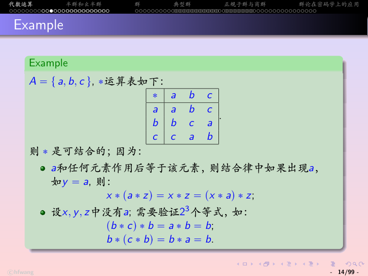
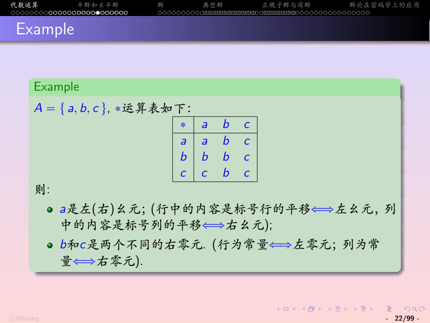
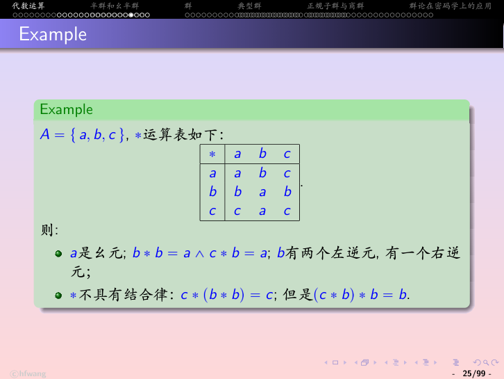

# 第7章 代数系统 - 学习笔记

> 本笔记以武汉大学《代数系统》课件（06-group，99 页）为主线，融合课堂录音整理而成。Rosen《离散数学及其应用（原书第8版）》没有独立的代数结构/群章节，本章按武大课件顺序编写，先建立代数运算的一般概念与性质，半群、群等具体结构留待后续章节。

> **目录**
>
> - [[#1. 代数系统的引入]]
> - [[#2. 运算]]
> - [[#3. 代数定律与代入规则]]
> - [[#4. 结合律]]
> - [[#5. 交换律]]
> - [[#6. 幺元和零元]]
> - [[#7. 逆元]]
> - [[#8. 消去律]]
> - [[#9. 本章小结]]

---

## 1. 代数系统的引入

### 1.1 三种熟悉的运算

在前面的章节中，我们已经多次遇到“把两个对象合成一个新对象”的运算。它们作用在不同的对象上，却表现出完全相同的规律。

**函数的合成**。设 $X^X$ 是集合 $X$ 到自身的所有函数构成的集合，函数合成

$$\circ:X^X\times X^X\to X^X,\qquad \langle g,f\rangle\mapsto g\circ f$$

把两个函数合成为一个新函数，结果仍然是 $X$ 到 $X$ 的函数，没有离开集合 $X^X$。它满足：

- 结合律：$h\circ(g\circ f)=(h\circ g)\circ f$；
- 特殊元素恒等函数 $1_X$：$1_X\circ f=f\circ 1_X=f$；
- 乘幂：$f^m\circ f^n=f^{m+n}$，$(f^m)^n=f^{mn}$。

恒等函数在合成运算中扮演的角色，很像自然数乘法中的 $1$：任何数乘 $1$ 都不变，任何函数与恒等函数合成也都不变。

**关系的合成**。设 $\mathcal P(A\times A)$ 是集合 $A$ 上所有二元关系的全体（即 $A\times A$ 的幂集），关系合成

$$\circ:\mathcal P(A\times A)\times\mathcal P(A\times A)\to\mathcal P(A\times A),\qquad \langle R,S\rangle\mapsto R\circ S$$

同样满足：

- 结合律：$R\circ(S\circ T)=(R\circ S)\circ T$；
- 特殊元素恒等关系 $1_A$：$1_A\circ R=R\circ 1_A=R$；
- 乘幂：$R^m\circ R^n=R^{m+n}$，$(R^m)^n=R^{mn}$。

**矩阵的乘法**。设 $M_n$ 是所有 $n$ 阶方阵构成的集合，矩阵乘法

$$\cdot:M_n\times M_n\to M_n,\qquad \langle M,N\rangle\mapsto M\cdot N$$

满足：

- 结合律：$L\cdot(M\cdot N)=(L\cdot M)\cdot N$；
- 特殊元素单位矩阵 $1$：$1\cdot M=M\cdot 1=M$；
- 乘幂：$M^i\cdot M^j=M^{i+j}$，$(M^i)^j=M^{ij}$。

此外，字母表 $\Sigma$ 上所有字符串的集合 $\Sigma^*$ 中，字符串联结（concatenation）运算与空串 $\varepsilon$ 也满足同样的规律：联结可结合，空串是单位元素，字符串重复联结形成幂。

### 1.2 结构的抽象

这四种运算的对象（函数、关系、矩阵、字符串）各不相同，但把它们放在一起比较，会发现规律完全一致：都有一个把两个对象合成一个对象的二元运算，该运算都满足结合律，都存在一个起“单位”作用的元素，都可以据此定义幂。既然如此，就没有必要对每种对象分别研究，可以把这些共同特征抽取出来，统一研究一个抽象的结构。

设 $A$ 是一个抽象集合（它可以是函数的集合、关系的集合，也可以是数的集合），设

$$*:A\times A\to A,\qquad (x,y)\mapsto x*y$$

是 $A$ 上的一个二元运算。设 $*$ 满足下面两个条件：

1. 结合律：$\forall x,y,z\in A,\ (x*y)*z=x*(y*z)$；
2. 单位元：$\exists e\in A,\ \forall x\in A,\ e*x=x*e=x$。

在这个抽象结构中，元素的幂（power）递归定义为

$$x^0=e$$

$$x^{n+1}=x^n*x$$

即以单位元为零次幂，每多运算一次就把幂次加一。

由此可以证明幂的两条运算规律：

$$x^m*x^n=x^{m+n}$$

$$(x^m)^n=x^{mn}$$

先证第一式，对 $n$ 作归纳。当 $n=0$ 时，$x^m*x^0=x^m*e=x^m=x^{m+0}$，结论成立。假设 $n=k$ 时等式成立，即 $x^m*x^k=x^{m+k}$，则当 $n=k+1$ 时，

$$\begin{aligned} x^m*x^{k+1}&=x^m*(x^k*x) &&\text{（幂的定义）}\\ &=(x^m*x^k)*x &&\text{（结合律）}\\ &=x^{m+k}*x &&\text{（归纳假设）}\\ &=x^{m+k+1} &&\text{（幂的定义）}\end{aligned}$$

故第一式对所有 $n$ 成立。第二式 $(x^m)^n=x^{mn}$ 同样可由归纳法证明。

### 1.3 代数系统的研究方法与定义

回顾上面的过程，研究这类抽象结构遵循一条固定的路径：先从具体结构中找出运算的共同特征，再利用这些共同特征定义一个抽象的结构，然后在抽象结构中演绎运算的相关性质，最后得到一个强有力的结论——任何满足抽象结构条件的具体结构，都自动满足抽象结构中演绎出的全部性质。其中，从具体运算归纳出抽象结构是一个归纳（泛化）的过程，从抽象结构推出具体结论则是一个演绎的过程。

抽象集合、抽象运算、抽象的特殊元素三者合在一起，就构成了一个抽象的代数结构。对这种抽象结构的研究就是代数学。

一个被赋予一组运算和一些特殊元素、并且这些运算满足一定运算规律的抽象结构，称为**代数系统**（Algebra）。例如上面讨论的结构就记作

$$\langle A,*,e\rangle$$

其中 $A$ 是抽象集合，$*$ 是二元运算，$e$ 是单位元。

---

## 2. 运算

### 2.1 n 元运算的定义

设 $A$ 是一个集合，函数

$$f:A^n\to A,\qquad \langle x_1,x_2,\ldots,x_n\rangle\mapsto f(x_1,x_2,\ldots,x_n)$$

称为集合 $A$ 上的一个 **n 元运算**（n-ary operation），集合 $A$ 称为该运算的**载体**（Carrier）。

当 $n=0$ 时，运算没有自变量，退化为 $A$ 中的一个常量；$n=1$ 时是一元运算，$n=2$ 时是二元运算。代数学通常只研究一元运算和二元运算。

二元运算一般采用**中缀表示法**，即把运算符号写在两个运算对象之间，常用符号有 $+$、$*$、$\cdot$、$\circ$、$\star$ 等，例如

$$*:\langle x,y\rangle\mapsto x*y$$

### 2.2 运算的两个属性：处处有定义与封闭性

运算本质上是一个函数，因此必须具备两个属性：

1. **处处有定义**：定义域中的每一点都有函数值，即对任意一组自变量，运算都能给出结果；
2. **封闭性**（closed）：运算的值域一定包含在载体 $A$ 中，即运算结果仍然是 $A$ 中的元素。

封闭性在把某个运算限制到一个子集合上时尤其容易被忽略：一个在大集合上封闭的运算，放到小集合上未必封闭。

### 2.3 运算的例子

前面讨论的四种运算都满足封闭性：

- 函数合成 $\circ:X^X\times X^X\to X^X$，载体是 $X^X$；
- 关系合成 $\circ:\mathcal P(A\times A)^2\to\mathcal P(A\times A)$，载体是 $\mathcal P(A\times A)$；
- 矩阵乘法 $\cdot:M_n^2\to M_n$，载体是 $M_n$；
- 字符串联结 $\cdot:\Sigma^*\times\Sigma^*\to\Sigma^*$，载体是 $\Sigma^*$。

下面两个例子说明，同一个运算在一个集合上可能是运算，在另一个集合上却不是。

减法 $\langle x,y\rangle\mapsto x-y$ 是整数集 $\mathbb Z$ 上的二元运算，但不是自然数集 $\mathbb N$ 上的运算，因为两个自然数相减可能得到负数，结果不再属于 $\mathbb N$，不满足封闭性。

求逆 $f\mapsto f^{-1}$ 是集合 $\mathcal B(X,X)=\{X$ 上的所有双射函数$\}$ 上的一元运算，因为双射函数的逆仍然是双射；但它不是 $X^X$ 上的运算，因为一个普通的（非双射的）函数未必有逆。

---

## 3. 代数定律与代入规则

代数定律通常写成下面的一般形式：

$$\forall x\,\forall y\,\forall z,\qquad \exp_1(x,y,z)=\exp_2(x,y,z)$$

其中 $\exp_1$ 和 $\exp_2$ 是由运算和变量构成的表达式。

由于定律使用了全称量词，它要求等式对变量的**所有**取值都成立，因此每一条代数定律都是一个非常强的条件。也正是因为全称量词，在证明中可以把任意具体的表达式代入变量，得到相应的等式——这种**代入规则**是代数恒等变换的核心，也是代数推理的基本手段。

接下来各节讨论的结合律、交换律等，都是这种一般形式的具体定律。

---

## 4. 结合律

### 4.1 结合律的定义

设 $\langle A,*\rangle$ 是一个代数系统。如果二元运算 $*$ 满足

$$\forall x\,\forall y\,\forall z,\qquad (x*y)*z=x*(y*z)$$

则称 $*$ 具有**结合律**，或称 $*$ 是可结合的（associative）。

前面讨论的函数合成、关系合成、矩阵乘法、字符串联结都是可结合的。

### 4.2 用运算表验证结合律

有限集合上的二元运算可以用**运算表**（operation table，也称 Cayley 表）给出：表的第 $i$ 行第 $j$ 列填写第 $i$ 个元素与第 $j$ 个元素运算的结果。

> **图1** 集合 $A=\{a,b,c\}$ 上的运算表（本质上是模 $3$ 加法，$a=0,b=1,c=2$）。$a$ 是单位元：$a$ 行、$a$ 列都与表头相同。

验证该运算可结合时，先利用单位元简化：只要三个元素中出现 $a$，结合律就自动成立，例如取 $y=a$ 时，

$$x*(a*z)=x*z=(x*a)*z$$

再设 $x,y,z$ 中都不含 $a$，只需逐一验证 $b,c$ 的组合，例如

$$(b*c)*b=a*b=b$$

$$b*(c*b)=b*a=b$$

两者相等。其余组合同样验证，即可确认运算可结合。

### 4.3 左结合约定

在满足结合律的前提下，省略括号时默认按**左结合**理解，即

$$x_1*x_2*\cdots*x_n\triangleq(\cdots((x_1*x_2)*x_3)*\cdots)*x_n\triangleq\prod_{i=1}^n x_i$$

同一个元素连续运算 $n$ 次记作它的幂：

$$\underbrace{x*x*\cdots*x}_{n\text{ 个 }x}\triangleq x^n$$

当运算写成加法时，相应地有 $x_1+\cdots+x_n=\sum_{i=1}^n x_i$，而 $\underbrace{x+\cdots+x}_{n\text{ 个 }x}\triangleq nx$。

### 4.4 广义结合律定理

结合律只保证三个元素时两种括号方式结果相同，但仅凭这一条，可以推出任意多个元素、任意加括号的结果都相同。

**定理**：设 $\langle A,*\rangle$ 满足结合律，$x_1,x_2,\ldots,x_m\in A$。若把这 $m$ 个元素任意分成若干段，

$$y_1=x_1*x_2*\cdots*x_{p_1}$$

$$y_2=x_{p_1+1}*\cdots*x_{p_2}$$

$$\cdots$$

$$y_n=x_{p_{n-1}+1}*\cdots*x_m$$

则

$$x_1*x_2*\cdots*x_m=y_1*y_2*\cdots*y_n$$

也就是说，无论怎样加括号、怎样分段，最终结果都相同。

**推论**：

$$x^m*x^n=x^{m+n}$$

$$(x^m)^n=x^{mn}\qquad (m\ge 1,\ n\ge 1)$$

**证明**：对 $m$ 作归纳。$m=1$ 时结论显然成立。假设 $m-1$ 时结论成立，即

$$x_1*\cdots*x_{m-1}=y_1*\cdots*y_n'$$

其中 $y_n'=x_{p_{n-1}+1}*\cdots*x_{m-1}$。则 $m$ 时，

$$\begin{aligned} x_1*\cdots*x_m&=(x_1*\cdots*x_{m-1})*x_m &&\text{（定义）}\\ &=(y_1*\cdots*y_n')*x_m &&\text{（归纳假设）}\\ &=((y_1*\cdots*y_{n-1})*y_n')*x_m &&\text{（定义）}\\ &=(y_1*\cdots*y_{n-1})*(y_n'*x_m) &&\text{（结合律）}\\ &=(y_1*\cdots*y_{n-1})*y_n &&\text{（定义，}y_n=y_n'*x_m\text{）}\\ &=y_1*\cdots*y_n &&\text{（定义）}\end{aligned}$$

证毕。

---

## 5. 交换律

### 5.1 交换律的定义

设 $\langle A,*\rangle$ 是代数系统。如果二元运算满足

$$\forall x\,\forall y,\qquad x*y=y*x$$

则称 $*$ 具有**交换律**，或称 $*$ 是可交换的（commutative）。

在运算表中，可交换体现为表格关于主对角线对称：第 $i$ 行第 $j$ 列与第 $j$ 行第 $i$ 列的元素相同。

### 5.2 可交换与不可交换的例子

集合运算中，$\langle\mathcal P(A),\cap,\cup\rangle$ 的交并运算既可结合又可交换。

而前面讨论的四种“合成”类运算虽然可结合，却一般不可交换：

- 函数合成 $\langle X^X,\circ\rangle$：一般 $g\circ f\ne f\circ g$；
- 关系合成 $\langle\mathcal P(A\times A),\circ\rangle$：一般 $R\circ S\ne S\circ R$；
- 矩阵乘法 $\langle M_n,\cdot\rangle$：一般 $M\cdot N\ne N\cdot M$；
- 字符串联结 $\langle\Sigma^*,\cdot\rangle$：$s\cdot t$ 与 $t\cdot s$ 一般不同。

需要特别说明命题逻辑中的合取与析取。$\wedge$、$\vee$ 在**逻辑等价**意义下既可结合又可交换，这是命题逻辑的基本等值式。课件中“在相等意义下不可结合、不可交换”的说法，是把“相等”理解为**语法上的恒等**：$(p\wedge q)\wedge r$ 与 $p\wedge(q\wedge r)$ 作为符号串（或公式树）并不完全相同，它们之间是逻辑等价而非字面相等。这是“相等”与“等价”两个概念的区分，并不是说合取真的不满足结合律。

### 5.3 交换律定理

**定理**：设 $\langle A,*\rangle$ 同时满足结合律和交换律，$x_1,\ldots,x_m\in A$。若 $(i,j,k,\ldots,n)$ 是 $(1,2,\ldots,m)$ 的任意一个置换，则

$$x_1*x_2*\cdots*x_m=x_i*x_j*x_k*\cdots*x_n$$

也就是说，在可结合、可交换的运算中，任意调换元素的先后顺序都不改变结果。

**证明**：对 $m$ 作归纳。$m=1$ 时成立。设 $m-1$ 时成立，记

$$\mathcal X=x_1*\cdots*x_{n-1},\qquad \mathcal Y=x_{n+1}*\cdots*x_m$$

则由归纳假设与结合律，$\mathcal X*\mathcal Y=x_i*x_j*\cdots*x_p$。于是 $m$ 时，

$$\begin{aligned} x_i*x_j*\cdots*x_p*x_n&=(\mathcal X*\mathcal Y)*x_n &&\text{（定义）}\\ &=\mathcal X*(\mathcal Y*x_n) &&\text{（结合律）}\\ &=\mathcal X*(x_n*\mathcal Y) &&\text{（交换律）}\\ &=\mathcal X*x_n*\mathcal Y &&\text{（结合律）}\\ &=x_1*x_2*\cdots*x_m &&\text{（结合律与定义）}\end{aligned}$$

证毕。

---

## 6. 幺元和零元

### 6.1 幺元和零元的定义

设 $\langle A,*\rangle$ 是代数系统。

若元素 $1_l\in A$ 满足

$$\forall x\in A,\qquad 1_l*x=x$$

则称 $1_l$ 为**左幺元**（左单位元，Left identity）；若元素 $1_r\in A$ 满足

$$\forall x\in A,\qquad x*1_r=x$$

则称 $1_r$ 为**右幺元**（Right identity）。

类似地，若元素 $O_l\in A$ 满足

$$\forall x\in A,\qquad O_l*x=O_l$$

则称 $O_l$ 为**左零元**（Left zero）；若元素 $O_r\in A$ 满足

$$\forall x\in A,\qquad x*O_r=O_r$$

则称 $O_r$ 为**右零元**（Right zero）。

### 6.2 常见系统中的幺元与零元

> **图2** 集合 $A=\{a,b,c\}$ 上的运算表。$a$ 行、$a$ 列都是表头的平移，故 $a$ 是左、右幺元；$b$ 列、$c$ 列分别是常量 $b$、$c$，故 $b$、$c$ 是两个不同的右零元。

在前面熟悉的系统中，幺元与零元如下：

- 集合运算 $\langle\mathcal P(A),\cap,\cup\rangle$：全集 $A$ 是 $\cap$ 的幺元、$\cup$ 的零元（$A\cap X=X$，$A\cup X=A$）；空集 $\varnothing$ 是 $\cup$ 的幺元、$\cap$ 的零元（$\varnothing\cup X=X$，$\varnothing\cap X=\varnothing$）。
- 函数合成 $\langle X^X,\circ\rangle$：恒等函数 $1_X$ 是幺元，没有零元。
- 关系合成 $\langle\mathcal P(A\times A),\circ\rangle$：恒等关系 $1_A$ 是幺元，空关系 $\varnothing$ 是零元。
- 矩阵乘法 $\langle M_n,\cdot\rangle$：单位矩阵 $1$ 是幺元，零矩阵 $O$ 是零元。
- 字符串联结 $\langle\Sigma^*,\cdot\rangle$：空串 $\varepsilon$ 是幺元，没有零元。

从运算表上识别幺元、零元有直观的规律：某一行是表头行的平移，对应元素是左幺元；某一列是表头列的平移，对应元素是右幺元；某一行是常量，对应元素是左零元；某一列是常量，对应元素是右零元。

### 6.3 幺元、零元的唯一性

**定理**：在代数系统 $\langle A,*\rangle$ 中，如果左幺元和右幺元同时存在，则二者必定相等，称为**幺元**，一般记作 $1$ 或 $e$，该系统记作 $\langle A,*,1\rangle$。

证明：设左、右幺元分别为 $1_l$、$1_r$。一方面，由 $1_r$ 是右幺元，$1_l*1_r=1_l$；另一方面，由 $1_l$ 是左幺元，$1_l*1_r=1_r$。故 $1_l=1_r$。

**定理**：同理，如果左零元和右零元同时存在，则二者相等，称为**零元**，一般记作 $0$，该系统记作 $\langle A,*,0\rangle$。

证明：设左、右零元为 $O_l$、$O_r$。由左零元性质 $O_l*O_r=O_l$，由右零元性质 $O_l*O_r=O_r$，故 $O_l=O_r$。

需要注意，幺元、零元的唯一性以左、右两侧同时存在为前提。正如图 2 所示，只有右零元而没有左零元时，右零元可以不唯一（$b$、$c$ 都是右零元）。

---

## 7. 逆元

### 7.1 逆元的定义

设 $\langle A,*,1\rangle$ 是带有幺元 $1$ 的代数系统。如果

$$x*y=1$$

则称 $x$ 是 $y$ 的**左逆元**（$y$ 左可逆），称 $y$ 是 $x$ 的**右逆元**（$x$ 右可逆）。若元素同时存在左、右逆元，则称该元素可逆。

### 7.2 常见系统中的逆

幺元的逆元是它自己，因为 $1*1=1$。

在常见系统中：

- 集合运算 $\langle\mathcal P(A),\cap,\cup\rangle$：$\cap$ 的幺元是 $A$，只有 $A$ 有逆元（$A\cap A=A$）；$\cup$ 的幺元是 $\varnothing$，只有 $\varnothing$ 有逆元（$\varnothing\cup\varnothing=\varnothing$）。
- 函数合成 $\langle X^X,\circ,1_X\rangle$：函数 $f$ 有右逆元当且仅当 $f$ 是满射，$f$ 有左逆元当且仅当 $f$ 是单射。这与第 6 章中“满射有右逆、单射有左逆”的结论一致。
- 矩阵乘法 $\langle M_n,\cdot\rangle$：矩阵 $M$ 可逆当且仅当 $\det(M)\ne 0$。
- 字符串联结 $\langle\Sigma^*,\cdot\rangle$：只有空串 $\varepsilon$ 有逆元，且逆元就是它自己。

### 7.3 逆元不唯一的例子

> **图3** 集合 $A=\{a,b,c\}$ 上的运算表，$a$ 是幺元。由 $b*b=a$、$c*b=a$，元素 $b$ 有两个左逆元（$b$ 和 $c$）、一个右逆元（$b$）。

这个运算不满足结合律，例如

$$c*(b*b)=c*a=c$$

$$(c*b)*b=a*b=b$$

两者不相等。正是因为缺少结合律，逆元才可能不唯一。

### 7.4 逆元的唯一性

**定理**：设 $\langle A,*,1\rangle$ 是可结合的代数系统。对任意元素 $x$，如果它的左逆元和右逆元同时存在，则二者相等并且唯一，称为 $x$ 的**逆元**，记作 $x^{-1}$，并称 $x$ 是可逆的。在加法记号下，逆元记作 $-x$。

证明：设 $x$ 的左、右逆元分别为 $l$、$r$，即 $l*x=1$、$x*r=1$。则

$$\begin{aligned} l&=l*1 &&\text{（幺元）}\\ &=l*(x*r) &&\text{（}r\text{ 是右逆）}\\ &=(l*x)*r &&\text{（结合律）}\\ &=1*r &&\text{（}l\text{ 是左逆）}\\ &=r &&\text{（幺元）}\end{aligned}$$

故左、右逆元相等。同理，若 $x$ 有两个逆元，它们也相等，因此逆元唯一。

**推论**：若 $a$ 有逆元 $a^{-1}$，则

$$(a^{-1})^{-1}=a$$

因为 $a^{-1}*a=1$ 且 $a*a^{-1}=1$，所以 $a$ 就是 $a^{-1}$ 的逆元。

### 7.5 运算下求逆：穿脱原则

**定理**：设 $\langle A,*,1\rangle$ 可结合，$a,b$ 都可逆，则 $a*b$ 也可逆，且其逆元为

$$(a*b)^{-1}=b^{-1}*a^{-1}$$

证明：

$$(b^{-1}*a^{-1})*(a*b)=b^{-1}*(a^{-1}*a)*b=b^{-1}*1*b=b^{-1}*b=1$$

同理可得 $(a*b)*(b^{-1}*a^{-1})=1$，故 $b^{-1}*a^{-1}$ 是 $a*b$ 的逆元。

这一结论称为**穿脱原则**（socks and shoes）：先穿袜子后穿鞋，脱的时候要先脱鞋后脱袜，顺序恰好反过来。

---

## 8. 消去律

**定理（消去律）**：设 $\langle A,*,1\rangle$ 是可结合的代数系统，元素 $a$ 可逆。若

$$a*x=a*y$$

则 $x=y$。

证明：在等式两侧同时用 $a^{-1}$ 从左侧运算，

$$\begin{aligned} a*x&=a*y\\ a^{-1}*(a*x)&=a^{-1}*(a*y)\\ (a^{-1}*a)*x&=(a^{-1}*a)*y\\ 1*x&=1*y\\ x&=y\end{aligned}$$

这称为左消去律。可逆元素之所以能“消去”，本质上是因为它带有逆元，可以通过逆元把它从等式中移除。在不要求每个元素都可逆的系统中，消去律需要单独作为一条性质来讨论。

---

## 9. 本章小结

本章从函数合成、关系合成、矩阵乘法、字符串联结四种具体运算出发，抽象出代数系统的一般概念，并讨论了二元运算的基本性质。

- **代数系统**：一个集合（载体）连同其上的若干运算和特殊元素，运算满足一定规律，记作 $\langle A,*,e\rangle$ 等。研究方法是从具体归纳出抽象、再由抽象演绎到具体。
- **运算**：$f:A^n\to A$，必须处处有定义且封闭；代数学主要研究一元和二元运算。
- **结合律**：$(x*y)*z=x*(y*z)$；可结合时任意加括号、分段结果相同（广义结合律），并保证幂律 $x^m*x^n=x^{m+n}$、$(x^m)^n=x^{mn}$。
- **交换律**：$x*y=y*x$；可结合且可交换时，任意置换不改变结果。
- **幺元与零元**：幺元满足 $1*x=x*1=x$，零元满足 $0*x=x*0=0$；左、右同时存在时各自唯一。
- **逆元**：$x*y=1$ 时互为逆；可结合时逆元唯一，记 $x^{-1}$，且 $(a*b)^{-1}=b^{-1}*a^{-1}$。
- **消去律**：可逆元素满足 $a*x=a*y\Rightarrow x=y$。

需要特别注意“相等”与“等价”的区分：命题逻辑的 $\wedge$、$\vee$ 在逻辑等价意义下可结合、可交换，而不是在字面相等意义下。

本章只建立了代数运算的一般框架。在此基础上，若进一步要求运算可结合就得到半群，再要求存在幺元就得到幺半群，进一步要求每个元素都有逆元就得到群，这些结构将在后续章节讨论。
