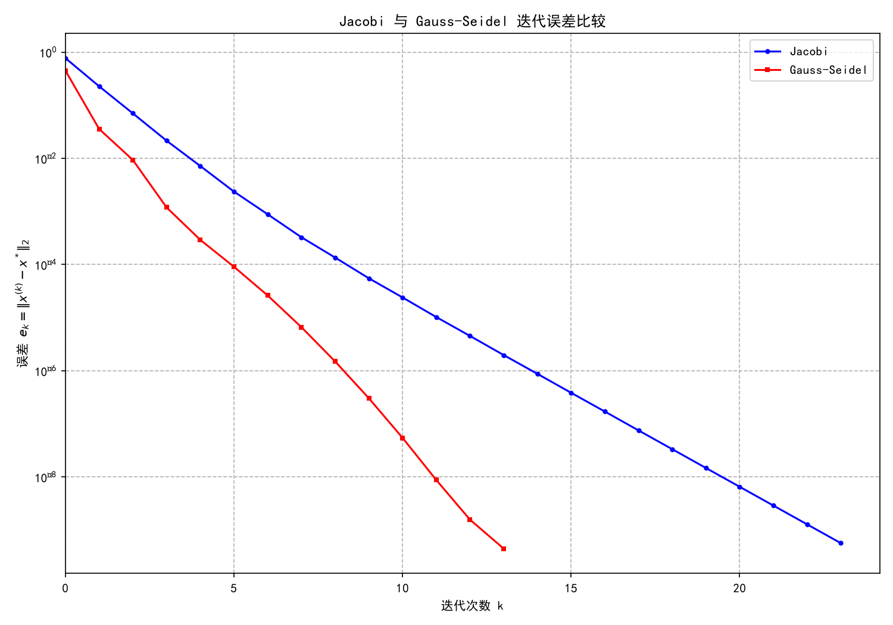
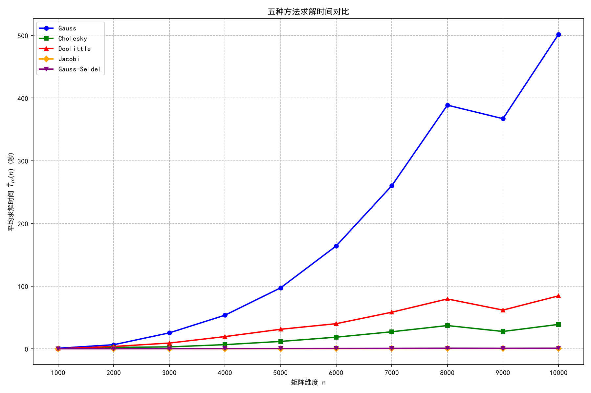
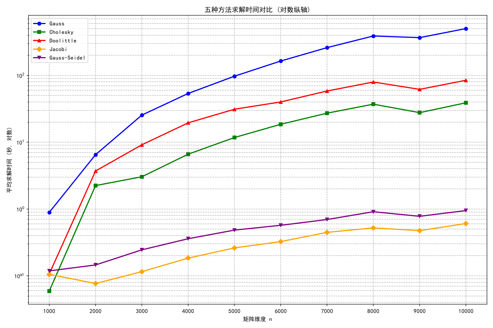

# 实验课笔记：线性方程组直接法与迭代法对比

对应课本第 5 章（直接法）和第 6 章（迭代法），用 Python（numpy / scipy）实现五种解法并在不同规模下对比精度与耗时。代码主体为 `solvers.py`，两个实验入口分别为 `experiment_1/main.py` 和 `experiment_2/main.py`。

## 1. 五种解法的代码实现与课本对应

### 1.1 列主元高斯消去 `gauss_elim`

课本 §5.2 的列主元消去。第 $k$ 步在第 $k$ 列下半段选绝对值最大者交换到 $(k,k)$，再做行消去：

```python
for k in range(n):
    pivot = np.argmax(np.abs(A[k:, k])) + k
    if pivot != k:
        A[[k, pivot]] = A[[pivot, k]]
        b[[k, pivot]] = b[[pivot, k]]
    factors = A[k+1:, k] / A[k, k]
    A[k+1:, k:] -= np.outer(factors, A[k, k:])
    b[k+1:] -= factors * b[k]
x = back_sub(A, b)
```

`factors` 就是课本里的乘数 $m_{ik} = a_{ik}^{(k)}/a_{kk}^{(k)}$；选主元是为了避免小主元放大舍入误差（对应 §5.5 例 4 那个 0.001 主元把解算坏的教训）。

### 1.2 Doolittle 三角分解 `doolittle_solve`

课本 §5.3.1 的递推公式：先定 $U$ 第 $k$ 行，再定 $L$ 第 $k$ 列。

```python
for k in range(n):
    U[k, k:] = A[k, k:] - L[k, :k] @ U[:k, k:]
    if k < n - 1:
        L[k+1:, k] = (A[k+1:, k] - L[k+1:, :k] @ U[:k, k]) / U[k, k]
```

对应笔记 5.3 里的公式（3.2）（3.3）：$u_{kj} = a_{kj} - \sum_{s<k} l_{ks}u_{sj}$，$l_{ik} = (a_{ik} - \sum_{s<k} l_{is}u_{sk})/u_{kk}$。分解完前代 $Ly=b$、回代 $Ux=y$。

### 1.3 Cholesky 分解 `cholesky_solve`

课本 §5.3.2 平方根法。对称正定矩阵 $A=LL^T$，按列计算 $g_{jj}$ 和 $g_{ij}$：

```python
for j in range(n):
    s = A[j, j] - L[j, :j] @ L[j, :j]
    L[j, j] = np.sqrt(s)
    L[j+1:, j] = (A[j+1:, j] - L[j+1:, :j] @ L[j, :j]) / L[j, j]
```

只有对称正定才能做（代码里实验 2 的矩阵就是按 SPD 生成的）。相比 Doolittle 只算了一半元素，理论运算量 $n^3/6$，是普通 LU 的一半。

### 1.4 Jacobi 迭代 `jacobi`

课本 §6.2.1 的同步迭代。$A=D+L+U$，迭代格式 $x^{(k+1)} = D^{-1}(b-(L+U)x^{(k)})$。代码里 $D=\text{diag}(A)$，$R=A-D$，直接按分量更新：

```python
x_new = (b - R @ x) / D
```

注意每一步用的都是上一轮的旧 $x$，所有分量同时更新——这是 Jacobi 与 Gauss-Seidel 的本质区别。

### 1.5 Gauss-Seidel 迭代 `gauss_seidel`

课本 §6.2.2 的异步迭代。一旦算出新分量立刻被后面的分量使用。代码把 $L_{\text{下}}=\text{tril}(A)$、$U_{\text{上}}=\text{triu}(A,1)$，然后解下三角方程组：

```python
x_new = forward_sub(L, b - U @ x)
```

数学格式是 $(D+L)x^{(k+1)} = b - Ux^{(k)}$，每步解一个下三角（前代），等价于按分量顺序立刻用上新值。

### 1.6 停止条件

两种迭代都用**相对残差**停机：

$$
\frac{\|b - Ax^{(k)}\|_2}{\|b\|_2} \le 10^{-10}
$$

这比直接看 $\|x^{(k)}-x^{(k-1)}\|$ 更可靠（相邻两步差小不代表真解近），也对应课本 §6.1.3 事后误差判据。

## 2. 实验一：7×7 小矩阵精度对比

### 2.1 矩阵构造

取 $A$ 为 7 阶对称正定严格对角占优矩阵（对角元 9–12，非对角元绝对值 ≤2），右端 $b=(14,13,15,13,14,14,10)^T$，真解 $x^*=(1,1,1,1,1,1,1)^T$，初值 $x^{(0)}=0$。

### 2.2 直接法精度

三种直接法都收敛到机器精度：

| 方法 | 误差（2 范数） |
|---|---|
| 列主元高斯消去 | 3.3e-16 |
| Cholesky | 3.3e-16 |
| Doolittle | 1.1e-16 |

差别在 1e-16 量级，纯属浮点舍入——对良态矩阵，直接法之间没有精度差距，选哪个只看速度和存储。

### 2.3 迭代法收敛步数

| 方法 | 收敛步数 | 最终残差 | 最终误差 |
|---|---|---|---|
| Jacobi | 24 次（k=0..23） | 3.4e-9 | 5.7e-10 |
| Gauss-Seidel | 14 次（k=0..13） | 3.0e-9 | 4.5e-10 |

同一个 $A$，Gauss-Seidel 用了 Jacobi 约 60% 的步数就达到同样精度——对应课本 §6.2.4 的结论：对严格对角占优矩阵，Gauss-Seidel 收敛通常快于 Jacobi（因为新值立刻被使用，信息不浪费）。



纵轴是半对数的 $\|e^{(k)}\|_2$。两条曲线都近似直线，说明误差按等比数列衰减——对应 §6.1.6 讲的"$\log\|e^{(k)}\|$ 与 $k$ 线性相关，斜率为 $\ln\rho(B)$"。GS 直线更陡，即 $\rho(B_{\text{GS}}) < \rho(B_J)$。

## 3. 实验二：大规模下的耗时对比

### 3.1 矩阵生成

按课本 SPD 要求随机生成：先造对称矩阵 $(B+B^T)/2$，再把对角元设为"该行非对角元绝对值之和 + 随机正扰动"，保证严格对角占优（从而 Jacobi/GS 必收敛）。规模取 $n=1000,2000,\dots,10000$，每规模随机 5 组取平均。

### 3.2 平均耗时（秒）

| $n$ | Gauss | Cholesky | Doolittle | Jacobi | Gauss-Seidel |
|---|---|---|---|---|---|
| 1000 | 0.89 | 0.059 | 0.107 | 0.105 | 0.118 |
| 2000 | 6.50 | 2.240 | 3.705 | 0.077 | 0.145 |
| 3000 | 25.43 | 3.037 | 9.141 | 0.116 | 0.245 |
| 5000 | 97.18 | 11.742 | 31.142 | 0.262 | 0.483 |
| 7000 | 260.14 | 27.176 | 58.345 | 0.447 | 0.696 |
| 10000 | 501.77 | 38.889 | 84.474 | 0.607 | 0.948 |





### 3.3 结果分析

- **直接法是 $O(n^3)$**：$n$ 从 1000 到 10000 翻 10 倍，Gauss 耗时从 0.9s 涨到 502s（约 560 倍，接近 $10^3$），Doolittle 从 0.1s 涨到 84s（约 790 倍）。曲线在双对数图上是直线，斜率 ≈ 3，验证了课本 §5.2.3 的 $2n^3/3$ 运算量。
- **Cholesky 比 Doolittle 快约 2 倍**：因为利用对称性只算一半元素，运算量 $n^3/6$ vs $n^3/3$。对 SPD 矩阵优先选它。
- **列主元 Gauss 比 Doolittle 慢约 6 倍**：代码里 Gauss 用 Python 循环做行消去（`np.outer` 外层循环），Doolittle 也是 Python 循环但乘加更少；两者都没走 scipy 优化路径，差距不代表算法本身，只说明手撸循环在 $n=10^4$ 量级已不可接受。
- **迭代法是 $O(n^2)$ 乘常数**：$n$ 翻 10 倍，Jacobi 从 0.1s 涨到 0.6s（约 6 倍），GS 从 0.12s 涨到 0.95s（约 8 倍），远慢于 $n^3$。每步迭代只做一次矩阵-向量乘 $O(n^2)$，步数对这类严格对角占优矩阵基本不随 $n$ 增长。
- **规模分界**：$n\le 2000$ 时直接法（尤其 Cholesky）与迭代法同量级甚至更快；$n=5000$ 以上直接法已经掉到几十秒到上百秒，迭代法仍在 1 秒内——这就是课本为什么说"稀疏大矩阵用迭代法"。

## 4. 结论

1. **小矩阵 / 稠密矩阵**：直接法精度稳到机器精度，选 Cholesky（SPD）或列主元 Gauss（一般矩阵），不要纠结迭代。
2. **大矩阵 / 稀疏矩阵**：迭代法把 $O(n^3)$ 降到 $O(k n^2)$，$k$ 是收敛步数；对严格对角占优矩阵 $k$ 很小，优势随 $n$ 放大。
3. **Gauss-Seidel 通常比 Jacobi 快**（本实验 14 步 vs 24 步），但不能保证对所有矩阵都成立（课本 §6.2.4 有反例）。
4. **停止条件用相对残差** $\|r\|/\|b\|$，不要用相邻两步差——后者可能在真解附近仍振荡。
