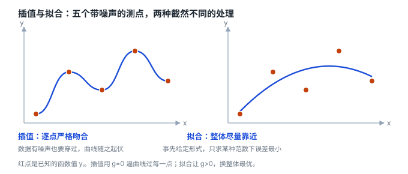

# 2.1 插值问题与拉格朗日插值

> 上课：11.18（[课堂录音稿/11.18-插值问题](../原始材料/课堂录音稿/11.18-插值问题/)：原文 + 导读 + 整理版逐字稿）；板书 8 张（用户当堂提供，未入 vault），公式记法据板书校正，转写稿把「基函数」听作「奇函数」、「$\lambda$」听作「兰姆达」、「$\varphi$」听作「斐」
> 对应课本：李庆扬《数值分析》§2.1（插值法基本概念）、§2.2（拉格朗日插值），教材定理 1 = 存在唯一性、定理 2 = 余项估计；§2.3 牛顿插值留下一篇
> [返回总览](../00-索引.md) ｜ [上一篇：8.5 奇异值分解与广义逆](../第8章-矩阵特征值/8.5-奇异值分解与广义逆.md)（按上课时间：11.18 接 11.17）

## 目录

- [[#1. 插值问题的来源与定义]]
  - [[#1.1 五个测点推回温度分布]]
  - [[#1.2 定义与四个名词]]
- [[#2. 插值与拟合：同一个 $g$ 的两种要求]]
  - [[#2.1 用 $g(x)$ 统一刻画]]
  - [[#2.2 范数决定拟合方式]]
- [[#3. 为什么选多项式，以及三个核心问题]]
- [[#4. 存在唯一性：范德蒙德矩阵（教材定理 1）]]
  - [[#4.1 插值条件化为线性方程组]]
  - [[#4.2 为什么实际不用它构造]]
- [[#5. 误差估计：余项定理（教材定理 2）]]
  - [[#5.1 余项的形式与两部分]]
  - [[#5.2 构造性证明：辅助函数 + 罗尔定理]]
  - [[#5.3 误差界与它的局限]]
- [[#6. 基函数构造：把方程组对角化]]
  - [[#6.1 换一组基就是换一种插值法]]
  - [[#6.2 为什么正好选 $n$ 次]]
- [[#7. 拉格朗日插值：先解一个特殊问题]]
  - [[#7.1 特殊问题：$y_i$ 只在一点为 1]]
  - [[#7.2 定出 $\lambda$：拉格朗日基函数]]
  - [[#7.3 回到一般问题：系数直接填 $y_i$]]
  - [[#7.4 线性插值与二次插值]]
  - [[#7.5 用 $\omega_{n+1}$ 改写]]
- [[#8. 拉格朗日的缺点与牛顿插值的引出]]

---

## 1. 插值问题的来源与定义

### 1.1 五个测点推回温度分布

课上给的背景：测房间温度，在门口、后门口、窗户、中间各测一次，得到五个点的温度；仪器拿走后还想知道其他点的温度。手上只有这五个数，但它们背后存在一个温度分布函数 $f(x)$，只是不知道它的形式。于是想基于这五个数和某些假设，把 $f$ 近似出来，再用这个近似函数去算没测的点。

这个思路贯穿全章：**已知有限个点上的函数值，重构背后的函数**。它和最小二乘、数值积分都有联系——数值积分正是以插值为基础推出来的。

### 1.2 定义与四个名词

**插值问题的数学表述**：设 $f(x)$ 在 $[a,b]$ 上连续，给定 $n+1$ 个点

$$
a\le x_0<x_1<\cdots<x_n\le b
$$

上的函数值 $y_i=f(x_i)$，求一个函数 $P(x)$ 作为 $f(x)$ 的近似，使

$$
P(x_i)=f(x_i),\qquad i=0,1,\dots,n .
$$

则称 $P(x)$ 为 $f(x)$ 的**插值函数**。四个名词（板书与教材一致）：

- $f$：**被插值函数**；
- $x_i$：**插值节点**；
- $[a,b]$：**插值区间**；
- $P(x_i)=f(x_i)$：**插值条件**。

若 $P(x)$ 是次数不超过 $n$ 的代数多项式 $P(x)=a_0+a_1x+\cdots+a_nx^n$，就称它为**插值多项式**，相应的插值法叫多项式插值。本篇只讨论多项式插值。

## 2. 插值与拟合：同一个 $g$ 的两种要求

### 2.1 用 $g(x)$ 统一刻画

换一个观点：把已知的 $f(x_i)$ 与待定的 $P(x_i)$ 逐点作差，定义

$$
g(x)=\sum_{i=0}^{n}\bigl(f(x_i)-P(x_i)\bigr)^2 .
$$

$P$ 的形式是我们给的，参数是待变的：取 $P(x)=a_0+a_1x+a_2x^2+\cdots$，参数是 $a_0,a_1,a_2$；取 $P(x)=a_0+a_1\cos x+b_1\sin x+a_2\cos 2x+b_2\sin 2x+\cdots$，参数就是 $a_0,a_1,b_1,a_2,b_2$。于是 $g$ 是这些参数的函数。

- 若能让 $g$ 的最小值取到 **$0$**——每个差值都为零，逐点严格吻合——就是**插值问题**；
- 若 $g$ 的最小值 **$>0$**——只求整体最近——就是**拟合问题**。

**两者的分工**（板书画了两幅对照图）：插值要求曲线严格通过所有点，数据有什么复杂现象，插值函数就得适应什么现象——即使数据里带着噪声，也要逐点吻合；拟合则先定好 $P$ 的形式，让它去配合数据，只求在某种意义下离所有点尽可能近。实际应用里拟合用得更多；但数值积分是从插值概念往前推的，所以插值在理论上有它的位置。

### 2.2 范数决定拟合方式

「总体上离所有点尽可能近」在数学上要落成一个可以优化的式子：把原始数据看成一个向量，把拟合曲线在各点的值看成另一个向量，让两个向量的差在某个**范数**下尽量小。范数不同，拟合方式就不同：

- 一范数（绝对值之和）：不可导，但并非无用，对应所谓 L1 回归；
- 二范数（平方后可导）：这就是**最小二乘法**，目标函数可求导是它的一大便利（完整解法见 [3.1 最小二乘问题](../第3章-最小二乘问题/3.1-最小二乘问题法方程与正交变换.md)，从超定方程组的角度引入见 [1.1 §7](../第1章-数值分析与科学计算引论/1.1-介绍.md)）；
- 无穷范数：取最大偏差最小化。

最小二乘用得最多、性质好，但也有它自己的问题，本篇不展开。本篇只讨论插值。

## 3. 为什么选多项式，以及三个核心问题

**为什么选多项式。** $P$ 的选法很多，课上给了两种：多项式与三角函数（傅里叶展开，系数靠在区间上积分定出，前面课程学过）。本篇选多项式，因为形式简单、方便计算、便于积分。还有一层理由：在一点附近考察一个光滑函数，做泰勒展开得到的正是一串多项式，各阶系数与函数在该点的各阶导数一一对应（$f(x_0)$、$f'(x_0)$、$f''(x_0)/2!$……）。所以在一个小范围里用多项式表达函数是站得住的，泰勒展开已把理论铺好（泰勒展开用于局部近似的完整算例与余项估计见 [1.2 §6](../第1章-数值分析与科学计算引论/1.2-误差.md)）。这样得到的 $P$ 称为**插值多项式**。

**三个核心问题。** 对插值多项式，要依次回答：

1. **存在性与唯一性**：满足插值条件的多项式是否存在？若存在，是否唯一？会不会有多条曲线都过这些点？
2. **误差估计**：节点上相等，非节点上一般不相等，$P$ 与未知的 $f$ 之间有误差；误差不能精确算出，能否做理论估计？
3. **实际计算**：即使前两个问题解决了，怎样把表达式有效地写出来、算出来？

下面 §4、§5、§6–§7 依次回答这三个问题。

## 4. 存在唯一性：范德蒙德矩阵（教材定理 1）

### 4.1 插值条件化为线性方程组

从插值条件 $P(x_i)=f(x_i)$ 出发，把 $P(x)=a_0+a_1x+\cdots+a_nx^n$ 代入：

$$
a_0+a_1x_i+a_2x_i^2+\cdots+a_nx_i^n=f(x_i)=f_i,\qquad i=0,1,\dots,n .
$$

未知量是 $a_0,a_1,\dots,a_n$；$x_i,x_i^2,\dots,x_i^n$ 和右端 $f_i$ 都已知。$n+1$ 个节点给出 $n+1$ 个方程：

$$
\begin{cases}
a_0+a_1x_0+a_2x_0^2+\cdots+a_nx_0^n=f_0,\\
a_0+a_1x_1+a_2x_1^2+\cdots+a_nx_1^n=f_1,\\
\ \vdots\\
a_0+a_1x_n+a_2x_n^2+\cdots+a_nx_n^n=f_n .
\end{cases}
$$

系数矩阵是范德蒙德（Vandermonde）矩阵

$$
M=\begin{pmatrix}
1&x_0&x_0^2&\cdots&x_0^n\\
1&x_1&x_1^2&\cdots&x_1^n\\
\vdots&\vdots&\vdots&&\vdots\\
1&x_n&x_n^2&\cdots&x_n^n
\end{pmatrix},\qquad
\det M=\prod_{j>i}(x_j-x_i)\ne 0 .
$$

节点互异保证行列式非零，于是方程组有唯一解。

**定理 1**（教材） 满足条件 $P(x_i)=y_i$（$i=0,1,\dots,n$）的插值多项式存在且唯一。

注意：唯一性说的是**次数不超过 $n$ 的多项式**唯一；次数更高、同样过这 $n+1$ 个点的多项式当然还有很多。

### 4.2 为什么实际不用它构造

这套推导同时给出了一种构造方法——解线性方程组。但课上提醒：插值问题本来是精确的，转成方程组后也得精确求解；而范德蒙德矩阵当节点多时**条件数增长极快**，直接解很麻烦。所以实际不这么构造，下面 §6–§7 给出更好的办法。这也呼应了第 1 章学条件数时的结论：矩阵是否非奇异只决定解存在与否，不决定数值上能否算准（条件数的定义与几何解释见 [5.5 §4](../第5章-解线性方程组的直接法/5.5-线性方程组的性态与误差分析.md)）。

## 5. 误差估计：余项定理（教材定理 2）

### 5.1 余项的形式与两部分

记余项 $R_n(x)=f(x)-L_n(x)$（这里用教材记号 $L_n$，即 §4 的 $P$）。

**定理 2**（教材） 设 $f^{(n)}(x)$ 在 $[a,b]$ 上连续、$f^{(n+1)}(x)$ 在 $(a,b)$ 内存在，节点 $a\le x_0<\cdots<x_n\le b$，$L_n$ 满足插值条件，则对任意 $x\in[a,b]$

$$
R_n(x)=f(x)-L_n(x)=\frac{f^{(n+1)}(\xi)}{(n+1)!}\,\omega_{n+1}(x),
\qquad
\omega_{n+1}(x)=\prod_{i=0}^{n}(x-x_i),\quad \xi\in(a,b).
$$

$\xi$ 依赖于 $x$，具体位置一般不知道。这个式子分两部分看：

- 前面的系数 $\dfrac{f^{(n+1)}(\xi)}{(n+1)!}$ 与泰勒余项同形，是个**没法确定的常数**；
- 后面的 $\omega_{n+1}(x)$ 是 $n+1$ 次连乘多项式，结构上完全确定——它在每个节点 $x_i$ 处为零。

### 5.2 构造性证明：辅助函数 + 罗尔定理

课上强调这个证明是**构造性**的：不是直接算 $R_n$，而是先造一个辅助函数，逼出它的高阶导数在某点为零。

把 $x$ 暂看作区间上一个**固定点**（先设它不与任何 $x_i$ 重合），把自变量改记为 $t$，作

$$
\varphi(t)=f(t)-P_n(t)-\frac{f(x)-P_n(x)}{\omega_{n+1}(x)}\,\omega_{n+1}(t).
$$

**第一步，算 $\varphi^{(n+1)}$。** 三项分别求导：

- $P_n$ 是 $n$ 次多项式，$n+1$ 阶导数为 $0$（正如直线求二阶导、抛物线求三阶导为零）；
- $\omega_{n+1}$ 是 $n+1$ 次多项式。把它的最高次项写成 $P_{n+1}t^{n+1}+\cdots$：每个因子 $(t-x_j)$ 要凑出 $t^{n+1}$，只能每次都取 $t$，共有 $n+1$ 个因子、每个系数都是 $1$，所以 $P_{n+1}=1$；求 $n+1$ 阶导数后只剩 $(n+1)!\,P_{n+1}=(n+1)!$；
- 中间那个分式与 $t$ 无关，是常数因子。

于是

$$
\varphi^{(n+1)}(t)=f^{(n+1)}(t)-\frac{f(x)-P_n(x)}{\omega_{n+1}(x)}\,(n+1)! .
$$

**第二步，数 $\varphi$ 的零点。** 把 $t=x_0,x_1,\dots,x_n$ 代入：第一项 $f(x_k)-P_n(x_k)=0$（插值条件），第二项 $\omega_{n+1}(x_k)=0$，所以都是零点。再把 $t=x$ 代入：第二项的 $\omega_{n+1}(x)$ 与分母约掉，剩 $f(x)-P_n(x)-[f(x)-P_n(x)]=0$。因此 $\varphi$ 有 **$n+2$ 个零点**：

$$
x_0,x_1,\dots,x_n,x .
$$

**第三步，反复用罗尔定理。** $\varphi$ 连续且有 $n+1$ 阶导数。$n+2$ 个零点之间逐段用罗尔定理：

$$
\varphi\ \text{有}\ n+2\ \text{个零点}
\Rightarrow \varphi'\ \text{至少}\ n+1\ \text{个}
\Rightarrow \varphi''\ \text{至少}\ n\ \text{个}
\Rightarrow \cdots
\Rightarrow \varphi^{(n+1)}\ \text{至少}\ 1\ \text{个零点}\ \xi .
$$

**第四步，代入结论。** 由 $\varphi^{(n+1)}(\xi)=0$ 得

$$
0=f^{(n+1)}(\xi)-\frac{f(x)-P_n(x)}{\omega_{n+1}(x)}\,(n+1)!
\quad\Longrightarrow\quad
f(x)-P_n(x)=\frac{f^{(n+1)}(\xi)}{(n+1)!}\,\omega_{n+1}(x),
$$

即定理结论。若 $x$ 恰是某个节点，$R_n(x)=0$，公式两边都为零，同样成立。

**特殊情形**。余项公式对 $f(x)=x^k$（$k\le n$）立刻给出 $R_n=0$（因为 $f^{(n+1)}=0$）：插值本身是 $n$ 次多项式，插值它自己就得到它自己。由此还能推出基函数的两个常用恒等式：

$$
\sum_{i=0}^{n} x_i^k\,l_i(x)=x^k\ (k=0,1,\dots,n),
\qquad
\sum_{i=0}^{n} l_i(x)=1 .
$$

### 5.3 误差界与它的局限

$\xi$ 的位置不知道，所以单点误差算不出来；但可以给出**整个区间上的误差限**。若 $M_{n+1}=\max_{a\le t\le b}\lvert f^{(n+1)}(t)\rvert$ 可求，则

$$
\lvert R_n(x)\rvert\le\frac{M_{n+1}}{(n+1)!}\,\max_{a\le t\le b}\bigl\lvert\omega_{n+1}(t)\bigr\rvert .
$$

分子上的 $f^{(n+1)}$ 虽然未知，但 $f$ 往往有物理背景：比如温度分布必满足某个偏微分方程或守恒方程，从这些约束可间接把导数的界估出来。若连这个信息也没有，就只有一个形式上的估计式；真要用到具体问题上有难度——课上把它如实指出，没有把它说成万能公式。

## 6. 基函数构造：把方程组对角化

### 6.1 换一组基就是换一种插值法

§4 的解方程组法不好用。更好的办法是把 $P_n$ 写成一组基函数的线性组合：

$$
P_n(x)=a_0\varphi_0(x)+a_1\varphi_1(x)+\cdots+a_n\varphi_n(x).
$$

若取 $\varphi_i=x^i$，就回到原来的多项式形式；但基函数**不必机械地取 $1,x,x^2,\dots$**——可以把零阶、一阶、二阶等函数组合成具有特定意义的形式。**选什么基，就对应什么插值方法**。

**动机（线性代数视角）**：$n$ 次多项式由 $n+1$ 个系数唯一确定，这 $n+1$ 个系数可看成 $\mathbb{R}^{n+1}$ 中的一个向量；所有 $n$ 次多项式构成 $n+1$ 维空间。这个空间可以取很多组基——$1,x,x^2,\dots$ 是一组，$1,1+x,x+x^2,\dots$ 也是一组。若基选得好，相当于把 §4 的系数矩阵对角化，系数一眼读出，不必解方程组。拉格朗日基函数正是把矩阵化成单位阵的那一组。

### 6.2 为什么正好选 $n$ 次

选 $n$ 次多项式，$n+1$ 个系数正好与 $n+1$ 个插值节点一一对应，方程组是方阵，才有唯一解。若只选三次多项式（4 个未知数）却有 $n+1$ 个节点，就是超定方程组，一般无解；多选一阶则欠定，解不唯一。这两个方向都会把问题从插值推向拟合——所以「$n+1$ 个节点配 $n$ 次多项式」不是随意的约定，而是唯一性能成立的前提。

## 7. 拉格朗日插值：先解一个特殊问题

课上先说明定位：下一节的牛顿插值在实际问题里用得不多，但对理解插值思想很重要；拉格朗日插值的形式最紧凑，是理论分析的主要工具。

### 7.1 特殊问题：$y_i$ 只在一点为 1

考虑一个特殊的插值问题：节点仍是 $x_0,x_1,\dots,x_n$，但函数值取

$$
x_i:\ x_0\ x_1\ \cdots\ x_i\ \cdots\ x_n,\qquad
y_i:\ 0\ \ 0\ \ \cdots\ \ 1\ \ \cdots\ \ 0 .
$$

即要求的 $n$ 次多项式 $m(x)$ 满足 $m(x_i)=1$，在其余节点全为 $0$。

$m$ 至少有 $n$ 个零点 $x_j\ (j\ne i)$，每个零点对应一个因子 $(x-x_j)$，故

$$
m(x)=\lambda\prod_{\substack{j=0\\ j\ne i}}^{n}(x-x_j).
$$

后面这 $n$ 个因子已凑成 $n$ 次多项式；$m$ 也是 $n$ 次的，所以 $\lambda$ **只能是常数**——只要含 $x$ 就会抬高次数（这条是板书上专门写出的推理）。

### 7.2 定出 $\lambda$：拉格朗日基函数

用剩下的条件 $m(x_i)=1$：

$$
\lambda\prod_{\substack{j=0\\ j\ne i}}^{n}(x_i-x_j)=1
\quad\Longrightarrow\quad
\lambda=\frac{1}{\displaystyle\prod_{\substack{j=0\\ j\ne i}}^{n}(x_i-x_j)} .
$$

于是得到第 $i$ 个**拉格朗日基函数**（板书写作 $l_i(x)$，教材 §2.2 定义 1 同）：

$$
l_i(x)=\prod_{\substack{j=0\\ j\ne i}}^{n}\frac{x-x_j}{x_i-x_j},\qquad i=0,1,\dots,n .
$$

它的关键性质是 Kronecker $\delta$ 型（板书写成 $l_i(x_j)=\delta_{ij}$）：

$$
l_i(x_j)=\begin{cases}1,& i=j,\\0,& i\ne j.\end{cases}
$$

$i=0,1,\dots,n$ 各得一个这样的多项式，共 $n+1$ 个；它们线性无关，构成 $n$ 次多项式空间的一组基——这就把 §6.1 说的「基」具体造出来了。

### 7.3 回到一般问题：系数直接填 $y_i$

现在把函数值改回一般的 $y_0,y_1,\dots,y_n$。既然任意 $n$ 次多项式都能由这组基线性表示，设

$$
P_n(x)=p_0l_0(x)+p_1l_1(x)+\cdots+p_nl_n(x).
$$

代入 $n+1$ 个节点得线性方程组。但基函数已经把系数矩阵**化成了单位阵**：第 $i$ 行只有 $p_i l_i(x_i)=p_i$ 一项留下，其余全被 $l_j(x_i)=0\ (j\ne i)$ 消掉。于是根本不用解方程组，系数直接就是函数值：

$$
L_n(x)=\sum_{i=0}^{n} y_i\,l_i(x)
      =\sum_{i=0}^{n} y_i\prod_{\substack{j=0\\ j\ne i}}^{n}\frac{x-x_j}{x_i-x_j}.
$$

这就是**拉格朗日插值多项式**。写法只有两步：按连乘式写出基函数，把对应的 $y_i$ 填在前面。节点上它必等于 $y_i$；由于唯一性（定理 1），它也就是 §4 方程组解出的那个多项式。

### 7.4 线性插值与二次插值

**线性插值（$n=1$，两个节点）。** 基函数各带一个因子：

$$
l_0(x)=\frac{x-x_1}{x_0-x_1},\qquad l_1(x)=\frac{x-x_0}{x_1-x_0},
$$

$$
P_1(x)=y_0\frac{x-x_1}{x_0-x_1}+y_1\frac{x-x_0}{x_1-x_0}
      =\frac{y_1-y_0}{x_1-x_0}(x-x_0)+y_0 .
$$

最后一步就是点斜式：斜率 $\dfrac{y_1-y_0}{x_1-x_0}$ 乘 $(x-x_0)$ 再加 $y_0$。板书特意做了这个整理，说明「两点拉一条直线」在拉格朗日形式里只是一组系数恰好为 $y_0,y_1$ 的线性组合。

**二次插值（$n=2$，三个节点）。** 基函数各带两个因子：

$$
l_0(x)=\frac{(x-x_1)(x-x_2)}{(x_0-x_1)(x_0-x_2)},\quad
l_1(x)=\frac{(x-x_0)(x-x_2)}{(x_1-x_0)(x_1-x_2)},\quad
l_2(x)=\frac{(x-x_0)(x-x_1)}{(x_2-x_0)(x_2-x_1)},
$$

$$
P_2(x)=y_0l_0(x)+y_1l_1(x)+y_2l_2(x).
$$

写基函数的操作次序（板书）：先写分母，分母里 $x_i$ 减去了哪个 $x_j$，分子就把那个 $x_j$ 换成自变量 $x$。几何上 $P_2$ 是过三点的抛物线；若三点共线，二次项系数相消，$P_2$ 退化为直线——这正是「不超过 $n$ 次」中「不超过」的含义。

### 7.5 用 $\omega_{n+1}$ 改写

引入 $\omega_{n+1}(x)=\prod_{i=0}^{n}(x-x_i)$（§5 里出现过的同一个多项式）。由于

$$
\omega_{n+1}'(x_k)=\prod_{\substack{j=0\\ j\ne k}}^{n}(x_k-x_j),
$$

基函数可写成

$$
l_k(x)=\frac{\omega_{n+1}(x)}{(x-x_k)\,\omega_{n+1}'(x_k)},
\qquad
L_n(x)=\sum_{k=0}^{n} y_k\frac{\omega_{n+1}(x)}{(x-x_k)\,\omega_{n+1}'(x_k)} .
$$

这个写法在教材里紧接拉格朗日公式给出，形式紧凑，后面与牛顿插值、均差作等价性比较时会用到。

## 8. 拉格朗日的缺点与牛顿插值的引出

课上如实指出拉格朗日插值的代价：若在三个点做的二次插值上**再测一个新点**，就得写四个基函数，而且每个基函数的次数都要从二次升到三次——原来的三个基函数全部作废，没有直接可复用的部分。节点每增加一个，所有基函数都要重写一遍。

于是提出改进的方向：能不能把原来的 $n-1$ 次插值多项式**保留**，只算新多项式与它相差的那一项？比如两点做了线性插值，再加一点做二次插值，两者之间只差一个二次项，把这个差直接求出来即可。这就是下一节**牛顿插值**的动机：利用已有结果，避免重复计算。另一门课的完整笔记 [数值分析/04 §3](../../数值分析/04-插值法.md) 已把牛顿插值（差商定义、差商表、逐次生成）写全，可以提前对照——本篇按课上进度只到这里。

最后强调两者的关系：拉格朗日插值与牛顿插值本质相同，都是多项式插值，只是把同一个多项式按不同的基、不同的系数拆开；若都摊开写成 $x^0,x^1,x^2,\dots$ 的系数，两种写法完全一样。这并不违背定理 1 的唯一性——唯一的是多项式本身，不唯一的是它的表示形式。
