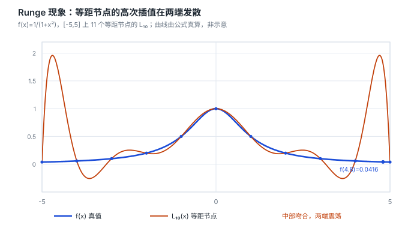
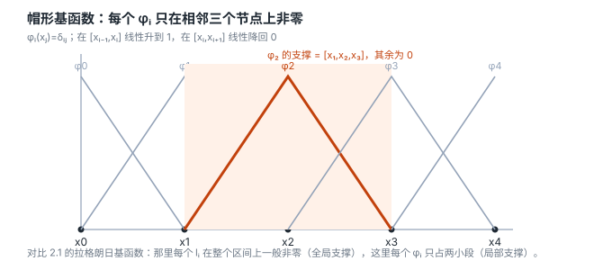
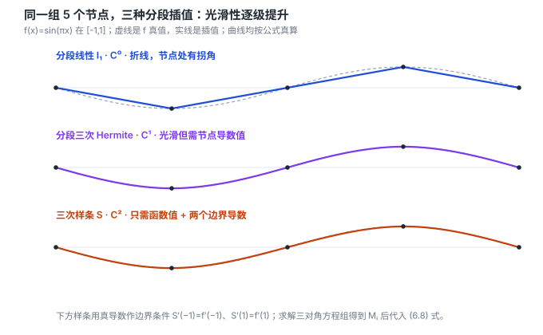

# 2.3 分段插值与三次样条

> **来源说明**：本篇内容**只有手写稿一个来源**——[CM+Opt_插值手写笔记](../原始材料/CM+Opt_插值手写笔记.pdf) 第 4–8 页，2026-11-24 收到，**当天录音没有讲到**。公式、记号与结论均按李庆扬《数值分析》§2.4–§2.6 核对、补齐推导；手写稿中只写了个别特例或省略的步骤，若教材有标准形式则以教材为准，并在文中标明哪些是教材补充。凡手写稿未写、教材也没有展开的内容（如样条的误差界证明），不臆造。
> 手写稿前 3 页与录音同源，对应 [2.2 牛顿插值](2.2-牛顿插值.md)；本篇接其后，是手写稿多出来的部分。逐字稿的对应备查段见 [11.24 逐字稿第八节](../原始材料/课堂录音稿/11.24-拉格朗日与牛顿插值/整理版逐字稿.md)。
> 对应课本：李庆扬《数值分析》§2.4 埃尔米特插值、§2.5 分段低次插值、§2.6 三次样条插值
> [返回总览](../00-索引.md) ｜ [上一篇：2.2 牛顿插值](2.2-牛顿插值.md)

## 目录

- [[#1. 为什么要分段：Runge 现象]]
- [[#2. 分段线性插值]]
  - [[#2.1 定义与基函数]]
  - [[#2.2 帽形基函数的表示]]
  - [[#2.3 误差估计]]
- [[#3. 两点三次 Hermite 插值（准备）]]
  - [[#3.1 插值条件与四个基函数]]
  - [[#3.2 基函数的显式形式]]
- [[#4. 分段三次 Hermite 插值]]
  - [[#4.1 定义与余项]]
  - [[#4.2 与分段线性的比较]]
- [[#5. 三次样条插值]]
  - [[#5.1 定义与自由度计数]]
  - [[#5.2 边界条件：还差两个方程]]
  - [[#5.3 用二阶导数 $M_i$ 表达 $S(x)$]]
  - [[#5.4 三弯矩方程]]
  - [[#5.5 等距节点的特例]]
  - [[#5.6 求解与性质]]

---

## 1. 为什么要分段：Runge 现象

[2.2 §8](2.2-牛顿插值.md) 末尾提到手写稿的那条小结：高次插值有缺点，即 **Runge 现象**。教材 §2.5.1 给出了完整例子：

$$
f(x)=\frac{1}{1+x^2}\quad \text{在}\ [-5,5]\ \text{上各阶导数都存在},
$$

在 $[-5,5]$ 取 $n+1$ 个等距节点做 $n$ 次拉格朗日插值。当 $n$ 增大时，插值多项式 $L_n$ 在区间**中部**逼近得很好，但在**两端**越来越剧烈地震荡——教材表 2-5 列出 $L_n(x_{n-1/2})$ 的误差随 $n$ 增大几乎成倍增长，$n=20$ 时误差约 $40$；$L_{10}(4.8)=1.80438$ 而 $f(4.8)=0.04160$。

**表：误差随次数增长（教材表 2-5，取 $x_{n-1/2}=(x_{n-1}+x_n)/2$，最后两个节点的中点）**

| $n$ | $x_{n-1/2}$ | $f(x_{n-1/2})$ | $L_n(x_{n-1/2})$ | 误差 $R_n$ |
| --- | --- | --- | --- | --- |
| 2 | 2.5 | 0.137931 | 0.759615 | $-0.621684$ |
| 4 | 3.75 | 0.066390 | $-0.356826$ | $0.423216$ |
| 10 | 4.5 | 0.047059 | 1.578721 | $-1.531662$ |
| 20 | 4.75 | 0.042440 | $-39.952449$ | $39.994889$ |

表中数值用重心形式插值公式真算核对过，与教材一致。注意 $x_{n-1/2}$ 本身随 $n$ 往端点靠近，所以「误差变大」里既有次数增加的作用，也有测点更靠边的作用；更直接的对照是固定点 $x=4.8$ 处：$L_2$ 到 $L_{10}$ 的震荡幅度一路上升。

**为什么等距节点会这样。** 记 $\omega_{n+1}(x)=\prod_{i=0}^{n}(x-x_i)$，由 [2.1 §5](2.1-插值问题与拉格朗日插值.md) 的余项公式

$$
R_n(x)=\frac{f^{(n+1)}(\xi)}{(n+1)!}\,\omega_{n+1}(x),
$$

$f^{(n+1)}$ 对 $1/(1+x^2)$ 在端点附近增长很快，而等距节点的 $\omega_{n+1}$ 在区间中部小、两端大——于是余项被「两端大、中部小」的 $\omega_{n+1}$ 放大成两端震荡。Runge 证明了存在常数 $c\approx3.63$：$|x|\le c$ 时 $L_n(x)\to f(x)$，$|x|>c$ 时发散。所以「次数越高越准」是错的。手写稿只点了名字，这条例子、表与 $c$ 的数值按教材补入。

**出路**：不在整个区间上用一个高次多项式，而是把区间切成小区间，每段用**低次**多项式逼近——这就是分段低次插值。光滑性要求进一步提高时，再用三次样条。

## 2. 分段线性插值

### 2.1 定义与基函数

设 $a=x_0<x_1<\cdots<x_n=b$，已知节点函数值 $y_i=f(x_i)$。分段线性插值函数 $I_1(x)$ 满足（教材 §2.5.2）：

1. $I_1\in C[a,b]$（连续）；
2. $I_1(x_k)=y_k$（过节点）；
3. 在每个小区间 $[x_k,x_{k+1}]$ 上是**一次**函数。

几何上就是把相邻节点用直线段连起来，得到一条折线。在 $[x_k,x_{k+1}]$ 上

$$
I_1(x)=y_k\frac{x-x_{k+1}}{x_k-x_{k+1}}
      +y_{k+1}\frac{x-x_k}{x_{k+1}-x_k}.
$$

### 2.2 帽形基函数的表示

手写稿把 $I_1$ 写成一组**分段基函数** $\varphi_i(x)$ 的线性组合：

$$
\varphi(x)=\sum_{i=0}^{n}y_i\varphi_i(x),
$$

其中每个 $\varphi_i$ 满足

$$
\varphi_i(x_j)=\begin{cases}1,& i=j,\\0,& i\ne j,\end{cases}
$$

并且在其他小区间上恒为 $0$。因为 $\varphi_i$ 只在 $x_{i-1},x_i,x_{i+1}$ 三个相邻节点之间不为零、形状像一顶帽子，称为**帽形函数**（分段线性插值的基函数）：

$$
\varphi_i(x)=
\begin{cases}
\dfrac{x-x_{i-1}}{x_i-x_{i-1}}, & x\in[x_{i-1},x_i],\\[6pt]
\dfrac{x-x_{i+1}}{x_i-x_{i+1}}, & x\in[x_i,x_{i+1}],\\[6pt]
0, & \text{其他}.
\end{cases}
$$

端点处的 $\varphi_0,\varphi_n$ 只有一侧非零。手写稿画出了 $i=0,\dots,8$ 的一列帽形函数图，每一个都在自己的节点处取 1、向两侧线性降到 0——这正对应「$\varphi_i$ 在 $x_j$ 取值 $\delta_{ij}$」的性质，与 [2.1](2.1-插值问题与拉格朗日插值.md) 的拉格朗日基函数是同一条思路，只是基函数变成了分段多项式。

**局部支撑是这里的关键差别。** $\varphi_i$ 的支撑（非零区域）只有 $[x_{i-1},x_{i+1}]$ 两小段，而拉格朗日基函数 $l_i$ 在整个区间上一般处处非零。由此得到两个实用结论：

1. **任一点的插值只由邻近两个函数值决定**。在 $[x_k,x_{k+1}]$ 上只有 $\varphi_k,\varphi_{k+1}$ 非零，所以 $I_1(x)=y_k\varphi_k(x)+y_{k+1}\varphi_{k+1}(x)$——这正是 §2.1 的两点直线公式，两种写法是同一件事。
2. **改动一个节点只影响相邻两段**。若 $y_i$ 测量有误需要修正，只有 $[x_{i-1},x_i]$、$[x_i,x_{i+1}]$ 上的曲线会变，其余部分不动；拉格朗日形式下改一个 $y_i$ 会让整条曲线都变（所有 $l_j$ 的系数表达式都牵连）。这是分段插值在局部修改数据时更省事的根源。

**为什么 $\sum y_i\varphi_i$ 一定过节点**：在 $x_k$ 处，只有 $\varphi_k(x_k)=1$，其余 $\varphi_i(x_k)=0$（包括相隔更远的节点，那里 $\varphi_i\equiv0$），于是 $I_1(x_k)=y_k\cdot1=y_k$——不用解任何方程组，插值条件由基函数的 $\delta_{ij}$ 性质自动满足。这与 [2.1 §7.3](2.1-插值问题与拉格朗日插值.md) 拉格朗日插值「系数直接填 $y_i$」是同一条推理。

手写稿在这些帽形函数下面用蓝笔写了一个往差分方程转化的思路（$\Delta f=\sum y_i\Delta\varphi_i$，再去找相邻 $\varphi_i$ 之间的关系）。这部分只有草图式记号、没有完整推导，无法从手写稿唯一确定他想写的系数，本篇不替他补全、也不据此下结论；只记下方向：分段插值函数与一阶差分/线性方程组有联系。

### 2.3 误差估计

由 [2.1 §5](2.1-插值问题与拉格朗日插值.md) 的线性插值余项，在每个小区间 $[x_i,x_{i+1}]$ 上

$$
R(x)=f(x)-I_1(x)=\frac{f''(\xi)}{2!}(x-x_i)(x-x_{i+1}),
$$

记 $h_i=x_{i+1}-x_i$、$M_2$ 为 $|f''|$ 在 $[a,b]$ 上的上界。

**$\frac{h_i^2}{4}$ 是怎么来的**：令 $t=\dfrac{x-x_i}{h_i}\in[0,1]$，则

$$
(x-x_i)(x-x_{i+1})=t h_i\,(t-1)h_i=h_i^2\,t(t-1).
$$

$t(t-1)$ 在 $[0,1]$ 上是开口向上的抛物线，端点取 0、中点 $t=\frac12$ 取最小值 $-\frac14$，故 $\bigl|t(t-1)\bigr|\le\frac14$，从而 $\bigl|(x-x_i)(x-x_{i+1})\bigr|\le\frac{h_i^2}{4}$，等号在小区间中点达到。手写稿写出

$$
|R(x)|\le \frac{M_2}{2!}\cdot\frac{h_i^2}{4}=\frac{M_2h_i^2}{8}.
$$

手写稿那一行写成 $\frac{M}{2}\cdot\frac{h^2}{4}$，正是 $\frac{Mh^2}{8}$——与下一行「在整个 $[a,b]$ 上 $|R(x)|\le M_2h^2/8$」一致（取 $h=\max h_i$）。教材 §2.5.2 的 (5.2) 式给的是一致收敛结论：$h\to0$ 时 $I_1\rightrightarrows f$。

结论：$h\to0$ 时误差按 $h^2$ 下降，所以分段线性插值**一致收敛**到 $f$——不会像 Runge 例子那样越插越坏。

## 3. 两点三次 Hermite 插值（准备）

### 3.1 插值条件与四个基函数

分段线性插值虽然收敛，但导数在节点处有跳跃（折线的拐角）。若节点上还给出**导数值** $y_i'=f'(x_i)$，就能构造导数连续的三次插值。先看相邻两点 $x_k,x_{k+1}$ 上的**两点三次 Hermite 插值** $H_3(x)$，要求

$$
H_3(x_k)=y_k,\quad H_3(x_{k+1})=y_{k+1},\quad
H_3'(x_k)=y_k',\quad H_3'(x_{k+1})=y_{k+1}' .
$$

四个条件、三次多项式四个系数，恰好唯一确定。写成基函数形式（教材 (4.7)）：

$$
H_3(x)=\alpha_k(x)y_k+\alpha_{k+1}(x)y_{k+1}
      +\beta_k(x)y_k'+\beta_{k+1}(x)y_{k+1}',
$$

四个基函数都是三次多项式，各自满足对应的一个条件为 1、其余三个为 0（例如 $\alpha_k(x_k)=1$，而 $\alpha_k(x_{k+1})=\alpha_k'(x_k)=\alpha_k'(x_{k+1})=0$）。

### 3.2 基函数的显式形式

手写稿把四个基函数的条件列成表，但未填完右端的 $\varphi_i$ 表达式；教材 (4.8)–(4.11) 给出了完整结果。记 $h_k=x_{k+1}-x_k$、$t=\dfrac{x-x_k}{h_k}$，则

$$
\alpha_k(x)=(1+2t)(1-t)^2,\qquad
\alpha_{k+1}(x)=(3-2t)t^2,
$$

$$
\beta_k(x)=h_k\,t(1-t)^2,\qquad
\beta_{k+1}(x)=h_k\,t^2(t-1).
$$

**这四个式子是怎么定出来的**（以 $\alpha_k$ 为例，其余三个同理）。整段只做一件事：用四个条件把一个三次多项式唯一确定下来。

- **先锁零点**——$\alpha_k(x_{k+1})=\alpha_k'(x_{k+1})=0$。函数值与一阶导数同时在 $x_{k+1}$ 为零，说明 $x_{k+1}$ 是二重零点，故 $\alpha_k$ 必含因子 $(x-x_{k+1})^2$。在变量 $t=(x-x_k)/h_k$ 下这个因子就是 $(1-t)^2$。剩下的因子只能是一次式 $a+bt$（否则次数超过三）——这个「先找零点」的步骤把四个未知系数压成两个。
- **再用端点值**——$\alpha_k(x_k)=1$，即 $t=0$ 时 $(a+b\cdot0)(1-0)^2=a=1$，所以 $a=1$。
- **最后用导数**——$\alpha_k'(x_k)=0$。对 $(a+bt)(1-t)^2$ 求导并在 $t=0$ 取值：$b(1-t)^2-2(a+bt)(1-t)\big|_{t=0}=b-2a=0$，得 $b=2a=2$。于是 $\alpha_k=(1+2t)(1-t)^2$。

**为什么 $\beta_k$ 带一个因子 $h_k$**：$\beta_k$ 乘的是**导数值** $y_k'$，量纲与 $y_k$ 差一个长度；$\alpha_k$ 无量纲，$\beta_k$ 必须有一次方的量纲才能相加。同样从 $\beta_k(x_{k+1})=\beta_k'(x_{k+1})=0$ 出发得 $\beta_k=c\,t(1-t)^2$，再由 $\beta_k'(x_k)=1$（注意对 $x$ 求导要除以 $h_k$：$\frac{d}{dx}=\frac1{h_k}\frac{d}{dt}$）定出 $c=h_k$。缺了这个因子，$\beta_k$ 对 $x$ 的导数在 $x_k$ 处就不是 1。

**四者的分工**：$\alpha_k,\alpha_{k+1}$ 负责「把两个端点的函数值搬过来」，它们的导数是 0，不会破坏导数插值条件；$\beta_k,\beta_{k+1}$ 负责「把两个端点的导数值搬过来」，它们的函数值是 0，不会破坏函数值条件。这就是把四个条件拆成两组、每组两个基函数的思路。

（板书/手写稿用 $\varphi_i$ 统称这四个基函数，教材用 $\alpha_k,\alpha_{k+1},\beta_k,\beta_{k+1}$，本篇按教材记号。）余项（教材 (4.13)）：

$$
f(x)-H_3(x)=\frac{f^{(4)}(\xi)}{4!}(x-x_k)^2(x-x_{k+1})^2 .
$$

## 4. 分段三次 Hermite 插值

### 4.1 定义与余项

把上面的两点三次 Hermite 插值逐段做，得 $I_3(x)$（教材 §2.5.3）：

1. $I_3\in C^1[a,b]$（函数与一阶导数都连续）；
2. $I_3(x_k)=y_k,\ I_3'(x_k)=y_k'$（函数值与导数值都插值）；
3. 在每个 $[x_k,x_{k+1}]$ 上是三次多项式。

在每段上直接用 §3.2 的 $H_3$ 公式。由余项 (4.13) 得误差估计（教材定理 4）：若 $f\in C^4[a,b]$，则

$$
\max_{a\le x\le b}|f(x)-I_3(x)|
\le \frac{M_4}{4!}\left(\frac{h}{2}\right)^4
=\frac{M_4h^4}{384},\qquad h=\max_k h_k .
$$

### 4.2 与分段线性的比较

分段线性是 $C^0$（只连续），误差 $O(h^2)$；分段三次 Hermite 是 $C^1$（一阶导连续），误差 $O(h^4)$——精度明显改善（教材定理 4 的结论）。代价是**要提供每个节点上的导数值** $y_k'$，信息量比只给函数值多一倍；而且光滑度仍只有一阶导连续。

**同一道题横向对照**。取 $f(x)=\sin(\pi x)$ 在 $[-1,1]$ 上 5 个等距节点（$h=0.5$），三种方法各走一遍；样条用真导数作两端边界条件，曲线按公式真算：

| 方法 | 节点处形态 | 最大误差（真算） | 光滑性 |
| --- | --- | --- | --- |
| 分段线性 | 折线，节点有拐角 | $2.11\times10^{-1}$ | $C^0$ |
| 分段三次 Hermite | 光滑，但曲率在节点可跳 | $1.08\times10^{-2}$ | $C^1$ |
| 三次样条 | 整体光滑 | $2.36\times10^{-2}$ | $C^2$ |

这组数提醒一件事：Hermite 在这道题上误差比样条更小，因为**它多用了一倍信息**（每个节点的真导数），并非样条更差；样条的卖点是在**同样只靠函数值**的前提下达到 $C^2$。误差量级 $O(h^2)$ 与 $O(h^4)$ 是 $h\to0$ 的渐近结论，单个 $h=0.5$ 的算例不用来判定谁渐近更优。

手写稿也写了「信息太多、光滑度不高」这两条，正是它引出样条的理由：

> 要求给出节点上的导数值，所要提供的信息太多，其光滑度也不高（只有一阶导数连续）——改进这种插值就导致三次样条插值。

## 5. 三次样条插值

### 5.1 定义与自由度计数

**定义**（教材定义 3）：$S(x)\in C^2[a,b]$，且在每个小区间 $[x_j,x_{j+1}]$ 上是三次多项式，其中 $a=x_0<x_1<\cdots<x_n=b$。若还满足插值条件

$$
S(x_j)=y_j=f(x_j),\qquad j=0,1,\dots,n,
$$

则 $S$ 称为**三次样条插值函数**。物理背景（手写稿与教材都提到）：早期制图用弹性细木条（样条）固定在样点上，让它自由弯曲后沿木条画线；木条在样点处二阶光滑，正是 $C^2$ 的直观来源。

**自由度计数**（手写稿红字「待补充完整」处，教材 §2.6.1 写全）：

- 每个小区间上三次多项式有 4 个系数，$n$ 个区间共 $4n$ 个待定量；
- 内部节点 $x_1,\dots,x_{n-1}$ 处要求 $S,S',S''$ 都连续，给出 $3(n-1)$ 个条件；
- 插值条件 $S(x_j)=y_j$ 给出 $n+1$ 个条件；

合计 $3(n-1)+(n+1)=4n-2$ 个条件，**还差 2 个**——这就是边界条件要补的部分。

### 5.2 边界条件：还差两个方程

手写稿列了三类（教材 (6.3)–(6.5) 同）：

1. **给定两端二阶导**：$S''(x_0)=y_0''$、$S''(x_n)=y_n''$。特例 $S''(x_0)=S''(x_n)=0$ 称为**自然边界条件**。
2. **给定两端一阶导**：$S'(x_0)=y_0'$、$S'(x_n)=y_n'$。
3. **周期性条件**：$S'(x_0)=S'(x_n)$、$S''(x_0)=S''(x_n)$（用于周期函数）。

手写稿末尾的例子取的是第 1 类（$M_0=y_0''$、$M_n=y_n''$）。

### 5.3 用二阶导数 $M_i$ 表达 $S(x)$

记

$$
M_j=S''(x_j),\qquad h_j=x_{j+1}-x_j .
$$

因为 $S$ 在每个区间上是三次多项式，$S''$ 在该区间上是**一次**函数，可用两端值线性插值：

$$
S''(x)=M_j\frac{x_{j+1}-x}{h_j}+M_{j+1}\frac{x-x_j}{h_j},
\qquad x\in[x_j,x_{j+1}].
$$

对它积分两次，并用 $S(x_j)=y_j$、$S(x_{j+1})=y_{j+1}$ 定出两个积分常数，得（教材 (6.8)）

$$
\begin{aligned}
S(x)=&\ \frac{M_j}{6h_j}(x_{j+1}-x)^3
+\frac{M_{j+1}}{6h_j}(x-x_j)^3\\
&+\left(\frac{y_j}{h_j}-\frac{M_jh_j}{6}\right)(x_{j+1}-x)
+\left(\frac{y_{j+1}}{h_j}-\frac{M_{j+1}h_j}{6}\right)(x-x_j).
\end{aligned}
$$

**两次积分的来龙去脉**（这个式子容易记混，看一遍推导就不再靠背）。记 $s=x-x_j$，则 $x_{j+1}-x=h_j-s$，$S''$ 是 $s$ 的线性函数：

$$
S''(x)=M_j+\frac{M_{j+1}-M_j}{h_j}\,s .
$$

- **先积一次**：$S'(x)=A+M_js+\dfrac{M_{j+1}-M_j}{2h_j}s^2$，$A$ 是积分常数（也就是 $S'(x_j)$）。
- **再积一次**：$S(x)=B+As+\dfrac{M_j}{2}s^2+\dfrac{M_{j+1}-M_j}{6h_j}s^3$，$B=S(x_j)$。
- **端点定值**：$s=0$ 时 $S=y_j$，故 $B=y_j$；$s=h_j$ 时 $S=y_{j+1}$，解出 $A=\dfrac{y_{j+1}-y_j}{h_j}-\dfrac{h_j}{6}(2M_j+M_{j+1})$。

把 $A$、$B$ 代回并按 $(h_j-s)$ 与 $s$ 重新整理，就得到上面那个对称形式。**「对称」不是巧合**：它把 $x_j$ 与 $x_{j+1}$ 放在完全等价的地位，交换 $j\leftrightarrow j+1$ 时式子形式不变，检验时很好用。

手写稿第 7 页写的就是这个式子。要注意：$M_j$ 此时还是未知量，共 $n+1$ 个，要用导数连续条件建立方程组来定——这正是 §5.4 要做的事。

### 5.4 三弯矩方程

整段只做一件事：用**一阶导数在内部节点连续**这一个条件，把未知量 $M_0,\dots,M_n$ 串成线性方程组。

**先求导**——对 §5.3 的 $S(x)$ 求导：

$$
S'(x)=-\frac{M_j}{2h_j}(x_{j+1}-x)^2
+\frac{M_{j+1}}{2h_j}(x-x_j)^2
+\frac{y_{j+1}-y_j}{h_j}-\frac{h_j}{6}(M_{j+1}-M_j).
$$

**再取端点**——在 $x=x_j$ 处，上式给出区间 $[x_j,x_{j+1}]$ 的**左端**导数：

$$
S'(x_j+0)=-\frac{h_j}{6}(2M_j+M_{j+1})+\frac{y_{j+1}-y_j}{h_j}.
$$

把公式中的区间换成 $[x_{j-1},x_j]$、令 $x=x_j$，得同一节点的**右端**导数：

$$
S'(x_j-0)=\frac{h_{j-1}}{6}(2M_j+M_{j-1})+\frac{y_j-y_{j-1}}{h_{j-1}}.
$$

这里两个式子里的 $M_j$ 是同一个（$S''$ 连续已自动满足），所以只剩一阶导连续这一个条件要加。

**令左右相等**——$S'(x_j+0)=S'(x_j-0)$，移项：

$$
\frac{h_{j-1}}{6}M_{j-1}+\frac{h_{j-1}+h_j}{3}M_j+\frac{h_j}{6}M_{j+1}
=\frac{y_{j+1}-y_j}{h_j}-\frac{y_j-y_{j-1}}{h_{j-1}},
\qquad j=1,2,\dots,n-1 .
$$

这就是手写稿第 7 页红字「为保证一阶导函数连续」下面推的那一条。共 $n-1$ 个方程、$n+1$ 个未知量，加上 §5.2 的两个边界条件恰好封闭。

**教材的归一化写法**（(6.10)）：

$$
\mu_j M_{j-1}+2M_j+\lambda_j M_{j+1}=d_j,
$$

$$
\lambda_j=\frac{h_j}{h_{j-1}+h_j},\quad
\mu_j=\frac{h_{j-1}}{h_{j-1}+h_j}=1-\lambda_j,\quad
d_j=6f[x_{j-1},x_j,x_{j+1}] .
$$

两种写法的换算要说清楚，不能含混地说「等价」：把上式两边同乘 $\dfrac{h_{j-1}+h_j}{6}$，左边正好变成手写稿的展开式左边；右边变成

$$
\frac{h_{j-1}+h_j}{6}\,d_j
=(h_{j-1}+h_j)f[x_{j-1},x_j,x_{j+1}]
=\frac{y_{j+1}-y_j}{h_j}-\frac{y_j-y_{j-1}}{h_{j-1}},
$$

最后一步用了二阶差商展开 $f[x_{j-1},x_j,x_{j+1}]=\dfrac{1}{h_{j-1}+h_j}\left(\dfrac{y_{j+1}-y_j}{h_j}-\dfrac{y_j-y_{j-1}}{h_{j-1}}\right)$。**差的那一个因子 $h_{j-1}+h_j$ 来自归一化**：教材把 $M_j$ 的系数标准化的 2，手写稿保留原始的 $\frac{h_{j-1}+h_j}{3}$。

**算例核对**（教材例 7）：节点 $x=27.7,28,29,30$、$y=4.1,4.3,4.1,3.0$，边界 $S'(27.7)=3.0$、$S'(30)=-4.0$。教材给 $d_2=6f[x_1,x_2,x_3]=-2.70000$；按上式算 $f[x_1,x_2,x_3]=\bigl(\frac{3.0-4.1}{1}-\frac{4.1-4.3}{1}\bigr)/(30-28)=-0.45$，乘 6 得 $-2.7$，一致。解三对角方程组得

$$
M=(-23.53135,\ 0.39604,\ 0.82970,\ -9.11485)^T ,
$$

回代内部方程 $j=2$ 检验：左边 $=-0.9$，右边 $=-0.9$（数值真算；$j=1$ 处同为 $-0.8667$）。端点方程随边界条件而变（教材 (6.12)–(6.15)）：第一类给 $M_0=y_0''$、$M_n=y_n''$；第二类给 $M_0,M_n$ 与一阶导的关系；第三类给周期条件。

### 5.5 等距节点的特例

若节点等距，$h_j=h_{j-1}=h$，则 $\mu_j=\lambda_j=\frac12$，内部方程化为

$$
\frac16 M_{j-1}+\frac23 M_j+\frac16 M_{j+1}
=\frac{1}{h^2}(y_{j+1}-2y_j+y_{j-1}).
$$

手写稿第 8 页把它与两个端点方程合写成矩阵形式：

$$
\begin{pmatrix}
2 & 1 & & & \\
\frac12 & 2 & \frac12 & & \\
& \ddots & \ddots & \ddots & \\
& & \frac12 & 2 & \frac12 \\
& & & 1 & 2
\end{pmatrix}
\begin{pmatrix}M_0\\M_1\\\vdots\\M_{n-1}\\M_n\end{pmatrix}
=
\begin{pmatrix}
\frac{3}{h^2}(y_1-2y_0+y_{-1})\\
\frac{3}{h^2}(y_2-2y_1+y_0)\\
\vdots
\end{pmatrix}.
$$

注意手写稿首行右端写了 $y_1-2y_0+y_{-1}$——这需要节点向左延拓一个点，属于手写稿按某个具体边界条件写下的形式；**一般情形应以 §5.4 的方程组加 §5.2 的边界条件为准**，此处不把特例当成通式。

### 5.6 求解与性质

教材把 (6.10) 连同端点方程写成三对角线性方程组（(6.13)、(6.16)），称为**三弯矩方程**——$M_j$ 在力学上解释为细梁在 $x_j$ 截面处的弯矩。以第一类边界条件为例，矩阵形态是

$$
\begin{pmatrix}
2 & \lambda_0 & & & \\
\mu_1 & 2 & \lambda_1 & & \\
& \ddots & \ddots & \ddots & \\
& & \mu_{n-1} & 2 & \lambda_{n-1} \\
& & & \mu_n & 2
\end{pmatrix}
\begin{pmatrix}M_0\\M_1\\\vdots\\M_{n-1}\\M_n\end{pmatrix}
=\begin{pmatrix}d_0\\d_1\\\vdots\\d_{n-1}\\d_n\end{pmatrix}.
$$

只有主对角与相邻两条副对角非零——这就是 §5.5 手写稿矩阵的一般形式。

**为什么一定有唯一解**：内部行上 $\lambda_j+\mu_j=1$ 且 $\mu_j,\lambda_j\ge0$，主对角元 $2$ 严格大于副对角元绝对值之和 $\mu_j+\lambda_j=1$；端点行同样是 $2>|\lambda_0|$、$2>|\mu_n|$。所以矩阵**严格对角占优**，由 [5.2 §4](../第5章-解线性方程组的直接法/5.2-高斯消去法.md) 的结论它非奇异，方程组有唯一解，且直接用 Gauss 消去不必换行。

**为什么用追赶法**：三对角矩阵只在三条对角线上有非零元，通用 $O(n^3)$ 的 LU 分解在这里会白算大量零；[5.3 追赶法](../第5章-解线性方程组的直接法/5.3-矩阵三角分解法.md) 利用带状结构把成本降到 $O(n)$。解出 $M_j$ 后代回 §5.3 的 $S(x)$ 表达式，三次样条就完全确定了——**整条曲线只由 $n+1$ 个数 $M_0,\dots,M_n$ 决定**。

另一门课的 [数值分析/04 §7](../../数值分析/04-插值法.md) 还列了样条的**最小曲率性质**（自然三次样条使 $\int(S'')^2dx$ 最小）与收敛性（$f^{(4)}$ 连续时 $S,S',S'',S'''$ 分别一致收敛到 $f$ 的各阶导数）。这些结论**不在手写稿里**，是那一门课的内容，此处只给出处，不并入手写稿这份材料的结论。

## 6. 三种方法的分工

| 方法 | 光滑性 | 每节点所需信息 | 误差量级 |
| --- | --- | --- | --- |
| 分段线性插值 | $C^0$ | 函数值 | $O(h^2)$ |
| 分段三次 Hermite | $C^1$ | 函数值 + 一阶导 | $O(h^4)$ |
| 三次样条插值 | $C^2$ | 只需函数值（另加两个边界条件） | 见教材 §2.6.3 |

三次样条的优势正在最后一行：它只要求函数值，却给出 $C^2$ 的光滑度——靠的是把内部节点的一、二阶导连续性转化为关于 $M_j$ 的三对角方程组，而不是预先给出导数值。这解决了分段 Hermite 插值「要的信息太多、光滑度又不高」的毛病。

**本篇状态**：这些内容当天只有手写稿、无录音；等课上正式讲到 §2.4–§2.6 时，再把逐字稿里的讲解与本篇核对、补充动机细节。样条的误差界与收敛性（教材 §2.6.3）本篇未展开，待后续课程。
