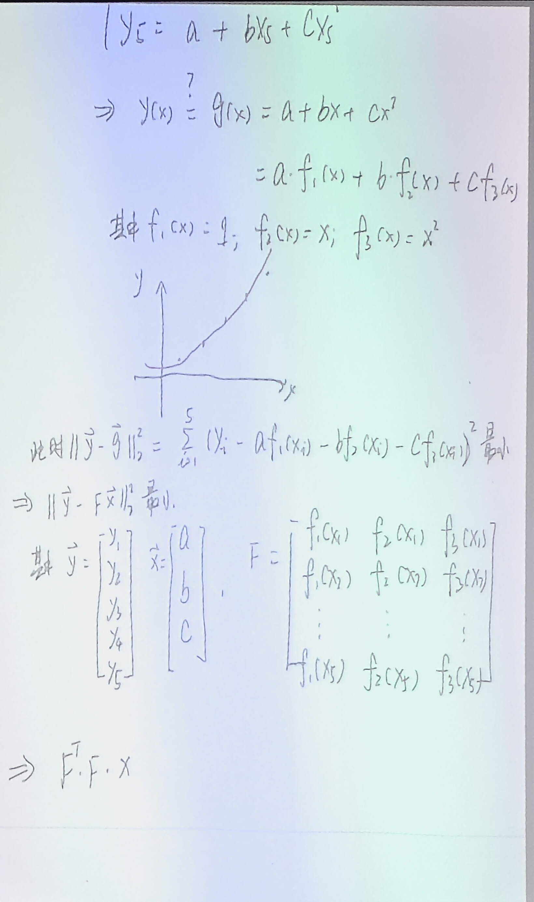
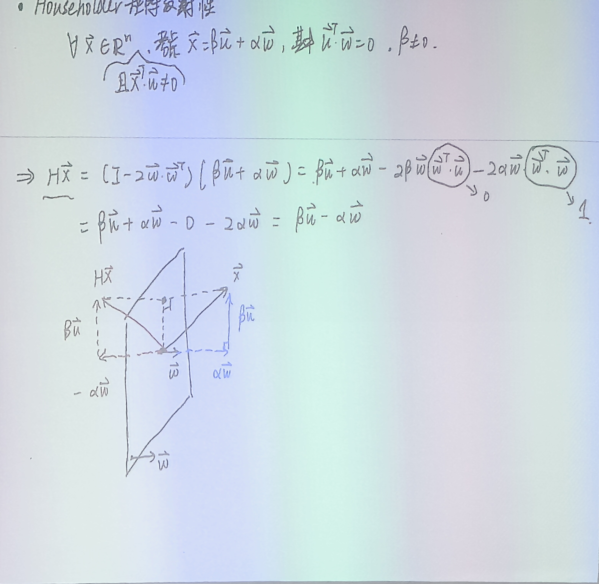
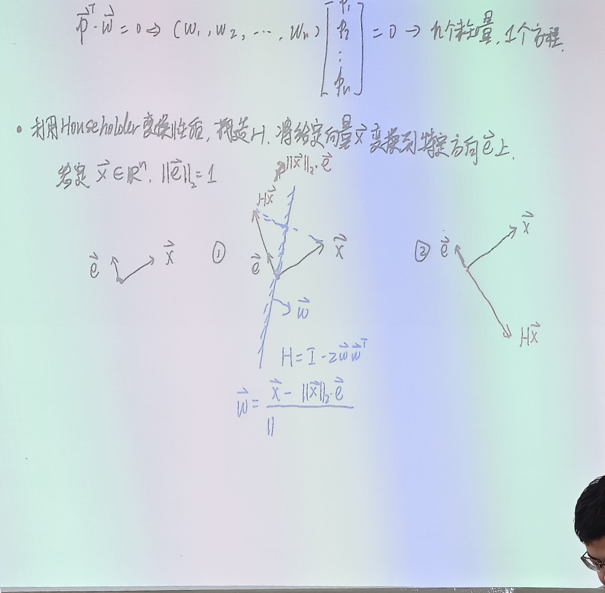
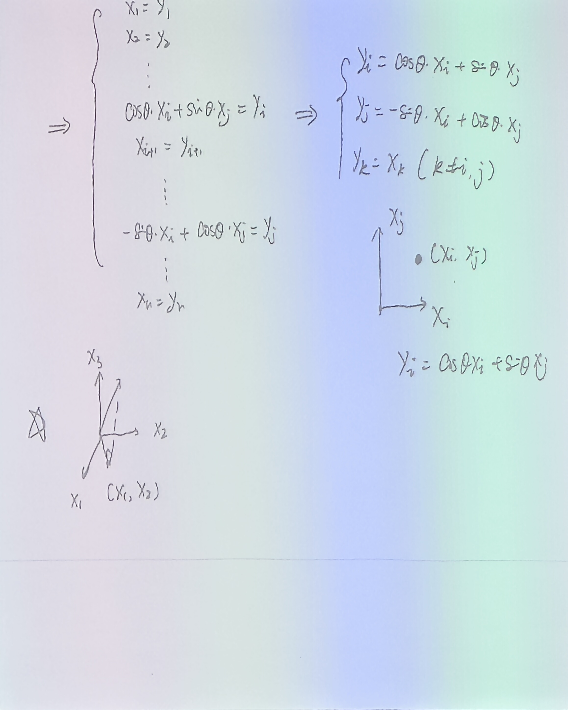

# 3.1 最小二乘问题、法方程与正交变换

> 上课：10.14 录音整理｜对应课本：徐树方《数值线性代数》第三章 §3.1–§3.4

## 1. 最小二乘问题的两种写法

给定 $A\in\mathbb R^{m\times n}$、$b\in\mathbb R^m$，最小二乘问题是

$$
\min_{x\in\mathbb R^n}\ \|Ax-b\|_2
$$

未知量是 $x$，通过改变 $x$ 使 $Ax$ 与 $b$ 的差距最小。把 $A$ 按列分块 $A=[a_1,a_2,\dots,a_n]$，向量写法就是

$$
b-\sum_{i=1}^n x_i a_i
$$

也就是用列向量 $a_i$ 的线性组合去逼近 $b$。

同一个问题还可以写成函数形式。把"目标向量 $b$"换成"目标函数 $y(x)$"，把"列向量 $a_i$"换成"基函数 $f_i(x)$"，就得到

$$
y(x)-\sum_{i=1}^n \beta_i f_i(x)
$$

这两种写法完全等价：向量写法里的 $a_i$ 在采样点 $x_j$ 处取值后就是函数写法里的 $f_i(x_j)$，$x_i$ 就是组合系数 $\beta_i$。几何上都是一件事——在由 $\{a_i\}$（或 $\{f_i\}$）张成的子空间里找一个最接近目标的点，也就是把目标投影到这个子空间上。

当 $m>n$ 且 $A$ 列满秩时，$Ax=b$ 通常不相容（方程个数多于未知量个数），不存在精确解，只能找"最不差"的解。这正是最小二乘问题存在的意义。

## 2. 数据拟合例子

给定 5 个数据点：

| $i$ | 1 | 2 | 3 | 4 | 5 |
| --- | --- | --- | --- | --- | --- |
| $x_i$ | 0 | 1 | 2 | 3 | 4 |
| $y_i$ | 4 | 7 | 12 | 39 | 64 |

想用二次函数 $g(x)=a+bx+cx^2$ 拟合这些点。把每个点代入，得到 5 个方程、3 个未知量的方程组：

$$
\begin{cases}
y_1 = a+bx_1+cx_1^2\\
y_2 = a+bx_2+cx_2^2\\
\quad\vdots\\
y_5 = a+bx_5+cx_5^2
\end{cases}
$$

这是一个不相容方程组——5 个点不可能恰好落在一条二次曲线上。于是问题变成：$y(x)$ 能不能"尽量等于"$g(x)$？那个等号要打个问号。

把 $g(x)$ 写成三个基函数的线性组合：

$$
g(x)=a f_1(x)+b f_2(x)+c f_3(x),\qquad f_1(x)=1,\ f_2(x)=x,\ f_3(x)=x^2
$$

要让拟合误差最小，就是最小化

$$
\sum_{i=1}^5\bigl(y_i-a f_1(x_i)-b f_2(x_i)-c f_3(x_i)\bigr)^2
$$

写成矩阵形式。令

$$
\vec y=\begin{bmatrix}y_1\\y_2\\y_3\\y_4\\y_5\end{bmatrix},\qquad
\vec x=\begin{bmatrix}a\\b\\c\end{bmatrix},\qquad
F=\begin{bmatrix}
f_1(x_1)&f_2(x_1)&f_3(x_1)\\
f_1(x_2)&f_2(x_2)&f_3(x_2)\\
\vdots&\vdots&\vdots\\
f_1(x_5)&f_2(x_5)&f_3(x_5)
\end{bmatrix}
=\begin{bmatrix}
1&x_1&x_1^2\\
1&x_2&x_2^2\\
\vdots&\vdots&\vdots\\
1&x_5&x_5^2
\end{bmatrix}
$$

$F$ 是 5×3 的 Vandermonde 型矩阵。问题就变成

$$
\min_{\vec x}\ \|\vec y-F\vec x\|_2^2
$$

数据拟合问题被还原成了一个不相容线性方程组的最小二乘问题。

**线性拟合 vs 非线性拟合**：虽然模型本身是二次曲线（含 $x^2$），但待求的参数 $a,b,c$ 在表达式里是线性的（没有交叉项、没有指数），所以仍然是线性最小二乘问题。基函数可以任意复杂——指数项、对数项、高次多项式都无所谓，只要对系数是线性的就行。反过来，如果模型是 $y=a e^{-bx}$，$a$ 和 $b$ 耦合在指数上，就不是直接的线性问题；可以两边取对数把它线性化：$\ln y=\ln a-bx$，令 $A=\ln a$、$B=-b$，就变成 $A+Bx$ 的线性拟合。

## 3. 法方程

对 $\|Ax-b\|_2^2$ 关于 $x$ 求导并令其为零，得到

$$
A^T A x = A^T b
$$

这就是**法方程**（normal equation）。对上面的拟合例子，就是 $F^TF\vec x=F^T\vec y$。

几何上，法方程说的是残差 $r=Ax-b$ 与 $A$ 的每一列都正交：

$$
a_i^T(Ax-b)=0,\qquad i=1,\dots,n
$$

即残差垂直于整个列空间 $\operatorname{col}(A)$。这正是"投影到列空间"的代数表达——$Ax$ 是 $b$ 在列空间上的投影，$b-Ax$ 是垂直于列空间的那部分。

法方程的求解直接回到第五章和第六章的工具：当 $A$ 列满秩时，$A^TA$ 是 $n\times n$ 对称正定矩阵，可以用 Cholesky 分解（直接法）或共轭梯度法（迭代法）求解。但要注意一个关键问题：

$$
\kappa_2(A^TA)=\kappa_2(A)^2
$$

条件数被平方放大。当 $A$ 本身接近病态时，$A^TA$ 会严重病态，法方程数值不稳定。这正是后面要引入 QR 分解等正交方法的动机——正交变换不改变向量长度，可以避开这个平方。

## 4. 初等矩阵的一般形式

后面要用到的 Gauss 变换、Householder 变换、Givens 变换都可以写成同一个形式：

$$
E(u,v,\sigma)=I-\sigma u v^T
$$

其中 $u,v$ 是列向量，$\sigma$ 是标量。$uv^T$ 是秩一矩阵（每一列都是 $u$ 乘 $v$ 的某个分量，所有列成比例），所以 $E$ 是"单位阵的一个秩一修正"。

**Gauss 变换**（第五章 LU 分解里用过）：取 $\sigma=-1$，

$$
u^T=[0,\dots,0,l_{j+1,j},l_{j+2,j},\dots,l_{nj}],\qquad v=e_j
$$

则 $L_j=I+uv^T$，就是第 $j$ 列对角线以下填入乘子 $l_{ij}$ 的下三角单位阵。

后面要讲的 Householder 变换是这个一般形式的另一个特例。

## 5. Householder 变换的定义

取 $\sigma=2/(v^Tv)$、$u=v$（$v$ 任意非零向量），代入一般形式：

$$
H=I-\frac{2}{v^Tv}vv^T
$$

令

$$
\omega=\frac{v}{\|v\|_2}=\frac{v}{\sqrt{v^Tv}}
$$

即把 $v$ 单位化，就得到标准形式

$$
H=I-2\omega\omega^T,\qquad \omega^T\omega=1
$$

$v$ 称为 Householder 向量。$H$ 仍然是单位阵的秩一修正，只不过修正部分是两个相同向量的外积 $\omega\omega^T$。

## 6. Householder 矩阵的五条性质

**定理**：设 $H=I-2\omega\omega^T\in\mathbb R^{n\times n}$，$\|\omega\|_2=1$，则

1. $H^T=H$（对称）；
2. $H^TH=I$（正交）；
3. $H^2=I$（对合）；
4. $\det H=-1$；
5. $H$ 的特征值只有 $1$ 和 $-1$，其中 $1$ 的代数重数为 $n-1$。

**证明 (1)**：

$$
H^T=(I-2\omega\omega^T)^T=I-2(\omega\omega^T)^T=I-2\omega\omega^T=H
$$

**证明 (2)(3)**：直接乘开，利用 $\omega^T\omega=1$：

$$
H^2=(I-2\omega\omega^T)(I-2\omega\omega^T)
=I-4\omega\omega^T+4\omega\omega^T\omega\omega^T
=I-4\omega\omega^T+4\omega(\omega^T\omega)\omega^T
=I-4\omega\omega^T+4\omega\omega^T=I
$$

由 (1) $H^T=H$，所以 $H^TH=H^2=I$。(2)(3) 同时成立。

性质 (4)(5) 暂时放一放，下一节用反射性来统一推出。

## 7. 反射性（镜面对称）

对任意 $x\in\mathbb R^n$（只要 $x^T\omega\neq 0$），总能把 $x$ 分解成平行于镜面和垂直于镜面的两部分：

$$
x=\beta u+\alpha\omega,\qquad u^T\omega=0,\ \beta\neq 0
$$

其中 $\omega$ 是镜面法向，$u$ 在镜面内。代入 $H$：

$$
Hx=(I-2\omega\omega^T)(\beta u+\alpha\omega)
=\beta u+\alpha\omega-2\beta\omega(\omega^T u)-2\alpha\omega(\omega^T\omega)
$$

因为 $\omega^Tu=0$（正交）、$\omega^T\omega=1$（单位向量），所以

$$
Hx=\beta u-\alpha\omega
$$

也就是说：**平行于镜面的分量 $\beta u$ 保持不变，垂直于镜面的分量 $\alpha\omega$ 反了一个符号**。把 $x$ 和 $Hx$ 的终点连起来，连线与镜面垂直，两个终点关于镜面对称。$\omega$ 决定了一面镜子，$H$ 就是这面镜子的反射变换。

## 8. 用反射性确定特征值

特征方程是 $Hp=\lambda p$。从反射性看，$Hp$ 与 $p$ 关于镜面对称；从特征值定义看，$Hp$ 又必须与 $p$ 在同一条直线上。一个向量既要镜像对称、又要共线，只有两种可能：

**情况一：$p\parallel\omega$（$p$ 沿镜面法向）。** 反射后法向分量反向，切向分量为零，所以

$$
Hp=-p,\qquad \lambda=-1
$$

特征向量就是 $\omega$ 方向，只有一维。

**情况二：$p^T\omega=0$（$p$ 在镜面内）。** 没有垂直于镜面的分量，反射后不变，

$$
Hp=p,\qquad \lambda=1
$$

特征向量可以是镜面（$\omega$ 的正交补空间）内的任意向量。这个正交补空间的维数是多少？条件 $p^T\omega=0$ 展开是

$$
\omega_1p_1+\omega_2p_2+\cdots+\omega_np_n=0
$$

$n$ 个未知量、1 个方程，解空间维数为 $n-1$。所以特征值 $1$ 的代数重数是 $n-1$，特征值 $-1$ 的重数是 $1$。

由此立刻得到性质 (4)：

$$
\det H=(-1)^1\cdot 1^{n-1}=-1
$$

## 9. Householder 定向：把向量变到指定方向

Householder 变换最重要的用途是：给定任意向量 $x$ 和一个单位向量 $e$（$\|e\|_2=1$），构造一个 $H$ 使得 $Hx$ 与 $e$ 平行。

因为 $H$ 保长（下一节证明），$\|Hx\|_2=\|x\|_2$，所以 $Hx$ 只有两种可能：

$$
Hx=\|x\|_2 e\quad\text{（同向）},\qquad\text{或}\qquad Hx=-\|x\|_2 e\quad\text{（反向）}
$$

根据反射性，$x$ 和 $Hx$ 关于镜面对称，镜面法向 $\omega$ 沿着 $x$ 与 $Hx$ 的差方向。

**同向**（$Hx=\|x\|_2e$）：

$$
\omega=\frac{x-\|x\|_2 e}{\|x-\|x\|_2 e\|_2},\qquad H=I-2\omega\omega^T
$$

**反向**（$Hx=-\|x\|_2e$）：

$$
\omega=\frac{x+\|x\|_2 e}{\|x+\|x\|_2 e\|_2},\qquad H=I-2\omega\omega^T
$$

做法很直接：把变换前后两个向量一减（或一加），单位化就得到 $\omega$。实际计算中通常取反向（$Hx=-\|x\|_2e$），因为 $x+\|x\|_2e$ 在 $x$ 与 $e$ 接近时不会消去（避免两个相近向量相减导致的精度损失）。

这种构造不唯一——$H$ 有 $n^2$ 个元素但只受 $n$ 个约束，但我们只需要一个能完成定向的 $H$，够用就行。

## 10. Givens 变换

Givens 变换是另一种正交变换，它在 $x_i$-$x_j$ 平面内做旋转，其余分量不动。矩阵形式为

$$
G=I+(\cos\theta-1)(e_ie_i^T+e_je_j^T)+\sin\theta(e_ie_j^T-e_je_i^T)
$$

其中 $e_i,e_j$ 是第 $i$、$j$ 个标准单位向量。

看一下每个外积矩阵落在哪里：$e_ie_i^T$ 只有 $(i,i)$ 位置是 1，$e_je_j^T$ 只有 $(j,j)$ 位置是 1，$e_ie_j^T$ 只有 $(i,j)$ 位置是 1，$e_je_i^T$ 只有 $(j,i)$ 位置是 1。所以 $G$ 本质上是单位阵，只有 4 个元素被修改：

- $(i,i)$ 和 $(j,j)$：从 1 变成 $\cos\theta$；
- $(i,j)$：变成 $\sin\theta$；
- $(j,i)$：变成 $-\sin\theta$。

作用到向量 $x$ 上，得到 $y=Gx$：

$$
y_i=\cos\theta\,x_i+\sin\theta\,x_j
$$

$$
y_j=-\sin\theta\,x_i+\cos\theta\,x_j
$$

$$
y_k=x_k\qquad(k\neq i,j)
$$

几何上就是在 $x_i$-$x_j$ 这个二维平面内把向量转了 $\theta$ 角，其他坐标轴一概不动。

## 11. Givens 消去一个分量

如果想让 $y_j=0$，从 $y_j=-\sin\theta\,x_i+\cos\theta\,x_j=0$ 可以解出

$$
\tan\theta=\frac{x_j}{x_i}
$$

取

$$
\cos\theta=\frac{x_i}{\sqrt{x_i^2+x_j^2}},\qquad
\sin\theta=\frac{x_j}{\sqrt{x_i^2+x_j^2}}
$$

代入 $y_i$：

$$
y_i=\frac{x_i}{\sqrt{x_i^2+x_j^2}}x_i+\frac{x_j}{\sqrt{x_i^2+x_j^2}}x_j
=\frac{x_i^2+x_j^2}{\sqrt{x_i^2+x_j^2}}=\sqrt{x_i^2+x_j^2}
$$

所以

$$
y_i=\sqrt{x_i^2+x_j^2},\qquad y_j=0
$$

一次旋转就把第 $j$ 个分量消成零，第 $i$ 个分量变成这两个分量的合模长。

## 12. 两类变换对比：保长性与适用场景

Householder 和 Givens 都是正交变换，都保长。以 Householder 为例证明：

$$
\|Hx\|_2^2=(Hx)^T(Hx)=x^TH^THx=x^TIx=x^Tx=\|x\|_2^2
$$

Givens 同理（$G^TG=I$ 可直接展开验证）。

两类变换的取舍：

| 对比项 | Householder | Givens |
| --- | --- | --- |
| 保长性 | 正交保长 | 正交保长 |
| 一次消零分量数 | 一次消 $n-1$ 个（把整个向量变到 $e_1$ 方向） | 一次消 1 个 |
| 存储 | 需存 $\omega$（$n$ 个数）或构造 $H$ | 只需记 $\theta,i,j$（3 个数），矩阵本身只有 4 个非对角元 |
| 适用场景 | 批量消元、QR 分解 | 稀疏矩阵、逐元素消零、特征值计算 |

Householder 像"大砍刀"，一次砍掉一大片；Givens 像"手术刀"，一次只切一个，但省内存、灵活。后面学矩阵特征值计算时还会见到 Givens 的其他用途。

## 13. QR 分解的定义

给定 $A\in\mathbb R^{m\times n}$（$m\ge n$），如果能找到列正交规范矩阵 $Q\in\mathbb R^{m\times n}$（即 $Q^TQ=I_n$，每列单位长度、列间两两正交）和上三角矩阵 $R\in\mathbb R^{n\times n}$，使得

$$
A=QR
$$

则称这是 $A$ 的 QR 分解。

把 $Q$ 按列分块 $Q=[q_1,q_2,\dots,q_n]$，$R$ 是上三角阵。按列计算 $A=QR$：

$$
a_1=r_{11}q_1
$$

$$
a_2=r_{12}q_1+r_{22}q_2
$$

$$
a_3=r_{13}q_1+r_{23}q_2+r_{33}q_3
$$

一般地，

$$
a_i=\sum_{k=1}^i r_{ki}q_k
$$

$A$ 的第 $i$ 列只由前 $i$ 个正交向量 $q_1,\dots,q_i$ 线性组合而成——这正是上三角结构带来的。

**唯一性**：如果 $A$ 列满秩，则 $R$ 的对角元全为正，且 $Q,R$ 唯一。

## 14. Gram–Schmidt 正交化实现 QR

QR 分解的第一种实现就是经典的 Gram–Schmidt 正交化。

**第 1 步**：由 $a_1=r_{11}q_1$，

$$
r_{11}=\|a_1\|_2,\qquad q_1=\frac{a_1}{r_{11}}
$$

**第 2 步**：由 $a_2=r_{12}q_1+r_{22}q_2$，两边左乘 $q_1^T$，利用 $q_1^Tq_2=0$，

$$
r_{12}=q_1^Ta_2
$$

从 $a_2$ 中减掉在 $q_1$ 方向的投影，剩下的就是 $r_{22}q_2$：

$$
r_{22}=\|a_2-r_{12}q_1\|_2,\qquad q_2=\frac{a_2-r_{12}q_1}{r_{22}}
$$

**第 3 步**：同理，

$$
r_{13}=q_1^Ta_3,\qquad r_{23}=q_2^Ta_3
$$

$$
r_{33}=\|a_3-r_{13}q_1-r_{23}q_2\|_2,\qquad
q_3=\frac{a_3-r_{13}q_1-r_{23}q_2}{r_{33}}
$$

**第 $i$ 步**（一般式）：前 $i-1$ 个 $q$ 已知，先算投影系数

$$
r_{ji}=q_j^Ta_i,\qquad j=1,\dots,i-1
$$

再减去所有投影、取范数、单位化：

$$
r_{ii}=\left\|a_i-\sum_{k=1}^{i-1}r_{ki}q_k\right\|_2
$$

$$
q_i=\frac{a_i-\sum_{k=1}^{i-1}r_{ki}q_k}{r_{ii}}
$$

这就是 Gram–Schmidt 的核心：把新一列 $a_i$ 对前面已正交的各列做投影，把投影分量全部减掉，剩下的自然与前面全部正交，再单位化即可。

经典 Gram–Schmidt 在数值上有正交性随计算逐步丢失的问题，改进的 Gram–Schmidt（Modified Gram–Schmidt）以及基于 Householder 变换、Givens 旋转的 QR 分解实现，留到下一次课。QR 分解一旦做好，解最小二乘问题就变得非常直接：$Ax=b$ 即 $QRx=b$，两边左乘 $Q^T$ 得上三角系统 $Rx=Q^Tb$，回代即可，而且全程正交变换保长，不会出现法方程那种条件数平方放大的问题。
