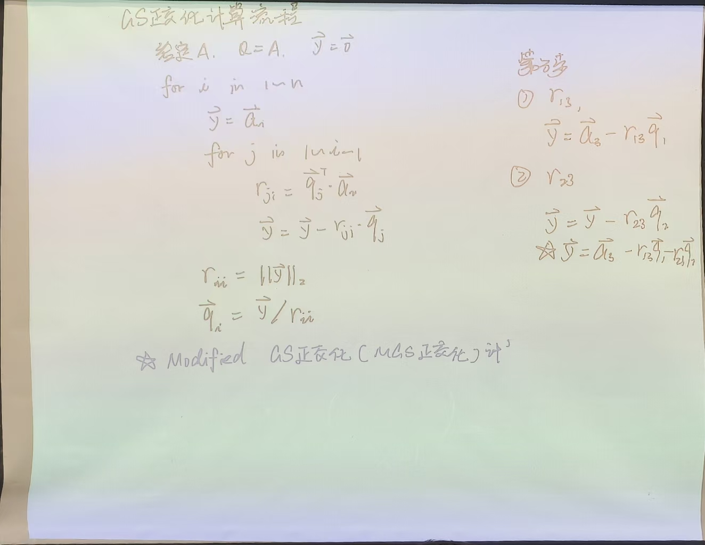
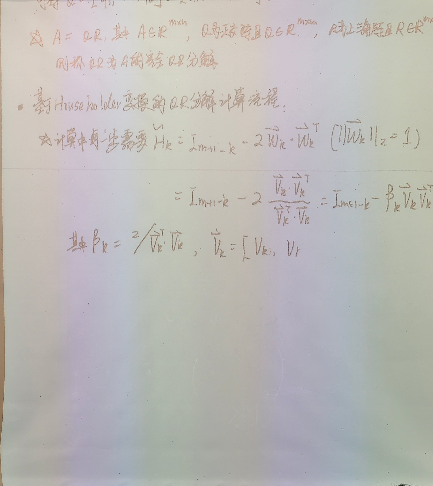
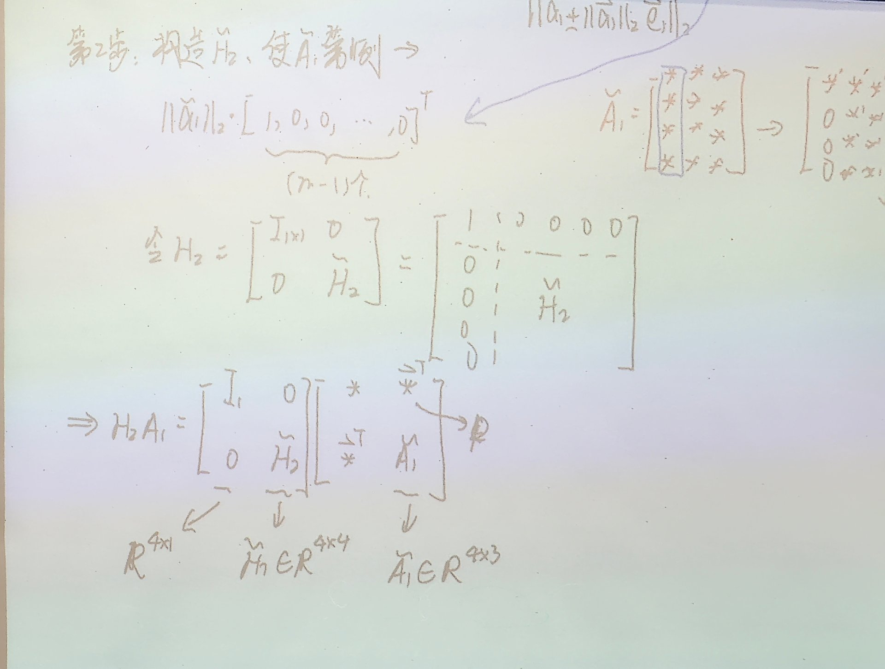
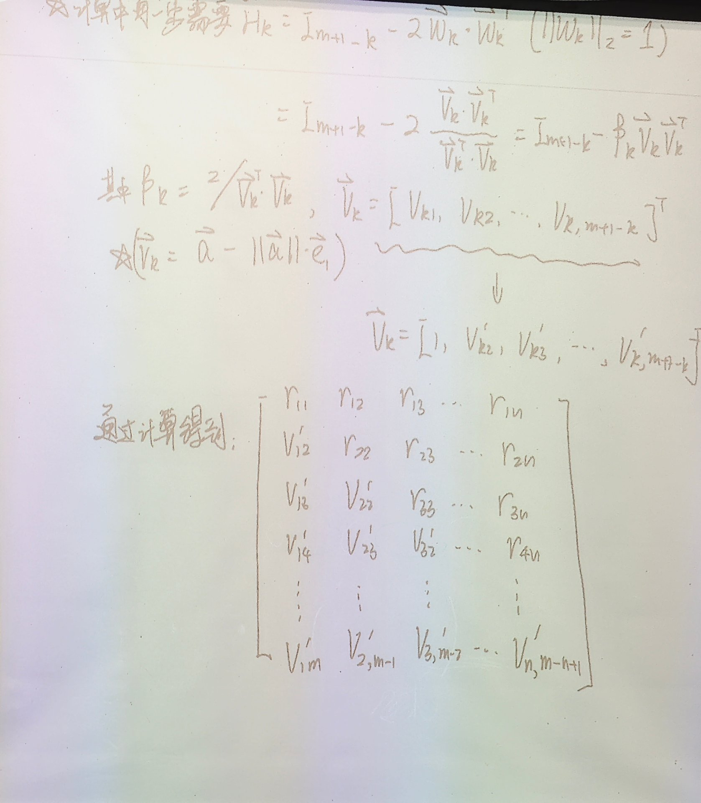
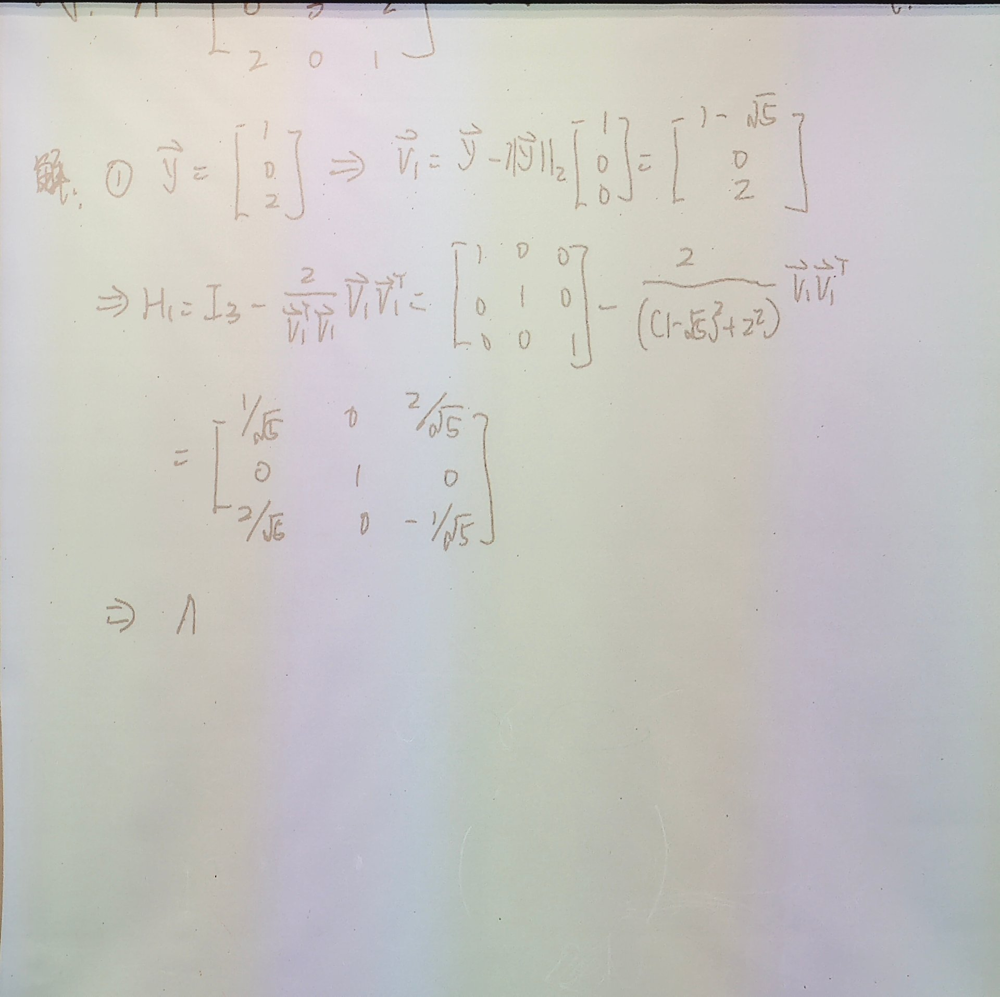
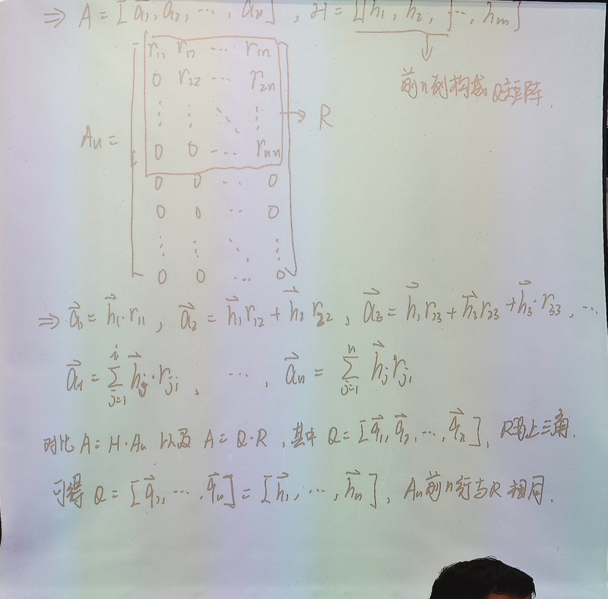
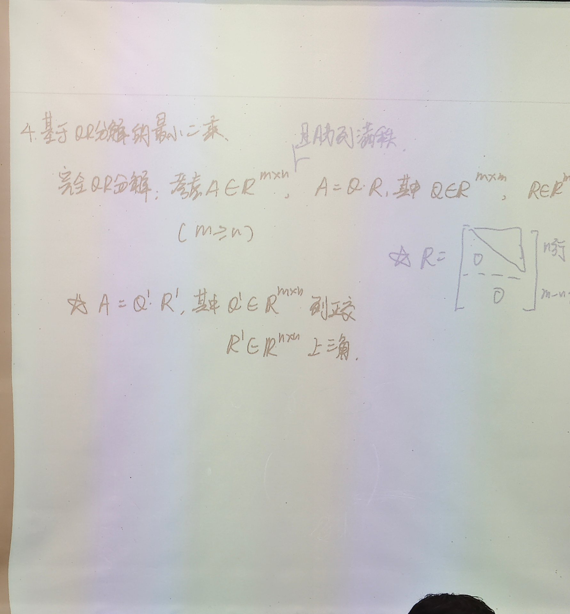
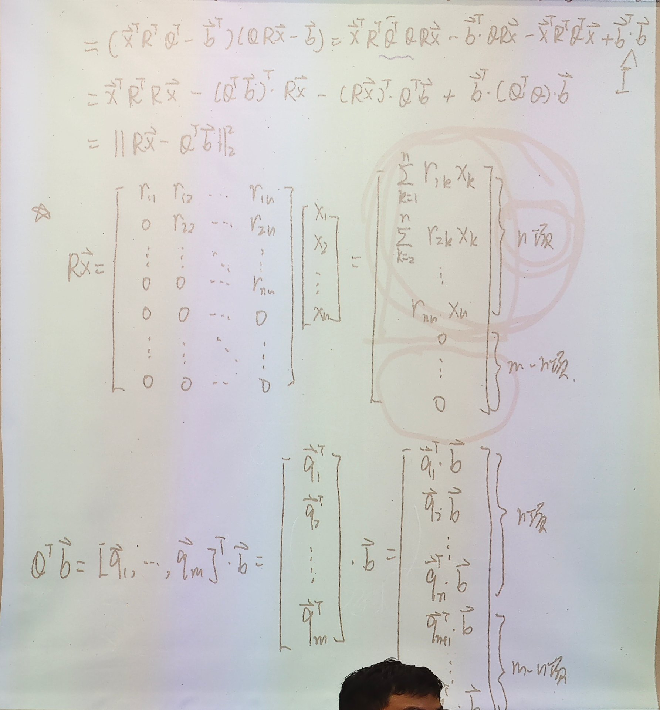
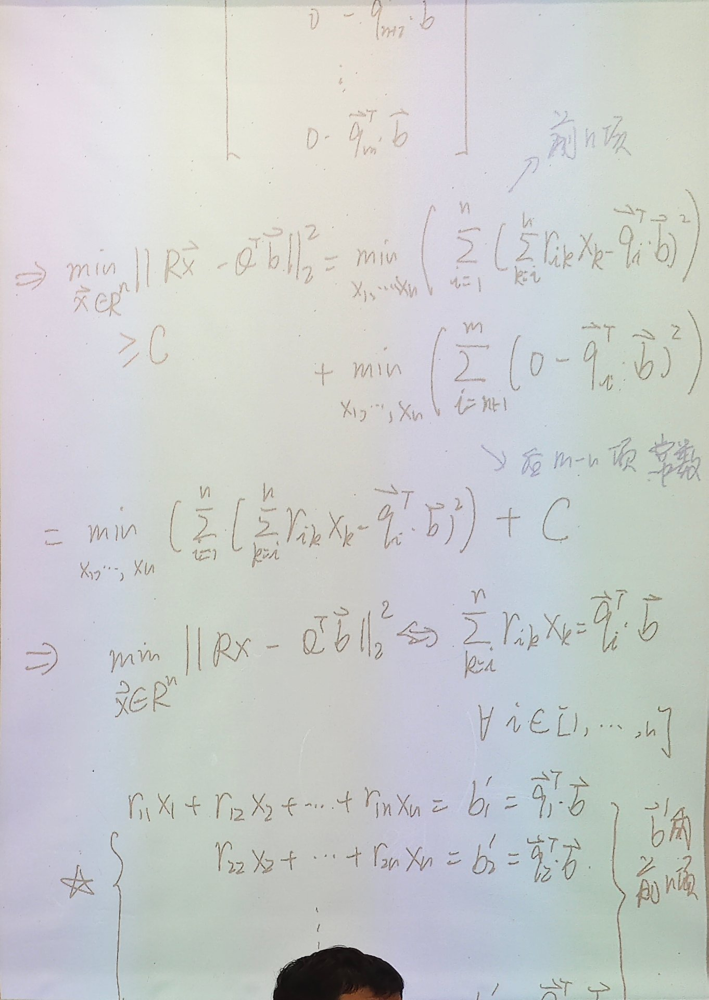
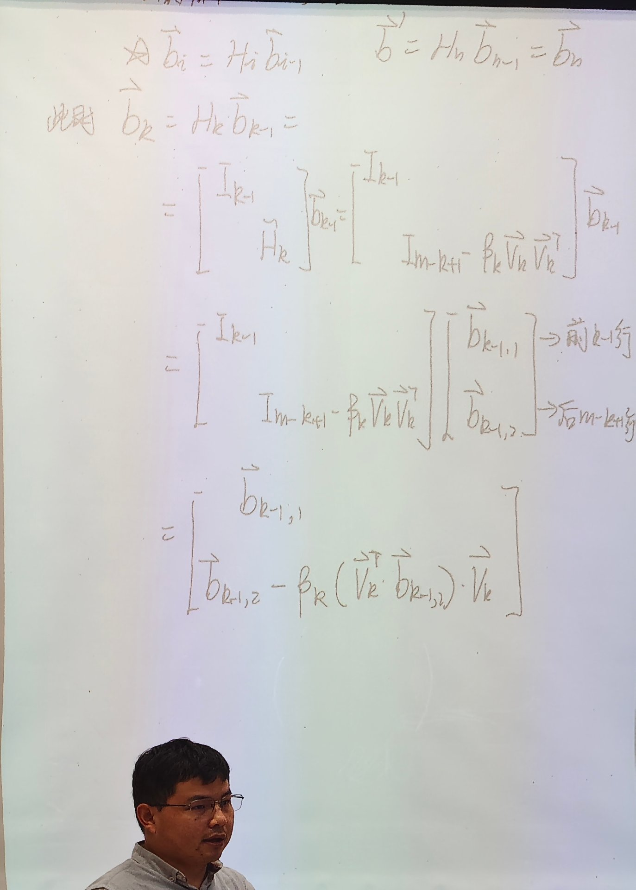

# 3.2 基于 Householder 的 QR 分解与 QR 最小二乘

> 上课：10.20 录音整理（逐字稿《矩阵QR分解相关讲解》，约 1 小时 50 分）
> 对应课本：徐树方《数值线性代数（第二版）》**§3.3 正交变换法**（p.90–97）；其 Householder 前置内容在同章 §3.2 初等正交变换（p.84–89）
> [返回总览](../00-索引.md) ｜ [上一篇：3.1 最小二乘问题、法方程与正交变换](3.1-最小二乘问题法方程与正交变换.md)
>
> 前置：QR 分解的定义、Householder 矩阵的性质（$H^T=H$、$H^2=I$）见 [3.1](3.1-最小二乘问题法方程与正交变换.md) §5–§9、§13–§14，对应课本 §3.1–§3.2。
>
> **与课本的对照**（记号已统一到课本）：定理 3.3.1（QR 分解定理）→ §9、§10；算法 3.3.1（计算 QR 分解：Householder 方法）→ §3–§7；例 3.3.1（三种方法的数值对比）→ §15。课本把这个方法命名为**正交变换法**，与之对照的法方程方法课本称**正则化方法**（解的是"正则化方程组"，即法方程组）。

## 1. 从 Gram–Schmidt 到 Householder

上节课（3.1 §14）用 Gram–Schmidt 正交化得到了 QR 分解：把每一列 $a_i$ 对前面已正交的各列做投影、减掉、再单位化。思路直观，但有两个毛病：

- **数值上会丢正交性**。逐列减投影时，浮点舍入会积累，算出来的 $q_i$ 之间不再严格正交，而且正交性误差随 $\kappa(A)$ 放大；
- **必须逐列做，且要显式存下每一列 $q_i$**。

Householder 走另一条路。它不去"减投影"，而是**对整列做镜像反射**：一次变换就把某一列对角线以下的分量全部打成零。每步也是一个正交矩阵，连着做下去，矩阵就被压成上三角。

两条路的结果是同一个东西——$A=QR$，区别在于怎么算、算得多准。

## 2. 改进的 Gram–Schmidt（MGS）

先把上节课那个方法补完。Gram–Schmidt 写成计算流程是：

```
给定 A
for i = 1..n
    y = a_i
    for j = 1..i-1
        r_ji = q_j^T a_i
        y = y - r_ji q_j
    r_ii = ||y||_2
    q_i = y / r_ii
```



注意内层那一行 $r_{ji}=q_j^Ta_i$：投影系数是用**原始的 $a_i$** 算的。这就是**经典 Gram–Schmidt（CGS）**。

改进版把这一行改成用**当前残差 $y$**：

$$
r_{ji}=q_j^T y
$$

其余不变。看起来只差一点，但要紧的是：算 $r_{3i}$ 时，CGS 用的 $a_i$ 里还含着 $q_1,q_2$ 方向的分量（虽然理论上正交，但浮点上并不严格），MGS 用的 $y$ 已经把这两个方向减掉了，所以投影不会"重复扣"。

两者的区别可以概括成：

| | CGS | MGS |
|---|---|---|
| 投影系数取自 | 原始列 $a_i$ | 当前残差 $y$ |
| 数学上 | 完全等价 | 完全等价 |
| 正交性误差 | $\sim\kappa(A)^2\varepsilon$ | $\sim\kappa(A)\,\varepsilon$ |
| 是否可并行 | 外层可并行 | 严格串行（$y$ 依赖前一步） |

一句话：**MGS 用相同的运算量换来了一个数量级的正交性精度**，代价是失去并行性。

## 3. 逐步消零：Householder 实现 QR 的总思路

设 $A\in\mathbb R^{m\times n}$，$m\ge n$。记 $A_0=A$，第 $k$ 步左乘一个 Householder 矩阵 $H_k$：

$$
A_k=H_kA_{k-1},\qquad k=1,2,\dots,p
$$

每一步的目标只有一个：**把第 $k$ 列中第 $k$ 行以下的分量全部变成零**。做完第 $p$ 步之后，矩阵就成上梯形了。



步数 $p$ 要看形状：

- $m=n$（方阵）：最后一列下面是空的，**只需 $n-1$ 步**；
- $m>n$：第 $n$ 列下方还有 $m-n$ 个元素要消，**需要 $n$ 步**。

所以一般写 $p=\min(m,n)$，细究起来方阵时是 $\min(m,n)-1$。

## 4. 第 $k$ 步只动右下子块

关键观察：第 $k$ 步只需要处理第 $k$ 行、第 $k$ 列及其右下方的子矩阵，前面已经处理好的部分**一个元素都不能碰**。所以 $H_k$ 必须长成分块对角的样子：

$$
H_k=\begin{bmatrix} I_{k-1} & 0\\ 0 & \widetilde H_k\end{bmatrix},
\qquad \widetilde H_k\in\mathbb R^{(m-k+1)\times(m-k+1)}
$$

前面的 $I_{k-1}$ 保证前 $k-1$ 行原样不动；$\widetilde H_k$ 是一个低维的 Householder 矩阵，只作用在尾部 $m-k+1$ 个分量上。



按这个结构，$H_kA_{k-1}$ 的效果就是：前 $k-1$ 行不变、第 $k$ 列第 $k$ 行以下清零。板书写成

$$
H_k=\begin{bmatrix} I_{k-1} & 0\\ 0 & I_{m-k+1}-\beta_k v_kv_k^T\end{bmatrix}
$$

第 $k$ 步做完，$A_k$ 的形状是"左上 $k\times k$ 上三角 + 右下待处理子块"。

## 5. 构造 $\widetilde H_k$：把列向量反射到 $e_1$ 方向

取出待处理的那一段列向量

$$
x=A_{k-1}(k:m,\,k)\in\mathbb R^{m-k+1}
$$

目标是找一个反射，把 $x$ 打到第一个坐标轴上：$\widetilde H_kx=\|x\|_2\,e_1$，其中 $e_1$ 是 $m-k+1$ 维的第一个标准基向量（后 $m-k$ 个分量全零）。

按 3.1 §9 的定向构造，取

$$
v_k=x-\|x\|_2\,e_1,\qquad
\widetilde H_k=I-\frac{2v_kv_k^T}{v_k^Tv_k}
$$

验算一下为什么正好是 $\|x\|_2e_1$。记 $\alpha=\|x\|_2$，则 $v=x-\alpha e_1$，于是

$$
v^Tx=\|x\|_2^2-\alpha x_1=\alpha(\alpha-x_1),\qquad
v^Tv=\|x\|_2^2-2\alpha x_1+\alpha^2=2\alpha(\alpha-x_1)
$$

两式相除得 $\dfrac{2v^Tx}{v^Tv}=1$，所以

$$
\widetilde H_kx=x-\frac{2v(v^Tx)}{v^Tv}=x-v=\alpha e_1
$$

正好落到 $e_1$ 方向。若取 $v=x+\|x\|_2e_1$，结果是对称的另一侧 $-\alpha e_1$，两种符号都能用，只是反射面不同。**实际计算里要按 3.1 §9 说的挑符号**，避免 $x_1$ 与 $\|x\|_2$ 相减时的有效数字损失。

## 6. 参数化：只存 $\beta_k$ 和 $v_k'$

把系数并进去，记

$$
H_k=I-\beta_k\,v_kv_k^T,\qquad
\beta_k=\frac{2}{v_k^Tv_k}
$$

这里有个便利之处：**$v_k$ 乘任意非零常数，$H_k$ 不变**。因为若 $\tilde v=c\,v$，则

$$
\frac{2\tilde v\tilde v^T}{\tilde v^T\tilde v}
=\frac{2c^2vv^T}{c^2v^Tv}
=\frac{2vv^T}{v^Tv}
$$

常数被约掉了。既然长度无所谓，就把首分量归一化成 $1$：

$$
v_k=\big[\,1,\ v'_{k2},\ \dots,\ v'_{k,m-k+1}\,\big]^T
$$

这样只需要存后 $m-k$ 个分量 $v'_{k2},\dots$ 和标量 $\beta_k$，省掉一个常数，也省掉一次多余的开方。

## 7. 不显式构造 $H_k$：更新公式与紧凑存储

$H_k$ 是 $(m-k+1)\times(m-k+1)$ 的稠密矩阵，显式乘一次要 $O(m^2)$ 到 $O(m^3)$，纯属浪费。注意到它只有一个秩一的修正，作用在任意向量 $c$ 上是

$$
H_kc=c-\beta_k\,v_k\,(v_k^T c)
$$

先算一个内积 $v_k^Tc$（得到**一个数**），乘上 $v_k$（变成一个向量），再减掉。全程没有矩阵-矩阵乘。

作用到子矩阵 $C=A_{k-1}(k:m,\,k:n)$ 上，就是整列一起更新：

$$
C\leftarrow C-\beta_k\,v_k\,(v_k^TC)
$$

其中 $v_k^TC$ 是一**行**向量（$1\times(n-k+1)$），再与 $v_k$ 相乘摊成矩阵，最后从 $C$ 里减掉。这是标准的 BLAS-2 操作，很快。



存储上也省。整个分解过程只需要一块 $m\times n$ 的空间：

- **上三角部分**（含对角）存已经算出来的 $R$ 的元素 $r_{ij}$；
- **第 $k$ 列的对角线以下**存 $v_k$ 的后 $m-k$ 个分量 $v'_{k2},\dots$（首分量那个 $1$ 不用存）；
- 另外用一个长度 $p$ 的数组存 $\beta_1,\dots,\beta_p$。

所以"$H_k$ 在计算过程中根本不保留"，留下的只是 $\beta_k$ 和 $v_k'$——但**这些信息足够把 $H_k$ 重新作用到任何向量上**，这正是后面算 $Q^Tb$ 的基础。

课本把这个流程写成**算法 3.3.1（计算 QR 分解：Householder 方法）**，四行正好对应上面的参数化与存储：

```
for j = 1:n
    if j < m
        [v, β] = house(A(j:m, j))                       # 由第 j 列尾部构造 v 与 β
        A(j:m, j:n) = (I_{m-j+1} - β v v^T) A(j:m, j:n) # 更新右下子块
        d(j) = β                                        # β 另存一个数组
        A(j+1:m, j) = v(2:m-j+1)                        # v 的尾部覆盖到对角元以下
    end
end
```

两个细节值得对上：

- `if j < m` 就是前面"步数"讨论的落地——$j=m$ 时（方阵最后一列）下面是空的，直接跳过，所以方阵自动少做一步；
- 最后一行 `A(j+1:m,j) = v(2:m-j+1)` 说明 **$v$ 的首分量 $1$ 被省略**，只把尾部覆盖到第 $j$ 列对角元以下的位置。这就是"紧凑存储"的具体做法：$R$ 占上三角、$v'$ 占下三角，同一块内存。

## 8. 算例：第一步走一遍

取待处理的首列

$$
y=\begin{bmatrix}1\\0\\2\end{bmatrix},\qquad \|y\|_2=\sqrt5
$$

先算反射向量：

$$
v_1=y-\|y\|_2e_1=\begin{bmatrix}1-\sqrt5\\0\\2\end{bmatrix},
\qquad v_1^Tv_1=(1-\sqrt5)^2+2^2=10-2\sqrt5
$$



$$
H_1=I_3-\frac{2}{v_1^Tv_1}v_1v_1^T
=\begin{bmatrix}1&0&0\\0&1&0\\0&0&1\end{bmatrix}
-\frac{2}{(1-\sqrt5)^2+2^2}\,v_1v_1^T
$$

代进去化简，结果是

$$
H_1=\begin{bmatrix}
\dfrac{1}{\sqrt5} & 0 & \dfrac{2}{\sqrt5}\\[2mm]
0 & 1 & 0\\[2mm]
\dfrac{2}{\sqrt5} & 0 & -\dfrac{1}{\sqrt5}
\end{bmatrix}
$$

校验一下：$H_1y$ 的第一个分量是 $\frac{1}{\sqrt5}\cdot1+0+\frac{2}{\sqrt5}\cdot2=\frac{5}{\sqrt5}=\sqrt5$，第三个分量是 $\frac{2}{\sqrt5}\cdot1-\frac{1}{\sqrt5}\cdot2=0$。确实把 $y$ 打到了 $(\sqrt5,0,0)^T$。

顺带两个观察：

- 第二行是 $(0,1,0)$，因为 $v_1$ 的第二个分量正好是 $0$——**这个反射落在 $\operatorname{span}\{e_1,e_3\}$ 平面里**，跟 $e_2$ 无关；
- $H_1$ 对称、正交，$H_1^2=I$，与理论一致。

第二步就把 $A_1$ 的 $(2\!:\!m,2)$ 那一段取出来，重复同样的动作。老师课上留了一句："这一步大家完全可以自己去算一下"——因为流程已经完全一样，只是维度少了一。

## 9. 还原 $Q$ 与 $R$

做完 $p$ 步，把每一步乘起来：

$$
A_p=H_pH_{p-1}\cdots H_1A
$$

每个 $H_i$ 都正交且对称，所以 $H_i^{-1}=H_i^T=H_i$。两边依次左乘回去：

$$
A=H_1^{-1}H_2^{-1}\cdots H_p^{-1}A_p=H_1H_2\cdots H_pA_p
$$

于是令

$$
Q=H_1H_2\cdots H_p,\qquad R=A_p\ \text{的前}\ n\ \text{行}
$$

就有 $A=QR$。

$Q$ 的正交性直接验证：

$$
Q^TQ=(H_p\cdots H_1)(H_1\cdots H_p)=I
$$

中间每个 $H_i^2=I$ 依次消掉。

> **顺序最容易写反**：$Q=H_1H_2\cdots H_p$，而"作用在 $A$ 上"的那一串是 $H_p\cdots H_1$，两者互为转置（也就是互为逆）。$H_1$ 在最左边、$H_p$ 在最右边，不要照抄成 $H_p\cdots H_1$。

把 $A=QR$ 和 $R$ 的形状对起来，能看出 $R$ 到底是什么：

$$
A=[a_1,a_2,\dots,a_n],\qquad Q=[q_1,q_2,\dots,q_m]
$$

$$
a_1=r_{11}q_1,\qquad
a_2=r_{12}q_1+r_{22}q_2,\qquad
a_3=r_{13}q_1+r_{23}q_2+r_{33}q_3
$$



一般地 $a_i=\sum_{j=1}^{i}r_{ji}q_j$。这正是上三角的含义——第 $i$ 列只用到前 $i$ 个正交向量。

因为 $A$ 只有 $n$ 列，$q_{n+1},\dots,q_m$ 对表示 $A$ 的列毫无用处，它们的价值在别处：**补全整个 $\mathbb R^m$ 的一组标准正交基**。

## 10. 完全 QR 分解与薄 QR 分解

按上面的构造，$H_k$ 是 $m-k+1$ 维的完整反射，拼出来的 $Q$ 是 $m\times m$ 的。这就得到**完全 QR 分解**：

$$
A=QR,\qquad Q\in\mathbb R^{m\times m}\ (\text{正交}),\quad R\in\mathbb R^{m\times n}\ (\text{上梯形})
$$

$R$ 的形状是"上面 $n\times n$ 上三角、下面 $m-n$ 行全零"。

只取前 $n$ 列，就得到**薄 QR 分解**：

$$
A=Q_1R_1,\qquad Q_1\in\mathbb R^{m\times n}\ (\text{列正交规范}),\quad R_1\in\mathbb R^{n\times n}\ (\text{上三角})
$$



两者的关系与几何含义：

- $Q=[Q_1\ Q_2]$，$Q_1$ 的列张成 $A$ 的**列空间** $\operatorname{col}(A)$，$Q_2$ 的列张成它的**正交补** $\operatorname{col}(A)^\perp$；
- $R_1$ 是 $R$ 的上 $n$ 行，两者共用同一块存储；
- 如果 $A$ 列满秩，$R_1$ 可逆（对角元非零）；不满列秩时 $R_1$ 会奇异，见 §16。

顺带说清两种实现的差别：**Gram–Schmidt 直接给出薄 QR（$Q_1$ 的每一列都算出来了），Householder 给的是完全 QR，而且 $Q$ 的显式元素我们其实并没有真正算出来**——手上只有 $\beta_k$ 和 $v_k$。$Q$ 是"知道怎么构造、但没真正展开"的状态，这个区别在 §13 会变成实打实的省算量。

## 11. 用 QR 解最小二乘：先把目标函数换个写法

回到主线。要求

$$
\min_{x}\|Ax-b\|_2^2
$$

把 $A=QR$ 代进去，$Q$ 正交：左乘 $Q^T$ 不改变二范数，所以

$$
\|Ax-b\|_2^2=\|QRx-b\|_2^2=\|Q(Rx-Q^Tb)\|_2^2=\|Rx-Q^Tb\|_2^2
$$

也可以直接展开验证（板书就是这么写的）：

$$
\begin{aligned}
\|Ax-b\|_2^2
&=(x^TR^TQ^T-b^T)(QRx-b)\\
&=x^TR^TQ^TQRx-x^TR^TQ^Tb-b^TQRx+b^Tb\\
&=x^TR^TRx-2\,x^TR^TQ^Tb+b^TQQ^Tb\\
&=\|Rx-Q^Tb\|_2^2
\end{aligned}
$$

第二行到第三行做了两件事：用 $Q^TQ=I$ 把 $x^TR^TQ^TQRx$ 缩成 $x^TR^TRx$；把两个交叉项合并成一个 $-2x^TR^TQ^Tb$——它们其实是同一个标量（$b^TQRx=x^TR^TQ^Tb$，标量的转置等于自身）。最后一步把 $b^Tb$ 补成 $b^TQQ^Tb$ 再合并，是为了凑成完全平方，不然拼不出范数。



于是原来的问题变成

$$
\min_x\|Rx-Q^Tb\|_2^2
$$

系数矩阵从 $A$ 换成了 $R$——**一个上梯形矩阵**。这就是全部的动机。

## 12. 分块展开：后 $m-n$ 项是常数

现在把 $Rx$ 和 $Q^Tb$ 都按"前 $n$ 个分量 / 后 $m-n$ 个分量"切开。

$Rx$：$R$ 的后 $m-n$ 行全零，所以 $Rx$ 只有前 $n$ 个分量非零：

$$
Rx=\Big(\ \underbrace{r_{11}x_1+\cdots+r_{1n}x_n,\ \dots,\ r_{nn}x_n}_{n\ \text{个非零分量}},\ \underbrace{0,\ \dots,\ 0}_{m-n\ \text{个零分量}}\ \Big)^T
$$

$Q^Tb$：按 $Q$ 的列拆开，$Q^Tb=[q_1^Tb,\dots,q_m^Tb]^T$，同样是前 $n$ 项、后 $m-n$ 项。

两者相减，残差向量分成两块：前 $n$ 个分量是 $\sum_{k=i}^{n}r_{ik}x_k-q_i^Tb$，后 $m-n$ 个分量是 $-q_i^Tb$（因为对应位置是 $0$）。

取二范数平方，求和拆成两段：

$$
\|Rx-Q^Tb\|_2^2
=\underbrace{\sum_{i=1}^{n}\Big(\sum_{k=i}^{n}r_{ik}x_k-q_i^Tb\Big)^2}_{\text{与 }x\text{ 有关}}
+\underbrace{\sum_{i=n+1}^{m}\big(q_i^Tb\big)^2}_{\text{常数 }C}
$$

第二段里 $x$ 已经完全不出现——它是个**常数**。所以

$$
\min_x\|Rx-Q^Tb\|_2^2 \;\Longleftrightarrow\; \min_x \sum_{i=1}^{n}\Big(\sum_{k=i}^{n}r_{ik}x_k-q_i^Tb\Big)^2
$$

在 $A$ 列满秩、$R_1$ 可逆的前提下，这是 $n$ 个未知量、$n$ 个方程且系数矩阵可逆，有唯一解——把那个解代进去，每个括号都为零，和式取到极小值 $0$。于是条件就是括号里全为零：

$$
R_1x=Q_1^Tb
$$

写开就是上三角方程组

$$
\begin{aligned}
r_{11}x_1+r_{12}x_2+\cdots+r_{1n}x_n&=b_1'\\
r_{22}x_2+\cdots+r_{2n}x_n&=b_2'\\
\ddots&\quad\vdots\\
r_{nn}x_n&=b_n'
\end{aligned}
\qquad b_i'=q_i^Tb
$$



从最后一个方程解出 $x_n$，再一路回代。**注意这里出现了两个简化**：

1. 问题从 $m$ 个方程降成 $n$ 个方程，且不需要"最小化"了，直接解方程；
2. 系数矩阵 $R_1$ 是上三角，回代即可，不用求逆。

顺带说清常数 $C$ 是什么：它就是**残差平方和**。因为 $\|Ax-b\|^2=\|Rx-Q^Tb\|^2$ 在取到最优 $x$ 时前一项为零，剩下

$$
C=\sum_{i=n+1}^{m}(q_i^Tb)^2=\|b\|_2^2-\|Q_1^Tb\|_2^2
$$

也就是 $b$ 落在 $\operatorname{col}(A)^\perp$ 上那部分分量的长度平方。

## 13. 右端项 $Q^Tb$ 怎么快速算

到这一步还剩一个麻烦：$Q_1^Tb$ 里的 $Q_1$ 我们并没有显式算出来（§7 说了，$H_k$ 都没保留）。难道要把 $Q$ 乘出来？

不用。回到定义 $Q^T=H_p\cdots H_1$（注意 $Q^T=H_p\cdots H_1$ 与 $Q=H_1\cdots H_p$ 是同一件事），记

$$
\tilde b_0=b,\qquad \tilde b_k=H_k\tilde b_{k-1}
$$

迭代到第 $p$ 步就得到 $\tilde b_p=H_p\cdots H_1b=Q^Tb$。

每一步只作用一个 $H_k$，可以按它的分块结构拆开。把 $\tilde b_{k-1}$ 也切成前 $k-1$ 行 / 后 $m-k+1$ 行两段：

$$
\tilde b_k=H_k\tilde b_{k-1}
=\begin{bmatrix}I_{k-1}&0\\0&I_{m-k+1}-\beta_kv_kv_k^T\end{bmatrix}
\begin{bmatrix}\tilde b_{k-1,1}\\ \tilde b_{k-1,2}\end{bmatrix}
=\begin{bmatrix}\tilde b_{k-1,1}\\ \tilde b_{k-1,2}-\beta_k(v_k^T\tilde b_{k-1,2})v_k\end{bmatrix}
$$



读出来的意思是：**第 $k$ 步只更新尾部那 $m-k+1$ 个分量，前面的原样搬过去**。

再看一个结构性事实：第 $k$ 步只改第 $k$ 个分量往后的部分，所以**做完第 $n$ 步，前 $n$ 个分量就定型了**——即使后面还有变换（$k>n$），它们前面挂的是 $I_n$，根本碰不到前 $n$ 个分量。

于是求 $Q_1^Tb$ 只需做到第 $n$ 步。这里要说清省下来的到底是什么：**不是步数**（$p=\min(m,n)\le n$，本来也做不满），而是**根本不用去管后 $m-n$ 个分量的值**——它们只影响残差常数 $C$，对 $x$ 毫无作用，算出来也是白算。

把这条和 §7 的存储合起来，整个求解流程是：

1. **分解**：逐列算出 $\beta_k,v_k'$，同时把 $R$ 填进上三角；
2. **右端项**：从 $\tilde b=b$ 起，用存下来的 $\beta_k,v_k'$ 做 $n$ 步更新，取前 $n$ 个分量；
3. **回代**：解 $R_1x=\tilde b(1:n)$。

全程没有出现任何一次"矩阵 × 矩阵"，只有内积、数乘、向量相减。

## 14. 运算量

**分解阶段**：第 $k$ 步更新 $(m-k+1)\times(n-k+1)$ 的子矩阵，每列一次内积加一次数乘减法，累计约

$$
2mn^2-\frac{2}{3}n^3\ \text{flops}
$$

课本给的形式是 $2n^2\!\left(m-\dfrac{n}{3}\right)$，展开即上式。

**右端项阶段**：第 $k$ 步只碰尾部 $m-k+1$ 个分量，累计

$$
O(mn)\quad(\text{当 }m\approx n\text{ 时就是 }O(n^2))
$$

课上的说法是"整个算右端项需要的运算量就是 $n$ 的平方"，指的就是 $m\approx n$ 这个量级。

对比一下"笨办法"——先把 $Q$ 显式乘出来（$O(m^2n)$ 甚至 $O(m^3)$），再算 $Q^Tb$（$O(m^2)$）：**省掉的正好是最贵的那一块**。老师原话："我都没有利用到矩阵向量乘，所有利用到的计算全部都是向量-向量计算。"

## 15. QR 与法方程：条件数与几何

两条路都把最小二乘变成了线性方程组，区别在系数矩阵：

| | 法方程 | QR |
|---|---|---|
| 方程 | $A^TAx=A^Tb$ | $R_1x=Q_1^Tb$ |
| 系数矩阵 | 对称正定，$n\times n$ | 上三角，$n\times n$ |
| 条件数 | $\kappa_2(A^TA)\approx\kappa_2(A)^2$ | $\kappa_2(R_1)\approx\kappa_2(A)$ |
| 形成矩阵 | 要做 $A^TA$（一次 $mn^2$ 量级的乘） | 不做，直接在 $A$ 上消零 |
| 求解 | Cholesky + 前代回代 | 只需回代 |

条件数的差距是数量级级别的。课上的算例：$A$ 的条件数是 $10$，$A^TA$ 的条件数就是 $100$；$A$ 的条件数 $10^2$，$A^TA$ 就是 $10^4$。**病态被平方放大**，而 $R_1$ 只承受 $A$ 本身的那一份（实际中 $R$ 的条件数往往还略小于 $A$）。

几何上也能说清 QR 好在哪。$Q_1=[q_1,\dots,q_n]$ 是 $\operatorname{col}(A)$ 的一组**标准正交基**。算 $Q_1^Tb$ 就是把 $b$ 逐个投影到这组基上：

$$
Q_1^Tb=\begin{bmatrix}q_1^Tb\\ \vdots\\ q_n^Tb\end{bmatrix}
$$

因为基是正交的，**各列之间没有任何交叉项**——$q_i^Tb$ 与 $q_j^Tb$ 互不影响。这就是 3.1 §14 末尾说的"找到正交基，问题就变简单"的真正兑现：GS 那一步只是给出了正交基的**构造方式**，而 QR 把它变成了可算的**解耦**。

剩下一件事是把坐标换回去：$b$ 在这组正交基下的坐标是 $Q_1^Tb$，而要的是原来那组列 $a_i$ 下的坐标 $x$，两者的换算关系就是 $R_1$：

$$
\underbrace{Q_1^Tb}_{\text{正交基坐标}}=R_1\underbrace{x}_{\text{原列坐标}}
$$

所以 $R$ 的角色是"**线性变换矩阵**"，它记录了原矩阵各列在这组正交基下是怎么组合出来的。这也解释了为什么 $R$ 的对角元 $\|y\|_2$ 恰好是"第 $i$ 列减掉前面投影后剩下的长度"。

**课本例 3.3.1 把"条件数平方"做成了实测。** 构造一个条件数恰为 $k$ 的矩阵 $A$（$k>1$ 是参数），它的最小二乘解残差恒为 $\sqrt6$、**与 $k$ 完全无关**——所以一旦算出的残差偏离 $\sqrt6$，就说明解已经走样了。取 $k=10^5,10^7,10^9$，三种方法的结果（课本表 3.1）是：

| 方法 | $k=10^5$ | $k=10^7$ | $k=10^9$ |
|---|---|---|---|
| NC：Cholesky 解法方程 | 误差 $0$ | 误差 $0.001955$ | 误差 $2.000651$，残差涨到 $3.742$ |
| NG：列主元 Gauss 解法方程 | 误差 $0$ | 误差 $0.001955$ | 误差 $2.000651$，残差涨到 $3.742$ |
| QR：正交变换法 | 误差 $0$ | 误差 $0$ | 误差 $0$，残差始终 $\sqrt6\approx2.449$ |

三点结论：

- 条件数到 $10^7$ 时法方程已经丢了两位有效数字，到 $10^9$ 时解彻底崩掉——残差从 $2.449$ 变成 $3.742$，意味着求出来的根本不是最小二乘解；
- **NC 和 NG 的结果一模一样**。这条最说明问题：换一个更稳的解方程算法也救不回来，误差是在形成 $A^TA$ 那一步就进去的，之后无论用什么方法解都无济于事；
- QR 从头到尾没受影响，因为 $R$ 的条件数就是 $A$ 的条件数（左乘正交阵不改变奇异值），**没有被平方**。

课本原话的总结是："随着系数矩阵条件数的增大，正则化方法得到的计算解误差越来越大，而正交变换法得到的计算解就没有受到任何影响。"

## 16. $A$ 不满列秩的情形

> 📌 课本 §3.3 整节都建立在"$A$ 有线性无关的列"这个前提上（列满秩），**秩亏情形是课上补充的**，超出课本本节范围。这里按录音整理，只求把"哪里坏、怎么办"说清楚。

前面都默认 $A$ 列满秩。如果不满秩：

**法方程直接坏掉**。$A^TA$ 奇异（$\operatorname{rank}(A^TA)=\operatorname{rank}(A)<n$），没有逆可求。

**QR 还活着，但要说清楚哪里坏了**。Householder 不会"跳过"线性相关的列，它只管消零，所以分解照样能做完，只是 $R_1$ 的对角上会出现零（或极接近零的数），回代时除零。

从几何上看，问题本身仍然有意义。把 $b$ 正交分解：

$$
b=b_1+b_2,\qquad b_1\in\operatorname{col}(A),\quad b_2\perp\operatorname{col}(A)
$$

最小二乘要找的是让 $Ax$ 逼近 $b$ 的 $x$，但 $Ax$ 永远落在 $\operatorname{col}(A)$ 里，所以 $b_2$ 这一块**根本消不掉**——它是最小残差。真正要满足的只是 $Ax=b_1$。

麻烦在于：$A$ 不满列秩 $\Longrightarrow$ 零空间非平凡 $\Longrightarrow$ 满足 $Ax=b_1$ 的 $x$ **不唯一**，图上是一整族解。要拿到"某一个确定的解"，得再补条件。

实际做法是借助**秩揭示**的手段：

- **列主元 QR**（QR with column pivoting）：每步挑剩余列中范数最大的换到前面来，$R$ 的对角会呈递减趋势，$\|r_{kk}\|$ 突然掉下去的位置就是数值秩；
- **秩揭示 QR / SVD**：SVD 最稳，$\sigma_i$ 掉到阈值以下就截断，直接给出最小范数解。

课上的结论就一句：**QR 依然提供分析列空间与残差的工具，但秩亏时必须谨慎处理 $R$ 的可逆性**。

## 17. 两种实现的小结

| | Gram–Schmidt（CGS / MGS） | Householder |
|---|---|---|
| 基本操作 | 逐列减投影、单位化 | 整列镜像反射，一次清一段 |
| 得到 $Q$ | 显式算出每一列 | 不显式得到，只留 $\beta_k,v_k'$ |
| 默认形式 | 薄 QR | 完全 QR（取前 $n$ 列得薄 QR） |
| 数值稳定性 | CGS 差、MGS 尚可 | 好（正交性由构造保证） |
| 运算量 | $2mn^2$ | $2mn^2-\frac23n^3$ |
| 并行性 | MGS 强串行 | 每步内部可并行 |

一句话概括这节课的链路：

$$
A\ \xrightarrow{\ \text{Householder 逐步消零}\ }\ R\ (\text{上梯形})
\ \xrightarrow{\ \text{取前 }n\text{ 行}\ }\ R_1
\ \xrightarrow{\ \text{解 }R_1x=Q_1^Tb\ }\ x
$$

其中 $Q_1^Tb$ 靠存下来的 $\beta_k,v_k'$ 迭代算出、只算前 $n$ 项——**全场没有一次矩阵-矩阵乘，也没有显式形成 $Q$**。这就是 Householder QR 解最小二乘的完整算法。
