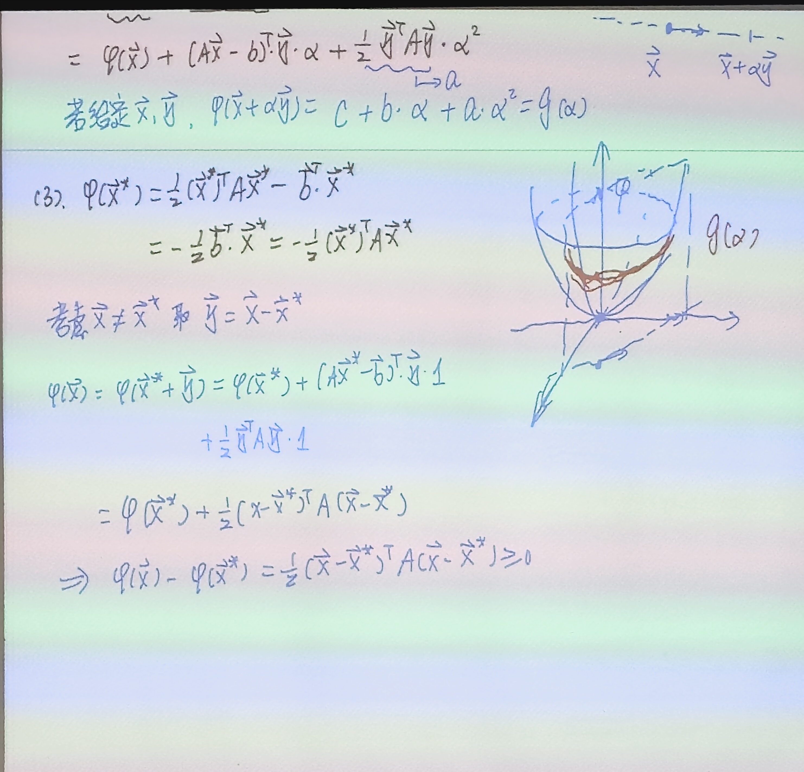

# 6.3 最速下降法与等价变分问题

> 上课：9.23（两节课，录音整理）｜ 对应课本：第 6 章共轭梯度法前置（最速下降法、等价变分原理）
> [返回总览](../00-索引.md) ｜ [上一篇：6.2.4 一维模型问题](6.2.4-应用-微分方程离散化与迭代法.md)

## 1. 从迭代格式的通项说起（收敛性回顾）

前面 Jacobi / GS / SOR 都写成不动点迭代

$$
x^{(k+1)} = B x^{(k)} + f
$$

把它反复展开，任意第 $k+1$ 步的解由两部分组成：

$$
x^{(k+1)} = B^{k+1} x^{(0)} + \big(I + B + B^2 + \cdots + B^k\big) f
$$

- **第一部分** $B^{k+1} x^{(0)}$：由初值 $x^{(0)}$ 决定。当 $\rho(B) < 1$ 时 $B^{k+1}\to 0$，这一项被"压没"——所以初值怎么选不影响最终收敛到的解，工程上直接取 $x^{(0)} = 0$ 向量即可。
- **第二部分** $(I+B+\cdots+B^k)f$：由右端 $f$ 决定。它像矩阵版的等比数列求和，利用 $(I-B)(I+B+\cdots+B^k) = I - B^{k+1}$，当 $\rho(B)<1$ 时 $I-B$ 可逆（因为 $B$ 离零矩阵"不远"，对角占优的可逆性不会被破坏），于是

$$
(I+B+\cdots+B^k) \to (I-B)^{-1}
$$

代回原方程 $x = Bx+f$，就得到 $x^* = (I-B)^{-1}f$——也就是 $Ax=b$ 的真解。这从理论上解释了"为什么只要 $\rho(B)<1$ 就一定收敛到真解"。

真正在起作用的是第二部分：每一步 $B^k f$ 像填空一样把真解的各个分量逐步补出来，初值的影响则被 $B^k$ 逐步抹掉。

## 2. 换一个视角：把解方程变成求最小值

前面所有迭代都是"左边等于右边"的平衡方程视角。这节课换一个视角——**找一个二次函数的最小值**。

### 2.1 弹簧的例子

一个弹簧弹性系数 $k$、受外力 $b$、伸长量 $x$：

- **力平衡视角**：$kx = b$（胡克定律，直接解方程）。
- **能量视角**：弹性势能 $\tfrac12 kx^2$，外力做功 $-bx$，总势能

$$
E(x) = \tfrac12 kx^2 - bx
$$

平衡位置就是 $E(x)$ 的最小值点。对 $E(x)$ 求导：$E'(x) = kx - b = 0$，恰好就是 $kx = b$。

**两个视角给出同一个解**：平衡方程 $Ax=b$ 和二次函数极小化 $\min \varphi(x)$ 是等价的。我们要做的就是把这件事从一维弹簧推广到 $n$ 维方程组。

### 2.2 等价变分问题

设 $A$ 是 $n\times n$ **对称正定**矩阵（对称是为了梯度公式干净，正定是为了二次函数开口向上、最小值唯一），$b\in\mathbb R^n$。定义二次泛函

$$
\varphi(x) = \frac12 x^T A x - b^T x
$$

**核心结论（定理）**：设 $A$ 对称正定，则 $x^*$ 是 $Ax=b$ 的解，当且仅当 $x^*$ 是 $\varphi(x)$ 的全局最小值点——即

$$
Ax^*=b \quad\Longleftrightarrow\quad \varphi(x^*) = \min_{x\in\mathbb R^n}\varphi(x)
$$

解正定线性方程组与求二次泛函最小值是同一个问题的两种表述。

## 3. 二次泛函 $\varphi(x)$ 的三条性质

### 3.1 梯度

$$
\nabla \varphi(x) = Ax - b
$$

推导：$\varphi(x) = \frac12 \sum_{i,j} a_{ij} x_i x_j - \sum_i b_i x_i$，对 $x_k$ 求偏导。由链式法则，$\frac{\partial x_i}{\partial x_k} = \delta_{ik}$（克罗内克函数：下标相等为 1，否则为 0），展开后三项：

- 第一项 $\frac12\sum_{i,j} a_{ij}\delta_{ik}x_j = \frac12\sum_j a_{kj}x_j$；
- 第二项 $\frac12\sum_{i,j} a_{ij}x_i\delta_{jk} = \frac12\sum_i a_{ik}x_i$，利用 $A$ 对称 $a_{ik}=a_{ki}$，与第一项合并为 $\sum_j a_{kj}x_j = (Ax)_k$；
- 第三项 $-\sum_i b_i\delta_{ik} = -b_k$。

拼起来就是 $(\nabla\varphi)_k = (Ax)_k - b_k$。

**注意**：$\nabla\varphi = 0$ 只是极值的必要条件——鞍点、极大值点梯度也为零。要证明它确实是最小值，需要下面两条。

### 3.2 沿任意方向的截面是开口向上的抛物线

任给起点 $x$ 和方向 $y\neq 0$，沿直线 $x+\alpha y$ 展开：

$$
\varphi(x+\alpha y) = \varphi(x) + \alpha\,(Ax-b)^T y + \frac{\alpha^2}{2}\, y^T A y
$$

因为 $A$ 正定，$y^T A y > 0$，所以这是关于 $\alpha$ 的**开口向上**的二次函数。几何上：用一把竖直的刀沿方向 $y$ 切开 $\varphi$ 的椭圆抛物面，截出来的曲线 $g(\alpha)=\varphi(x+\alpha y)$ 一定是开口向上的抛物线，必然存在唯一的最小值。

### 3.3 $\varphi(x^*)$ 是全局最小值

设 $Ax^* = b$，令 $y = x - x^*$，代入展开式：

$$
\varphi(x) = \varphi(x^*) + \underbrace{(Ax^*-b)^T y}_{=\,0} + \frac12 y^T A y = \varphi(x^*) + \frac12 (x-x^*)^T A (x-x^*)
$$

由 $A$ 正定，最后一项 $\ge 0$，等号当且仅当 $x = x^*$ 成立。所以 $\varphi(x) \ge \varphi(x^*)$，且只在 $x^*$ 取等——$x^*$ 是唯一的全局最小值点。这就完成了"$Ax=b \iff \varphi$ 取最小"的等价性证明。

## 4. 线搜索算法（通用框架）

从 $x^*$ 唯一这件事出发，构造迭代序列 $\{x_k\}$ 逐步逼近最小值：

1. 取初值 $x_0$；
2. 每步选一个非零**搜索方向** $p_k$（怎么选后面再讲）；
3. 沿这条射线 $x_k + \alpha p_k$ 找最优步长 $\alpha_k$，使 $\varphi$ 在这条线上最小——这叫**线搜索**。

把 $\varphi(x_k+\alpha p_k)$ 对 $\alpha$ 求导并令其为零：

$$
\frac{d\varphi}{d\alpha} = (Ax_k-b)^T p_k + \alpha\, p_k^T A p_k = 0
$$

因为 $p_k\neq 0$ 且 $A$ 正定，$p_k^T A p_k > 0$ 可做分母，解得

$$
\alpha_k = \frac{(b-Ax_k)^T p_k}{p_k^T A p_k}
$$

把这个最优 $\alpha_k$ 代回 $\varphi(x_k+\alpha p_k)$，可算出这一步的函数值下降量：

$$
\varphi(x_k+\alpha_k p_k) = \varphi(x_k) - \frac{\big[(b-Ax_k)^T p_k\big]^2}{2\,p_k^T A p_k}
$$

分母 $p_k^T A p_k > 0$，所以下降量 $\ge 0$。若下降量为零，只能是分子为零即 $(b-Ax_k)^T p_k=0$；只要 $p_k\neq 0$ 且还没收敛，这个量就严格为正，每一步函数值都严格下降。一旦下降量为零，说明 $b-Ax_k=0$，已经到达真解 $x^*$，迭代可以停止。

## 5. 残差及其递推

定义**残差** $r_k = b - Ax_k$——虽然不知道 $x_k$ 离真解 $x^*$ 有多远（$x^*-x_k$ 算不出来，因为 $x^*$ 未知），但把误差用 $A$ 作用一下：

$$
r_k = b - Ax_k = Ax^* - Ax_k = A(x^* - x_k)
$$

残差就是"真解误差经过 $A$ 放大后的像"。$b$、$A$、$x_k$ 都已知，所以 $r_k$ 可以直接算，是衡量误差的可计算代理。

步长公式简化为

$$
\alpha_k = \frac{r_k^T p_k}{p_k^T A p_k}
$$

残差本身也有递推关系，不必每步都重新算 $Ax_k$：

$$
r_{k+1} = b - A x_{k+1} = b - A(x_k + \alpha_k p_k) = r_k - \alpha_k A p_k
$$

**工程意义**：每步本来就要算 $A p_k$（在分母 $p_k^T A p_k$ 里），把它存下来，下一步残差就只是向量加减，省下一次 $O(n^2)$ 的矩阵-向量乘。

另外还有一条正交性质。把上一步的搜索方向 $p_{k-1}$ 点乘到残差递推式上：

$$
p_{k-1}^T r_k = p_{k-1}^T r_{k-1} - \alpha_{k-1}\, p_{k-1}^T A p_{k-1}
$$

把第 $k-1$ 步的步长 $\alpha_{k-1} = \dfrac{r_{k-1}^T p_{k-1}}{p_{k-1}^T A p_{k-1}}$ 代入，第二项的分母与 $p_{k-1}^T A p_{k-1}$ 恰好约掉：

$$
p_{k-1}^T r_k = p_{k-1}^T r_{k-1} - \frac{r_{k-1}^T p_{k-1}}{p_{k-1}^T A p_{k-1}}\cdot p_{k-1}^T A p_{k-1} = 0
$$

即"新残差与上一步的搜索方向正交"——无论 $p_k$ 怎么选，只要严格按线搜索找最优步长，这条正交性就成立。它是后面共轭梯度法（CG）构造共轭方向的基础。

## 6. 最速下降法（steepest descent）

线搜索框架里方向 $p_k$ 还没指定。最自然的选法是**负梯度方向**——蒙着眼下山时，只能凭局部信息知道往哪个方向下降最快，那就是 $-\nabla\varphi$。

由 $\nabla\varphi(x_k) = Ax_k - b = -r_k$，负梯度方向正好就是残差方向。一开始直觉上会把方向归一化，取

$$
p_k = \frac{r_k}{\|r_k\|}
$$

但代入步长公式后发现归一化是多余的：分子 $r_k^T p_k = \dfrac{r_k^T r_k}{\|r_k\|}$，分母 $p_k^T A p_k = \dfrac{r_k^T A r_k}{\|r_k\|^2}$，$\|r_k\|$ 的因子在最终的 $x_{k+1}=x_k+\alpha_k p_k$ 里全部约掉，结果与直接取 $p_k=r_k$ 完全相同。所以实际计算中**不对方向归一化**，直接取

$$
p_k = r_k,\qquad \alpha_k = \frac{r_k^T r_k}{r_k^T A r_k}
$$

于是最速下降法的完整迭代格式：

$$
\begin{aligned}
r_k &= b - A x_k \\
\alpha_k &= \frac{r_k^T r_k}{r_k^T A r_k} \\
x_{k+1} &= x_k + \alpha_k r_k
\end{aligned}
$$

**算法流程**：取初值 $x_0$（一般取 0），置 $k=0$、误差标志 $\text{err}=1$；当 $k\le N_{\max}$ 且 $\text{err}>\varepsilon$ 时，依次算 $r_k=b-Ax_k$、$\alpha_k=\dfrac{r_k^Tr_k}{r_k^TAr_k}$、$x_{k+1}=x_k+\alpha_k r_k$，然后 $k\leftarrow k+1$、$\text{err}=\|r_k\|$，进入下一轮。

## 7. 收敛速度证明

记 $A$ 的特征值为 $0 < \lambda_1 \le \lambda_2 \le \cdots \le \lambda_n$。目标是证明最速下降法在 **$A$-范数**（$\|e\|_A = \sqrt{e^T A e}$，几何上就是误差能量）下有估计：

$$
\|x_k - x^*\|_A \le \left(\frac{\lambda_n - \lambda_1}{\lambda_n + \lambda_1}\right)^k \|x_0 - x^*\|_A
$$

### 7.1 引理（多项式 $A$-范数估计）

设 $A$ 对称正定，$p(t)$ 是任一多项式，则对任意 $x\in\mathbb R^n$，

$$
\|p(A)x\|_A \le \max_i |p(\lambda_i)|\cdot \|x\|_A
$$

其中 $A$-范数定义为 $\|x\|_A = \sqrt{x^T A x}$。

**证明**：把 $x$ 按 $A$ 的正交特征基展开 $x=\sum_i\beta_i e_i$，利用特征向量间的正交性，交叉项全部消去，

$$
\|p(A)x\|_A^2 = x^T p(A)^T A p(A) x = \sum_i \lambda_i \beta_i^2\, p(\lambda_i)^2
$$

把每一项的 $p(\lambda_i)^2$ 放大成 $\max_i|p(\lambda_i)|^2$ 并提出求和号，剩下的正好就是 $\|x\|_A^2=\sum_i\lambda_i\beta_i^2$：

$$
\|p(A)x\|_A^2 \le \max_i |p(\lambda_i)|^2 \cdot \sum_i\lambda_i\beta_i^2 = \max_i|p(\lambda_i)|^2\cdot\|x\|_A^2
$$

两边开根号即得引理。

### 7.2 误差递推是"矩阵乘子"

记误差 $e_k = x_k - x^*$。由 $r_k = b-Ax_k = Ax^* - Ax_k = -Ae_k$，代入最速下降更新 $x_{k+1}=x_k+\alpha_k r_k$：

$$
e_{k+1} = x_{k+1}-x^* = e_k + \alpha_k r_k = e_k - \alpha_k A e_k = (I-\alpha_k A)\,e_k
$$

每一步误差都是被同一个矩阵多项式 $p(t)=1-\alpha_k t$ 作用一次。应用引理：

$$
\|e_{k+1}\|_A \le \max_i |1-\alpha_k\lambda_i|\cdot\|e_k\|_A
$$

### 7.3 min-max：选 $\alpha$ 让最大模最小

关键观察：上面这个不等式对**任意 $\alpha$** 都成立，所以我们可以挑一个 $\alpha$ 让右边的 $\max_i|1-\alpha\lambda_i|$ 尽量小。

把 $|1-\alpha\lambda|$ 画出来：它是一条 V 形折线，过 $(0,1)$，在 $\alpha=1/\lambda$ 处触零，左支斜率 $-\lambda$，右支斜率 $+\lambda$。$\lambda$ 越大折线越陡。

所有特征值 $\lambda_i\in[\lambda_1,\lambda_n]$ 对应的折线里，左支最陡的是 $\lambda=\lambda_n$ 那条（斜率 $-\lambda_n$），右支最陡的也是 $\lambda=\lambda_n$ 那条（斜率 $+\lambda_n$）。所以 $\max_i|1-\alpha\lambda_i|$ 的包络就是：

- 左半支（$\alpha<1/\lambda_n$）：$1-\alpha\lambda_n$（最大那个 $\lambda_n$ 贡献的）
- 右半支（$\alpha>1/\lambda_1$）：$\alpha\lambda_1-1$（最小那个 $\lambda_1$ 贡献的）

让这两条直线相交，就是 $\max$ 取最小值的点：

$$
1-\alpha\lambda_n = \alpha\lambda_1 - 1 \;\Longrightarrow\; \alpha = \frac{2}{\lambda_1+\lambda_n}
$$

代回，最小的最大模为

$$
\max_i |1-\alpha\lambda_i| = \frac{\lambda_n-\lambda_1}{\lambda_n+\lambda_1}
$$

于是每一步误差都被这个常数压缩一次，$k$ 步后

$$
\|e_k\|_A \le \left(\frac{\lambda_n-\lambda_1}{\lambda_n+\lambda_1}\right)^k \|e_0\|_A
$$

### 7.4 收敛速度与特征值分布的关系

- **特征值全相等**（$\lambda_n=\lambda_1$）：压缩常数为 0，一步精确收敛——此时 $A$ 是数量阵 $cI$，$Ax=b$ 本来就能直接除出来。
- **特征值集中**（$\lambda_n/\lambda_1$ 接近 1）：压缩常数接近 0，收敛快。
- **特征值分散**（$\lambda_n\gg\lambda_1$，条件数大）：压缩常数接近 1，收敛极慢。二维例子里这表现为著名的"锯齿形"路径，在很扁的椭圆谷里来回震荡，几十上百步都到不了底。

这就是最速下降法的已知弱点，也是引出下一节共轭梯度法（CG）的动机。
