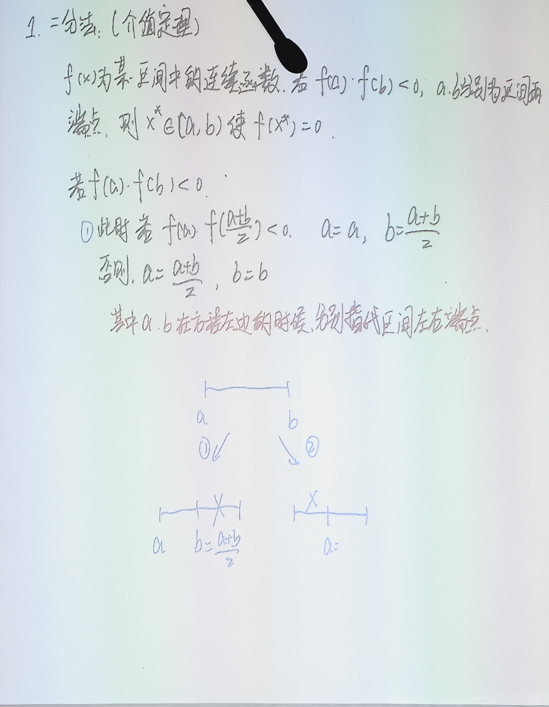
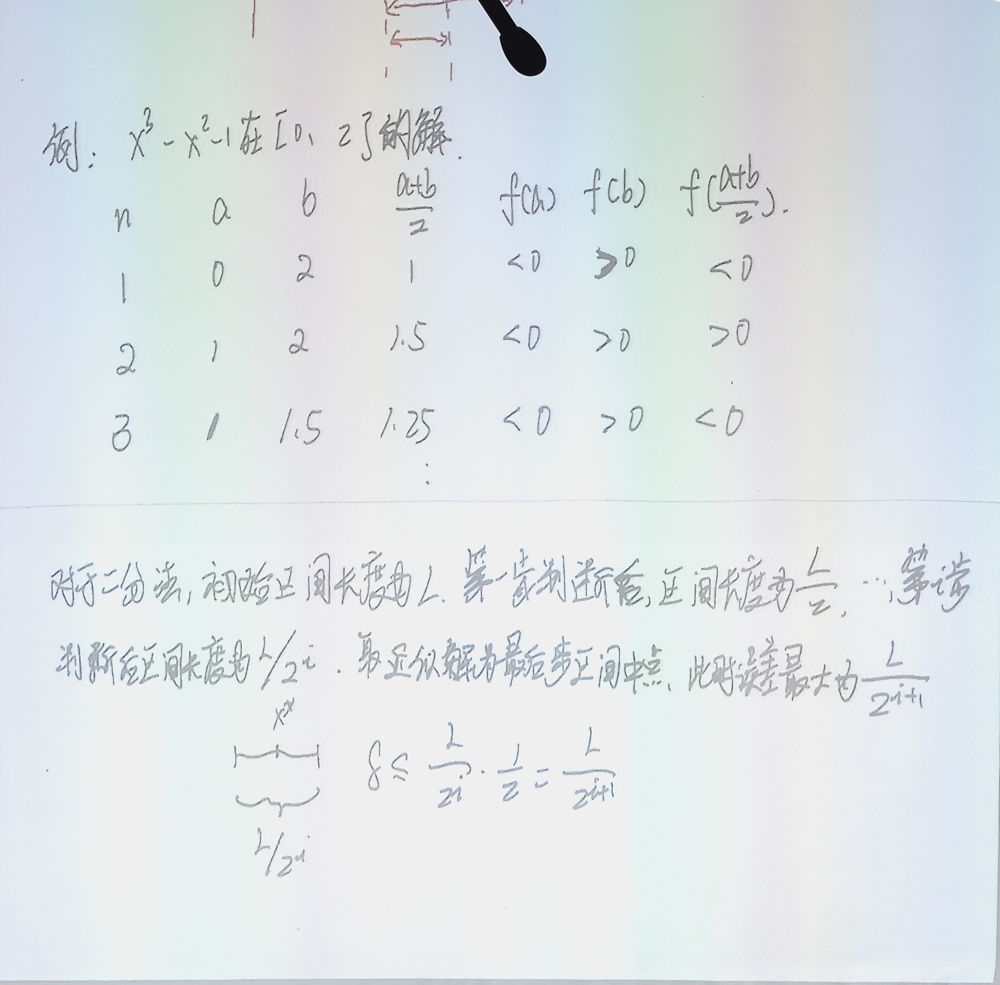

# 7.1 非线性方程求根：二分法与不动点迭代

> 上课：10.21 录音整理
> 对应课本：李庆扬《数值分析（第五版）》第七章 **§7.1 方程求根与二分法 + §7.2 不动点迭代法及其收敛性**（p.212–219）；法方程与 QR 的衔接见 [3.2](../第3章-最小二乘问题/3.2-基于Householder的QR分解与QR最小二乘.md)，本节之前也可以先回顾 [6.1](../第6章-解线性方程组的迭代法/6.1-迭代法引论与收敛理论.md) 中"迭代法"的一般思想
> [返回总览](../00-索引.md) ｜ [上一篇：6.4 共轭梯度法](../第6章-解线性方程组的迭代法/6.4-共轭梯度法.md) ｜ [下一篇：7.2 收敛性判据、收敛阶与迭代加速](7.2-收敛性判据收敛阶与迭代加速-牛顿法与割线法.md)

## 1. 引言：非线性方程与有根区间

前面几章处理的对象都是线性方程组 $Ax=b$，系数矩阵是线性的，可以靠消元、分解等直接方法求解。本章转向单个**非线性方程**

$$
f(x)=0
$$

其中 $x\in\mathbb R$，$f\in C[a,b]$（区间也可以是无穷区间）。如果实数 $x^*$ 满足 $f(x^*)=0$，称 $x^*$ 是方程的**根**，也叫函数 $f(x)$ 的**零点**。

关于根还需要区分重数：若 $f(x)=(x-x^*)^m g(x)$，其中 $m$ 为正整数且 $g(x^*)\neq 0$，则称 $x^*$ 为 $f$ 的 $m$ 重零点（$m$ 重根），$m=1$ 时叫单根。当 $g$ 充分光滑时，重根与导数的关系是

$$
f(x^*)=f'(x^*)=\cdots=f^{(m-1)}(x^*)=0,\qquad f^{(m)}(x^*)\neq 0
$$

方程本身分两类：

- **代数方程**：$f(x)=a_0x^n+a_1x^{n-1}+\cdots+a_{n-1}x+a_n$ 是多项式。按代数基本定理，$n$ 次代数方程在复数域有且只有 $n$ 个根（含重根）。$n=1,2$ 有现成求根公式，$n=3,4$ 的求根公式虽存在但过于复杂、不适合数值计算，$n\ge 5$ 则没有通用的公式解，必须用数值方法；
- **超越方程**：如 $e^{-x/10}\sin(10x)=0$，在整个 $x$ 轴上可能有**无穷多个解**，讨论时必须先限定求解区间 $[a,b]$。

非线性问题一般没有直接的求解公式，都要用**迭代法**，而迭代法要求先知道根的一个近似位置。判断根大致在哪里的依据是**有根区间**：若 $f\in C[a,b]$ 且 $f(a)f(b)<0$，由连续函数的介值性质，$f(x)=0$ 在 $(a,b)$ 内**至少有一个实根**，这时称 $[a,b]$ 为有根区间。通常用**逐次搜索法**找有根区间：取一个步长 $h$，依次计算 $f(x_0),f(x_0+h),f(x_0+2h),\dots$，相邻两点函数值异号处就夹着一个根。课本例 1 用这一方法搜索三次多项式 $x^3-11.1x^2+38.8x-41.77=0$ 的有根区间，最终把根分别锁定在三个互不相交的子区间里。搜索步长的选取会影响结果：步长太大可能跳过两个相距很近的根，步长太小计算量大，一般先粗搜再细搜。

## 2. 二分法：介值定理与区间更新规则

有根区间找到了，怎么把根精确求出来？最朴素可靠的方法就是**二分法**：每步把当前区间对半切开，保留含根的那一半。

理论依据就是**介值定理**：$f$ 在 $[a,b]$ 上连续，且 $f(a)f(b)<0$，则存在 $x^*\in(a,b)$ 使 $f(x^*)=0$。区间端点符号相反，根就被"夹"在中间。

具体做法：设当前有根区间为 $[a,b]$（约定 $a<b$，左端函数值符号记为 $\operatorname{sgn}f(a)$），取中点

$$
m=\frac{a+b}{2}
$$

然后看 $f(a)$ 与 $f(m)$ 的符号关系：

- 若 $f(a)f(m)<0$（异号），说明根在左半边，更新右端点 $b\leftarrow m$，区间变为 $[a,m]$；
- 否则（同号或 $f(m)=0$），说明根在右半边，更新左端点 $a\leftarrow m$，区间变为 $[m,b]$。

无论哪种情况，新的有根区间长度都是原来的一半。用递推式写就是：第 $k$ 步的区间 $[a_k,b_k]$ 与第 $k+1$ 步的区间满足

$$
[a_{k+1},b_{k+1}]=
\begin{cases}
[a_k,\ (a_k+b_k)/2],& f(a_k)f\!\left(\dfrac{a_k+b_k}{2}\right)<0\\[4pt]
[(a_k+b_k)/2,\ b_k],& \text{否则}
\end{cases}
$$

对新区间重复同样的手续，就得到一列不断收缩的有根区间

$$
[a,b]\supset[a_1,b_1]\supset[a_2,b_2]\supset\cdots\supset[a_k,b_k]\supset\cdots
$$

其中 $b_k-a_k=\dfrac{b-a}{2^k}$。当 $k\to\infty$ 时区间长度趋于零，这些区间最终收缩到一点，这一点就是根。实际计算中不可能无限二分，而是给定精度要求后二到足够多次，取最后一个区间的中点作为近似根。

## 3. 二分法的误差估计

记初始区间长度 $L=b-a$。第 $i$ 次判断后区间长度为 $L/2^i$（板书记号；课本把"二分 $k$ 次后的有根区间"记为 $[a_k,b_k]$，长度 $(b-a)/2^k$，两种记号一致）。取近似解为最后区间的**中点**，此时根与中点的距离最多是区间长度的一半，所以绝对误差

$$
|x^*-x_i|\le \frac{L}{2^{i+1}}
$$

这个误差界可以直接用来**预算二分次数**。要求 $|x^*-x_k|\le\varepsilon$，只需解

$$
\frac{b-a}{2^{k+1}}\le\varepsilon\quad\Longrightarrow\quad
k\ge \log_2\frac{b-a}{\varepsilon}-1
$$

例如课本例 2：$f(x)=x^3-x-1=0$ 在 $[1.0,1.5]$ 内求根、要求准确到小数点后第 2 位，即误差不超过 $0.005$。此时 $L=0.5$，代入得 $0.5/2^{k+1}\le 0.005$，即 $2^{k+1}\ge 100$，二分 $k=6$ 次即可达到精度。

## 4. 二分法例题：$x^3-x^2-1$ 在 $[0,2]$ 内求根

课堂上用 $f(x)=x^3-x^2-1$ 在 $[0,2]$ 上演示完整过程。先验算端点：$f(0)=-1<0$，$f(2)=8-4-1=3>0$，异号，确有根。逐次二分的结果如下表（$f(a),f(b),f(m)$ 列只记符号）：

| $n$ | $a$ | $b$ | $\dfrac{a+b}{2}$ | $f(a)$ | $f(b)$ | $f\!\left(\dfrac{a+b}{2}\right)$ |
| --- | --- | --- | --- | --- | --- | --- |
| 1 | 0 | 2 | 1 | $<0$ | $>0$ | $<0$ |
| 2 | 1 | 2 | 1.5 | $<0$ | $>0$ | $>0$ |
| 3 | 1 | 1.5 | 1.25 | $<0$ | $>0$ | $<0$ |

第 1 步：中点 $m_1=1$，$f(1)=1-1-1=-1<0$，与 $f(0)$ 同号，根在右侧，区间收成 $[1,2]$。第 2 步：$m_2=1.5$，$f(1.5)=3.375-2.25-1=0.125>0$，与 $f(1)<0$ 异号，根在左半，区间收成 $[1,1.5]$。第 3 步：$m_3=1.25$，$f(1.25)\approx-0.609375<0$，与 $f(1)<0$ 同号，区间收成 $[1.25,1.5]$。此后重复同一流程，区间不断减半逼近根。真实根 $x^*\approx1.4656$，若以 $L=2$ 起算，二分 $i$ 次后误差不超过 $2/2^{i+1}=1/2^i$。

课本例 2 的 $f(x)=x^3-x-1=0$ 在 $[1.0,1.5]$ 上算到第 6 次二分后取中点 $x_6\approx1.3242$，满足误差要求（真实根 $1.324718$ 左右），计算过程完全一样。

## 5. 二分法的计算步骤与小结

课本把二分法归纳为三步（计算机实现时就是循环）：

1. **准备**：计算 $f(x)$ 在有根区间端点处的值 $f(a),f(b)$（确认 $f(a)f(b)<0$）；
2. **二分**：计算 $f(x)$ 在中点 $m=(a+b)/2$ 处的值；
3. **判断**：若 $f(m)=0$，则 $m$ 就是根，结束；否则若 $f(a)f(m)<0$，用 $m$ 代替 $b$，反之用 $m$ 代替 $a$。

反复执行第 2、3 步，直到区间长度小于允许误差 $\varepsilon$，此时中点即为所求近似根。

**优点**：算法简单、只用到函数值的符号（连 $f$ 的导数都不需要）、**总是收敛**（条件满足后保证）。
**缺点**：收敛太慢——误差上界按等比数列 $\dfrac{L}{2},\dfrac{L}{4},\dfrac{L}{8},\cdots$ 衰减，即速率固定为 $1/2$ 的**线性收敛**；每一步就是机械地除 2，同一算法下没有参数可以调快，所以一般**不单独**用它求根，只用来为其他更快的迭代法提供一个好的初始近似。课堂上顺带提到，中点不是唯一选择：也可以取三等分点甚至黄金分割点作为剖分点（后者在速度上略有优势，本节课不展开）。此外还有几条局限：

- 必须先找到端点函数值异号的区间；端点同号**不能**据此断定区间内没有根（比如偶重根两侧同号，或区间内有偶数个根）；
- 若区间内有多个根，二分法只能沿保留下来的子区间找到其中**一个**，无法自动列出全部根；
- 结果依赖初始区间，不能保证找到的是用户最关心的那个特定根。

## 6. 不动点迭代法：定义与几何

二分法每步只缩小区间，完全不利用函数本身的更多信息。更高效的做法是把方程改写后反复代入。把 $f(x)=0$ 改写成**等价形式**

$$
x=g(x)
$$

若 $x^*$ 满足 $f(x^*)=0$，则 $x^*=g(x^*)$，反过来也对。这样的 $x^*$ 称为函数 $g$ 的**不动点**——被 $g$ 作用后不动。求 $f$ 的零点等价于求 $g$ 的不动点。给定初始近似 $x_0$，代入右端得到 $x_1=g(x_0)$，再代再得，就得到**不动点迭代**：

$$
x_{k+1}=g(x_k),\qquad k=0,1,2,\dots
$$

$g$ 称为**迭代函数**。如果对任何 $x_0\in[a,b]$，由迭代产生的序列 $\{x_k\}$ 有极限 $x^*$，则称迭代收敛，且 $x^*=g(x^*)$ 是 $g$ 的不动点。这个思路叫**逐次逼近法**：把隐式方程 $x=g(x)$ 转化为一组显式的递推公式，迭代过程实质上是逐步把"隐式"变成"显式"。

几何上，求 $x=g(x)$ 的根就是在 $xy$ 平面上找曲线 $y=g(x)$ 与直线 $y=x$ 的交点 $P^*$。从 $x_0$ 出发：先在曲线 $y=g(x)$ 上找到点 $P_0=(x_0,g(x_0))=(x_0,x_1)$，沿水平方向平移到直线 $y=x$ 上得到 $Q_1=(x_1,x_1)$，再沿竖直方向回到曲线上得 $P_1=(x_1,x_2)$……如此在曲线和直线之间走"折线阶梯"。若点列 $\{P_k\}$ 趋向交点 $P^*$，迭代值 $x_k$ 就收敛到根。这条阶梯路径要么呈"收敛螺旋/收敛阶梯"，要么向外发散，取决于 $g$ 的形状。

改写成不动点形式**并不唯一**：同一个 $f(x)=0$ 可以有很多种 $x=g(x)$ 的写法，不同写法对应的迭代收敛性完全不同。所以改写之后必须研究"这个迭代是否收敛"。

## 7. 例：$x^3-x-1=0$ 的两种改写，一收敛一发散

课本例 3 用 $f(x)=x^3-x-1=0$ 在 $x_0=1.5$ 附近求根，演示了改写方式的重要性。

**改写一**：$x=\sqrt[3]{x+1}$，迭代格式

$$
x_{k+1}=\sqrt[3]{x_k+1}
$$

从 $x_0=1.5$ 出发的计算结果：

| $k$ | $x_k$ | $k$ | $x_k$ |
| --- | --- | --- | --- |
| 0 | 1.5 | 5 | 1.32476 |
| 1 | 1.35721 | 6 | 1.32473 |
| 2 | 1.33086 | 7 | 1.32472 |
| 3 | 1.32588 | 8 | 1.32472 |
| 4 | 1.32494 | | |

只取 6 位数字时 $x_7$ 与 $x_8$ 完全相同，可认为 $x_7\approx1.32472$ 已满足方程，就是所求的根。这个迭代**收敛**。

**改写二**：$x=x^3-1$，迭代格式

$$
x_{k+1}=x_k^3-1
$$

初值仍取 $x_0=1.5$，则 $x_1=1.5^3-1=2.375$，$x_2=2.375^3-1\approx12.39$——结果越来越大，显然不可能趋向某个极限。这种不收敛的迭代过程叫**发散**，纵使迭代千百次也毫无价值。

同一个方程、两个都"正确"的改写，一个收敛一个发散，关键差别就在迭代函数的性质（导数大小），这正是下一节定理要回答的问题。作为练习可以自行画出两种迭代的阶梯图：改写一是收敛的螺旋阶梯，改写二是向外发散。

## 8. 不动点存在唯一性定理

先问最基础的问题：$g$ 在什么条件下**保证有**不动点、且**只有一个**不动点？

**定理 1**（不动点存在唯一性）设 $g\in C[a,b]$，满足两个条件：

1. **自映射**：对任意 $x\in[a,b]$ 有 $a\le g(x)\le b$（$g$ 把区间映射进自身）；
2. **Lipschitz 压缩**：存在常数 $0<L<1$，使对任意 $x,y\in[a,b]$ 有

$$
|g(x)-g(y)|\le L|x-y|
$$

则 $g$ 在 $[a,b]$ 上存在**唯一**的不动点 $x^*$。

**证明（存在性）**。若 $g(a)=a$ 或 $g(b)=b$，端点本身就是不动点，结论显然。否则由自映射条件知 $g(a)>a$、$g(b)<b$（注意 $g(a)$ 落在 $[a,b]$ 内且不等于 $a$，故 $g(a)>a$，同理 $g(b)<b$）。定义辅助函数

$$
\varphi(x)=g(x)-x
$$

则 $\varphi\in C[a,b]$，且

$$
\varphi(a)=g(a)-a\ge 0,\qquad \varphi(b)=g(b)-b\le 0
$$

（板书记作 $\varphi(a)\ge0,\ \varphi(b)\le0$，画图即可理解：曲线 $y=g(x)$ 在左端点在 $y=x$ 上方、右端点在 $y=x$ 下方，中间必然穿过直线）。由介值定理，存在 $x^*\in(a,b)$ 使 $\varphi(x^*)=0$，即 $x^*=g(x^*)$。存在性得证。

**证明（唯一性）**。反证。设 $x_1^*,x_2^*\in[a,b]$ 都是不动点，即 $g(x_1^*)=x_1^*$、$g(x_2^*)=x_2^*$，且 $x_1^*\neq x_2^*$。由 Lipschitz 条件

$$
|x_1^*-x_2^*|=|g(x_1^*)-g(x_2^*)|\le L|x_1^*-x_2^*|<|x_1^*-x_2^*|
$$

最后一步用了 $L<1$。得到 $|x_1^*-x_2^*|<|x_1^*-x_2^*|$ 的矛盾，故 $x_1^*=x_2^*$，不动点唯一。

条件 2 就是常说的**压缩条件**（contraction）：$g$ 不会放大任意两点之间的距离。直观上，只要 $g$ 把整个区间"捏紧"（任何两点的像比原来靠得更近），就只能有一个不动点。它真正的威力在于：**把非线性函数 $g$ 用一条线性不等式约束住**——$g$ 的具体形状可能很复杂，但一旦知道它对任意两点距离的放大倍数不超过 $L<1$，后续所有分析（唯一性、收敛性、误差估计）都可以在这条"线性放大"的不等式上直接推，这就是后面证明里反复用它的原因。

## 9. 迭代收敛性定理与误差估计

不动点存在唯一还不够，还要保证迭代 $x_{k+1}=g(x_k)$ 从任意初值出发都收敛到它。

**定理 2**（不动点迭代收敛定理）设 $g\in C[a,b]$ 满足定理 1 的两个条件，则对任意 $x_0\in[a,b]$，由 $x_{k+1}=g(x_k)$ 产生的序列 $\{x_k\}$ 收敛到 $g$ 的唯一不动点 $x^*$，且

$$
|x_k-x^*|\le L^k|x_0-x^*|
$$

**证明**。由自映射条件知 $\{x_k\}\subset[a,b]$（只要 $x_{k-1}\in[a,b]$，$x_k=g(x_{k-1})$ 就在 $[a,b]$ 内）。反复用 Lipschitz 条件：

$$
|x_k-x^*|=|g(x_{k-1})-g(x^*)|\le L|x_{k-1}-x^*|\le\cdots\le L^k|x_0-x^*|
$$

因为 $0<L<1$，当 $k\to\infty$ 时 $L^k\to0$，故 $x_k\to x^*$。

这个估计说明两点：一是**收敛速度至少是指数级**的（每一步误差至少乘 $L$）；二是误差上界含 $L$ 和初值，实际计算中不易直接使用。课本还给出一个**实用的停止准则**。相邻两次迭代的差满足

$$
|x_{k+1}-x_k|=|g(x_k)-g(x_{k-1})|\le L|x_k-x_{k-1}|\le\cdots\le L^k|x_1-x_0|
$$

再对 $|x_{k+p}-x_k|$ 用三角不等式叠加，令 $p\to\infty$ 可得：只要相邻两次计算结果的偏差 $|x_{k+1}-x_k|$ 足够小，就能保证近似值 $x_k$ 具有足够精度。所以程序里常用

$$
|x_{k+1}-x_k|<\varepsilon
$$

作为停机条件，而不去估计 $L$。

## 10. 用导数判断收敛：中值定理推论

定理 1、2 中的 Lipschitz 条件逐点验证比较麻烦，实际使用时常换成导数条件。

**推论（导数判据）** 设 $g\in C^1[a,b]$，且

$$
|g'(x)|\le L<1,\qquad\forall x\in[a,b]
$$

则（在自映射条件 $a\le g(x)\le b$ 也满足时）$g$ 在 $[a,b]$ 上存在唯一不动点，且不动点迭代收敛。

**证明**。由微分中值定理，对任意 $x,y\in[a,b]$，存在 $\eta\in(a,b)$ 使

$$
|g(x)-g(y)|=|g'(\eta)(x-y)|=|g'(\eta)|\cdot|x-y|\le L|x-y|
$$

正好就是定理 1 的 Lipschitz 条件。所以只要 $|g'|$ 在整个区间上被一个小于 1 的常数控制，压缩条件自动成立。**实际中验证导数绝对值的上界比验证任意两点的压缩不等式方便得多**。

回看例 3：改写一 $g(x)=\sqrt[3]{x+1}$，$g'(x)=\frac{1}{3}(x+1)^{-2/3}$，在 $[1,2]$ 上满足 $|g'|\le\frac13<1$ 且自映射成立，故收敛；改写二 $g(x)=x^3-1$，$g'(x)=3x^2$，在 $[1,2]$ 上 $|g'|>1$，不满足条件，故发散。

## 11. 局部收敛性与收敛阶

定理 2 要求条件在整个 $[a,b]$ 上成立，这叫**全局收敛性**。实际应用时往往只在根 $x^*$ 的**邻近**考察收敛性。

**定义（局部收敛）** 设 $x^*$ 是 $g$ 的不动点，若存在 $x^*$ 的某个邻域 $R:\ |x-x^*|\le\delta$，使对任意 $x_0\in R$，迭代序列 $\{x_k\}\subset R$ 且收敛到 $x^*$，则称迭代法局部收敛。

**定理 3**（局部收敛定理）设 $x^*$ 是 $g$ 的不动点，$g$ 在 $x^*$ 的某个邻域内连续，且 $|g'(x^*)|<1$，则迭代法局部收敛。

证明思路：由 $g'$ 在 $x^*$ 处连续，存在邻域 $R$ 使该邻域内 $|g'(x)|\le L<1$；再由中值定理，$R$ 内 $|g(x)-x^*|=|g(x)-g(x^*)|\le L|x-x^*|\le\delta$，即 $g$ 把 $R$ 映进自身，于是套用定理 2 即可。

收敛之后还要比较快慢。**定义（收敛阶）** 设迭代 $x_{k+1}=g(x_k)$ 收敛到 $x^*$，记误差 $e_k=x_k-x^*$。若

$$
\lim_{k\to\infty}\frac{|e_{k+1}|}{|e_k|^p}=C\neq 0\ \text{（常数）}
$$

则称迭代过程是 $p$ 阶收敛的。特别地，$p=1$ 且 $|C|<1$ 时称**线性收敛**，$p>1$ 时称**超线性收敛**，$p=2$ 时称**平方收敛**（也叫二阶收敛）。

**定理 4**（收敛阶判定）对迭代 $x_{k+1}=g(x_k)$，若 $g^{(p)}$ 在根 $x^*$ 邻近连续，且

$$
g'(x^*)=g''(x^*)=\cdots=g^{(p-1)}(x^*)=0,\qquad g^{(p)}(x^*)\neq 0
$$

则该迭代在 $x^*$ 邻近是 $p$ 阶收敛的。证明是把 $g(x_k)$ 在 $x^*$ 处做 $p$ 阶泰勒展开，代入 $x_{k+1}=g(x_k)$ 后对误差取极限。

由定理 4 立刻得到：若 $g'(x^*)\neq 0$，迭代只可能是**线性收敛**；想让迭代更快（二阶以上），必须让 $g$ 在 $x^*$ 处的导数尽量多地为零。课本例 4 用 $x^2-3=0$（根 $x^*=\sqrt3\approx1.7320508$）构造了四种不同改写对比：迭代法 (1)（$g(x)=x^2+x-3$，$g'(\sqrt3)=2\sqrt3+1>1$）不满足局部收敛条件、发散；迭代法 (3) 中 $g'(x^*)\approx0.134\neq0$，线性收敛；迭代法 (4) 中 $g'(x^*)=0$，由定理 4 知二阶收敛，实际收敛比 (3) 快得多。这说明**迭代函数的选取直接决定收敛与否与收敛快慢**。

## 12. 与线性方程组迭代法的对照

不动点迭代并不是非线性问题独有的套路——线性方程组的迭代法就是它的"线性版"。课堂上把两条线并排写在了一起：对线性方程组 $Ax=b$ 也可以改写为

$$
x=Bx+g
$$

（例如 $A=D-L-U$ 时，$B$ 就是 Jacobi 或 Gauss–Seidel 的迭代矩阵），迭代格式 $x^{(k+1)}=Bx^{(k)}+g$。一维非线性情形 $x_{k+1}=g(x_k)$ 与多维线性情形 $x^{(k+1)}=Bx^{(k)}+g$ 结构完全平行：

| 对照项 | 线性迭代 $x^{(k+1)}=Bx^{(k)}+g$ | 非线性迭代 $x_{k+1}=g(x_k)$ |
| --- | --- | --- |
| "迭代算子" | 迭代矩阵 $B$ | 迭代函数 $g$ |
| 收敛判据 | 谱半径 $\rho(B)<1$ | $\lvert g'(x)\rvert\le L<1$（或压缩条件） |
| 不动点 | $x^*=Bx^*+g$ | $x^*=g(x^*)$ |
| 收敛性来源 | 谱半径是"最坏方向"的放大倍数 | 导数界是"最坏位置"的放大倍数 |

两者的共通思想：把"解方程"变成"反复施加同一个映射"，收敛与否取决于这个映射是否**压缩**——线性情形看谱半径，非线性情形看导数上界。

特别地，若方程退化到**一个未知数的线性方程** $x=bx+c$，迭代矩阵 $B$ 就是数 $b$，谱半径条件 $\rho(B)<1$ 退化为 $|b|<1$，正好对应非线性判据 $\lvert g'(x)\rvert\le L<1$（此时 $g'(x)\equiv b$）。老师课堂上的说法：线性问题靠 $B$ 矩阵连乘把误差不断缩小，非线性问题靠 $g$ 这个映射反复作用把误差缩小——本质是同一件事，只是压缩的"度量"从谱半径换成了导数上界。

## 13. 小结与牛顿法预告

本章（7.1）两条主线：

- **二分法**：靠介值定理，只判断符号、不计算导数，实现简单、必定收敛，但每步只把区间减半，收敛慢，适合做"粗定位"；
- **不动点迭代**：把 $f(x)=0$ 改写为 $x=g(x)$ 反复代入，收敛性由 $g$ 的自映射、Lipschitz 压缩条件或导数界 $|g'|\le L<1$ 保证，收敛阶由 $g$ 在根处导数的前几阶是否为零决定。

对改写不唯一这一点要特别警惕：不同的 $g$ 会带来完全不同的收敛行为，必须先用第 8–10 节的定理验证。

下一讲 [7.2 收敛性判据、收敛阶与迭代加速](7.2-收敛性判据收敛阶与迭代加速-牛顿法与割线法.md) 会先把本节末尾提到的局部收敛性、收敛阶两条定理补上完整证明，再讲加速与牛顿法：牛顿迭代 $x_{k+1}=x_k-\dfrac{f(x_k)}{f'(x_k)}$ 可以看成由 $g(x)=x-\dfrac{f(x)}{f'(x)}$ 生成的不动点迭代，其巧妙之处在于让 $g'(x^*)=0$（因为 $g'(x)=\dfrac{f(x)f''(x)}{[f'(x)]^2}$，在根处分子为零），从而获得二阶（平方）收敛，这正是本节收敛阶理论的应用。
