# 7.2 收敛性判据、收敛阶与迭代加速：牛顿法与割线法

> 上课：10.27（两段录音拼接：`20261027_183153` 前段 + 《迭代法推导近似估计公式》后段）+ 板书 19 张
> 原始材料：[课堂录音稿/10.27](../原始材料/课堂录音稿/10.27-收敛阶迭代加速与牛顿法/)（原文 / 导读 / 逐字稿校订版各两份）；19 张板书全份在 `C:\Users\29469\Desktop\计算方法与优化\计算方法与优化课程实录\10.27\`，正文只嵌入语义命名过的 13 张
> 对应课本：李庆扬《数值分析（第五版）》第七章 **§7.2.3 局部收敛性与收敛阶（定义 1、定理 3、定义 2、定理 4）+ §7.3 迭代收敛的加速方法（Aitken、Steffensen，定理 5）+ §7.4 牛顿法 + §7.5.1 弦截法（定理 6）**，p.218–229
> 板书的节号是课本体系里的 **2.2 迭代法收敛性质**、**2.3 迭代加速收敛的方法**，与笔记的小节号不对应，按内容对齐即可
> 标记约定：本节全部是课堂内容，**没有超纲部分，故无 ⚠️**；📌 标出的是「课本有、课上没展开」的补充（§7.3.2 例 5/例 6、§7.4.3 下山法与简化牛顿法、§7.4.4 重根修正、§7.5.2 抛物线法），以及课本与课堂结论不一致处的数值判定
> [返回总览](../00-索引.md) ｜ [上一篇：7.1 二分法与不动点迭代](7.1-非线性方程求根-二分法与不动点迭代.md) ｜ [下一篇：7.3 非线性方程组](7.3-非线性方程组-向量函数压缩映射与牛顿法.md)

## 1. 开场：同一个方程的三种改写

7.1 的结论是「同一个 $f(x)=0$ 可以改写成很多种 $x=g(x)$，收敛性完全不同」。这节课先把这句话再演示一遍，再给出判断的**理论工具**。

方程

$$
x^2+x-10=0,\qquad x^*=\frac{-1+\sqrt{41}}{2}\approx 2.7015621
$$

三种等价的改写：

1. $x=10-x^2$（把 $x^2$ 与 $-10$ 从左边挪到右边）；
2. $x=x^2+2x-10$（在 $x^2+x-10=0$ 两边同时加上 $x$）；
3. $x=\sqrt{10-x}$（把 $x=10-x^2$ 右边开根号）。

取 $x_0=1$ 迭代：

| $k$ | (1) $10-x_k^2$ | (2) $x_k^2+2x_k-10$ | (3) $\sqrt{10-x_k}$ |
| --- | --- | --- | --- |
| 0 | 1 | 1 | 1 |
| 1 | 9 | $-7$ | 3 |
| 2 | $-71$ | 25 | 2.645751 |
| 3 | $-5031$ | 665 | 2.711872 |
| 4 | $-2.53\times10^{7}$ | $4.44\times10^{5}$ | 2.699653 |
| 5 | — | — | 2.701915 |
| 6 | — | — | 2.701497 |

(1)(2) 的绝对值越滚越大、直接发散；(3) 来回摆动但幅度越来越小，收敛到 $x^*\approx2.7015621$。

用 7.1 §10 的导数判据一看就明白：

$$
g_1'=-2x\Rightarrow |g_1'(x^*)|=5.40,\qquad
g_2'=2x+2\Rightarrow |g_2'(x^*)|=7.40,\qquad
g_3'=-\frac{1}{2\sqrt{10-x}}\Rightarrow |g_3'(x^*)|=0.185
$$

前两个大于 $1$，第三个小于 $1$——正是收敛与发散的分界。

注意：录音转写把第二种改写记成 $x_{k+1}=(x_k^2+2x_k-10)/2$，但按「两边同加 $x$」应当是 $x_k^2+2x_k-10$ 本身；除以 $2$ 之后方程变成 $x^2=10$，不动点是 $\pm\sqrt{10}$，与另外两种改写不是同一个方程了。笔记按等价形式取后者。

老师用这个例子把问题归成三件事：**收不收敛**（全局 / 局部）、**收敛多快**（收敛阶）、**能不能变快**（加速）。这一节就按这三件事走。

## 2. 全局收敛性

板书 2.2 的第一条。

**定理（全局收敛性，= 7.1 定理 1 + 定理 2 合并陈述）** 设 $g\in C[a,b]$，满足

1. **自映射**：$a\le g(x)\le b$，$\forall x\in[a,b]$；
2. **Lipschitz 压缩**：存在 $0<L<1$，使 $|g(x)-g(y)|\le L|x-y|$，$\forall x,y\in[a,b]$；

则对**任意** $x_0\in[a,b]$，迭代 $x_{k+1}=g(x_k)$ 产生的序列都收敛到 $g$ 的不动点 $x^*=g(x^*)$。

「全局」二字的含义要说准：它指的是**预先给定一个区间，区间里任意初值都收敛**。区间可大可小，但必须是事先给定的有限区间；不是说在整个实轴上随便取初值都收敛。所以讨论重心是「区间 $[a,b]$ 与函数 $g$ 是否配套」，而不是初值的具体位置。

证明就是 7.1 §9 的四行，板书原样抄下来：

$$
|x_k-x^*|=|g(x_{k-1})-g(x^*)|\le L|x_{k-1}-x^*|\le\cdots\le L^k|x_0-x^*|
$$

$L\in(0,1)\Rightarrow L^k\to0\Rightarrow x_k\to x^*$。

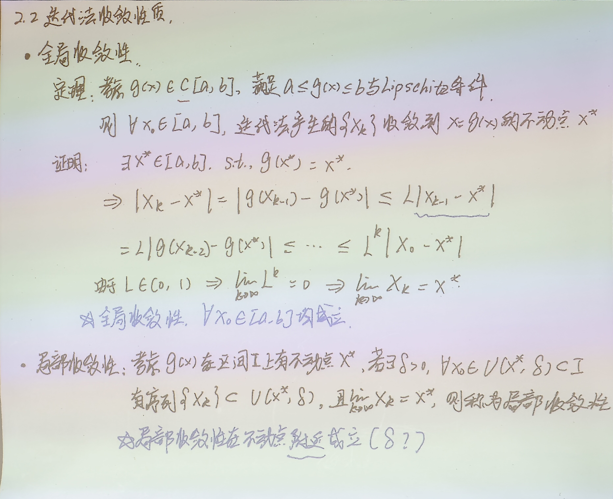

板书到这里就停了，顺带说了一句：从数学分析的角度还可以再讨论不动点的唯一性、误差估计等一系列性质，课上不展开（唯一性和误差估计在 7.1 §8–§9 已经写过）。

## 3. 局部收敛性

### 3.1 定义

**定义（局部收敛，课本定义 1）** 设 $g$ 在区间 $I$ 上有不动点 $x^*$。若存在 $\delta>0$，使对任意 $x_0\in U(x^*,\delta)\subset I$，由迭代产生的序列满足

$$
\{x_k\}\subset U(x^*,\delta),\qquad \lim_{k\to\infty}x_k=x^*
$$

则称该迭代在 $x^*$ 处**局部收敛**。

两个要点：一是初值只在 $x^*$ 附近取（不像全局收敛那样对整区间负责）；二是序列**不许跑出**这个邻域——既要求收敛，也要求过程中不越界。后一条不是废话，它正是证明里要单独验的。

### 3.2 定理与证明

**定理（局部收敛定理，课本定理 3）** 设 $x^*=g(x^*)$，$g$ 在 $x^*$ 的某个邻域内导数存在且连续，且 $|g'(x^*)|<1$，则迭代 $x_{k+1}=g(x_k)$ 在 $x^*$ 处局部收敛。

**证明**（板书四步）：

1. 由 $g'$ 连续、$|g'(x^*)|<1$，取 $\varepsilon>0$ 使 $L:=|g'(x^*)|+\varepsilon<1$；由连续性存在 $\delta>0$，使 $x\in U(x^*,\delta)$ 时 $|g'(x)|\le L$。板书右侧的小图上标的就是这件事：$g'$ 在 $x^*$ 附近整段落在 $|g'(x^*)|+\varepsilon$ 的水平线下方，取 $\delta=\dfrac{1-|g'(x^*)|}{2}$ 即可；
2. 对 $x\in U(x^*,\delta)$，由微分中值定理
   $|g(x)-g(x^*)|=|g(x)-x^*|\le L|x-x^*|$；
3. 而 $|x-x^*|\le\delta$，故 $|g(x)-x^*|\le L\delta<\delta$，即
   $g\big(U(x^*,\delta)\big)\subset U(x^*,\delta)=[x^*-\delta,\,x^*+\delta]$
   ——**$g$ 把这个小闭区间映进自身**；
4. 有了「映进自身」，就把 §2 的全局收敛性定理套在这个闭区间上（Lipschitz 条件取 $L$），得对任意 $x_0\in U(x^*,\delta)$ 收敛。

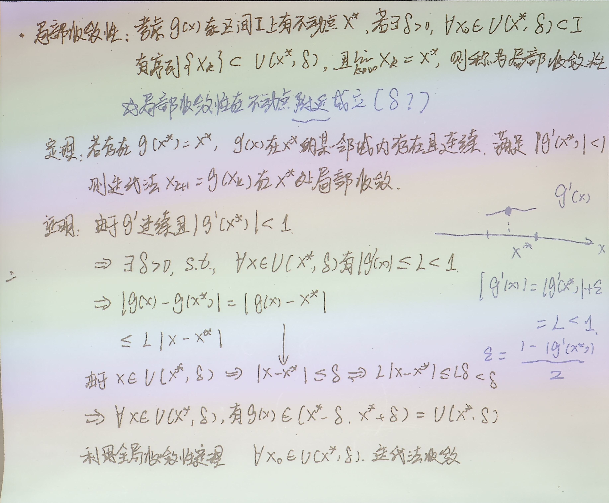

一句话概括这个定理干了什么：**把「在 $x^*$ 处导数的绝对值小于 $1$」这个单点信息，翻译成一个够小的、$g$ 不变的闭区间**，然后交给全局定理。所以局部收敛定理的实质不是「在 $x^*$ 附近收敛」，而是「**存在**一个邻域，在该邻域上原全局定理的条件都成立」。

### 3.3 「附近」到底有多近

$\delta$ 是证明里凑出来的存在性产物，依赖 $\varepsilon$，也依赖放缩。老师特意强调了三点：

- 几乎所有例子里 $\delta$ 都**算不出来**；能给的只是上界，而这个上界往往很**保守**；
- 保守的根源是不等式放缩。为了让不等号成立，中间的量被放大得过分了。老师的比方：$0.1<100$ 万确实成立，但从「小于 100 万」这个界反推回去，你想到的是 10 万、20 万，不会一上来就想到 $0.1$；
- 实际计算中真正能用的范围通常**远大于**理论界。所以这里只能承诺「存在」，报不出具体数字。

### 3.4 三个条件怎么用

定理的条件可以拆成三条：① 不动点存在；② $g'$ 在某邻域内存在且连续；③ $|g'(x^*)|<1$。

- ① 一般靠问题本身有解（画图、介值定理），是最容易的一条；
- ② 列出 $g$ 就能算导数，也容易；
- ③ 麻烦在 $x^*$ **根本不知道**，写出来的 $g'(x^*)$ 只是一个含未知数的表达式。

③ 的通用绕法：记住 $x^*=g(x^*)$，把 $g'(x^*)$ 里的 $x^*$ 用 $g(x^*)$ 反复代换、化简。

最典型的例子就是下面要讲的牛顿法。它的迭代函数是 $g(x)=x-\dfrac{f(x)}{f'(x)}$，于是

$$
g'(x)=1-\frac{f'(x)f'(x)-f(x)f''(x)}{f'(x)^2}=\frac{f(x)f''(x)}{[f'(x)]^2}
$$

在根处 $f(x^*)=0$，所以 $g'(x^*)=0$——**不知道 $x^*$ 的具体值，也能断定条件 ③ 成立**。这正是牛顿法「一上来就给出二阶」的来历（详见 §11）。

### 3.5 反向推论：发散判据

若 $g'$ 在 $x^*$ 附近连续且 $|g'(x^*)|>1$，则对任意 $x_0\ne x^*$，迭代都发散——邻域取多小都没用。

于是「改写二 $x=x^3-1$ 发散」这类判断（7.1 §7）就有了严格依据：$g'(x^*)=3x^{*2}>1$。板书把这条写在定理后面作为推论，用的是同一个中值定理不等式，方向反过来即可。

## 4. 收敛阶

收敛了还要比快慢。衡量快慢的量叫**收敛阶**（有的书叫收敛速率），它是整节课后面所有方法的评价标准。

### 4.1 定义

**定义（收敛阶，课本定义 2）** 设 $\lim_{k\to\infty}x_k=x^*$，记误差 $e_k=x_k-x^*$。若存在实数 $p\ge1$ 与非零常数 $C>0$，使

$$
\lim_{k\to\infty}\frac{|e_{k+1}|}{|e_k|^{p}}=C
$$

则称该迭代过程是 **$p$ 阶收敛**的，$C$ 称**渐近误差常数**。当 $p=1$ 时还额外要求 $0<C<1$（否则误差不缩小）。

### 4.2 $p$ 的含义：把误差「指数地」压下去

板书给了一串数字，把 $p$ 的威力算给出来。设 $p=2$，

$$
e_{k+1}=Ce_k^2,\quad e_{k+2}=Ce_{k+1}^2=C^3e_k^4,\quad e_{k+3}=Ce_{k+2}^2=C^7e_k^8
$$

（指数 $1,3,7$ 就是 $2^j-1$：每平方一次，$C$ 的幂次和 $e_k$ 的位数都翻一倍。）若 $e_k\approx10^{-2}$，则

$$
|e_{k+1}|\approx C\cdot10^{-4},\quad |e_{k+2}|\approx C^3\cdot10^{-8},\quad |e_{k+3}|\approx C^7\cdot10^{-16}
$$

只要 $C$ 不是特别大（个位数、甚至 10 也还行），误差三步就从百分之一量级掉到 $10^{-16}$。

对照线性收敛（$p=1$）：$C=0.1$ 时误差 $1\to0.1\to0.01\to10^{-3}$；$C=0.9$ 时 $1\to0.9\to0.81\to0.729$。差别一眼就看出来了——一个是几何级数的衰减，一个是**指数套指数**的衰减。

### 4.3 为什么用 $p$ 而不是 $C$ 衡量速度

把定义两边同除一次：

$$
\frac{|e_{k+1}|}{|e_k|}\approx C\,|e_k|^{p-1}
$$

$p>1$ 时右边随 $e_k\to0$ 而趋于零，即**相邻两步误差之比比任何固定常数都小**——这就是「超线性」的字面意思。而调整 $C$ 只是把同一个固定倍数改小，阶数没变。所以 $C$ 重要，$p$ 才是决定性的。

术语：$p=1$ 称**线性收敛**（线性方程组的迭代法基本都是这一类，见第 6 章）；$p=2$ 称**平方收敛**（也叫二阶收敛）；$p>1$ 统称**超线性收敛**。

### 4.4 一个容易忽略的细节：$p$ 不必是整数

定义里只要求 $p\ge1$ 是实数，写成 $e_{k+1}\approx Ce_k^{1.618}$ 也完全合法。但下一节判定阶的定理只对**整数** $p$ 成立；非整数阶要靠专门的定理（割线法的 $p=(1+\sqrt5)/2$ 就是这种情形，见 §15）。这一点课上专门点了出来，因为后面马上会遇到。

## 5. 收敛阶判定定理

**定理（收敛阶判定，课本定理 4）** 设 $x^*=g(x^*)$，$p\ge1$ 为整数，$g^{(p)}$ 在 $x^*$ 的某邻域内连续，且

$$
g'(x^*)=g''(x^*)=\cdots=g^{(p-1)}(x^*)=0,\qquad g^{(p)}(x^*)\ne0
$$

则该迭代在 $x^*$ 附近 $p$ 阶收敛，并且

$$
\lim_{k\to\infty}\frac{e_{k+1}}{e_k^{p}}=\frac{g^{(p)}(x^*)}{p!}
$$

**证明**（板书）：先看局部收敛性——$g'(x^*)=0$ 当然满足 $|g'(x^*)|<1$，§3 已保证收敛。再把 $g(x_k)$ 在 $x^*$ 处泰勒展开到 $p-1$ 阶，余项用拉格朗日形式：

$$
g(x_k)=g(x^*)+\sum_{j=1}^{p-1}\frac{g^{(j)}(x^*)}{j!}(x_k-x^*)^{j}+\frac{g^{(p)}(\xi)}{p!}(x_k-x^*)^{p},\qquad \xi\ \text{介于}\ x_k\ \text{与}\ x^*\ \text{之间}
$$

中间那些项前面的导数因子全为零，只剩首末两项。用 $g(x_k)=x_{k+1}$、$g(x^*)=x^*$ 相减：

$$
x_{k+1}-x^*=\frac{g^{(p)}(\xi)}{p!}(x_k-x^*)^{p}
\quad\Longrightarrow\quad
\frac{e_{k+1}}{e_k^{p}}=\frac{g^{(p)}(\xi)}{p!}
$$

$k\to\infty$ 时 $x_k\to x^*$，被夹在中间的 $\xi$ 也跟着收向 $x^*$；再由 $g^{(p)}$ 连续，极限就是 $\dfrac{g^{(p)}(x^*)}{p!}$。

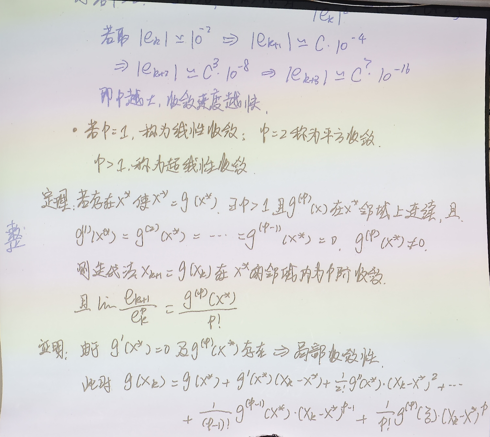

**用法**：给定了 $g$，就逐阶算 $g^{(j)}(x^*)$（同样用 $x^*=g(x^*)$ 化简），**第一个不为零的阶数**就是收敛阶。板书把这句作为结论写在最下面。

两个直接推论：

- 若 $g'(x^*)\ne0$，迭代最多只能是**线性**收敛；
- 想要更快，就必须让 $g$ 在 $x^*$ 处的前几阶导数成片为零。课本例 4（$x^2-3=0$ 的四种改写，7.1 §11 已列）就是这条的实测表：$g'(x^*)\approx0.134$ 的那个线性收敛，$g'(x^*)=0$ 的那个三步就到 $1.732051$。

## 6. Aitken $\Delta^2$ 加速

### 6.1 动机

线性收敛时误差按固定比例缩小。$C=0.9$ 就是每步只砍掉一成的误差，慢得没脾气。既然迭代已经算出了一串数，能不能拿其中几个「外推」出一个更好的值？

### 6.2 推导

$k$ 充分大时，线性收敛给出

$$
x_{k+1}-x^*\approx C(x_k-x^*),\qquad x_{k+2}-x^*\approx C(x_{k+1}-x^*)
$$

$C$ 是未知的，两式相除把它消掉：

$$
\frac{x_{k+2}-x^*}{x_{k+1}-x^*}\approx\frac{x_{k+1}-x^*}{x_k-x^*}
$$

这是关于 $x^*$ 的**一次**方程，解出来：

$$
x^*\approx\frac{x_kx_{k+2}-x_{k+1}^2}{x_{k+2}-2x_{k+1}+x_k}
$$

右端全是已经算出来的数。把它作为 $x^*$ 的新近似，记作 $\overline{x_k}$：

$$
\overline{x_k}=x_k-\frac{(x_{k+1}-x_k)^2}{(x_{k+2}-x_{k+1})-(x_{k+1}-x_k)}
$$

两种写法通分后恒等：分子 $=x_k(x_{k+2}-2x_{k+1}+x_k)-(x_{k+1}-x_k)^2=x_kx_{k+2}-x_{k+1}^2$。板书两种都写了。

**差分写法**：记一阶差分 $\Delta x_k=x_{k+1}-x_k$，二阶差分 $\Delta^2x_k=\Delta x_{k+1}-\Delta x_k=x_{k+2}-2x_{k+1}+x_k$，则

$$
\overline{x_k}=x_k-\frac{(\Delta x_k)^2}{\Delta^2x_k}
$$

老师说得很实在：不必去记每一步的具体公式，记住这个差分关系（分子的平方、分母是两个一阶差分相减）就够了。

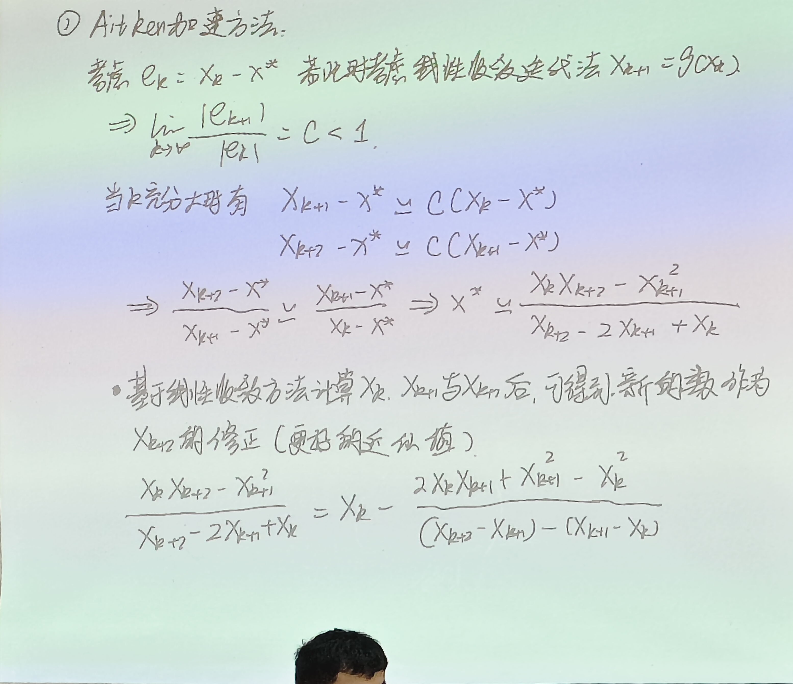

### 6.3 加速定理

**定理（Aitken 加速，板书 / 课本 §7.3.1）** 设序列 $\{x_k\}$ 满足 $x_k\to x^*\ne0$，且存在 $\lambda$，$|\lambda|<1$，使

$$
x_{k+1}-x^*=(\lambda+\delta_k)(x_k-x^*),\qquad \lim_{k\to\infty}\delta_k=0
$$

则 $k$ 充分大时 $\overline{x_k}$ 存在（即分母不为零），且

$$
\lim_{k\to\infty}\frac{\overline{x_k}-x^*}{x_k-x^*}=0
\quad\Longleftrightarrow\quad
\overline{x_k}-x^*=o(x_k-x^*)
$$

课上不证（「严格性的证明在课上就不去做」）。这个结论的分量要说清楚：比值趋于 $0$ 意味着加速后的序列比原序列快**无穷多倍**，而不是只快一个常数倍。

极端情形最能看清这件事：若序列**严格**是等比 $x_k-x^*=c\lambda^k$，Aitken 一步就精确命中 $x^*$（把三个值代进去，分式约完正好等于 $x^*$）。实际序列带着高阶项，所以只是逐步变好——定理里的 $\delta_k\to0$ 量的就是这个「偏离等比」的程度。

### 6.4 序列图与用法

板书画了一张图：上面一行 $\{x_k\}$ 一直往前走，每三个数向下引一个箭头，得到下面一行 $\{\overline{x_k}\}$ 的一个元素。

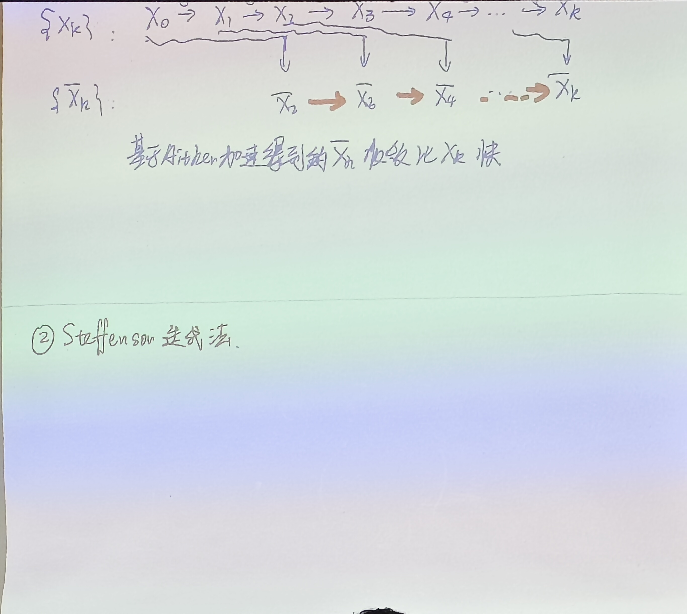

两个要点：

- $\{\overline{x_k}\}$ **没有自己的递推关系**。它不是由 $\overline{x_k}$ 算 $\overline{x_{k+1}}$，而是完全寄生的：只要 $\{x_k\}$ 有连续三个值，就能算出一个 $\overline{x_k}$，甚至前面那些值都可以不管；
- 所以实现上很灵活：可以先按原迭代一直走到底，最后拿末尾三个值修正一次（课上说法：相当于「在最后一步加一点点小的修正」），也可以每三步修正一次。

### 6.5 数值例：$\cos$ 迭代

取 $x_{k+1}=\cos x_k$，$x_0=1$。真值 $x^*=0.7390851\ldots$，$g'(x^*)=-\sin x^*=-0.6736$。

| $k$ | 0 | 1 | 2 | 3 | 4 | 5 | 6 | 7 | 8 |
| --- | --- | --- | --- | --- | --- | --- | --- | --- | --- |
| $x_k$ | 1.00000 | 0.54030 | 0.85755 | 0.65429 | 0.79348 | 0.70137 | 0.76396 | 0.72210 | 0.75042 |
| $e_k$ | 2.61e-1 | 1.99e-1 | 1.19e-1 | 8.48e-2 | 5.44e-2 | 3.77e-2 | 2.49e-2 | 1.70e-2 | 1.13e-2 |

相邻误差比稳定在 $0.66\sim0.72$，正是线性收敛（与 $|g'|=0.6736$ 吻合）。

拿末尾三个值 $(x_6,x_7,x_8)$ 做**一次** Aitken：$\overline{x_6}=0.7389922$，误差 $9.3\times10^{-5}$。也就是从 $1.13\times10^{-2}$ 一步压到 $9.3\times10^{-5}$，等效于原迭代再多走 $12$ 步（$\ln122/\ln(1/0.674)\approx12$）。三个数换十二步，这就是外推的收益。

### 6.6 它不够好的地方

Aitken 只**改常数、不改阶**：加速序列的误差每一步仍按某个固定比例缩小，只是比例更小。原因很直接——定理给的结论是「比原序列快」，而原序列的阶本来就是 $1$；而且 $\{\overline{x_k}\}$ 没有自己的迭代格式，也就谈不上独立的「阶」。

要真正把阶提上去，必须把「加速」**写进迭代格式**。这就是下一步。

## 7. Steffensen 迭代法

把 Aitken 公式里的 $x_{k+1},x_{k+2}$ 换成用 $g$ 现算的值：

$$
y_k=g(x_k),\qquad z_k=g(y_k)=g(g(x_k)),
$$
$$
x_{k+1}=x_k-\frac{(y_k-x_k)^2}{z_k-2y_k+x_k}=:\varphi(x_k)
$$

这就是 **Steffensen 迭代法**（课本 (3.3)）。

写成显式的迭代函数：

$$
\varphi(x)=x-\frac{(g(x)-x)^2}{g(g(x))-2g(x)+x}
=\frac{x\,g(g(x))-(g(x))^2}{g(g(x))-2g(x)+x}
$$

第二个等号通分即得（板书两行都写了）。于是 Steffensen 迭代就是一个**普通的不动点迭代**，迭代函数 $\varphi$ 完全由 $g$ 决定。

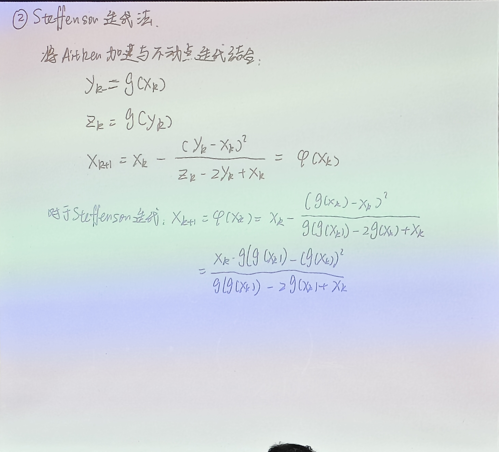

代价是每步算**两次** $g$；换来的是它是一个有自己格式的迭代，可以谈收敛性和阶。这正是课上反复强调的差别：

- Aitken：算完给你一个修正值，收敛率仍按老序列说话；
- Steffensen：把修正写成 $x_{k+1}=\varphi(x_k)$，于是能做收敛性、收敛阶的判断。

课本还给了另一种理解（📌 课上没讲，可作为旁证）：令 $e(x)=g(x)-x$，则 $e(x_k)=y_k-x_k$、$e(y_k)=z_k-y_k$，把「误差」外推到零——过 $(x_k,e(x_k))$ 与 $(y_k,e(y_k))$ 两点作线性插值，其零点恰好就是上面的 $x_{k+1}$。

## 8. 定理：$\varphi$ 与 $g$ 的不动点等价

**定理（课本定理 5 前半）** 若 $x^*=\varphi(x^*)$，则 $x^*=g(x^*)$；反之，若 $x^*=g(x^*)$，且 $g'$ 在 $x^*$ 附近存在连续、$g'(x^*)\ne1$，则 $x^*=\varphi(x^*)$。

两个方向要证明的东西不同：正向是「$\varphi$ 的不动点不会凭空多出来」，反向是「$g$ 的不动点不会被 $\varphi$ 漏掉」。后者需要一个附加条件，这个条件的来历正是证明的看点。

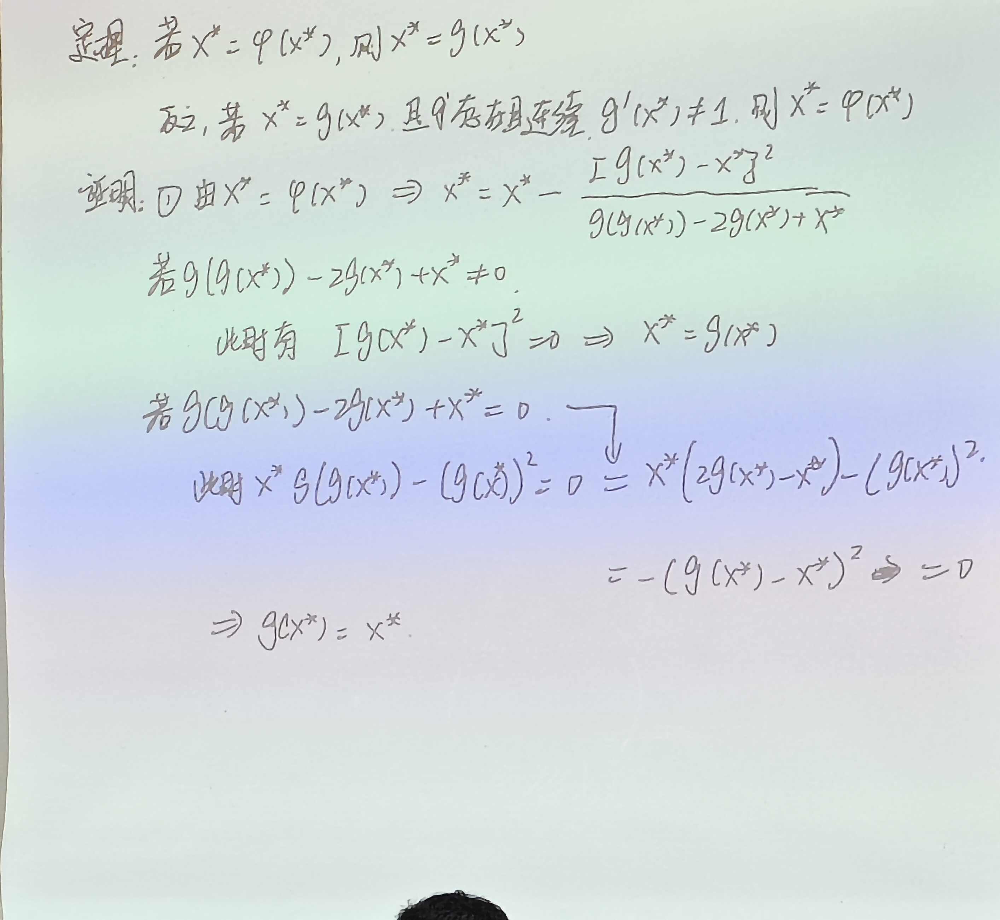

### 8.1 方向一：$\varphi$ 的不动点一定是 $g$ 的不动点

设 $x^*=\varphi(x^*)$。按通分形式 $\varphi(x)=\dfrac{x\,g(g(x))-(g(x))^2}{g(g(x))-2g(x)+x}$ 讨论分母。

**分母不为零**：由 $x^*=\varphi(x^*)$ 得

$$
x^*=x^*-\frac{(g(x^*)-x^*)^2}{g(g(x^*))-2g(x^*)+x^*}
\quad\Longrightarrow\quad
(g(x^*)-x^*)^2=0
$$

直接得 $g(x^*)=x^*$。

**分母为零**：此时 $g(g(x^*))-2g(x^*)+x^*=0$，即 $g(g(x^*))=2g(x^*)-x^*$。而 $x^*=\varphi(x^*)$ 在这个分支下只能理解为「分子也为零」（否则分式是 $0/0$ 型，$\varphi(x^*)$ 无从定义），即 $x^*g(g(x^*))-(g(x^*))^2=0$。把前一式代入：

$$
x^*\big(2g(x^*)-x^*\big)-\big(g(x^*)\big)^2=-\big(g(x^*)-x^*\big)^2=0
$$

同样得 $g(x^*)=x^*$。两个分支结论一致，方向一得证。

（这个分支讨论课堂上花了点笔墨，因为它是「分母可能退化」的唯一麻烦处；后面会发现，反向证明里的 $g'(x^*)\ne1$ 恰好就是用来堵住这个麻烦的。）

### 8.2 方向二：$g$ 的不动点在 $g'(x^*)\ne1$ 时也是 $\varphi$ 的不动点

设 $x^*=g(x^*)$。代入 $\varphi$ 的表达式：分子 $(g(x^*)-x^*)^2=0$，分母 $g(g(x^*))-2g(x^*)+x^*=x^*-2x^*+x^*=0$——**分子分母同时为零**，是 $0/0$ 型。于是对分子分母分别求导，用洛必达法则看极限：

$$
\text{分子}'=\Big[(g(x)-x)^2\Big]'=2\big(g(x)-x\big)\big(g'(x)-1\big),
$$
$$
\text{分母}'=\Big[g(g(x))-2g(x)+x\Big]'=g'(g(x))\cdot g'(x)-2g'(x)+1
$$

在 $x=x^*$ 处：

- 分子含因子 $g(x^*)-x^*=0$，故为 $0$；
- 分母 $=g'(g(x^*))g'(x^*)-2g'(x^*)+1=\big(g'(x^*)\big)^2-2g'(x^*)+1=\big(g'(x^*)-1\big)^2$。

因为 $g'(x^*)\ne1$，分母**不为零**。分母非零、分子为零，比值的极限为 $0$，于是

$$
\varphi(x^*)=x^*-0=x^*
$$

方向二得证。条件 $g'(x^*)\ne1$ 的全部作用就在这里：保证 $\big(g'(x^*)-1\big)^2\ne0$，也就是分式不退化。

课上对这个证明的评价是「形式上」的：用洛必达把极限算出来，说清了两个迭代函数的关系，但不算严格分析。对理解条件来源足够。

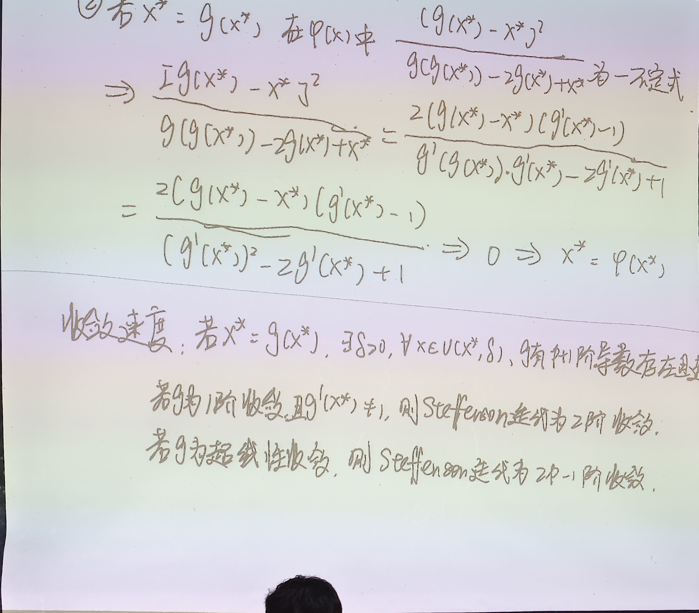

## 9. Steffensen 的收敛阶

板书（在「收敛速度」那一行下面）给了两条：

- 若 $g$ 是**线性**收敛（$p=1$）且 $g'(x^*)\ne1$，则 Steffensen 迭代是 **$2$ 阶**收敛；
- 若 $g$ 是 $p$ 阶收敛（$p>1$），则 Steffensen 迭代是 **$2p-1$ 阶**收敛。

第一条是课本定理 5 的后半；第二条课本没有，课上补的。注意 $2p-1$ 只用于 $p>1$：$p=1$ 时 $2\cdot1-1=1$ 与结论矛盾，线性收敛是单独一条。

📌 课本 §7.3.2 末尾的写法是「若迭代法 (2.2) 为 $p$ 阶收敛，则迭代法 (3.3) 为 $p+1$ 阶收敛」，与板书的 $2p-1$ 不一致。$p=2$ 时两者都给 $3$，看不出差别；$p=3$ 时 $2p-1=5$、$p+1=4$。这一点可以数值判定：取 $g(x)=\sqrt2+\tfrac12(x-\sqrt2)^3$（不动点 $\sqrt2$，前两阶导数为零，三阶收敛），用 400 位十进制精度算 Steffensen 的误差比 $\log e_{k+1}/\log e_k$：

| 原迭代阶 | Steffensen 实测阶 | $2p-1$ | $p+1$ |
| --- | --- | --- | --- |
| $p=2$ | 3.09、3.03 → 3 | 3 | 3 |
| $p=3$ | 5.19、5.04 → 5 | 5 | 4 |

$p=3$ 时实测是 $5$ 阶，所以**课堂的 $2p-1$ 是对的**，笔记按课堂记。

### 9.1 数值例：$\cos$ 迭代上的 Steffensen

同一个 $\cos$ 迭代（$g'(x^*)=-0.6736$，线性收敛），直接在 $x_0=1$ 上跑 Steffensen：

| $k$ | 0 | 1 | 2 | 3 | 4 |
| --- | --- | --- | --- | --- | --- |
| $x_k$ | 1.000000000 | 0.728010361 | 0.739066967 | 0.739085133166 | 0.739085133215 |
| $e_k$ | 2.61e-1 | 1.11e-2 | 1.82e-5 | 4.9e-11 | 机器精度 |

$e_{k+1}/e_k^2$：$1.82\times10^{-5}/(1.11\times10^{-2})^2=0.148$，$4.9\times10^{-11}/(1.82\times10^{-5})^2=0.148$——常数稳住，二阶收敛确认。四步就到机器精度，而原迭代走 $50$ 步也就 $10^{-9}$ 上下（$0.674^{50}\approx10^{-9}$）。

这个 $0.148$ 可以手算核对：设 $g(x)=x^*+\lambda u+cu^2$（$u=x-x^*$），把 $y=g(x)$、$z=g(y)$ 代进 $\varphi$ 展开到 $u^2$，可得

$$
x_{k+1}-x^*=\frac{c\lambda}{\lambda-1}u^2+O(u^3)
$$

代 $\lambda=-0.6736$、$c=-\tfrac12\cos(x^*)=-0.3695$，得 $-\dfrac{0.3695\times0.6736}{1.6736}=-0.1487$，与实测吻合。

### 9.2 课本的两个例子

📌 课本 §7.3.2 有例 5、例 6，课上只提了结论没展开，值得记一句：

- **例 5**：7.1 里那个发散的改写 $x_{k+1}=x_k^3-1$（$x_0=1.5$，第 2 步就冲到 $12.4$）用 Steffensen 反而**收敛**：第 3 步 $1.3290$、第 4 步 $1.3248$，已经贴在真值 $1.32472$ 附近（表 7-5）。说明原迭代发散并不等于 Steffensen 也发散——它等价于换了一个迭代函数 $\varphi$，收敛域不同；
- **例 6**：$3x^2-e^x=0$ 在 $[3,4]$ 上，不动点迭代 $x=2\ln x+\ln3$ 要 16 步到 $3.73307$；Steffensen 算 2 步（相当于原迭代 4 步）就到同一结果。

两个例子指向同一件事：**加速的收益在原迭代慢的时候最大**。

## 10. 为什么还要牛顿法

课上在这里提了一个很实在的观察，值得单独记下来：

1. **高阶算法在前期并不快**。平方收敛要等误差足够小才显出威力——得先把 $0.1$ 压到 $0.01$、再到 $10^{-4}$、再到 $10^{-8}$，这一段「爬坡」是躲不掉的。所以「一开始就上高阶算法」的收益有限；
2. Aitken / Steffensen 都**得先有一个迭代**（最好是线性收敛的），Steffensen 还每步算两次 $g$；
3. 有没有一个**一开始就快**、形式又极其简单的方法？有——牛顿法。

## 11. 牛顿法的推导

设 $f(x^*)=0$，$x_k$ 是当前近似值。把 $f(x^*)$ 在 $x_k$ 处泰勒展开，只留一阶，余项当小量丢掉：

$$
0=f(x^*)=f(x_k)+f'(x_k)(x^*-x_k)+\tfrac12f''(\xi)(x^*-x_k)^2
\approx f(x_k)+f'(x_k)(x^*-x_k)
$$

解这个线性方程（$f'(x_k)\ne0$）：

$$
x^*\approx x_k-\frac{f(x_k)}{f'(x_k)}
$$

把它当作下一步的近似，就得到**牛顿迭代格式**（课本 (4.2)）：

$$
x_{k+1}=x_k-\frac{f(x_k)}{f'(x_k)},\qquad g(x)=x-\frac{f(x)}{f'(x)}
$$

**几何读法**（板书那张图）：原来要找曲线 $y=f(x)$ 与 $x$ 轴的交点，曲线的交点不好算；但在 $x_k$ 这一点，函数值和导数值都是知道的，于是过 $(x_k,f(x_k))$ 作切线

$$
L(x)=f(x_k)+f'(x_k)(x-x_k)
$$

把「解 $f=0$」换成「解 $L=0$」，直线好解。只要切线在 $x_k$ 附近确实贴着曲线，用 $L$ 的零点近似 $f$ 的零点就不离谱。牛顿法因此也叫**切线法**。

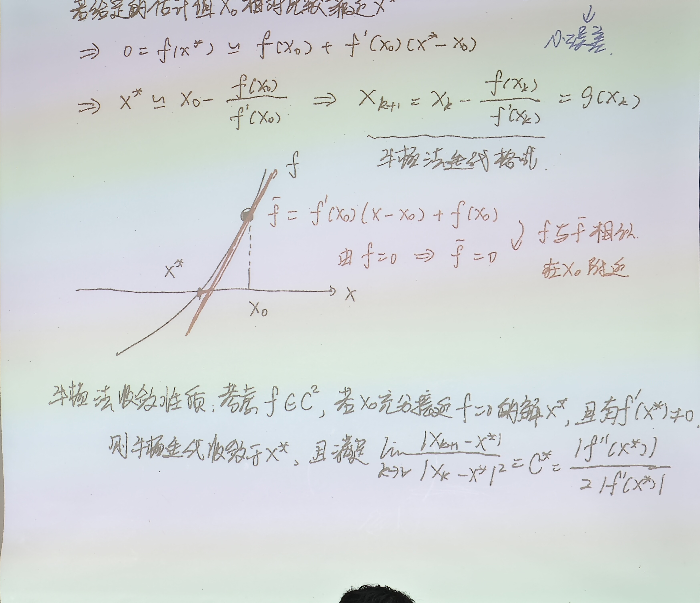

有两点必须强调：

- 这是**局部**替代——只在 $x_k$ 附近成立，所以牛顿法必然是局部收敛的方法，初值不能太远；
- 牛顿法就是不动点迭代的一个特例，只是 $g$ 选得巧。巧在哪儿？§3.4 已经算过：$g'(x^*)=\dfrac{f(x^*)f''(x^*)}{[f'(x^*)]^2}=0$。于是按 §5 的判定定理，只要 $g''(x^*)\ne0$ 就是**二阶**收敛，一步到位，不需要任何加速技巧。

## 12. 收敛定理与证明

**定理（牛顿法收敛性，课本 (4.3)）** 设 $f\in C^2$，$x^*$ 是 $f(x)=0$ 的解，且 $f'(x^*)\ne0$。若 $x_0$ 充分接近 $x^*$，则牛顿迭代收敛到 $x^*$，且

$$
\lim_{k\to\infty}\frac{|x_{k+1}-x^*|}{|x_k-x^*|^{2}}=C^*=\frac{|f''(x^*)|}{2|f'(x^*)|}
$$

即**平方收敛**，渐近误差常数是 $\dfrac{|f''(x^*)|}{2|f'(x^*)|}$。

「充分接近」的量化（板书旁注）：$x_0$ 落在 $x^*$ 的某个邻域内，且 $|x_0-x^*|<\dfrac1C$、$\left|\dfrac{f''}{2f'}\right|<C$。

**证明**（板书五步）：

1. 由 $f\in C^2$，把 $0=f(x^*)$ 在 $x_k$ 处展开到二阶（拉格朗日余项）：
   $$
   0=f(x_k)+f'(x_k)(x^*-x_k)+\tfrac12f''(\xi_k)(x^*-x_k)^2,\qquad \xi_k\ \text{介于}\ x_k\ \text{与}\ x^*\ \text{之间}
   $$
2. 两边除以 $f'(x_k)$ 整理：
   $$
   x^*=x_k-\frac{f(x_k)}{f'(x_k)}-\frac12(x^*-x_k)^2\cdot\frac{f''(\xi_k)}{f'(x_k)}
   $$
3. 认出第二项就是牛顿步 $x_{k+1}$：
   $$
   x^*=x_{k+1}-\frac12(x^*-x_k)^2\cdot\frac{f''(\xi_k)}{f'(x_k)}
   $$
4. 移项、取绝对值：
   $$
   \frac{|x_{k+1}-x^*|}{|x^*-x_k|^2}=\frac{|f''(\xi_k)|}{2|f'(x_k)|}
   $$
5. 控制右端：$f''$ 连续，在闭区间上有界（取上界）；$f'(x^*)\ne0$ 且 $f'$ 连续，在 $x^*$ 附近有正下界。于是存在 $\delta$-邻域，使右端 $\le C$。若 $x_k$ 落在其中且 $|x_k-x^*|<1/C$，则
   $$
   |x_{k+1}-x^*|\le C|x_k-x^*|^2<|x_k-x^*|
   $$
   误差**严格递减**，且递推下去始终留在 $\delta$ 内。
6. 误差有界递减 ⟹ 收敛；再令 $k\to\infty$，$\xi_k\to x^*$、$f'(x_k)\to f'(x^*)$，第 4 步的等式给出所要求的极限，常数就是 $|f''(x^*)|/(2|f'(x^*)|)$。

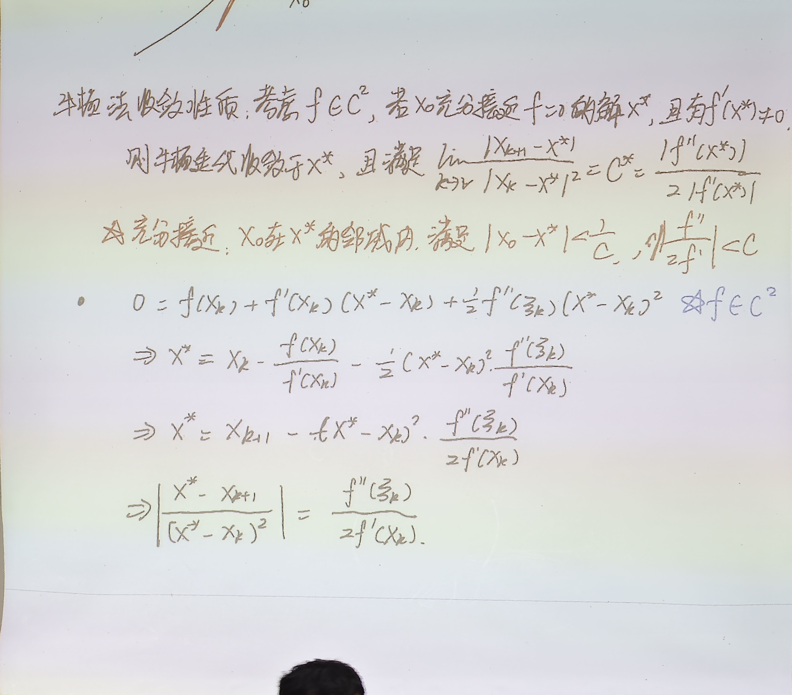

### 12.1 「充分接近」在实践中怎么办

定理里那句「$x_0$ 充分接近」在实际中没法验证：$\delta$ 依赖 $C$，$C$ 又依赖邻域本身，绕回原处。

老师的态度很直接，也是做数值计算与做理论分析的差别：

> 收敛有很明确的数值信号。可以先把迭代跑起来试试，前面几步就在收敛、误差在掉，就继续；跑几次发现结果开始离谱，就停下来换初值。实现上预先加一点朴素的自动判断（比如限定迭代 20 次，看是否在收敛）就够了——没必要、也确实不太可能给出一个非常精准的估计。

📌 课本 §7.4.3 给了两条正规的补救，课上没展开：

- **牛顿下山法**：附加单调性要求 $|f(x_{k+1})|<|f(x_k)|$，把牛顿步与上一步加权平均 $x_{k+1}=\lambda x_{k+1}^{N}+(1-\lambda)x_k$，$\lambda$ 从 $1$ 起逐次减半试算，直到下降条件成立；
- **简化牛顿法（平行弦法）**：把 $f'(x_k)$ 换成固定常数 $C$，即 $x_{k+1}=x_k-Cf(x_k)$，局部收敛条件 $|1-Cf'|<1$（即 $0<Cf'<2$），代价是降成线性收敛。

## 13. 三个例子：单根、二重根、多重根

### 13.1 例 1：算 $\sqrt2$（单根，平方收敛）

$$
x=\sqrt2\iff x^2-2=0,\quad f(x)=x^2-2,\quad f'(x)=2x
$$
$$
x_{k+1}=x_k-\frac{x_k^2-2}{2x_k}=\frac{x_k}{2}+\frac{1}{x_k}
$$

（第二个等号把 $-\dfrac{x_k^2-2}{2x_k}$ 拆成 $-\dfrac{x_k}{2}+\dfrac{1}{x_k}$ 再与 $x_k$ 合并；板书写成 $\dfrac{x_k}{2}+\dfrac{1}{x_k}$ 这个形式，手算方便。）

取 $x_0=2$：

| $k$ | 0 | 1 | 2 | 3 | 4 |
| --- | --- | --- | --- | --- | --- |
| $x_k$ | 2 | 1.5 | 1.4166667 | 1.4142157 | 1.4142136 |
| $e_k$ | 0.59 | 0.086 | 0.0025 | $2\times10^{-6}$ | — |

误差从小数点后一位掉到两位、四位，正是平方的样子。验证常数：$e_2/e_1^2=0.0025/0.086^2\approx0.34$，与 $C^*=\dfrac{|f''|}{2|f'|}=\dfrac{2}{2\cdot2\sqrt2}=\dfrac{1}{2\sqrt2}\approx0.354$ 吻合。

换初值 $x_0=-2$：$x_1=-1.5$，$x_2\approx-1.42$，收敛到 $-\sqrt2$。**收敛到哪个根由初值决定**——每步用的都是局部切线，初值靠近哪个根就奔哪个根去。这不是缺陷，而是局部收敛的必然。

初值取 $0$ 则第一步就出事：$f'(0)=0$，分母为零。这也是实际问题里要避开的（起手就除零）。

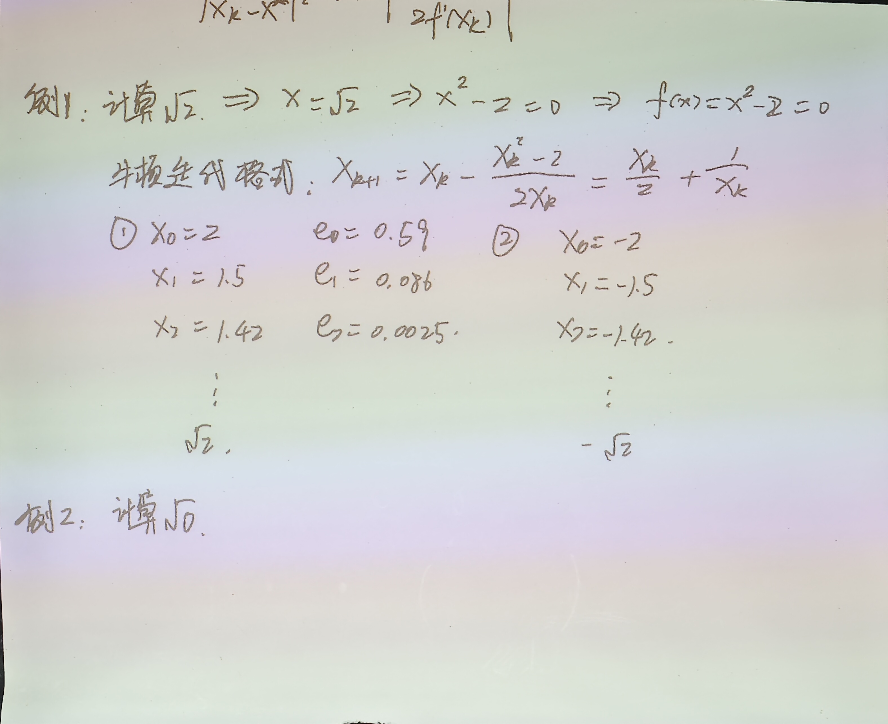

### 13.2 例 2：算 $\sqrt0$（二重根，退化成线性）

「算 $\sqrt0$」不是真要算它（一看就知道是 $0$），而是为了看 $f'(x^*)=0$ 会出什么状况。

$$
f(x)=x^2,\qquad x_{k+1}=x_k-\frac{x_k^2}{2x_k}=\frac{x_k}{2}
$$

竟然就是折半。取 $x_0=2$：$x_1=1$，$x_2=\frac12$，$x_3=\frac14,\dots$，即 $x_n=\dfrac{1}{2^{n-1}}$，$e_n=\dfrac{1}{2^{n-1}}$。

于是

$$
\frac{e_{n+1}}{e_n}=\frac12
$$

**没有平方收敛，但仍是线性收敛，迭代照样能算下去。**

结论：$f'(x^*)=0$ 并不使牛顿法失效，只是丢了平方收敛。几何上看，$x^*$ 成了重根，曲线在 $x^*$ 处与 $x$ 轴相切（切线斜率 $0$，交点被「推得很远」）。

### 13.3 例 3：$x^N=0$（更高的重根，更慢）

把上例推到 $N$ 次：

$$
f(x)=x^N,\qquad x_{k+1}=x_k-\frac{x_k^N}{Nx_k^{N-1}}=\left(1-\frac1N\right)x_k
$$

仍是线性收敛，常数 $C=1-\dfrac1N$：$N=2$ 时 $0.5$，$N=3$ 时 $0.667$，$N=4$ 时 $0.75$，$N=5$ 时 $0.8$——**重数越高越慢**。

统一说法：$x^*$ 是 $f$ 的 $m$ 重根时，牛顿法线性收敛，$C=1-\dfrac1m$。

📌 课本 §7.4.4 给了两条修正（课上没展开），都是把「$m$ 重根」化成「单根问题」：

- **知道重数 $m$**：用 $x_{k+1}=x_k-m\dfrac{f(x_k)}{f'(x_k)}$，恢复二阶收敛；
- **不知道 $m$**：令 $\mu(x)=\dfrac{f(x)}{f'(x)}$（$x^*$ 恰是 $\mu$ 的**单根**），对 $\mu$ 用牛顿法，也恢复二阶。

课本例 9（$x^4-4x^2+4=0$，$x^*=\sqrt2$ 是二重根，$x_0=1.5$）实测：两种修正各走 3 步就到 10 位有效数字 $1.414213562$，而原牛顿法只有线性收敛，同样精度要 30 步。

## 14. 拟牛顿法：把 $f'$ 换掉

### 14.1 动机

牛顿法的前提是**显式地知道并会算** $f'(x_k)$。这在实际问题里经常不成立。老师举的例子很具体：用神经网络去逼近一个函数，把逼近结果当作 $f$，这时 $f'$ 极难显式得到。

于是退一步：找一个**容易算**的量 $G$，让它近似 $f'(x_k)$，顶替分母。

> 所有「用一个好算的 $G$ 代替不好算的 $f'$」的方法，统称**拟牛顿方法**。

板书在牛顿公式的 $f'(x_k)$ 上圈了一个圈，旁边写：$G(x_k)\approx f'(x_k)$，且 $G$ 容易计算。

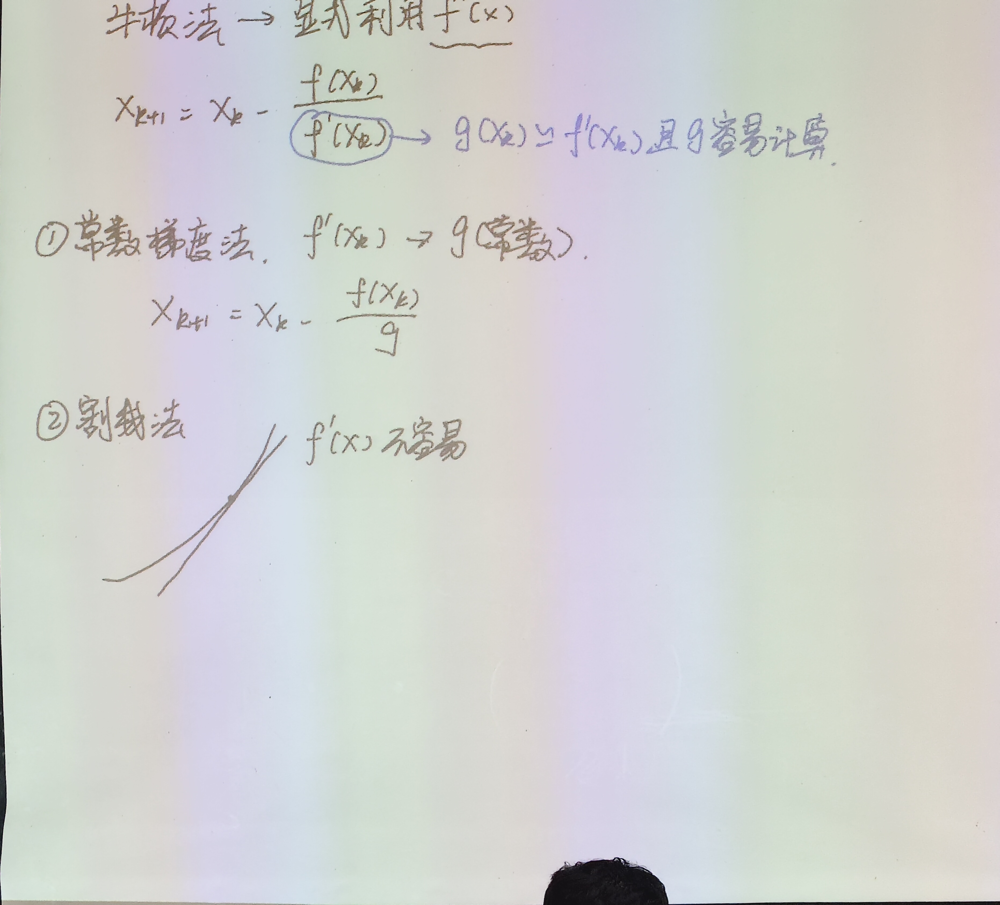

### 14.2 ① 常数（梯度）替代

直接把 $f'$ 换成一个常数 $G$：

$$
x_{k+1}=x_k-\frac{f(x_k)}{G}
$$

也可以在迭代过程中每隔若干步更新一次 $G$（比如 $0\sim20$ 步用同一个，$20\sim40$ 步换一个）。

老师说这和机器学习里调**学习率**有点像——定值加阶段调整；但要注意两者并不等价：那边本质上有梯度信息，这里没有。

📌 课本 §7.4.3 把这一类叫**简化牛顿法 / 平行弦法**：$x_{k+1}=x_k-Cf(x_k)$，$C\ne0$，迭代函数 $\varphi(x)=x-Cf(x)$，局部收敛条件是 $|\varphi'(x)|=|1-Cf'(x)|<1$，即 $0<Cf'<2$。几何上是用一族斜率为 $1/C$ 的**平行弦**与 $x$ 轴的交点逼近根。代价是只有线性收敛——这正好呼应 §4 的判据：换掉导数，阶就掉了。

### 14.3 ② 割线法

比常数替代更常用：不去算切线斜率，而是**过两个点连一条割线**，用割线斜率顶替导数。

$$
g_k=\frac{f(x_k)-f(x_{k-1})}{x_k-x_{k-1}}
\quad\Longrightarrow\quad
x_{k+1}=x_k-\frac{f(x_k)\,(x_k-x_{k-1})}{f(x_k)-f(x_{k-1})}
$$

这就是**割线法**（也叫**弦截法**，课本 (5.2)）。

几何：牛顿法用 $x_k$ 处的**切线**；割线法用经过 $(x_{k-1},f(x_{k-1}))$ 与 $(x_k,f(x_k))$ 的**割线**。两点靠得足够近时割线近似切线。

板书那两张对照图画的正是这件事：左边一条切线（要算导数），箭头右边换成一条割线（只用两个函数值）。

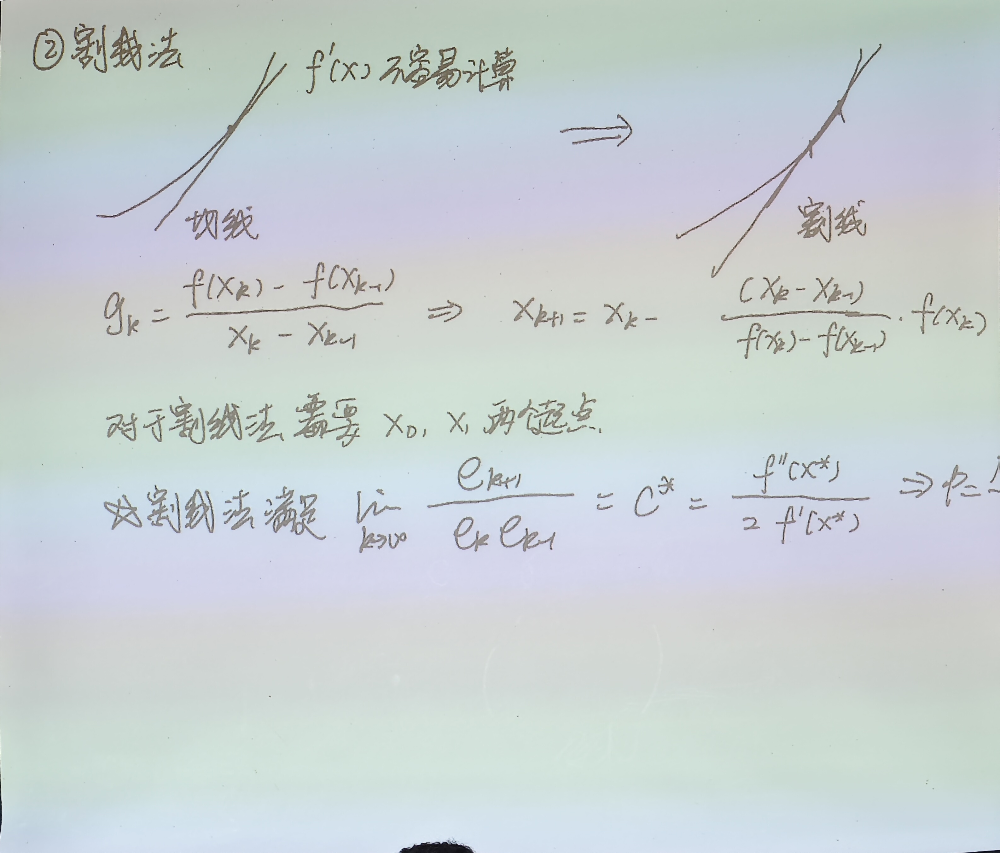

两个与牛顿法的本质差别：

- **需要两个初值** $x_0,x_1$（切线只要一个点就有斜率）；之后每步用前两步的结果；
- 每步只算**一次**新的 $f$，完全不用 $f'$。

## 15. 割线法的收敛阶

板书给的误差关系：

$$
\lim_{k\to\infty}\frac{e_{k+1}}{e_ke_{k-1}}=C^*=\frac{f''(x^*)}{2f'(x^*)}
$$

注意 $C^*$ 与牛顿法的常数是**同一个数**，只是分母从 $e_k^2$ 换成了 $e_ke_{k-1}$。

由此可以推出阶。设 $e_{k+1}\approx Ce_k^{p}$，则 $e_k\approx Ce_{k-1}^{p}$，即 $|e_{k-1}|\approx\left(\dfrac{|e_k|}{C}\right)^{1/p}$。代进上式：

$$
C|e_k|^{p}\approx C^*|e_k|\left(\frac{|e_k|}{C}\right)^{1/p}
$$

两边比较 $|e_k|$ 的幂次（左端是 $p$，右端是 $1+\frac1p$），得

$$
p=1+\frac1p\quad\Longrightarrow\quad p^2-p-1=0
$$

取正根 $p=\dfrac{1+\sqrt5}{2}\approx1.618$（黄金分割比）。课本定理 6 说「$p$ 是方程 $\lambda^2-\lambda-1=0$ 的正根」，来历就是这一步。

所以割线法是**超线性**但不是平方收敛：比线性快得多，比牛顿法略慢。它是个**实数阶**——正好印证 §4.4 那句「阶不一定是整数」，也说明它不能套用 §5 的整数阶判定定理，需要单独的定理（课本定理 6，证明引文献）。

**数值验证**：$f(x)=xe^x-1=0$，根 $x^*=0.56714329$，取 $x_0=0.5$、$x_1=0.6$：

| $k$ | 0 | 1 | 2 | 3 | 4 | 5 |
| --- | --- | --- | --- | --- | --- | --- |
| $x_k$ | 0.5 | 0.6 | 0.565315 | 0.567095 | 0.5671434 | 0.5671433 |
| $e_k$ | 6.7e-2 | 3.3e-2 | 1.8e-3 | 4.9e-5 | 7.3e-8 | 2.9e-12 |

$e_{k+1}/(e_ke_{k-1})=0.810,\ 0.820,\ 0.819,\ 0.819$——稳定在 $0.819$。理论值 $\dfrac{f''}{2f'}=\dfrac{(x+2)e^x}{2(x+1)e^x}$ 在 $x^*$ 处为 $0.8191$，完全吻合。

📌 课本 §7.5.2 还有**抛物线法**（密勒法，Müller）：用三个点作二次插值，取抛物线与 $x$ 轴的交点作为新的近似，阶 $p=1.840$（$\lambda^3-\lambda^2-\lambda-1=0$ 的根），比割线法更快、更接近牛顿法。课上没讲。

## 16. 小结

一条主线：**先判断收敛，再判断快慢，最后想办法变快。**

| 方法 | 迭代格式 | 阶 | 每步计算量 | 初始值 |
| --- | --- | --- | --- | --- |
| 不动点迭代 | $x_{k+1}=g(x_k)$ | 由 $g$ 在 $x^*$ 处为零的导数阶数决定 | 1 次 $g$ | 1 个 |
| Aitken 加速 | $\overline{x_k}=x_k-\dfrac{(\Delta x_k)^2}{\Delta^2x_k}$ | 无自有阶，比原序列快 | 由 3 个已有值算 1 个 | 沿用原序列 |
| Steffensen | $x_{k+1}=x_k-\dfrac{(y_k-x_k)^2}{z_k-2y_k+x_k}$ | $2$（$p=1$）；$2p-1$（$p>1$） | 2 次 $g$ | 1 个 |
| 牛顿法 | $x_{k+1}=x_k-\dfrac{f(x_k)}{f'(x_k)}$ | $2$（单根）；$1$（$m$ 重根） | $f$ 与 $f'$ | 1 个（须够近） |
| 割线法 | $x_{k+1}=x_k-\dfrac{f(x_k)(x_k-x_{k-1})}{f(x_k)-f(x_{k-1})}$ | $1.618$ | 1 次 $f$ | 2 个 |

三条贯穿全节的结论：

1. **收敛性看导数**：$|g'(x^*)|<1$ 局部收敛，$|g'(x^*)|>1$ 发散；要「全局」，就得整个区间上压缩（Lipschitz 条件）；
2. **阶看导数的零点重数**：$g'(x^*)=\cdots=g^{(p-1)}(x^*)=0$ 才可能有 $p$ 阶，第一个非零导数就是阶；
3. **加速两条路**：外推（Aitken / Steffensen，改造**序列**）与换模型（牛顿法用切线、割线法用割线，改造**迭代函数**）。前者不改阶、只改常数，后者直接把阶提上去；而牛顿法最划算的地方在于它一开始就有二阶，不需要先跑一段慢的。

下一讲转向**非线性方程组**：$f$ 从数变成向量，「导数」就成了 Jacobian 矩阵，牛顿法每一步要解一个线性方程组——正好回到第 5 章的直接法。详见 [7.3 非线性方程组：向量函数、压缩映射与牛顿法](7.3-非线性方程组-向量函数压缩映射与牛顿法.md)。
