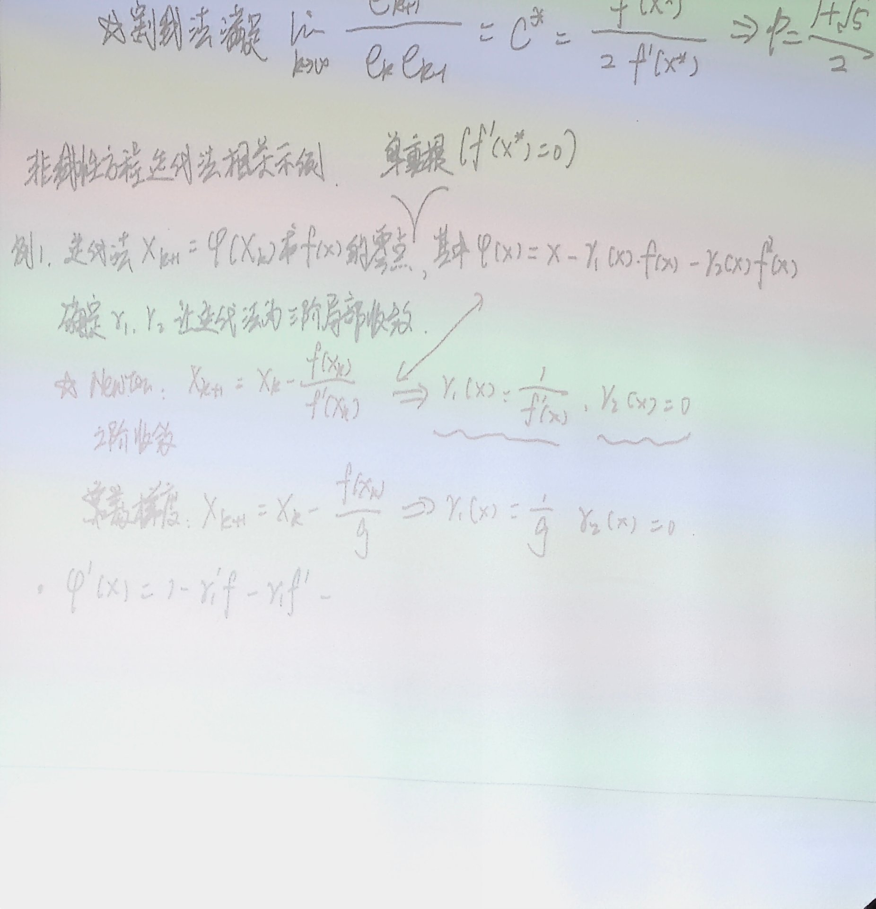
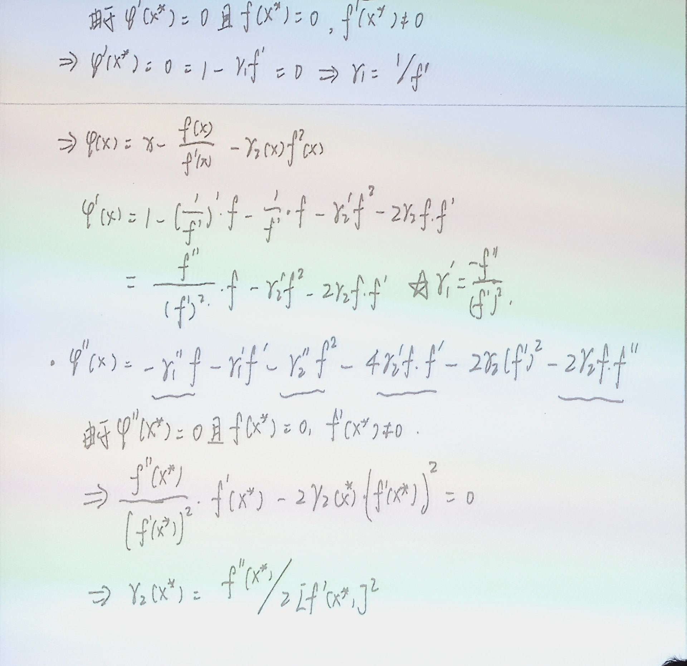
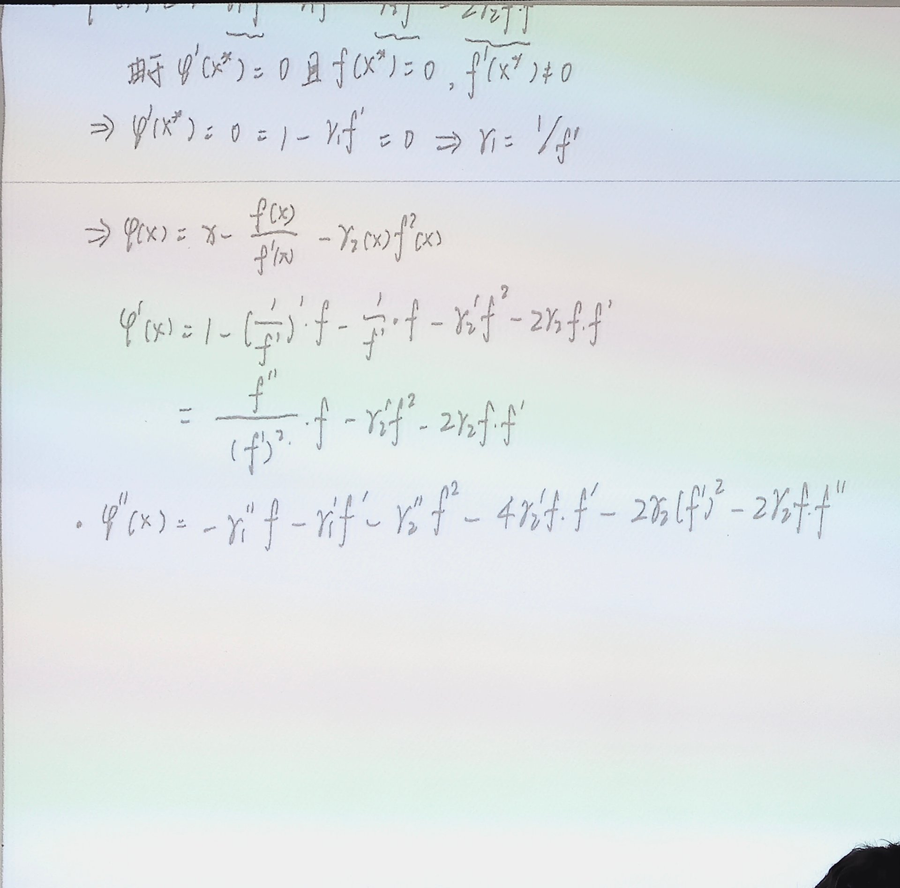
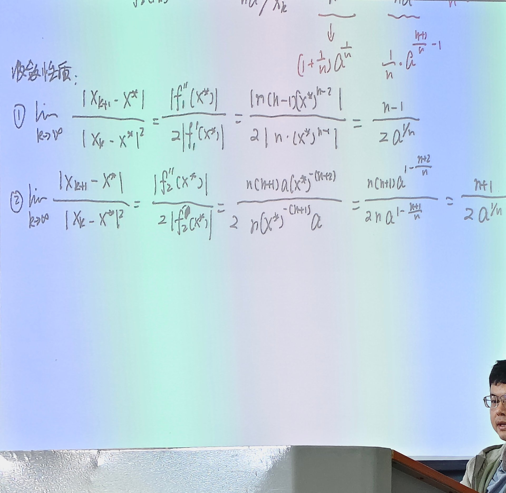
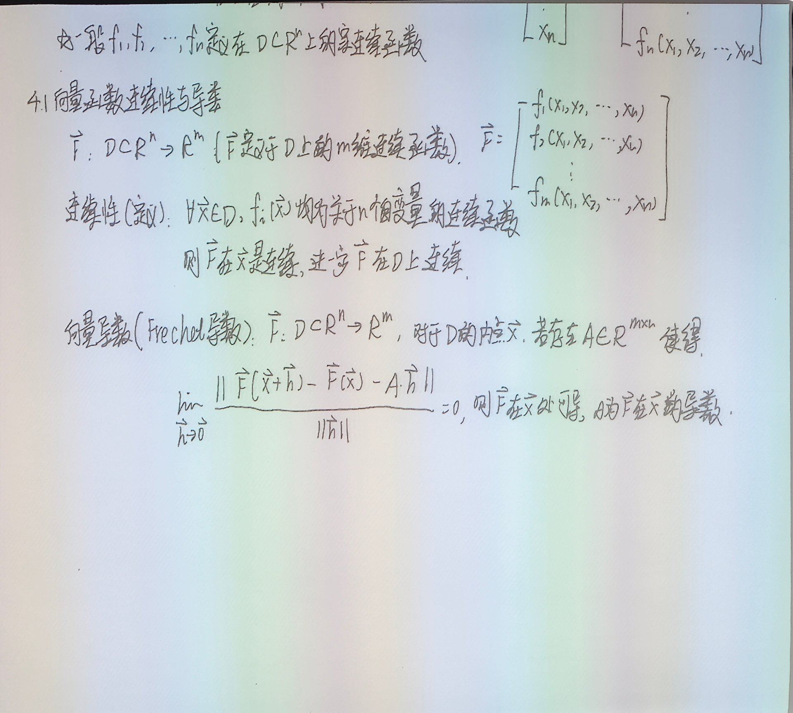
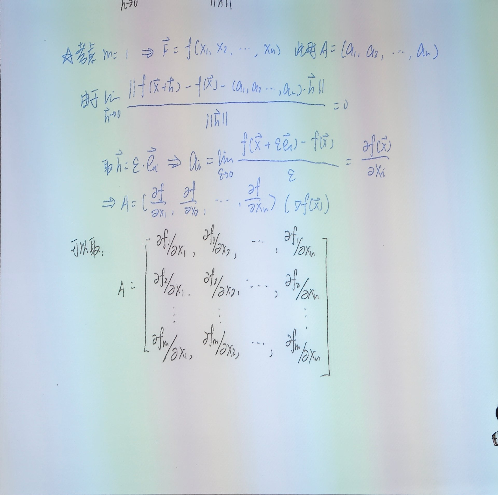
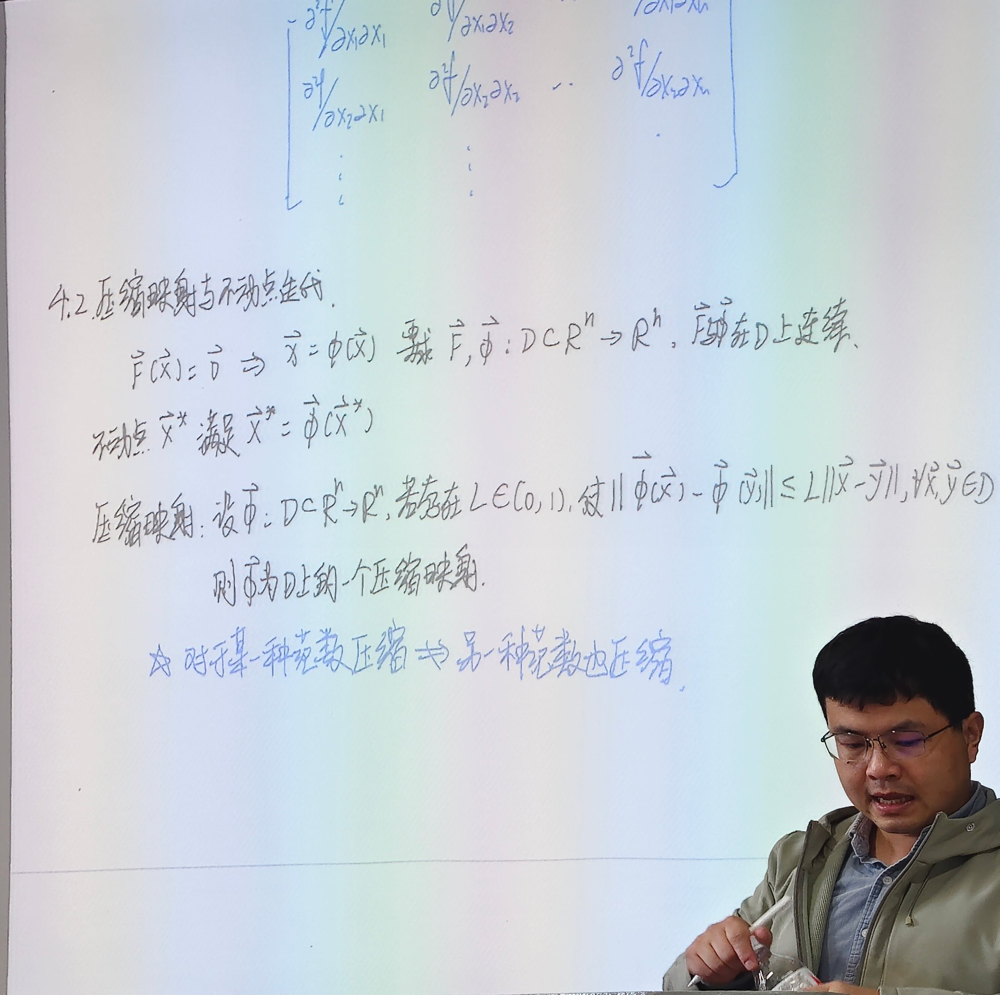
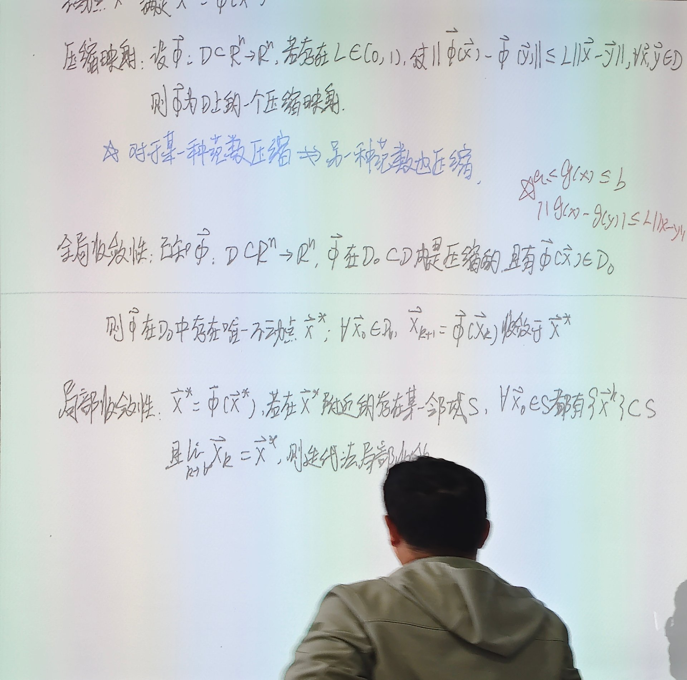
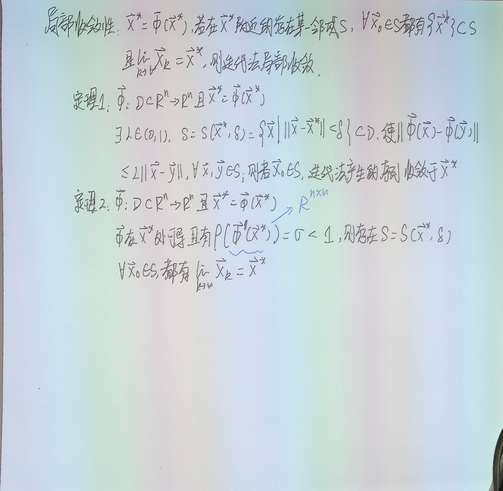
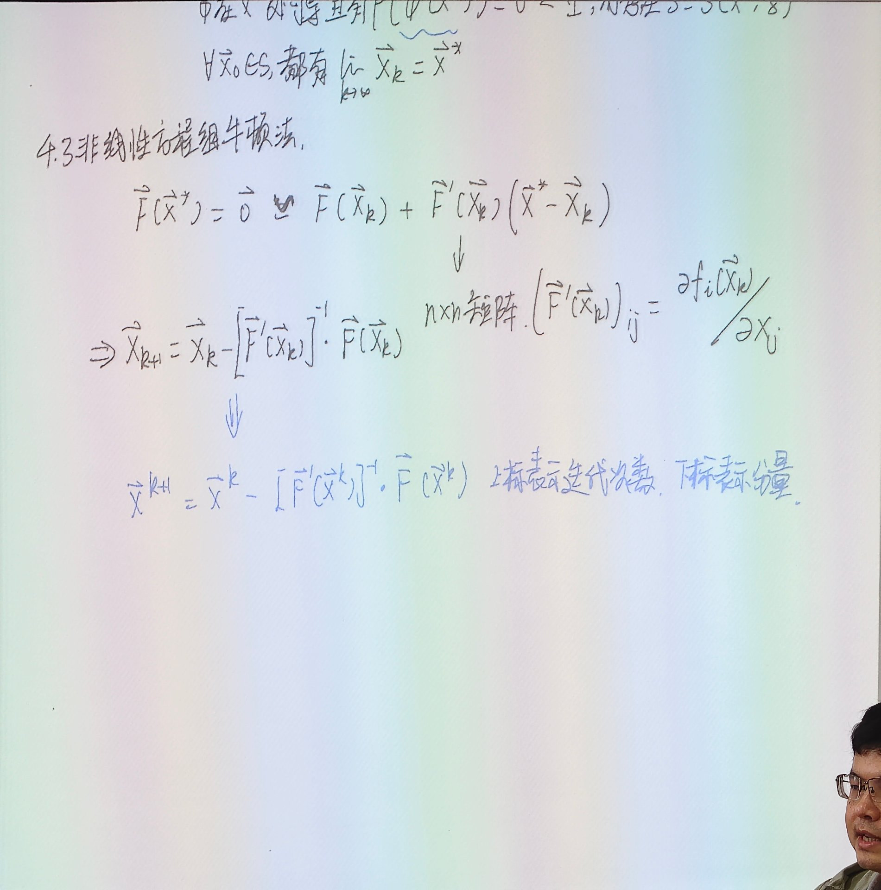

# 7.3 非线性方程组：向量函数、压缩映射与牛顿法

> 上课：10.28（整理稿《非线性方程迭代法相关讲解》约 1 小时 40 分 + 板书 12 张，板书时间 9:57–11:15）
> 原始材料：[课堂录音稿/10.28](../原始材料/课堂录音稿/10.28-向量函数压缩映射与方程组牛顿法/)（整理稿 + 导读）；12 张板书原片在 `C:\Users\29469\Desktop\计算方法与优化\计算方法与优化课程实录\10.28\`，正文嵌入语义命名过的 11 张
> 对应课本：李庆扬《数值分析（第五版）》**§7.7 非线性方程组的数值解法**——§7.7.1 非线性方程组（p.233）、§7.7.2 多变量方程的不动点迭代法（定理 7 压缩映射原理、定理 8 谱半径判据，p.234）、§7.7.3 非线性方程组的牛顿迭代法（定理 9，p.236）
> 板书的节号是课件体系里的 **4.1 向量函数连续性与导数**、**4.2 压缩映射与不动点迭代**、**4.3 非线性方程组牛顿法**，与笔记的 7.x 不对应，按内容对齐即可。**课上顺序与节号无关**：先讲标量三阶格式（9:57–10:19），再跳到向量（10:30），最后回到 4.3（11:15）
> 标记约定：全节是课堂内容，**没有超纲部分，故无 ⚠️**；📌 标出的是「课本有、课上没展开」——定理 9 的证明、课本例 7.14／例 15／例 16、Halley 法的对照，以及课本只给充分方向而实际可反推的判据
> [返回总览](../00-索引.md) ｜ [上一篇：7.2 收敛性判据、收敛阶与迭代加速](7.2-收敛性判据收敛阶与迭代加速-牛顿法与割线法.md)

## 1. 这节课的位置

7.1、7.2 处理的都是**一个方程一个未知数**：$f(x)=0$。所有的讨论都绕着一句话——收敛性看导数、阶看导数在根处的零点重数。

这节课做两件事，方向正好相反：

1. **先用这把尺子去「造」格式**。既然 $p$ 阶等价于 $\varphi'(x^*)=\cdots=\varphi^{(p-1)}(x^*)=0$，那就反过来：先在迭代函数里留几个待定函数，再要求前几阶导数为零，把待定函数解出来。这一半是标量情形，是 7.2 的自然延伸。
2. **再把这套东西搬到向量**：$f$ 变成向量值函数 $F$，「导数」从一个数变成一个矩阵（Jacobian），牛顿法每一步从「除以一个数」变成「解一个线性方程组」——绕了一圈回到第 5 章。

第二件事是本节的重点，也是这章后续（非线性方程组理论）的起点。

## 2. 上节的尾巴：割线法的阶

板书最上面接的是 7.2 §15 的最后一格：

$$
\lim_{k\to\infty}\frac{e_{k+1}}{e_ke_{k-1}}=C^*=\frac{f''(x^*)}{2f'(x^*)}
\quad\Longrightarrow\quad
p=\frac{1+\sqrt5}{2}
$$

这一步的来历是「比较 $|e_k|$ 的幂次」：把 $e_{k+1}=C^*e_ke_{k-1}$ 与 $e_{k+1}=Ce_k^p$、$e_k=Ce_{k-1}^p$ 联立，得到 $p=1+\frac1p$，即 $p^2-p-1=0$。7.2 里已经算过（实测比值稳定在 $0.819$，与 $f''/(2f')=0.8191$ 吻合），这里不再重复。

它出现在这里只是为了让下一个例子有参照：**多点的、不用导数的割线法，阶只有 1.618；而下面要造的格式，用上二阶导数就能到 3 阶。**

## 3. 通用迭代格式：牛顿法只是一个特例

板书例 1 给了一个比牛顿法更宽的框架。设要求 $f(x)=0$ 的零点，取

$$
x_{k+1}=\varphi(x_k),\qquad
\varphi(x)=x-\gamma_1(x)f(x)-\gamma_2(x)f^2(x)
$$

其中 $f$ 已知，$\gamma_1,\gamma_2$ 是**可选的**函数。整个格式的收敛性由这两个函数决定。

**两个已知成员**：

- **牛顿法**：$\gamma_1(x)=\dfrac1{f'(x)}$、$\gamma_2(x)=0$，就是 $x_{k+1}=x_k-\dfrac{f(x_k)}{f'(x_k)}$，单根处二阶收敛；
- **常数梯度法**（也叫简化牛顿）：$\gamma_1(x)=\dfrac1g$（$g$ 是 $f'$ 在根附近的某个固定近似）、$\gamma_2(x)=0$，即 $x_{k+1}=x_k-\dfrac{f(x_k)}{g}$。省掉了每步重算导数，代价是掉回线性收敛（除非 $g$ 恰好等于 $f'(x^*)$）。

两者都取 $\gamma_2=0$，所以都只用到二阶以下的信息。想再往上走，就必须动 $\gamma_2$。

## 4. 三阶构造（一）：让 $\varphi'(x^*)=0$

目标：$\varphi$ 在 $x^*$ 处满足 $\varphi'(x^*)=\varphi''(x^*)=0$。按 7.2 §5 的判定定理，这就够三阶了（还要 $\varphi'''(x^*)\ne0$，一般成立）。

逐项求导：

$$
\varphi'(x)=1-\gamma_1'(x)f(x)-\gamma_1(x)f'(x)-2\gamma_2(x)f(x)f'(x)-\gamma_2'(x)f^2(x)
$$

代入 $f(x^*)=0$，凡是带 $f$ 或 $f^2$ 的项全消失，只剩

$$
\varphi'(x^*)=1-\gamma_1(x^*)f'(x^*)=0
\quad\Longrightarrow\quad
\gamma_1(x^*)=\frac1{f'(x^*)}
$$

单点条件没什么用，要让它在根附近成立，直接取

$$
\gamma_1(x)=\frac1{f'(x)}
$$

**这一步和牛顿法一模一样**：一阶导为零的要求唯一确定了 $\gamma_1$，没有别的选择。牛顿法的二阶性就来自这里。

## 5. 三阶构造（二）：让 $\varphi''(x^*)=0$

继续求导（$\varphi'$ 里五项，逐项再求一次）：

$$
\varphi''(x)=-\gamma_1''f-2\gamma_1'f'-\gamma_1f''-\gamma_2''f^2-4\gamma_2'ff'-2\gamma_2(f')^2-2\gamma_2ff''
$$

代入 $f(x^*)=0$，带 $f$ 或 $f^2$ 的项全消失，只剩三项：

$$
\varphi''(x^*)=-2\gamma_1'(x^*)f'(x^*)-\gamma_1(x^*)f''(x^*)-2\gamma_2(x^*)\big[f'(x^*)\big]^2
$$

现在把 $\gamma_1=\dfrac1{f'}$ 代进去。关键是

$$
\gamma_1'(x)=\left(\frac1{f'(x)}\right)'=-\frac{f''(x)}{\big[f'(x)\big]^2}
$$

于是第一、二项合起来：

$$
-2\cdot\left(-\frac{f''}{(f')^2}\right)f'-\frac1{f'}f''=\frac{2f''}{f'}-\frac{f''}{f'}=\frac{f''}{f'}
$$

再令 $\varphi''(x^*)=0$：

$$
\frac{f''(x^*)}{f'(x^*)}-2\gamma_2(x^*)\big[f'(x^*)\big]^2=0
\quad\Longrightarrow\quad
\gamma_2(x^*)=\frac{f''(x^*)}{2\big[f'(x^*)\big]^3}
$$

同样把它从单点推广成函数：

$$
\gamma_2(x)=\frac{f''(x)}{2\big[f'(x)\big]^3}
$$

注意：板书这一步的指数容易被看丢。$\gamma_2$ 的分母是 $(f')^3$ 而不是 $(f')^2$——因为方程左边那个 $\dfrac{f''}{f'}$ 是从 $-2\gamma_1'f'$ 与 $-\gamma_1f''$ 两项合并来的，合并时已经吃掉一个 $f'$。写成 $(f')^2$ 会漏一次方，量纲也对不上。

## 6. 三阶格式，以及它和 Halley 法的关系

把两个 $\gamma$ 代回通用格式：

$$
x_{k+1}=x_k-\frac{f(x_k)}{f'(x_k)}-\frac{f''(x_k)\big[f(x_k)\big]^2}{2\big[f'(x_k)\big]^3}
$$

**规则：** 这个格式每步要用 $f,f',f''$ 三个值，比牛顿法多算一个二阶导数；换来的是阶从 2 变成 3。

先验一下它真的是三阶。取 $f(x)=x^2-2$、$x^*=\sqrt2$、$x_0=1.5$，用高精度算误差（普通双精度三步之后就压到 $10^{-16}$ 看不出阶了）：

| $k$ | $|x_k-\sqrt2|$ | $e_{k+1}/e_k^2$ | $e_{k+1}/e_k^3$ |
| --- | --- | --- | --- |
| 1 | $1.38\times10^{-4}$ | — | — |
| 2 | $6.61\times10^{-13}$ | $\approx0$ | 0.2499 |
| 3 | $7.22\times10^{-38}$ | $\approx0$ | 0.2500 |
| 4 | $9.4\times10^{-113}$ | $\approx0$ | 0.2500 |

三阶成立，且误差常数稳定在 $0.25$。

📌 **它和 Halley 法是同一个二阶展开、不同的三阶项**。Halley 法写成

$$
x_{k+1}=x_k-\frac{2f(x_k)f'(x_k)}{2\big[f'(x_k)\big]^2-f(x_k)f''(x_k)}
$$

对本格式里的 $\dfrac{1}{f'}\Big/\Big(1-\dfrac{ff''}{2(f')^2}\Big)$ 作一阶展开（$\frac1{1-z}\approx1+z$），正好得到 $-\dfrac{f}{f'}-\dfrac{f^2f''}{2(f')^3}$。**两者差在 $O(f^3)$ 那一项**，所以都是三阶但常数不同：同一例子上 Halley 的误差比是 $0.125$（本格式的 $\frac12$），实测 $\sqrt2$ 上三步就到 $10^{-41}$，比本格式还快一点。课上没提 Halley，记在这里只是提醒：**「三阶」只规定了误差的幂次，没规定常数；同一阶的格式可以差一倍。**

![板书：φ(x)=x-f/f'-f''f²/(2(f')³) 至少三阶局部收敛；例 2 的 \(\sqrt[n]{a}\) 两种牛顿迭代](figures/third-order-formula.jpg)

## 7. 这条思路的一般化

课上把结论收成一句：

**思路：** 构造迭代法时，考察 $\varphi$ 在不动点处各阶导数的取值。想要 $p$ 阶，就让前 $p-1$ 阶导数为零；每多消一阶，就要多引一个待定函数（格式里多一项 $f^j$），然后按「逐阶求导 + 代入 $f(x^*)=0$」解出来。

- 1 阶（不动点迭代）：$\varphi'(x^*)\ne0$，不用待定；
- 2 阶（牛顿法）：$\varphi'(x^*)=0$，解出 $\gamma_1=1/f'$；
- 3 阶：再加 $\varphi''(x^*)=0$，解出 $\gamma_2=f''/(2(f')^3)$；
- 4 阶及以上：继续加项，形式迅速膨胀，实际很少用——**阶高不等于好**，因为高阶导数难算、且收敛域更窄（初始值必须更靠近根）。

这条「待定系数 + 在根处逐阶比较」的套路，和 7.2 §5 的判定定理是同一件事的两面：**那边用导数判阶，这边用导数造阶。**

## 8. 例 2：$\sqrt[n]{a}$ 的两种牛顿迭代

同一个求根问题，可以写成不同的方程形式，得到的牛顿迭代也就不同。求 $\alpha=\sqrt[n]{a}$（$a>0$）：

**写法①**：$f_1(x)=x^n-a=0$。牛顿法

$$
x_{k+1}=x_k-\frac{x_k^n-a}{n\,x_k^{n-1}}
=\frac{n-1}{n}x_k+\frac{a}{n\,x_k^{n-1}}
$$

**写法②**：$f_2(x)=1-\dfrac{a}{x^n}=0$。先算导数 $f_2'(x)=\dfrac{na}{x^{n+1}}$，再

$$
x_{k+1}=x_k-\frac{1-a/x_k^n}{na/x_k^{n+1}}
=\frac{n+1}{n}x_k-\frac{x_k^{n+1}}{na}
$$

两式都只用四则运算（① 要一次除、② 要一次乘方加一次除），都不含开方，所以计算机上求 $\sqrt[n]{a}$ 就是这么做的。

**注意：** 两个方程的解集并不相同。$f_1=0$ 只有 $x=\alpha$ 一个实根（$n$ 为偶数时另有 $-\alpha$）；$f_2=1-a/x^n=0$ 也以 $x=\alpha$ 为根，但它在 $x=0$ 处根本没定义，而且 $f_2$ 在 $\alpha$ 两侧的单调性与 $f_1$ 不同——这就是为什么两者的收敛常数不一样，见下一节。

## 9. 两种写法的误差主项

板书用 7.2 §5 的判定定理直接算：二阶格式的误差常数是 $\dfrac{|f''(x^*)|}{2|f'(x^*)|}$。

**①** $f_1'=nx^{n-1}$、$f_1''=n(n-1)x^{n-2}$，在 $x^*=\alpha$ 处

$$
\frac{|f_1''(\alpha)|}{2|f_1'(\alpha)|}
=\frac{n(n-1)\alpha^{n-2}}{2n\,\alpha^{n-1}}
=\frac{n-1}{2\alpha}
=\frac{n-1}{2a^{1/n}}
$$

**②** $f_2'=na\,x^{-(n+1)}$、$f_2''=-n(n+1)a\,x^{-(n+2)}$，在 $\alpha$ 处

$$
\frac{|f_2''(\alpha)|}{2|f_2'(\alpha)|}
=\frac{n(n+1)a\,\alpha^{-(n+2)}}{2na\,\alpha^{-(n+1)}}
=\frac{n+1}{2\alpha}
=\frac{n+1}{2a^{1/n}}
$$

板书右侧那一串 $(1+\frac1n)a^{1/n}$、$\frac{n+1}{n}a$、$\frac1n a^{\frac{1-n}{n}}$ 之类，就是这两个比值在代入 $\alpha=a^{1/n}$ 时的中间形态，不必单独记。

于是

$$
e_{k+1}=\frac{n-1}{2\alpha}e_k^2+O(e_k^3),
\qquad
e_{k+1}=-\frac{n+1}{2\alpha}e_k^2+O(e_k^3)
$$

**结论：** 同为二阶，② 的常数总是比 ① 大（差 $\frac{n+1}{n-1}$ 倍），所以 **① 更好**。$n$ 越大差距越小（$n=2$ 差 3 倍，$n\to\infty$ 趋于 1）。

## 10. 数值对照：常数不是摆设

取 $n=3$、$a=8$（$\alpha=2$）、$x_0=2.6$：

| $k$ | ① $x_{k+1}=\frac23x_k+\frac{8}{3x_k^2}$ | ② $x_{k+1}=\frac43x_k-\frac{x_k^4}{24}$ | ① 的 $e_{k+1}/e_k^2$ | ② 的 $e_{k+1}/e_k^2$ |
| --- | --- | --- | --- | --- |
| 1 | 误差 $1.28\times10^{-1}$ | 误差 $4.37\times10^{-1}$ | — | — |
| 2 | $7.52\times10^{-3}$ | $1.65\times10^{-1}$ | 0.4606 | 0.8622 |
| 3 | $2.82\times10^{-5}$ | $2.57\times10^{-2}$ | 0.4975 | 0.9462 |
| 4 | $3.96\times10^{-10}$ | $6.57\times10^{-4}$ | 0.49999 | 0.9914 |
| 5 | $7.86\times10^{-20}$ | $4.32\times10^{-7}$ | — | — |
| 6 | $3.09\times10^{-39}$ | $1.86\times10^{-13}$ | — | — |

理论值是 $\frac{n-1}{2\alpha}=0.5$ 与 $-\frac{n+1}{2\alpha}=-1$，与最后一列吻合。

**这里有个要留意的地方**：两者都二阶，但 ② 的常数 $|C|\approx1$，收敛速度肉眼可见地慢——6 步才到 $10^{-13}$，① 已经到 $10^{-39}$。7.2 §4.3 说「衡量速度主要看 $p$、不看 $C$」，那是对**渐近**行为说的；实际迭代步数有限、初始误差也不小，$|C|$ 接近甚至超过 1 时，「二阶」这个标签几乎不起作用。$n=5,a=32$ 时 ② 的常数是 $1.5$，六步之后误差还在 $10^{-3}$ 量级。**$p$ 决定「最终多快」，$C$ 决定「多早开始快」。**

## 11. 换战场：向量函数

前面一个未知数一个方程。现在 $n$ 个未知数 $n$ 个方程，把未知量摞成向量 $x=(x_1,\dots,x_n)^T$，方程写成

$$
F(x)=\begin{bmatrix}f_1(x_1,\dots,x_n)\\ f_2(x_1,\dots,x_n)\\ \vdots\\ f_n(x_1,\dots,x_n)\end{bmatrix}=0
$$

每个 $f_i$ 都可能依赖全部 $n$ 个分量。为了后面统一处理（也包括非线性最小二乘那种 $m\ne n$ 的情形），先按更一般的 $F:D\subset\mathbb R^n\to\mathbb R^m$ 来定义。

**连续性**：$\forall x\in D$，若每个分量 $f_i$ 都是关于 $n$ 个变量的连续函数，则 $F$ 在 $x$ 处连续；若在 $D$ 上处处如此，则 $F$ 在 $D$ 上连续。逐分量判断即可，没有新东西。

## 12. 向量函数的导数：为什么必须是矩阵

难点在导数。板书给的定义是 **Fréchet 导数**：

**定义：** 设 $F:D\subset\mathbb R^n\to\mathbb R^m$，$x$ 是 $D$ 的内点。若存在矩阵 $A\in\mathbb R^{m\times n}$，使得

$$
\lim_{h\to0}\frac{\big\|F(x+h)-F(x)-A h\big\|}{\|h\|}=0
$$

则称 $F$ 在 $x$ 处可导，$A$ 是 $F$ 在 $x$ 处的导数，记 $F'(x)$。

**为什么是矩阵而不是数**：$h$ 是 $n$ 维的，$F(x+h)-F(x)$ 是 $m$ 维的，要把前者线性地变成后者，系数只能是一个 $m\times n$ 的矩阵。这也解释了定义里为什么要减 $Ah$ 而不是减 $\lambda h$：一元函数的 $f'(x)h$ 里 $h$ 是标量，这里 $h$ 是向量。

**怎么把 $A$ 的每个元素取出来**：先看 $m=1$，此时 $F$ 就是一个多元标量函数 $f(x_1,\dots,x_n)$，$A$ 退化为一个**行**向量 $(a_1,a_2,\dots,a_n)$。令 $h=\varepsilon e_i$（只有第 $i$ 个分量非零，$e_i$ 是第 $i$ 个坐标方向的单位向量），代进定义：

$$
\lim_{\varepsilon\to0}\frac{\big|f(x+\varepsilon e_i)-f(x)-\varepsilon a_i\big|}{|\varepsilon|}=0
$$

这正是「$a_i$ 是 $f$ 对 $x_i$ 的偏导数」的差分定义，所以

$$
a_i=\lim_{\varepsilon\to0}\frac{f(x+\varepsilon e_i)-f(x)}{\varepsilon}=\frac{\partial f(x)}{\partial x_i}
,\qquad
A=\Big(\frac{\partial f}{\partial x_1},\dots,\frac{\partial f}{\partial x_n}\Big)=\nabla f(x)^T
$$

**注意：** 这里 $A$ 是**行**向量，即梯度的转置。梯度有时写行、有时写列，是约定问题；写 Fréchet 导数时习惯用行向量，因为它要和 $h$（列向量）做内积。

## 13. Jacobian、Hessian 与更高阶

把 $m=1$ 的做法逐行用到 $F=(f_1,\dots,f_m)^T$ 上，$A$ 的第 $i$ 行就是 $\nabla f_i^T$，于是

$$
F'(x)=J_F(x)=\begin{bmatrix}
\dfrac{\partial f_1}{\partial x_1}&\dfrac{\partial f_1}{\partial x_2}&\cdots&\dfrac{\partial f_1}{\partial x_n}\\[2mm]
\dfrac{\partial f_2}{\partial x_1}&\dfrac{\partial f_2}{\partial x_2}&\cdots&\dfrac{\partial f_2}{\partial x_n}\\
\vdots&\vdots&&\vdots\\
\dfrac{\partial f_m}{\partial x_1}&\dfrac{\partial f_m}{\partial x_2}&\cdots&\dfrac{\partial f_m}{\partial x_n}
\end{bmatrix}
$$

这就是 **Jacobian 矩阵**：**第 $i$ 行对应第 $i$ 个方程，第 $j$ 列对应第 $j$ 个变量，元素是 $\partial f_i/\partial x_j$**。解 $n$ 个方程 $n$ 个未知数时，它是 $n\times n$ 方阵。

**再求一次导**：多元标量函数（$m=1$）的二阶导是

$$
\nabla^2f(x)=\Big(\frac{\partial^2f}{\partial x_i\partial x_j}\Big)_{n\times n}
$$

即 **Hessian 矩阵**；在二阶偏导连续时它对称。板书开头那块 $\partial^2f/\partial x_i\partial x_j$ 的矩阵就是它。

**向量函数的二阶及更高阶导数**形式上是张量（三阶就是 $m\times n\times n$ 的一堆数），本节不展开；非线性方程组的牛顿法只用到一阶，够用了。

## 14. 压缩映射

有了导数，就可以谈不动点迭代的收敛性。把方程组改写成不动点形式

$$
x=\Phi(x),\qquad x^{(k+1)}=\Phi\big(x^{(k)}\big)
$$

**定义（压缩映射）**：设 $\Phi:D\subset\mathbb R^n\to\mathbb R^n$，若存在常数 $L\in(0,1)$，使

$$
\big\|\Phi(x)-\Phi(y)\big\|\le L\|x-y\|,\qquad \forall x,y\in D
$$

则称 $\Phi$ 是 $D$ 上的一个压缩映射。

一句话：**任意两点的像，距离至少被压到原来的 $L$ 倍**（$L<1$ 才是压缩）。

**☆ 关于范数，板书专门打了星**：

> 对于某一种范数压缩 $\nRightarrow$ 另一种范数也压缩。

理由很直接。有限维空间里任意两种范数等价，即存在 $c_1,c_2>0$ 使 $c_1\|v\|\le\|v\|'\le c_2\|v\|$。把 $\|\cdot\|$ 下的 $L$ 换算到 $\|\cdot\|'$，只能得到

$$
\|\Phi(x)-\Phi(y)\|'\le c_2\|\Phi(x)-\Phi(y)\|\le c_2L\|x-y\|\le \frac{c_2L}{c_1}\|x-y\|'
$$

新常数 $\frac{c_2}{c_1}L$ **可能 $\ge1$**。而「压缩」恰恰要求常数**严格小于 1**，这个门槛在等价变换下守不住。所以谈压缩必须指明范数，不能只说「等价所以随便换」。

**一个一维的直观判据**（板书旁注）：若在区间上 $a\le g'(x)\le b$ 且 $\max(|a|,|b|)<1$，由中值定理 $|g(x)-g(y)|=|g'(\xi)||x-y|\le L|x-y|$，$g$ 就是压缩的。高维时把 $|g'|$ 换成 $\|J\|$，$L$ 取 $\sup_{x\in D}\|J_\Phi(x)\|$。

**压缩一定连续**（反之不成立）：两点靠近时像也靠近，被同一个 $L$ 控制住。所以压缩是比连续更强的要求。

## 15. 全局收敛：压缩映射原理（定理 7）

**定理 7**　设 $\Phi$ 定义在区域 $D\subset\mathbb R^n$ 上，且

1. 存在闭集 $D_0\subset D$ 与常数 $L\in(0,1)$，使 $\|\Phi(x)-\Phi(y)\|\le L\|x-y\|$，$\forall x,y\in D_0$；
2. 对任意 $x\in D_0$ 有 $\Phi(x)\in D_0$（即 $\Phi$ 把 $D_0$ 映入自身）；

则 $\Phi$ 在 $D_0$ 中有**唯一**不动点 $x^*$，且对任意 $x^{(0)}\in D_0$，迭代序列收敛到 $x^*$，并有误差估计

$$
\big\|x^{(k)}-x^*\big\|\le\frac{L^k}{1-L}\big\|x^{(1)}-x^{(0)}\big\|
$$

课本把条件 1 叫**压缩条件**，把定理叫**压缩映射原理**；它是迭代法在 $D_0$ 上的**全局收敛性**定理。

**唯一性**（三行）：

$$
\|p-q\|=\big\|\Phi(p)-\Phi(q)\big\|\le L\|p-q\|
\;\Longrightarrow\;(1-L)\|p-q\|\le0\;\Longrightarrow\;p=q
$$

**收敛性**（课上给的就是这个思路）：由压缩条件，

$$
\big\|x^{(k+1)}-x^{(k)}\big\|\le L\big\|x^{(k)}-x^{(k-1)}\big\|\le\cdots\le L^k\big\|x^{(1)}-x^{(0)}\big\|
$$

相邻两步的距离按几何级数缩小。对 $m>k$ 累加（三角不等式），

$$
\big\|x^{(m)}-x^{(k)}\big\|\le\sum_{j=k}^{m-1}L^j\big\|x^{(1)}-x^{(0)}\big\|
\le\frac{L^k}{1-L}\big\|x^{(1)}-x^{(0)}\big\|\xrightarrow{k\to\infty}0
$$

所以 $\{x^{(k)}\}$ 是 Cauchy 序列；$D_0$ 闭、$\mathbb R^n$ 完备，极限 $\bar x\in D_0$ 存在。再由 $\Phi$ 的连续性，对 $x^{(k+1)}=\Phi(x^{(k)})$ 两边取极限得 $\bar x=\Phi(\bar x)$，即 $\bar x$ 是不动点；由唯一性 $\bar x=x^*$。上面那个不等式让 $m\to\infty$ 就是误差估计。

**条件 2 不能省**：只压缩而不保证「不跑出 $D_0$」，序列可能在某一步离开 $D_0$，之后就既没有压缩性也没有定义域了。这也是为什么实际验收时常常要先估计 $\Phi(D_0)$ 的范围（见 §19 的例 15）。

## 16. 局部收敛：定理 8 与谱半径

全局条件往往太强——要求整个 $D_0$ 上都压缩，实际很难验。于是退一步只要求「在根附近压缩」。

**定义（局部收敛）**：设 $x^*=\Phi(x^*)$。若在 $x^*$ 附近存在邻域 $S$，使得对任意 $x^{(0)}\in S$，迭代产生的序列满足

$$
\{x^{(k)}\}\subset S\quad\text{且}\quad \lim_{k\to\infty}x^{(k)}=x^*
$$

则称该迭代法**局部收敛**。几何上，$S$ 是一维时 $x^*$ 附近的小区间、高维时以 $x^*$ 为中心的小球；要求「既不离开 $S$、又最终趋近 $x^*$」。

**定理 7′（板书的定理 1，压缩版）**　设 $x^*=\Phi(x^*)$。若存在 $\lambda\in(0,1)$ 与 $\delta>0$，使

$$
S=S(x^*,\delta)=\big\{x:\|x-x^*\|<\delta\big\}\subset D,
\qquad
\big\|\Phi(x)-\Phi(y)\big\|\le\lambda\|x-y\|\;\;\forall x,y\in S
$$

则对任意 $x^{(0)}\in S$，迭代收敛到 $x^*$。

这就是把定理 7 的 $D_0$ 缩成一个球，并顺手用「球心是不动点」补上了条件 2（压缩给出 $\|\Phi(x)-x^*\|=\|\Phi(x)-\Phi(x^*)\|\le\lambda\|x-x^*\|<\delta$，像仍在球内）。证明完全同前。

**定理 8（板书的定理 2，谱半径版）**　设 $x^*=\Phi(x^*)$，$\Phi$ 在 $x^*$ 处可导，且

$$
\rho\big(\Phi'(x^*)\big)=\sigma<1
$$

其中 $\rho$ 是 Jacobian $\Phi'(x^*)$ 的谱半径，则存在 $x^*$ 的邻域 $S$，对任意 $x^{(0)}\in S$ 迭代收敛到 $x^*$。

**为什么是谱半径而不是某个范数**：因为 $S$ 可以取得足够小。有限维里对任意 $\varepsilon>0$，总存在一种等价范数使 $\|\Phi'(x^*)\|\le\sigma+\varepsilon$（对 Jordan 标准形做相似变换即可）。取 $\varepsilon$ 使 $\sigma+\varepsilon<1$，再由导数定义——在 $x^*$ 附近 $\Phi(x)-\Phi(y)\approx\Phi'(x^*)(x-y)+o(\|x-y\|)$——就能在足够小的球内得到 $\|\Phi(x)-\Phi(y)\|\le(\sigma+\varepsilon)\|x-y\|$ 的压缩性，回到定理 7′。

**这就是范数问题的另一面**：§14 说「压缩性依赖范数」，但 $\rho<1$ 是**范数无关**的，所以只要给得起一个足够小的邻域，就能挑一种让压缩性成立的范数。局部收敛判据用 $\rho$ 而不用 $\|\cdot\|$，正是为了绕开这个依赖。

📌 **反向也成立**：若 $\Phi$ 在 $x^*$ 处 $C^1$ 且 $\rho(\Phi'(x^*))>1$，则 $x^*$ 不是**吸引**不动点——除了一小撮特殊初始点（落在与特征值 $<1$ 对应的稳定流形上）之外，从 $x^*$ 附近出发的迭代都会被推离。课本定理 8 只写了充分方向；$\rho=1$ 时不能判定，要看高阶项。这条与第 6 章「$\rho(B)<1$ 是线性方程组迭代法收敛的充要条件」严格同构——标量的 $|\varphi'(x^*)|<1$ 是它的 $n=1$ 特例。

## 17. 非线性方程组的牛顿法

推导和一元的完全一样，只是把「除以导数」换成「乘导数矩阵的逆」。

设 $F(x^*)=0$，当前点 $x^{(k)}$ 处作一阶展开：

$$
F(x)\approx F\big(x^{(k)}\big)+F'\big(x^{(k)}\big)\big(x-x^{(k)}\big)
$$

令右边为零，解出下一步：

$$
F'\big(x^{(k)}\big)\Delta x^{(k)}=-F\big(x^{(k)}\big),
\qquad
x^{(k+1)}=x^{(k)}+\Delta x^{(k)}
$$

形式上写成

$$
x^{(k+1)}=x^{(k)}-\Big[F'\big(x^{(k)}\big)\Big]^{-1}F\big(x^{(k)}\big)
$$

**注意符号**：要求 $F(x^{(k)})+F'(x^{(k)})\Delta x=0$，所以右端是 $-F(x^{(k)})$，而求出的 $\Delta x$ 是**加**回 $x^{(k)}$ 的。符号错一个，迭代立刻发散。

**记号**（板书特意强调）：迭代次数**上标**、变量分量**下标**——

$$
x^{(k)}=\big(x_1^{(k)},x_2^{(k)},\dots,x_n^{(k)}\big)^T
$$

否则 $x_{k+1}$ 到底是「第 $k+1$ 个分量」还是「第 $k+1$ 步」就说不清了。一元时没有这个问题，所以 7.2 一直用下标。

## 18. 从式子到代码：不要求逆

实际计算**不会**真的去求 $[F'(x^{(k)})]^{-1}$。理由很简单：需要的是「逆乘向量」这一个结果，不是整个逆矩阵。显式求逆要 $O(n^3)$ 且数值上更不稳定，而解一个线性方程组用 LU 也是 $O(n^3)$ 但常数小得多、稳定性好得多。

**算法（一步）**：

1. 算 $F(x^{(k)})$（$n$ 个函数值）；
2. 算 Jacobian $F'(x^{(k)})$（$n^2$ 个偏导数，$(\cdot)_{ij}=\partial f_i/\partial x_j$）；
3. 解线性方程组 $F'(x^{(k)})\Delta x=-F(x^{(k)})$——用第 5 章的 LU（若矩阵对称正定则 Cholesky；病态时用 3.2 的 QR）；
4. $x^{(k+1)}=x^{(k)}+\Delta x$，回到 1。

**整步的核心就这四句**：算函数值、组装 Jacobian、解线性方程组、更新。课上原话是「每一步的核心操作都相同」——难的是第 2 步的偏导怎么写，第 3 步是现成的。

## 19. 收敛性（定理 9）与计算量

**定理 9**（课本）　设 $F:D\subset\mathbb R^n\to\mathbb R^n$，$x^*\in D$ 满足 $F(x^*)=0$，$F'$ 在 $x^*$ 的开邻域 $S_0\subset D$ 上存在且连续，$F'(x^*)$ 非奇异，则牛顿法产生的序列在闭域 $S\subset S_0$ 上**超线性收敛**到 $x^*$；若还存在常数 $L>0$ 使

$$
\big\|F'(x)-F'(x^*)\big\|\le L\|x-x^*\|,\qquad \forall x\in S
$$

则至少**平方收敛**。

📌 **平方收敛的证明思路**（课本只给结论，这里补出来）：记 $e_k=x^{(k)}-x^*$。由 $F(x^{(k)})+F'(x^{(k)})\Delta x=0$ 与 $x^{(k+1)}=x^{(k)}+\Delta x$，

$$
e_{k+1}=e_k-\big[F'(x^{(k)})\big]^{-1}F(x^{(k)})
=\big[F'(x^{(k)})\big]^{-1}\Big\{F'(x^{(k)})e_k-F(x^{(k)})\Big\}
$$

用 $F(x^*)=0$ 把 $F(x^{(k)})$ 写成积分：

$$
F\big(x^{(k)}\big)-F(x^*)=\int_0^1F'\big(x^*+t\,e_k\big)e_k\,dt
$$

代回去，

$$
e_{k+1}=\big[F'(x^{(k)})\big]^{-1}\int_0^1\Big\{F'(x^{(k)})-F'\big(x^*+te_k\big)\Big\}e_k\,dt
$$

括号里差的是 $O(\|e_k\|)$（Lipschitz 条件），所以

$$
\|e_{k+1}\|\le\big\|[F'(x^{(k)})]^{-1}\big\|\cdot L\|e_k\|\cdot\|e_k\|=O\big(\|e_k\|^2\big)
$$

**关键在 $\big[F'(x^{(k)})\big]^{-1}$ 有界**：由于 $F'$ 连续、$F'(x^*)$ 非奇异，在 $x^*$ 附近 $F'(x^{(k)})$ 也非奇异且逆的范数有界。这也是定理里「$F'(x^*)$ 非奇异」这个条件的作用——它保证 Jacobian 在根附近可逆，而牛顿法每步都要解这个方程组。

**计算量**：设外层迭代 $K$ 步，

$$
\underbrace{O(n^2)}_{\text{偏导}}+\underbrace{O(n^3)}_{\text{解线性方程组}}\;\;\text{每步}
\quad\Longrightarrow\quad
O(Kn^3)\ \text{总量}
$$

偏导那项在 $n$ 大时不算主导，**瓶颈是每步那个 $O(n^3)$**。

**非精确牛顿法**：既然瓶颈在解方程组，就不一定每次解得那么精确。内层改用第 6 章的迭代法（Jacobi／GS／CG 等），把单步成本从 $O(n^3)$ 降到约 $O(n^2)$。代价是：

- 内层解不精确 $\Rightarrow$ 外层掉出原来的二阶，通常只剩超线性甚至线性；
- 外层迭代次数可能增加。

所以这是一个**权衡**：单步便宜多少 vs 多走多少步。判断依据是 $n$ 的大小和问题的结构——$n$ 很大时，即使外层多几倍步数，只要单步从立方降到平方，总量仍然占优；$n$ 小的时候不值得。课上还提到内外两层都用近似迭代的情形（Inexact Newton + 内层迭代解法），这是大规模问题的标准做法。

**注意：** 定理 9 只保证**局部**收敛——初始值必须足够靠近根。非线性方程组可能有多个解（甚至无解），初始值决定收敛到哪一个，选得差一点就跑到别的根去，或者发散。这一点比一元情形严重得多（见下例）。

## 20. 例：三次曲线与圆的交点

课上最后用一个几何例子走完流程，但**转写里常数丢了**。能确证的信息是：两条方程分别是三次曲线与圆，$x^{(0)}=(1,1)^T$，并保留下来三个偏导——第一条方程对 $x_1$ 的偏导是 $-3x_1^2$，第二条方程对 $x_1,x_2$ 的偏导分别是 $2x_1$、$2x_2$。由这三点足以复原方程**形式**：

$$
\begin{cases}
f_1=x_2-x_1^3+c_1=0 &\text{（三次曲线 }x_2=x_1^3-c_1\text{）}\\[1mm]
f_2=x_1^2+x_2^2-c_2=0 &\text{（圆）}
\end{cases}
\qquad
F'=\begin{bmatrix}-3x_1^2 & 1\\[1mm] 2x_1 & 2x_2\end{bmatrix}
$$

$c_1,c_2$ 的确切取值转写没保留。下表的 $c_1=1$、$c_2=4$ 是我为把流程走一遍选的，**不是课上原题的数**；方程形式与 Jacobian 的形式与课上一致。

**初值 $x^{(0)}=(1,1)^T$**：

| $k$ | $x_1^{(k)}$ | $x_2^{(k)}$ | $\lVert F(x^{(k)})\rVert$ | $\Delta x^{(k)}$ |
| --- | --- | --- | --- | --- |
| 0 | 1.000000000 | 1.000000000 | $2.24\times10^{0}$ | $(+0.500000000,\ +0.500000000)$ |
| 1 | 1.500000000 | 1.500000000 | $1.01\times10^{0}$ | $(-0.134408602,\ -0.032258065)$ |
| 2 | 1.365591398 | 1.467741935 | $8.12\times10^{-2}$ | $(-0.013084610,\ +0.005665235)$ |
| 3 | 1.352506788 | 1.473407171 | $7.28\times10^{-4}$ | $(-0.000119915,\ +0.000041085)$ |
| 4 | 1.352386873 | 1.473448256 | $6.05\times10^{-8}$ | $(-1.0\times10^{-8},\ +4\times10^{-9})$ |
| 5 | 1.352386863 | 1.473448259 | $8.9\times10^{-16}$ | — |

误差从 $8.1\times10^{-2}$ 到 $7.3\times10^{-4}$ 到 $6.1\times10^{-8}$，比值 $0.11$、$0.11$——平方收敛。

**第一步手算**（$x^{(0)}=(1,1)$）：

$$
F=\begin{bmatrix}1-1+1\\1+1-4\end{bmatrix}=\begin{bmatrix}1\\-2\end{bmatrix},
\qquad
F'=\begin{bmatrix}-3&1\\2&2\end{bmatrix},
\qquad
\det F'=-8
$$

解 $\begin{bmatrix}-3&1\\2&2\end{bmatrix}\Delta=-\begin{bmatrix}1\\-2\end{bmatrix}$ 得 $\Delta=(0.5,\,0.5)^T$，与表中一致。

**初值决定落到哪个解**：这组常数下曲线与圆有 **2 个**交点——$(1.3524,\,1.4734)$ 与 $(-0.9191,\,-1.7763)$。取 $x^{(0)}=(1,1)$ 收敛到前者；取 $x^{(0)}=(-1,-1)$ 同样 5 步但收敛到后者。**同一套公式、同一个问题，只改初始值，答案就换了。**

**还有一个更糟的情形**：$x^{(0)}=(0,-2)$ 时

$$
F'=\begin{bmatrix}0&1\\0&-4\end{bmatrix}
$$

**奇异**（第一列全零，因为 $\partial f_1/\partial x_1=-3x_1^2$ 在 $x_1=0$ 处为零），线性方程组解不出来，牛顿法当场失效。这正对应定理 9 里「$F'(x^*)$ 非奇异」那个条件——不满足时连一步都走不了。

📌 **课本的两个配套例子**（课上没展开，用来核对理解）：

- **例 7.14**（解的存在性）：两条抛物线 $x_2=x_1^2+a$ 与 $x_1=x_2^2+a$ 的交点。$a=1$ 时无解，$a=0$ 时两解 $(0,0)$ 与 $(1,1)$，$a=-1$ 时四解。用来演示「非线性方程组可能无解、一解、多解」。
- **例 15 + 例 16**（同一方程组的两种方法）：

$$
\begin{cases}f_1=x_1^2+x_2^2-10x_1+8=0\\[1mm] f_2=x_1x_2^2+x_1-10x_2+8=0\end{cases}
\qquad\Longleftrightarrow\qquad
\Phi(x)=\begin{bmatrix}(x_1^2+x_2^2+8)/10\\(x_1x_2^2+x_1+8)/10\end{bmatrix}
$$

  取 $D=\{0\le x_1,x_2\le1.5\}$。$\sup_D\|\Phi'\|_1=0.75$（列和最大者），满足定理 7；$\Phi'(x^*)=\begin{bmatrix}0.2&0.2\\0.2&0.2\end{bmatrix}$，特征值 $0.4$ 与 $0$，$\rho=0.4<1$，满足定理 8。$x^{(0)}=(0,0)$ 起：

| 方法 | 到 $\lVert e\rVert<10^{-6}$ 的步数 | $x^{(1)}$ | $x^{(2)}$ | $x^{(3)}$ | $x^{(4)}$ |
| --- | --- | --- | --- | --- | --- |
| 不动点迭代 | **15** | $(0.8,\,0.8)$ | $(0.928,\,0.9312)$ | $(0.97283,\,0.97327)$ | $(0.98937,\,0.98944)$ |
| 牛顿法 | **4** | $(0.8,\,0.88)$ | $(0.9917872,\,0.9917117)$ | $(0.9999752,\,0.9999685)$ | $(1.0000000,\,1.0000000)$ |

  牛顿法的误差比 $e_{k+1}/e_k^2$ 稳定在 $0.21\to0.29\to0.31$（三阶仍在前，比值尚未稳定），二次收敛无疑。**15 步 vs 4 步**——这就是 $\rho=0.4$ 的线性收敛和二阶收敛的实际差距。

## 21. 与第 6 章的对照，以及小结

| | 标量 $f(x)=0$ | 方程组 $F(x)=0$ |
| --- | --- | --- |
| 导数 | $f'(x)$，一个数 | $F'(x)$，$n\times n$ 矩阵（Jacobian） |
| 不动点迭代 | $x_{k+1}=\varphi(x_k)$ | $x^{(k+1)}=\Phi(x^{(k)})$ |
| 收敛判据 | $\lvert\varphi'(x^*)\rvert<1$ | $\rho\big(\Phi'(x^*)\big)<1$ |
| 全局收敛 | 区间上 $\lvert\varphi'\rvert\le L<1$ | $D_0$ 上压缩 + $\Phi(D_0)\subset D_0$（定理 7） |
| 牛顿法 | $x_{k+1}=x_k-\dfrac{f(x_k)}{f'(x_k)}$ | $x^{(k+1)}=x^{(k)}-[F'(x^{(k)})]^{-1}F(x^{(k)})$ |
| 牛顿每步 | 除一个数，$O(1)$ | 解一个线性方程组，$O(n^3)$ |
| 二阶 | 单根处，常数 $\dfrac{\lvert f''\rvert}{2\lvert f'\rvert}$ | $F'(x^*)$ 非奇异 + $F'$ Lipschitz（定理 9） |
| 判据来源 | 与第 6 章 $\rho(B)<1$ 同源 | 就是第 6 章那条，只是 $B\to\Phi'(x^*)$ |

**四条主线**：

1. **造高阶格式的通用套路**：待定函数 + 在根处逐阶令导数为零。牛顿法是「消掉一阶导」的最小解，三阶格式是再加一个 $f^2$ 项消掉二阶导。阶每加一，格式复杂一分、收敛域窄一分。
2. **同阶不等于同速**：$\sqrt[n]{a}$ 的两种牛顿法都是二阶，常数差 $\frac{n+1}{n-1}$ 倍；$n=5$ 时 ② 的常数是 $1.5$，六步只到 $10^{-3}$。$p$ 管远期、$C$ 管近期。
3. **从标量到向量，唯一真正变的东西是「导数成了矩阵」**：连续性、不动点、收敛阶这些概念原封不动，但「绝对值小于 1」必须换成「谱半径小于 1」，「除以 $f'$」必须换成「解线性方程组」。
4. **压缩条件依赖范数，谱半径不依赖**：这是两个判据（定理 7 与定理 8）分工的根源——全局判据只能靠压缩，所以必须指明范数；局部判据用 $\rho$，因为邻域足够小时总可以挑一种让压缩成立的范数。

下一讲会继续牛顿法的收敛性理论（收敛域、$F'$ 奇异时的修正）与非线性方程组的其他解法——课上最后一句是「后续还会继续讨论牛顿法的收敛性及非线性方程组的相关理论」。
