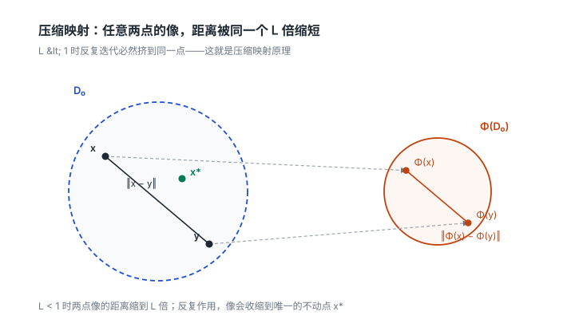

# 7.3 非线性方程组：向量函数、压缩映射与牛顿法

> 上课：10.28（整理稿《非线性方程迭代法相关讲解》约 1 小时 40 分 + 板书 12 张，板书时间 9:57–11:15；本篇收 10:30 之后的向量部分）
> 原始材料：[课堂录音稿/10.28](../原始材料/课堂录音稿/10.28-向量函数压缩映射与方程组牛顿法/)（整理稿 + 导读）；12 张板书原片在 `C:\Users\29469\Desktop\计算方法与优化\计算方法与优化课程实录\10.28\`，正文不再嵌入实拍，几何关系改用重画的示意图表示
> 对应课本：李庆扬《数值分析（第五版）》**§7.7 非线性方程组的数值解法**——§7.7.1 非线性方程组（p.233）、§7.7.2 多变量方程的不动点迭代法（定理 7 压缩映射原理、定理 8 谱半径判据，p.234）、§7.7.3 非线性方程组的牛顿迭代法（定理 9，p.236）
> 板书的节号是课件体系里的 **4.1 向量函数连续性与导数**、**4.2 压缩映射与不动点迭代**、**4.3 非线性方程组牛顿法**，与笔记的 7.x 不对应，按内容对齐即可。课上 9:57–10:19 先讲了一段**标量**三阶格式的构造，那部分属于一元方程，已并入 [7.2](7.2-收敛性判据收敛阶与迭代加速-牛顿法与高阶格式.md) §16–§17；本篇从 10:30 换到向量开始
> 标记约定：全节是课堂内容，**没有超纲部分，故无 ⚠️**；📌 标出的是「课本有、课上没展开」——定理 9 的证明、课本例 7.14／例 15／例 16，以及课本只给充分方向而实际可反推的判据
> [CM+Opt_ch4-非线性手写笔记](../原始材料/CM+Opt_ch4-非线性手写笔记.pdf) §4.1 向量函数导数、§4.2 压缩映射、§4.3 方程组牛顿法
> [返回总览](../00-索引.md) ｜ [上一篇：7.2 收敛性判据、收敛阶与迭代加速](7.2-收敛性判据收敛阶与迭代加速-牛顿法与高阶格式.md) ｜ [下一篇：7.4 非线性方程组的拟牛顿法](7.4-非线性方程组的拟牛顿法.md)

## 目录

- [[#1. 换战场：向量函数]]
- [[#2. 向量函数的导数：为什么必须是矩阵]]
- [[#3. Jacobian、Hessian 与更高阶]]
- [[#4. 压缩映射]]
- [[#5. 全局收敛：压缩映射原理（定理 7）]]
- [[#6. 局部收敛：定理 8 与谱半径]]
- [[#7. 非线性方程组的牛顿法]]
- [[#8. 从式子到代码：不要求逆]]
- [[#9. 收敛性（定理 9）与计算量]]
- [[#10. 例：三次曲线与圆的交点]]
- [[#11. 与第 6 章的对照，以及小结]]

---

## 1. 换战场：向量函数

7.1、7.2 处理的都是一个未知数一个方程：$f(x)=0$，收敛性看导数、阶看导数在根处的零点重数。现在 $n$ 个未知数 $n$ 个方程，把未知量摞成向量 $x=(x_1,\dots,x_n)^T$，方程写成

$$
F(x)=\begin{bmatrix}f_1(x_1,\dots,x_n)\\ f_2(x_1,\dots,x_n)\\ \vdots\\ f_n(x_1,\dots,x_n)\end{bmatrix}=0
$$

每个 $f_i$ 都可能依赖全部 $n$ 个分量。为了后面统一处理（也包括非线性最小二乘那种 $m\ne n$ 的情形），先按更一般的 $F:D\subset\mathbb R^n\to\mathbb R^m$ 来定义。

**连续性**：$\forall x\in D$，若每个分量 $f_i$ 都是关于 $n$ 个变量的连续函数，则 $F$ 在 $x$ 处连续；若在 $D$ 上处处如此，则 $F$ 在 $D$ 上连续。逐分量判断即可，没有新东西。

## 2. 向量函数的导数：为什么必须是矩阵

难点在导数。定义是 **Fréchet 导数**：

**定义：** 设 $F:D\subset\mathbb R^n\to\mathbb R^m$，$x$ 是 $D$ 的内点。若存在矩阵 $A\in\mathbb R^{m\times n}$，使得

$$
\lim_{h\to0}\frac{\big\|F(x+h)-F(x)-A h\big\|}{\|h\|}=0
$$

则称 $F$ 在 $x$ 处可导，$A$ 是 $F$ 在 $x$ 处的导数，记 $F'(x)$。

**为什么是矩阵而不是数**：$h$ 是 $n$ 维的，$F(x+h)-F(x)$ 是 $m$ 维的，要把前者线性地变成后者，系数只能是一个 $m\times n$ 的矩阵。这也解释了定义里为什么要减 $Ah$ 而不是减 $\lambda h$：一元函数的 $f'(x)h$ 里 $h$ 是标量，这里 $h$ 是向量。

**怎么把 $A$ 的每个元素取出来**：先看 $m=1$，此时 $F$ 就是一个多元标量函数 $f(x_1,\dots,x_n)$，$A$ 退化为一个**行**向量 $(a_1,a_2,\dots,a_n)$。令 $h=\varepsilon e_i$（只有第 $i$ 个分量非零，$e_i$ 是第 $i$ 个坐标方向的单位向量），代进定义：

$$
\lim_{\varepsilon\to0}\frac{\big|f(x+\varepsilon e_i)-f(x)-\varepsilon a_i\big|}{|\varepsilon|}=0
$$

这正是「$a_i$ 是 $f$ 对 $x_i$ 的偏导数」的差分定义，所以

$$
a_i=\lim_{\varepsilon\to0}\frac{f(x+\varepsilon e_i)-f(x)}{\varepsilon}=\frac{\partial f(x)}{\partial x_i}
,\qquad
A=\Big(\frac{\partial f}{\partial x_1},\dots,\frac{\partial f}{\partial x_n}\Big)=\nabla f(x)^T
$$

**注意：** 这里 $A$ 是**行**向量，即梯度的转置。梯度有时写行、有时写列，是约定问题；写 Fréchet 导数时习惯用行向量，因为它要和 $h$（列向量）做内积。

## 3. Jacobian、Hessian 与更高阶

把 $m=1$ 的做法逐行用到 $F=(f_1,\dots,f_m)^T$ 上，$A$ 的第 $i$ 行就是 $\nabla f_i^T$，于是

$$
F'(x)=J_F(x)=\begin{bmatrix}
\dfrac{\partial f_1}{\partial x_1}&\dfrac{\partial f_1}{\partial x_2}&\cdots&\dfrac{\partial f_1}{\partial x_n}\\[2mm]
\dfrac{\partial f_2}{\partial x_1}&\dfrac{\partial f_2}{\partial x_2}&\cdots&\dfrac{\partial f_2}{\partial x_n}\\
\vdots&\vdots&&\vdots\\
\dfrac{\partial f_m}{\partial x_1}&\dfrac{\partial f_m}{\partial x_2}&\cdots&\dfrac{\partial f_m}{\partial x_n}
\end{bmatrix}
$$

这就是 **Jacobian 矩阵**：**第 $i$ 行对应第 $i$ 个方程，第 $j$ 列对应第 $j$ 个变量，元素是 $\partial f_i/\partial x_j$**。解 $n$ 个方程 $n$ 个未知数时，它是 $n\times n$ 方阵。

**再求一次导**：多元标量函数（$m=1$）的二阶导是

$$
\nabla^2f(x)=\Big(\frac{\partial^2f}{\partial x_i\partial x_j}\Big)_{n\times n}
$$

即 **Hessian 矩阵**；在二阶偏导连续时它对称——上面那个 $\Big(\frac{\partial^2f}{\partial x_i\partial x_j}\Big)_{n\times n}$ 就是它。

**向量函数的二阶及更高阶导数**形式上是张量（三阶就是 $m\times n\times n$ 的一堆数），本节不展开；非线性方程组的牛顿法只用到一阶，够用了。

## 4. 压缩映射

有了导数，就可以谈不动点迭代的收敛性。把方程组改写成不动点形式

$$
x=\Phi(x),\qquad x^{(k+1)}=\Phi\big(x^{(k)}\big)
$$

**定义（压缩映射）**：设 $\Phi:D\subset\mathbb R^n\to\mathbb R^n$，若存在常数 $L\in(0,1)$，使

$$
\big\|\Phi(x)-\Phi(y)\big\|\le L\|x-y\|,\qquad \forall x,y\in D
$$

则称 $\Phi$ 是 $D$ 上的一个压缩映射。

一句话：**任意两点的像，距离至少被压到原来的 $L$ 倍**（$L<1$ 才是压缩）。

图上两件事同时发生：$\Phi$ 把整个 $D_0$ 映到它自己内部（自映射，定理 7 的条件 2），并且把 $x,y$ 之间的距离从 $\|x-y\|$ 缩到 $\| \Phi(x)-\Phi(y)\|$（压缩条件，条件 1）。前者保证迭代不会跑出定义域，后者保证序列是 Cauchy 的——两条合起来，不动点既存在、唯一，又对任意初值都收敛。

**☆ 关于范数，有一条容易忽略的**：

> 对于某一种范数压缩 $\nRightarrow$ 另一种范数也压缩。

理由很直接。有限维空间里任意两种范数等价，即存在 $c_1,c_2>0$ 使 $c_1\|v\|\le\|v\|'\le c_2\|v\|$。把 $\|\cdot\|$ 下的 $L$ 换算到 $\|\cdot\|'$，只能得到

$$
\|\Phi(x)-\Phi(y)\|'\le c_2\|\Phi(x)-\Phi(y)\|\le c_2L\|x-y\|\le \frac{c_2L}{c_1}\|x-y\|'
$$

新常数 $\frac{c_2}{c_1}L$ **可能 $\ge1$**。而「压缩」恰恰要求常数**严格小于 1**，这个门槛在等价变换下守不住。所以谈压缩必须指明范数，不能只说「等价所以随便换」。

**一个一维的直观判据**：若在区间上 $a\le g'(x)\le b$ 且 $\max(|a|,|b|)<1$，由中值定理 $|g(x)-g(y)|=|g'(\xi)||x-y|\le L|x-y|$，$g$ 就是压缩的。高维时把 $|g'|$ 换成 $\|J\|$，$L$ 取 $\sup_{x\in D}\|J_\Phi(x)\|$。

**压缩一定连续**（反之不成立）：两点靠近时像也靠近，被同一个 $L$ 控制住。所以压缩是比连续更强的要求。

## 5. 全局收敛：压缩映射原理（定理 7）

这一节是 [7.1](7.1-非线性方程求根-二分法与不动点迭代.md) 定理 2 的**向量版**：区间 $[a,b]$ 换成区域 $D_0$，绝对值换成范数，Lipschitz 不等式照样成立，结论照样是「唯一不动点 + 任意初值收敛」。

**定理 7**　设 $\Phi$ 定义在区域 $D\subset\mathbb R^n$ 上，且

1. 存在闭集 $D_0\subset D$ 与常数 $L\in(0,1)$，使 $\Phi$ 在 $D_0$ 上是**压缩**的（即对任意 $x,y\in D_0$ 有 $\\Phi(x)-\Phi(y)\\le L\\x-y\\$，压缩的定义见 §4）；
2. 对任意 $x\in D_0$ 有 $\Phi(x)\in D_0$（即 $\Phi$ 把 $D_0$ 映入自身）；

则 $\Phi$ 在 $D_0$ 中有**唯一**不动点 $x^*$，且对任意 $x^{(0)}\in D_0$，迭代序列收敛到 $x^*$，并有误差估计

$$
\big\|x^{(k)}-x^*\big\|\le\frac{L^k}{1-L}\big\|x^{(1)}-x^{(0)}\big\|
$$

课本把条件 1 叫**压缩条件**，把定理叫**压缩映射原理**；它是迭代法在 $D_0$ 上的**全局收敛性**定理。

**唯一性**（三行）：

$$
\|p-q\|=\big\|\Phi(p)-\Phi(q)\big\|\le L\|p-q\|
\;\Longrightarrow\;(1-L)\|p-q\|\le0\;\Longrightarrow\;p=q
$$

**收敛性**（课上给的就是这个思路）：由压缩条件，

$$
\big\|x^{(k+1)}-x^{(k)}\big\|\le L\big\|x^{(k)}-x^{(k-1)}\big\|\le\cdots\le L^k\big\|x^{(1)}-x^{(0)}\big\|
$$

相邻两步的距离按几何级数缩小。对 $m>k$ 累加（三角不等式），

$$
\big\|x^{(m)}-x^{(k)}\big\|\le\sum_{j=k}^{m-1}L^j\big\|x^{(1)}-x^{(0)}\big\|
\le\frac{L^k}{1-L}\big\|x^{(1)}-x^{(0)}\big\|\xrightarrow{k\to\infty}0
$$

所以 $\{x^{(k)}\}$ 是 Cauchy 序列；$D_0$ 闭、$\mathbb R^n$ 完备，极限 $\bar x\in D_0$ 存在。再由 $\Phi$ 的连续性，对 $x^{(k+1)}=\Phi(x^{(k)})$ 两边取极限得 $\bar x=\Phi(\bar x)$，即 $\bar x$ 是不动点；由唯一性 $\bar x=x^*$。上面那个不等式让 $m\to\infty$ 就是误差估计。

**条件 2 不能省**：只压缩而不保证「不跑出 $D_0$」，序列可能在某一步离开 $D_0$，之后就既没有压缩性也没有定义域了。这也是为什么实际验收时常常要先估计 $\Phi(D_0)$ 的范围（见 §9 的例 15）。

## 6. 局部收敛：定理 8 与谱半径

全局条件往往太强——要求整个 $D_0$ 上都压缩，实际很难验。于是退一步只要求「在根附近压缩」。

**定义（局部收敛）**：与 [7.2](7.2-收敛性判据收敛阶与迭代加速-牛顿法与高阶格式.md) §3.1 相同，只是把邻域从 $U(x^*,\delta)$ 换成球 $S$：若在 $x^*$ 附近存在邻域 $S$，使得对任意 $x^{(0)}\in S$，迭代产生的序列满足

$$
\{x^{(k)}\}\subset S\quad\text{且}\quad \lim_{k\to\infty}x^{(k)}=x^*
$$

则称该迭代法**局部收敛**。几何上，$S$ 是一维时 $x^*$ 附近的小区间、高维时以 $x^*$ 为中心的小球；要求「既不离开 $S$、又最终趋近 $x^*$」。

**定理 7′（板书的定理 1，压缩版）**　设 $x^*=\Phi(x^*)$。若存在 $\lambda\in(0,1)$ 与 $\delta>0$，使

$$
S=S(x^*,\delta)=\big\{x:\|x-x^*\|<\delta\big\}\subset D,
\qquad
\big\|\Phi(x)-\Phi(y)\big\|\le\lambda\|x-y\|\;\;\forall x,y\in S
$$

则对任意 $x^{(0)}\in S$，迭代收敛到 $x^*$。

这就是把定理 7 的 $D_0$ 缩成一个球，并顺手用「球心是不动点」补上了条件 2（压缩给出 $\|\Phi(x)-x^*\|=\|\Phi(x)-\Phi(x^*)\|\le\lambda\|x-x^*\|<\delta$，像仍在球内）。证明完全同前。

**定理 8（板书的定理 2，谱半径版）**　设 $x^*=\Phi(x^*)$，$\Phi$ 在 $x^*$ 处可导，且

$$
\rho\big(\Phi'(x^*)\big)=\sigma<1
$$

其中 $\rho$ 是 Jacobian $\Phi'(x^*)$ 的谱半径，则存在 $x^*$ 的邻域 $S$，对任意 $x^{(0)}\in S$ 迭代收敛到 $x^*$。

**为什么是谱半径而不是某个范数**：因为 $S$ 可以取得足够小。有限维里对任意 $\varepsilon>0$，总存在一种等价范数使 $\|\Phi'(x^*)\|\le\sigma+\varepsilon$（对 Jordan 标准形做相似变换即可）。取 $\varepsilon$ 使 $\sigma+\varepsilon<1$，再由导数定义——在 $x^*$ 附近 $\Phi(x)-\Phi(y)\approx\Phi'(x^*)(x-y)+o(\|x-y\|)$——就能在足够小的球内得到 $\|\Phi(x)-\Phi(y)\|\le(\sigma+\varepsilon)\|x-y\|$ 的压缩性，回到定理 7′。

**这就是范数问题的另一面**：§4 说「压缩性依赖范数」，但 $\rho<1$ 是**范数无关**的，所以只要给得起一个足够小的邻域，就能挑一种让压缩性成立的范数。局部收敛判据用 $\rho$ 而不用 $\|\cdot\|$，正是为了绕开这个依赖。

📌 **反向也成立**：若 $\Phi$ 在 $x^*$ 处 $C^1$ 且 $\rho(\Phi'(x^*))>1$，则 $x^*$ 不是**吸引**不动点——除了一小撮特殊初始点（落在与特征值 $<1$ 对应的稳定流形上）之外，从 $x^*$ 附近出发的迭代都会被推离。课本定理 8 只写了充分方向；$\rho=1$ 时不能判定，要看高阶项。这条与第 6 章「$\rho(B)<1$ 是线性方程组迭代法收敛的充要条件」严格同构——标量的 $|\varphi'(x^*)|<1$ 是它的 $n=1$ 特例。

## 7. 非线性方程组的牛顿法

推导和一元的完全一样，只是把「除以导数」换成「乘导数矩阵的逆」。

设 $F(x^*)=0$，当前点 $x^{(k)}$ 处作一阶展开：

$$
F(x)\approx F\big(x^{(k)}\big)+F'\big(x^{(k)}\big)\big(x-x^{(k)}\big)
$$

令右边为零，解出下一步：

$$
F'\big(x^{(k)}\big)\Delta x^{(k)}=-F\big(x^{(k)}\big),
\qquad
x^{(k+1)}=x^{(k)}+\Delta x^{(k)}
$$

形式上写成

$$
x^{(k+1)}=x^{(k)}-\Big[F'\big(x^{(k)}\big)\Big]^{-1}F\big(x^{(k)}\big)
$$

**注意符号**：要求 $F(x^{(k)})+F'(x^{(k)})\Delta x=0$，所以右端是 $-F(x^{(k)})$，而求出的 $\Delta x$ 是**加**回 $x^{(k)}$ 的。符号错一个，迭代立刻发散。

**记号**（这里特意强调）：迭代次数**上标**、变量分量**下标**——

$$
x^{(k)}=\big(x_1^{(k)},x_2^{(k)},\dots,x_n^{(k)}\big)^T
$$

否则 $x_{k+1}$ 到底是「第 $k+1$ 个分量」还是「第 $k+1$ 步」就说不清了。一元时没有这个问题，所以 7.2 一直用下标。

## 8. 从式子到代码：不要求逆

实际计算**不会**真的去求 $[F'(x^{(k)})]^{-1}$。理由很简单：需要的是「逆乘向量」这一个结果，不是整个逆矩阵。显式求逆要 $O(n^3)$ 且数值上更不稳定，而解一个线性方程组用 LU 也是 $O(n^3)$ 但常数小得多、稳定性好得多。

**算法（一步）**：

1. 算 $F(x^{(k)})$（$n$ 个函数值）；
2. 算 Jacobian $F'(x^{(k)})$（$n^2$ 个偏导数，$(\cdot)_{ij}=\partial f_i/\partial x_j$）；
3. 解线性方程组 $F'(x^{(k)})\Delta x=-F(x^{(k)})$——用第 5 章的 LU（若矩阵对称正定则 Cholesky；病态时用 3.2 的 QR）；
4. $x^{(k+1)}=x^{(k)}+\Delta x$，回到 1。

**整步的核心就这四句**：算函数值、组装 Jacobian、解线性方程组、更新。课上原话是「每一步的核心操作都相同」——难的是第 2 步的偏导怎么写，第 3 步是现成的。

## 9. 收敛性（定理 9）与计算量

**定理 9**（课本）　设 $F:D\subset\mathbb R^n\to\mathbb R^n$，$x^*\in D$ 满足 $F(x^*)=0$，$F'$ 在 $x^*$ 的开邻域 $S_0\subset D$ 上存在且连续，$F'(x^*)$ 非奇异，则牛顿法产生的序列在闭域 $S\subset S_0$ 上**超线性收敛**到 $x^*$；若还存在常数 $L>0$ 使

$$
\big\|F'(x)-F'(x^*)\big\|\le L\|x-x^*\|,\qquad \forall x\in S
$$

则至少**平方收敛**。

**证明**（课堂四步，只用 $F'$ 的连续性）。这条路要的结论比平方收敛**弱**——只到超线性，所以条件也弱：只要 $F'$ 连续，不要 Lipschitz。思路一句话：把误差写成「一个 Jacobian 的逆 × 一个二阶小量加一个一阶小量」，再证那个逆一致有界。

记 $e_k=x^{(k)}-x^*$，$\alpha=\big\|[F'(x^*)]^{-1}\big\|>0$。

1. **先用量把邻域压小。** 由 $F'$ 在 $x^*$ 处连续，对任意 $\varepsilon>0$ 存在 $\delta>0$，使 $x\in U(x^*,\delta)\subset S$ 时
   $$
   \big\|F'(x)-F'(x^*)\big\|<\varepsilon .
   $$
   后面会看到，要 $\varepsilon<\dfrac{1}{2\alpha}$ 才够用——这个量的用处要到第 3 步才显出来。
2. **把牛顿步的误差拆成两块。** 由 $F(x^*)=0$ 与 $x^{(k+1)}=x^{(k)}-[F'(x^{(k)})]^{-1}F(x^{(k)})$，
   $$
   e_{k+1}=\big[F'(x^{(k)})\big]^{-1}\Big\{F'(x^{(k)})e_k-\big[F(x^{(k)})-F(x^*)\big]\Big\}
   $$
   在花括号里加一项、减一项 $F'(x^*)e_k$，就凑成两块：
   $$
   F'(x^{(k)})e_k-F(x^{(k)})=\underbrace{-\big[F(x^{(k)})-F(x^*)-F'(x^*)e_k\big]}_{\text{二阶小量}}-\underbrace{\big[F'(x^{(k)})-F'(x^*)\big]e_k}_{\text{一阶小量}}
   $$
   取范数、用三角不等式：
   $$
   \|e_{k+1}\|\le\big\|[F'(x^{(k)})]^{-1}\big\|\Big\{\big\|F(x^{(k)})-F(x^*)-F'(x^*)e_k\big\|+\big\|\big[F'(x^{(k)})-F'(x^*)\big]e_k\big\|\Big\}
   $$
   第一块是 $F$ 在 $x^*$ 处一阶展开的余项，由可微性它是 $O(\|e_k\|^2)$；第二块由第 1 步不超过 $\varepsilon\|e_k\|$。
3. **证 Jacobian 的逆一致有界。** 这是全证明的技术核心——不先把这个逆控住，前面拆得再干净也没用。把 $[F'(x^{(k)})]^{-1}$ 用 $[F'(x^*)]^{-1}$ 表示出来：
   $$
   \big[F'(x^{(k)})\big]^{-1}=\big[F'(x^*)\big]^{-1}\Big(I-\underbrace{\big(I-[F'(x^*)]^{-1}F'(x^{(k)})\big)}_{=:T}\Big)^{-1}
   $$
   $T$ 的大小由第 1 步控制：$\|T\|\le\alpha\varepsilon<\frac12$。于是用 $\|(I-T)^{-1}\|\le\dfrac{1}{1-\|T\|}$，
   $$
   \big\|[F'(x^{(k)})]^{-1}\big\|\le\frac{\alpha}{1-\alpha\varepsilon}\le2\alpha=:M .
   $$
   顺带把定理的第一条结论也证出来了：邻域内每一点的 $F'$ 都可逆，因为上面这个构造本身就给出了逆。
4. **收尾：比值趋于零。** 把第 2、3 步合起来，
   $$
   \|e_{k+1}\|\le M\big(O(\|e_k\|^2)+\varepsilon\|e_k\|\big)
   \quad\Longrightarrow\quad
   \frac{\|e_{k+1}\|}{\|e_k\|}\le M\Big(\frac{O(\|e_k\|^2)}{\|e_k\|}+\varepsilon\Big)\xrightarrow[k\to\infty]{}0 .
   $$
   右端趋于 $M\varepsilon$，而 $\varepsilon$ 是任意给定的，所以比值的极限为零——**超线性收敛**。

这条证明有两处值得记住：一是它**没有**用 Lipschitz 条件，所以结论只到超线性；要平方收敛，得把第 2 步那块 $O(\|e_k\|^2)$ 收紧成「$\le C\|e_k\|^2$」，那就需要 $F'$ Lipschitz（正是定理 9 后半加的条件）。二是全证明**没有出现中值定理**——这不是疏漏，而是向量情形本来的样子，见下面。

📌 **另一条路线：积分形式**（课本只给结论，这里补出来，结论直接到平方收敛）。一元的证明（7.2 §12）是把 $f(x^*)$ 在 $x_k$ 处泰勒展开；这里不能照抄，因为**向量函数没有中值定理**——写成 $F(x^{(k)})-F(x^*)=F'(\xi)\,e_k$ 的那个 $\xi$，各分量一般各不相同，凑不出一个公共的 $\xi$。补上这个缺口的办法是改用**积分形式的中值定理**，它对向量函数照样成立。所以三步：把牛顿步写成误差的式子、用积分把 $F(x^{(k)})$ 换成 $x^*$ 处的值、再估计剩下的 Jacobian 之差。

记 $e_k=x^{(k)}-x^*$。

1. **先把牛顿步写成误差。** 由 $F(x^{(k)})+F'(x^{(k)})\Delta x=0$ 与 $x^{(k+1)}=x^{(k)}+\Delta x$，

   $$
   e_{k+1}=e_k-\big[F'(x^{(k)})\big]^{-1}F(x^{(k)})
   =\big[F'(x^{(k)})\big]^{-1}\Big\{F'(x^{(k)})e_k-F(x^{(k)})\Big\}
   $$

   这一步只是把牛顿步里的 $F$ 换成 $-[F']^{-1}F$，还没有做任何估计；它的用处是把式子整理成「一个 Jacobian 的逆 × 一对要相比较的量」。

2. **用积分把 $F(x^{(k)})$ 挪到 $x^*$ 去。** 因为 $F(x^*)=0$，

   $$
   F\big(x^{(k)}\big)-F(x^*)=\int_0^1F'\big(x^*+t\,e_k\big)e_k\,dt
   $$

   这里 $e_k$ 是常向量，可以整个提到积分号外——正是这一点让积分形式的公式和一维长得完全一样。代回去，

   $$
   e_{k+1}=\big[F'(x^{(k)})\big]^{-1}\int_0^1\Big\{F'(x^{(k)})-F'\big(x^*+te_k\big)\Big\}e_k\,dt
   $$

   现在括号里只剩两个 Jacobian 之差，而它们都在 $x^*$ 附近取值，这才轮到用 Lipschitz 条件。

3. **括号里的差是 $O(\|e_k\|)$。** 由 $\big\|F'(x)-F'(x^*)\big\|\le L\|x-x^*\|$，被积的那一项一致地小，于是

   $$
   \|e_{k+1}\|\le\big\|[F'(x^{(k)})]^{-1}\big\|\cdot L\|e_k\|\cdot\|e_k\|=O\big(\|e_k\|^2\big)
   $$

**关键在 $\big[F'(x^{(k)})\big]^{-1}$ 有界**：由于 $F'$ 连续、$F'(x^*)$ 非奇异，在 $x^*$ 附近 $F'(x^{(k)})$ 也非奇异且逆的范数有界。这也是定理里「$F'(x^*)$ 非奇异」这个条件的作用——它保证 Jacobian 在根附近可逆，而牛顿法每步都要解这个方程组。注意这个常数只影响 $O(\cdot)$ 里的常系数，不影响「误差平方」这个量级；少了它，上面那行就只能写成「若 $[F']^{-1}$ 有界则平方收敛」的条件式，而定理要的是无条件的结论。

**计算量**：设外层迭代 $K$ 步，

$$
\underbrace{O(n^2)}_{\text{偏导}}+\underbrace{O(n^3)}_{\text{解线性方程组}}\;\;\text{每步}
\quad\Longrightarrow\quad
O(Kn^3)\ \text{总量}
$$

偏导那项在 $n$ 大时不算主导，**瓶颈是每步那个 $O(n^3)$**。

**非精确牛顿法**：既然瓶颈在解方程组，就不一定每次解得那么精确。内层改用第 6 章的迭代法（Jacobi／GS／CG 等），把单步成本从 $O(n^3)$ 降到约 $O(n^2)$。代价是：

- 内层解不精确 $\Rightarrow$ 外层掉出原来的二阶，通常只剩超线性甚至线性；
- 外层迭代次数可能增加。

所以这是一个**权衡**：单步便宜多少 vs 多走多少步。判断依据是 $n$ 的大小和问题的结构——$n$ 很大时，即使外层多几倍步数，只要单步从立方降到平方，总量仍然占优；$n$ 小的时候不值得。课上还提到内外两层都用近似迭代的情形（Inexact Newton + 内层迭代解法），这是大规模问题的标准做法。

**注意：** 定理 9 只保证**局部**收敛——初始值必须足够靠近根。非线性方程组可能有多个解（甚至无解），初始值决定收敛到哪一个，选得差一点就跑到别的根去，或者发散。这一点比一元情形严重得多（见下例）。

## 10. 例：三次曲线与圆的交点

课上最后用这个例子走完流程。10.28 的转写把两条方程的常数丢了，只留下「三次曲线 + 圆」的形式、初值 $x^{(0)}=(1,1)^T$ 和三个偏导。下面这组方程按配套手写笔记 p12 补全：

$$
\begin{cases}
f_1=x_2-x_1^3=0 &\text{（三次曲线 }x_2=x_1^3\text{）}\\[1mm]
f_2=x_1^2+x_2^2-1=0 &\text{（单位圆）}
\end{cases}
\qquad
F'=\begin{bmatrix}-3x_1^2 & 1\\[1mm] 2x_1 & 2x_2\end{bmatrix}
$$

**注意：** 这组常数只有手写笔记一个来源，与录音转写无从交叉核对，所以**不能断言就是老师口述的原题**。定成 $c_1=0$ 靠两条自洽性检查：p12 第一行开头那处笔迹像 $5$ 或 $9$（放大后是方程组的大括号），若真取 $5$ 或 $9$，三次曲线与单位圆都不相交；而同页第一步给出 $F(x^{(0)})=(0,1)^T$，要求 $f_1(1,1)=0$。$c_2=1$ 是第二行直接写明的。若以后拿到课上原题的常数，以原题为准——换常数只需重跑一遍 §8 的四步，本节的结构与结论不变。

把 $x_2=x_1^3$ 代进圆得 $x_1^6+x_1^2-1=0$；令 $t=x_1^2$ 即 $t^3+t-1=0$，唯一正根 $t=0.6823278\ldots$，于是两个交点是 $(\pm0.826031358,\ \pm0.563624162)$（同号）。两个方程、两组解，正好用来演示初值决定落到哪个解。

**初值 $x^{(0)}=(1,1)^T$**：

| $k$ | $x_1^{(k)}$ | $x_2^{(k)}$ | $\lVert F(x^{(k)})\rVert$ | $\Delta x^{(k)}$ |
| --- | --- | --- | --- | --- |
| 0 | 1.000000000 | 1.000000000 | $1.00\times10^{0}$ | $(-0.125000000,\ -0.375000000)$ |
| 1 | 0.875000000 | 0.625000000 | $1.63\times10^{-1}$ | $(-0.045963652,\ -0.060650888)$ |
| 2 | 0.829036348 | 0.564349112 | $7.95\times10^{-3}$ | $(-0.002996240,\ -0.000729339)$ |
| 3 | 0.826040108 | 0.563619774 | $2.42\times10^{-5}$ | $(-0.000008750,\ +0.000004389)$ |
| 4 | 0.826031358 | 0.563624162 | $2.13\times10^{-10}$ | — |
| 5 | 0.826031358 | 0.563624162 | $1.1\times10^{-16}$ | — |

$\lVert F\rVert$ 从 $7.95\times10^{-3}$ 到 $2.42\times10^{-5}$ 到 $2.13\times10^{-10}$，比值 $\lVert F_{k+1}\rVert/\lVert F_k\rVert^2$ 为 $0.38$、$0.36$——平方收敛。

**第一步手算**（$x^{(0)}=(1,1)$）：

$$
F=\begin{bmatrix}1-1\\1+1-1\end{bmatrix}=\begin{bmatrix}0\\1\end{bmatrix},
\qquad
F'=\begin{bmatrix}-3&1\\2&2\end{bmatrix},
\qquad
\det F'=-8
$$

解 $\begin{bmatrix}-3&1\\2&2\end{bmatrix}\Delta=-\begin{bmatrix}0\\1\end{bmatrix}$ 得 $\Delta=(-0.125,\,-0.375)^T$，与表中一致。（手写笔记 p12 的第一步把右端写成了 $F$ 而非 $-F$，按 §8 的约定应为 $-F$。）

**初值决定落到哪个解**：曲线与单位圆有 **2 个**交点——$(0.8260,\,0.5636)$ 与 $(-0.8260,\,-0.5636)$。取 $x^{(0)}=(1,1)$ 收敛到前者；取 $x^{(0)}=(-1,-1)$ 同样 4 步但收敛到后者。**同一套公式、同一个问题，只改初始值，答案就换了。**

**还有一个更糟的情形**：$x^{(0)}=(0,-2)$ 时

$$
F'=\begin{bmatrix}0&1\\0&-4\end{bmatrix}
$$

**奇异**（第一列全零，因为 $\partial f_1/\partial x_1=-3x_1^2$ 在 $x_1=0$ 处为零），线性方程组解不出来，牛顿法当场失效。这正对应定理 9 里「$F'(x^*)$ 非奇异」那个条件——不满足时连一步都走不了。

📌 **课本的两个配套例子**（课上没展开，用来核对理解）：

- **例 7.14**（解的存在性）：两条抛物线 $x_2=x_1^2+a$ 与 $x_1=x_2^2+a$ 的交点。$a=1$ 时无解，$a=0$ 时两解 $(0,0)$ 与 $(1,1)$，$a=-1$ 时四解。用来演示「非线性方程组可能无解、一解、多解」。
- **例 15 + 例 16**（同一方程组的两种方法）：

$$
\begin{cases}f_1=x_1^2+x_2^2-10x_1+8=0\\[1mm] f_2=x_1x_2^2+x_1-10x_2+8=0\end{cases}
\qquad\Longleftrightarrow\qquad
\Phi(x)=\begin{bmatrix}(x_1^2+x_2^2+8)/10\\(x_1x_2^2+x_1+8)/10\end{bmatrix}
$$

  取 $D=\{0\le x_1,x_2\le1.5\}$。$\sup_D\|\Phi'\|_1=0.75$（列和最大者），满足定理 7；$\Phi'(x^*)=\begin{bmatrix}0.2&0.2\\0.2&0.2\end{bmatrix}$，特征值 $0.4$ 与 $0$，$\rho=0.4<1$，满足定理 8。$x^{(0)}=(0,0)$ 起：

| 方法 | 到 $\lVert e\rVert<10^{-6}$ 的步数 | $x^{(1)}$ | $x^{(2)}$ | $x^{(3)}$ | $x^{(4)}$ |
| --- | --- | --- | --- | --- | --- |
| 不动点迭代 | **15** | $(0.8,\,0.8)$ | $(0.928,\,0.9312)$ | $(0.97283,\,0.97327)$ | $(0.98937,\,0.98944)$ |
| 牛顿法 | **4** | $(0.8,\,0.88)$ | $(0.9917872,\,0.9917117)$ | $(0.9999752,\,0.9999685)$ | $(1.0000000,\,1.0000000)$ |

  牛顿法的误差比 $e_{k+1}/e_k^2$ 稳定在 $0.21\to0.29\to0.31$（三阶仍在前，比值尚未稳定），二次收敛无疑。**15 步 vs 4 步**——这就是 $\rho=0.4$ 的线性收敛和二阶收敛的实际差距。

## 11. 与第 6 章的对照，以及小结

标量与线性迭代的对照在 [7.1](7.1-非线性方程求根-二分法与不动点迭代.md) §11 已经列过一次（迭代算子、收敛判据、不动点、收敛性来源四项）；下面这张表把它换成「标量 vs 向量」，也就是本节真正要交代的差别。

| | 标量 $f(x)=0$ | 方程组 $F(x)=0$ |
| --- | --- | --- |
| 导数 | $f'(x)$，一个数 | $F'(x)$，$n\times n$ 矩阵（Jacobian） |
| 不动点迭代 | $x_{k+1}=\varphi(x_k)$ | $x^{(k+1)}=\Phi(x^{(k)})$ |
| 收敛判据 | $\lvert\varphi'(x^*)\rvert<1$ | $\rho\big(\Phi'(x^*)\big)<1$ |
| 全局收敛 | 区间上 $\lvert\varphi'\rvert\le L<1$ | $D_0$ 上压缩 + $\Phi(D_0)\subset D_0$（定理 7） |
| 牛顿法 | $x_{k+1}=x_k-\dfrac{f(x_k)}{f'(x_k)}$ | $x^{(k+1)}=x^{(k)}-[F'(x^{(k)})]^{-1}F(x^{(k)})$ |
| 牛顿每步 | 除一个数，$O(1)$ | 解一个线性方程组，$O(n^3)$ |
| 二阶 | 单根处，常数 $\dfrac{\lvert f''\rvert}{2\lvert f'\rvert}$ | $F'(x^*)$ 非奇异 + $F'$ Lipschitz（定理 9） |
| 判据来源 | 与第 6 章 $\rho(B)<1$ 同源 | 就是第 6 章那条，只是 $B\to\Phi'(x^*)$ |

**两条主线**：

1. **从标量到向量，唯一真正变的东西是「导数成了矩阵」**：连续性、不动点、收敛阶这些概念原封不动，但「绝对值小于 1」必须换成「谱半径小于 1」，「除以 $f'$」必须换成「解线性方程组」。
2. **压缩条件依赖范数，谱半径不依赖**：这是两个判据（定理 7 与定理 8）分工的根源——全局判据只能靠压缩，所以必须指明范数；局部判据用 $\rho$，因为邻域足够小时总可以挑一种让压缩成立的范数。

再往下走，要省掉的是「解线性方程组」这一步：[7.4 非线性方程组的拟牛顿法](7.4-非线性方程组的拟牛顿法.md) 用秩一修正直接维护逆矩阵的近似，把每步的 $O(n^3)$ 降下来。课上最后一句是「后续还会继续讨论牛顿法的收敛性及非线性方程组的相关理论」。
