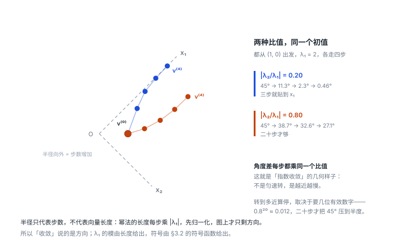

# 8.2 幂法与反幂法

> 上课：11.03 后段（约 35 分）+ 板书 6 张（板书时间 20:40–21:05）
> 原始材料：[课堂录音稿/11.03-拟牛顿法与特征值估计幂法](../原始材料/课堂录音稿/11.03-拟牛顿法与特征值估计幂法/)（原文逐字稿 + 导读 + 整理稿）；板书原片在 `C:\Users\29469\Desktop\计算方法与优化\计算方法与优化课程实录\11.03\`
> 对应课本：李庆扬《数值分析（第五版）》**§8.2 幂法及反幂法**——§8.2.1 幂法（p.245，定理 7 未规范化、定理 8 规范化）、§8.2.2 加速方法（p.248，原点平移法）、§8.2.3 反幂法（p.251）。**课本的规范化写法与板书不同但等价**，见 §3.2
> 板书的节号是课件体系里的 **5.2 幂法**（编号与课本章号不同，按内容对齐）
> 标记约定：全节是课堂内容，**没有超纲部分，故无 ⚠️**；📌 标出的是指向下一篇的接口（加速与收缩方法在 [8.3](8.3-幂法的加速与收缩方法.md) 展开）
> [返回总览](../00-索引.md) ｜ [上一篇：8.1 特征值的估计与扰动](8.1-特征值的估计与扰动.md) ｜ [下一篇：8.3 幂法的加速与收缩方法](8.3-幂法的加速与收缩方法.md)

## 目录

- [[#1. 幂法的想法：反复乘，方向就转过去了]]
  - [[#1.1 三条假设]]
  - [[#1.2 主导项：推导只有三行]]
- [[#2. 为什么要规范化]]
- [[#3. 算法流程]]
  - [[#3.1 迭代格式]]
  - [[#3.2 怎么读出特征值，以及符号函数的作用]]
- [[#4. 收敛速度：比值 $\lvert\lambda_2/\lambda_1\rvert$]]
  - [[#4.1 近似值的来源：两个规范化因子之比]]
  - [[#4.2 误差的衰减：差分给出的比值]]
- [[#5. 反幂法：算按模最小的特征值]]
  - [[#5.1 一句话的道理]]
  - [[#5.2 每步解一个线性方程组]]
- [[#6. 两种方法的分工与变形]]
- [[#7. 小结]]

---

## 1. 幂法的想法：反复乘，方向就转过去了

### 1.1 三条假设

设 $A\in\mathbb R^{n\times n}$，幂法要在下面三条假设下工作：

1. **$A$ 可对角化**：存在 $n$ 个线性无关的特征向量 $\vec x_1,\dots,\vec x_n$，$A\vec x_i=\lambda_i\vec x_i$。不要求这组向量正交，只要求它们线性无关——也就是构成 $\mathbb R^n$ 的一组基。
2. **$\lambda_1$ 是按模最大的单特征值**（课本还要求它是**实根**，否则规范化后的符号会来回震荡）：

$$
|\lambda_1|>|\lambda_2|\ge|\lambda_3|\ge\cdots\ge|\lambda_n| .
$$

3. **初始向量在 $\vec x_1$ 方向上有分量**：把任意 $\vec v^{(0)}$ 按这组基展开

$$
\vec v^{(0)}=\alpha_1\vec x_1+\alpha_2\vec x_2+\cdots+\alpha_n\vec x_n,
$$

要求 $\alpha_1\ne0$。

三条缺一不可：不可对角化就展不开；$\lambda_1$ 不唯一最大就分不出主项；$\alpha_1=0$ 则一开始就把主方向漏掉了。这三条合起来，就是课本**定理 7** 的条件——它只说"方向趋于主特征向量、相邻分量的比值趋于 $\lambda_1$"，还没有规范化；加上规范化之后是**定理 8**（见 §3）。

### 1.2 主导项：推导只有三行

用 $A$ 反复乘。第一步：

$$
A\vec v^{(0)}=\alpha_1\lambda_1\vec x_1+\alpha_2\lambda_2\vec x_2+\cdots+\alpha_n\lambda_n\vec x_n .
$$

定义 $\vec v^{(k)}=A\vec v^{(k-1)}$，则 $\vec v^{(k)}=A^k\vec v^{(0)}$，展开得

$$
\vec v^{(k)}=\alpha_1\lambda_1^k\vec x_1+\alpha_2\lambda_2^k\vec x_2+\cdots+\alpha_n\lambda_n^k\vec x_n .
$$

**把 $\lambda_1^k$ 提出来**（这是全推导唯一的关键动作）：

$$
\vec v^{(k)}=\lambda_1^k\left[\alpha_1\vec x_1+\left(\frac{\lambda_2}{\lambda_1}\right)^{k}\alpha_2\vec x_2+\cdots+\left(\frac{\lambda_n}{\lambda_1}\right)^{k}\alpha_n\vec x_n\right].
$$

由假设 2，每个 $|\lambda_i/\lambda_1|<1$（$i\ge2$），所以它们的 $k$ 次幂当 $k\to\infty$ 时**全部趋于零**。方括号里只剩第一项：

$$
\vec v^{(k)}\ \longrightarrow\ \lambda_1^k\,\alpha_1\vec x_1,\qquad k\to\infty .
$$

**结论**：$\vec v^{(k)}$ 的**方向**趋于 $\vec x_1$ 的方向。

注意这里说的是方向——$\lambda_1^k$ 这个因子会让向量长度趋于 $0$ 或趋于无穷（看 $|\lambda_1|$ 小于还是大于 1），所以 $\vec v^{(k)}$ 本身并不收敛。要的是方向，就得先把长度除掉。

推导里只有 $(\lambda_i/\lambda_1)^k\to0$ 这一句是定性的，它到底意味着「转多快」，落到角度上才看得清：把两组不同比值的迭代摆在一起走四步，角度差每步都乘同一个数，那个数就是 $|\lambda_2/\lambda_1|$。

这张图给的正是 $\S4$ 那个收敛因子的几何来源：比值 0.20 时角度差 $45^\circ\to11.3^\circ\to2.3^\circ\to0.46^\circ$，三步就贴到 $\vec x_1$；比值 0.80 时四步才走到 $22.7^\circ$，要压到半度需要二十步。**衰减是指数的，不是匀速的**——越接近 $\vec x_1$ 越慢，这也是为什么幂法在 $|\lambda_2/\lambda_1|$ 接近 1 时会变得没法用。

## 2. 为什么要规范化

如果直接迭代 $\vec v^{(k)}=A^k\vec v^{(0)}$，会有两个麻烦：

- $|\lambda_1|>1$ 时各分量指数增长，很快就会**溢出**；
- $|\lambda_1|<1$ 时各分量指数衰减，很快**下溢**成 0，方向信息全部丢失。

两个麻烦都是同一个原因：长度在按 $|\lambda_1|^k$ 变化，而我们不关心长度。

**思路**：每步都把长度的信息"除掉"，只让方向往下传。具体做法是每步除以当前向量的无穷范数（最大分量的绝对值），把长度压成 1。

**注意：规范化不改变方向**。第 2 步（见 §3.1）乘上去的 $\dfrac{1}{\operatorname{sgn}(\varphi)\|\vec z\|_\infty}$ 是**正**标量，方向分毫不动。所以 §1.2 关于"方向趋于 $\vec x_1$"的结论，对规范化后的序列照样成立，不必重新证一遍。

规范化还顺手给了另一样东西。§1.2 里 $\vec v^{(k)}$ 的长度被 $\lambda_1^k$ 拖着跑，长度并不收敛，只能说方向收敛；规范化把长度钉死之后，$\vec v^{(k)}$ 本身就收敛了。极限是**按同一约定取定的那个** $\vec x_1$：特征向量差任意倍数都算同一个，而"最大分量为 $+1$"这个约定把倍数定死，于是极限唯一。

## 3. 算法流程

### 3.1 迭代格式

给定初始向量 $\vec v^{(0)}$（任意非零向量，通常取全 1 或随机向量），对 $k=0,1,2,\dots$：

$$
\begin{cases}
\vec z^{(k+1)}=A\vec v^{(k)},\\[4pt]
\vec v^{(k+1)}=\dfrac{\vec z^{(k+1)}}{\operatorname{sgn}(\varphi)\cdot\big\|\vec z^{(k+1)}\big\|_\infty},
\end{cases}
$$

其中 $\varphi$ 是 $\vec z^{(k+1)}$ 中**绝对值最大的那个分量**，$\|\cdot\|_\infty$ 是无穷范数（最大分量绝对值），符号函数

$$
\operatorname{sgn}(\varphi)=\begin{cases}1,&\varphi>0,\\-1,&\varphi<0,\\0,&\varphi=0.\end{cases}
$$

第 2 步的效果：除以 $|\varphi|$（也就是无穷范数），再乘上 $\operatorname{sgn}(\varphi)$，结果是**让 $\vec v^{(k+1)}$ 的最大分量恒等于 $+1$**——不是绝对值等于 1，是等于 $+1$。

**规则**：每步之后都强制"最大分量 $=+1$"。所以迭代序列的长度是稳定可控的。

### 3.2 怎么读出特征值，以及符号函数的作用

**什么时候停**：迭代到相邻两步差别足够小（或者做够预设次数），认为已收敛。

**怎么读**：取最后一次

$$
\vec z^{(k+1)}=A\vec v^{(k)},
$$

**不做规范化**，直接看这个向量里绝对值最大的那个元素，它就是 $\lambda_1$ 的近似；而 $\vec v^{(k)}$ 就是对应的特征向量。

为什么是它？收敛时 $\vec v^{(k)}$ 趋于 $\vec x_1$——§1.2 给出方向，§2 说明规范化既不改变方向、又把倍数定死成"最大分量为 $+1$"，于是

$$
\vec z^{(k+1)}=A\vec v^{(k)}\approx\lambda_1\vec x_1\approx\lambda_1\vec v^{(k)} .
$$

既然 $\vec v^{(k)}$ 的最大分量是 $+1$，那么 $\vec z^{(k+1)}$ 最大分量的带符号值就是 $\lambda_1$。

拿一个二阶矩阵走五步，这件事就看得见了。取

$$
A=\begin{pmatrix}2&1\\1&2\end{pmatrix},\qquad \lambda_1=3,\ \lambda_2=1,\qquad \vec x_1=\begin{pmatrix}1\\1\end{pmatrix},\ \vec x_2=\begin{pmatrix}1\\-1\end{pmatrix},
$$

初值 $\vec v^{(0)}=(1,0)^T$，按 §3.1 迭代：

| $k$ | $\vec z^{(k+1)}=A\vec v^{(k)}$ | $\max\{\vec z^{(k+1)}\}$ | $\vec v^{(k+1)}$ |
|---|---|---|---|
| 0 | $(2,\ 1)$ | $2$ | $(1,\ 0.5)$ |
| 1 | $(2.5,\ 2)$ | $2.5$ | $(1,\ 0.8)$ |
| 2 | $(2.8,\ 2.6)$ | $2.8$ | $(1,\ 0.92857)$ |
| 3 | $(2.92857,\ 2.85714)$ | $2.92857$ | $(1,\ 0.97561)$ |
| 4 | $(2.97561,\ 2.95122)$ | $2.97561$ | $(1,\ 0.99187)$ |

$\max\{\vec z\}$ 这一列 $2\to2.5\to2.8\to2.929\to2.976$ 趋于 $\lambda_1=3$；$\vec v^{(k)}$ 的第二分量 $0.5\to0.8\to0.929\to0.976\to0.992$ 趋于 $1$，即 $\vec v^{(k)}$ 趋于 $\vec x_1=(1,1)^T$。$\lambda_1$ 的误差按 $1,\,0.5,\,0.2,\,0.0714,\,0.0244$ 递减，每步缩到约 $\dfrac13$——正是 §4 说的收敛因子 $\lvert\lambda_2/\lambda_1\rvert$。

**符号函数到底在防什么？** 如果第 2 步只除以范数、不乘 $\operatorname{sgn}(\varphi)$，那么 $\vec v^{(k)}$ 的最大分量会变成 $\pm1$，符号在迭代中来回跳。这时读出的值会差一个符号——看起来像"$\lambda_1$ 在正负之间乱跳"，实际是规范化时符号没定死。

乘上 $\operatorname{sgn}(\varphi)$、强制最大分量为 $+1$，读出来的符号才是 $\lambda_1$ 真实的符号（$\lambda_1$ 本身当然可能是负的，那是它的真符号，不是规范化造成的假象）。

**课本的写法更省一步**：课本把「$\vec z$ 的**带符号**最大分量」直接记成 $\max\{\vec z\}$——定义是「若有 $|z_{i_0}|=\max_i|z_i|$，则 $\max\{\vec z\}=z_{i_0}$」，注意右端**带符号**，不是绝对值。于是规范化写成

$$
\vec v^{(k+1)}=\frac{\vec z^{(k+1)}}{\max\{\vec z^{(k+1)}\}},
$$

一步就把长度和符号同时处理了。对照一下就知道两者是一回事：

$$
\operatorname{sgn}(\varphi)\cdot\|\vec z\|_\infty=\operatorname{sgn}(\varphi)\,|\varphi|=\varphi=\max\{\vec z\} .
$$

课上把它拆成"除绝对值、再乘符号函数"两步，写法啰嗦，但把"为什么需要符号"这件事暴露得更清楚——课本那个 $\max\{\cdot\}$ 的定义容易看漏"带符号"三个字。

## 4. 收敛速度：比值 $\lvert\lambda_2/\lambda_1\rvert$

幂法是**线性收敛**的，收敛因子就是 $|\lambda_2/\lambda_1|$。下面把这个因子从式子里逼出来，只做两件事：先把 $\lambda_1^{(k)}$ 写成两个规范化因子之比，再把比值展开看误差。

### 4.1 近似值的来源：两个规范化因子之比

先约定记号。设 $i_0$ 是 $\vec x_1$ 的最大分量位置，按 §2 的约定把 $\vec x_1$ 缩放成 $\vec x_{1,i_0}=+1$——特征向量本来就能任意缩放，这里挑的正是与算法一致的那个倍数。

记 $M_k$ 为把 $A^k\vec v^{(0)}$ 规范化成"最大分量为 $+1$"所需的带符号因子，即

$$
\vec v^{(k)}=\frac{A^k\vec v^{(0)}}{M_k}.
$$

收敛后 $\vec z^{(k+1)}=A\vec v^{(k)}$ 的最大绝对值分量位置稳定在 $i_0$，所以 $M_{k+1}$ 就是 $A^{k+1}\vec v^{(0)}$ 第 $i_0$ 位的带符号值。§3.2 说的"$A\vec v^{(k)}$ 在最大分量位置上的分量"，正是它：

$$
\lambda_1^{(k)}=\max\{\vec z^{(k+1)}\}=\frac{M_{k+1}}{M_k}.
$$

**近似值是相邻两个规范化因子之比**——这一步是全部推导的落点。它说明 $\lambda_1^{(k)}$ 里已经不含长度因子：$M_k$ 的量级是 $|\lambda_1|^k$，一除就抵消，剩下的只是"每乘一次 $A$ 涨了多少"。

把 $A^k\vec v^{(0)}$ 的特征展开代入第 $i_0$ 位，提出 $\lambda_1^k$：

$$
M_k=\lambda_1^k\Big[\alpha_1+\sum_{i\ge2}\alpha_i\left(\frac{\lambda_i}{\lambda_1}\right)^{k}\Big],
$$

其中 $\alpha_i$ 表示原展开系数再乘上 $\vec x_i$ 在第 $i_0$ 位的分量（$\vec x_1$ 那一项的系数按上面的约定正好还是 $\alpha_1$）。两个因子相除，$\lambda_1^k$ 消掉：

$$
\lambda_1^{(k)}=\lambda_1\cdot
\frac{\alpha_1+\sum_{i\ge2}\alpha_i\left(\dfrac{\lambda_i}{\lambda_1}\right)^{k+1}}
     {\alpha_1+\sum_{i\ge2}\alpha_i\left(\dfrac{\lambda_i}{\lambda_1}\right)^{k}} .
$$

### 4.2 误差的衰减：差分给出的比值

记 $r_i=\lambda_i/\lambda_1$（$|r_i|<1$）、$\delta_k=\sum_{i\ge2}\alpha_ir_i^k$，上式就是 $\lambda_1^{(k)}=\lambda_1\dfrac{\alpha_1+\delta_{k+1}}{\alpha_1+\delta_k}$。求误差：

$$
\lambda_1^{(k)}-\lambda_1
=\lambda_1\cdot\frac{(\alpha_1+\delta_{k+1})-(\alpha_1+\delta_k)}{\alpha_1+\delta_k}
=\lambda_1\cdot\frac{\delta_{k+1}-\delta_k}{\alpha_1+\delta_k}.
$$

**注意误差出在差分上，不是 $\delta_k$ 本身**。$\delta_k$ 只进分母，而 $\delta_k\to0$，分母趋于常数 $\alpha_1$，对阶没有贡献；决定衰减速率的是分子

$$
\delta_{k+1}-\delta_k=\sum_{i\ge2}\alpha_ir_i^k(r_i-1),
$$

里面每一项都以 $|r_i|^k$ 的速率衰减，主导项是 $|r_i|$ 最大的那一项，即 $i=2$：

$$
\lambda_1^{(k)}-\lambda_1\approx\lambda_1\cdot\frac{\alpha_2(r_2-1)}{\alpha_1}\,r_2^{\,k}.
$$

于是相邻两步的误差之比

$$
\frac{\big|\lambda_1^{(k+1)}-\lambda_1\big|}{\big|\lambda_1^{(k)}-\lambda_1\big|}\longrightarrow\left|\frac{\lambda_2}{\lambda_1}\right|,
$$

这就是线性收敛，**收敛因子是 $|\lambda_2/\lambda_1|$**。

**注意前一式里的系数不能单独当速度看**：$\lambda_1\dfrac{\alpha_2(r_2-1)}{\alpha_1}$ 与 $k$ 无关，只决定误差曲线的上下位置。$r_2$ 接近 $1$ 时 $|r_2-1|$ 反而变小，系数看着漂亮，但 $r_2^{\,k}$ 几乎不衰减，慢的就是它——快慢由 $r_2$ 说。

**这条结论很实用**：

- $|\lambda_2|$ 与 $|\lambda_1|$ 差距**大**（比值小）⟹ 收敛**快**；
- 两者**接近**（比值接近 1）⟹ 收敛**很慢**，慢到实际不可用。

所以幂法擅长"主特征值特别突出"的矩阵。如果前两个特征值模长几乎相等，幂法基本没法用——这也是课本 §8.2.2 要讲加速方法的原因。

两条边界情况顺带说清：

- 若 $\alpha_2=0$（初值恰好不含第二特征方向），主导项换成 $i=3$，收敛反而更快。这依赖初值的偶然性，不是方法的性质，不能指望。
- $\lambda_2$ 为负、或是一对共轭复根时，$r_2$ 符号不定，误差按 $|r_2|^k$ 衰减的同时来回变号（或振荡），读出的值会在 $\lambda_1$ 两侧跳。

## 5. 反幂法：算按模最小的特征值

### 5.1 一句话的道理

幂法算的是按模**最大**的特征值。要算按模**最小**的，用反幂法。道理只有一句：

$A$ 的特征值是 $\lambda_1,\dots,\lambda_n$（设都不为零），则 $A^{-1}$ 的特征值是

$$
\frac{1}{\lambda_1},\ \frac{1}{\lambda_2},\ \dots,\ \frac{1}{\lambda_n}.
$$

所以 **$A^{-1}$ 按模最大的特征值，对应 $A$ 按模最小的特征值**。对 $A^{-1}$ 用幂法，得到 $1/\lambda_n$，取倒数就得到 $\lambda_n$。

### 5.2 每步解一个线性方程组

把幂法的格式套过来，取 $B=A^{-1}$：

$$
\vec z^{(k+1)}=B\vec v^{(k)}=A^{-1}\vec v^{(k)},\qquad
\vec v^{(k+1)}=\frac{\vec z^{(k+1)}}{\operatorname{sgn}(\varphi)\big\|\vec z^{(k+1)}\big\|_\infty}.
$$

**但不会真的去求 $A^{-1}$。** $\vec z^{(k+1)}=A^{-1}\vec v^{(k)}$ 等价于解线性方程组

$$
A\vec z^{(k+1)}=\vec v^{(k)} .
$$

所以反幂法的每一步是：**解一个以 $A$ 为系数矩阵的线性方程组，然后规范化**。

关键的一点：这个方程组的系数矩阵在整个迭代中**不变**。所以可以预先做一次 LU 分解（对称正定时用 Cholesky，见 5.3 §2），之后每步只是前代回代，成本 $O(n^2)$。这样"每步解方程组"就不再是 $O(n^3)$ 的负担。

## 6. 两种方法的分工与变形

| 方法 | 算什么 | 每步做什么 | 每步成本 |
| --- | --- | --- | --- |
| 幂法 | 按模**最大**的特征值 $\lambda_1$ | 矩阵乘向量 $A\vec v$ | $O(n^2)$ |
| 反幂法 | 按模**最小**的特征值 $\lambda_n$ | 解线性方程组 $A\vec z=\vec v$ | 一次 LU（$O(n^3)$）+ 每步 $O(n^2)$ |

**反幂法的一个常用变形**：如果已经知道某个特征值的近似 $\sigma$，可以对 $A-\sigma I$ 用反幂法。

道理：$A-\sigma I$ 的特征值是 $\lambda_i-\sigma$，其中模最小的那个，就是"离 $\sigma$ 最近"的 $\lambda_i$。于是反幂法会收敛到**离 $\sigma$ 最近的那个特征值**。这就把"只能算最小模"变成了"可以定向算任意一个"——只要先有一个粗略的估计（圆盘定理正好能提供这个估计）。

📌 这一节只讲基础格式。**加速的方法**（原点位移把收敛比值改小、瑞利商把误差平方、以及把已知特征值剥掉的收缩方法）是 11.04 那一讲的内容，见 [8.3 幂法的加速与收缩方法](8.3-幂法的加速与收缩方法.md)。一句话预告：$\mu$ 取在 $\lambda_n$ 附近时，反幂法的比值从 $|\lambda_n/\lambda_{n-1}|$ 变成更小的 $|\lambda_n-\mu|/|\lambda_{n-1}-\mu|$；而瑞利商 $\vec v^{T}A\vec v/\vec v^{T}\vec v$ 因为在前者处梯度为零，能把误差从 $r^k$ 降到 $r^{2k}$。

## 7. 小结

幂法的全部内容可以压成三句话：

1. **反复乘 $A$**：$\vec v^{(k)}=A^k\vec v^{(0)}$，把 $\lambda_1^k$ 提出来，其余项是 $(\lambda_i/\lambda_1)^k$ 全都趋于零，所以**方向收敛到主特征向量**；
2. **每步规范化**：除以最大分量的绝对值、再乘它的符号，把最大分量钉成 $+1$。这样既不溢出也不下溢，而且最后读出的特征值符号才是对的；
3. **速度看比值**：线性收敛，因子 $|\lambda_2/\lambda_1|$。主特征值越突出越快。

反幂法只是把上面三条里的 $A$ 换成 $A^{-1}$，于是最大变成了最小，代价是每步解一个系数矩阵不变的线性方程组——预先分解之后并不贵。

三条假设（可对角化、$\lambda_1$ 单且模最大、$\alpha_1\ne0$）要记住，它们是幂法成立的前提，也划出了它的适用范围：**对角化不了、或者前两个特征值模长接近，幂法就不合适**。后者要靠加速方法或别的算法（QR 方法），那是本章后面的内容。
