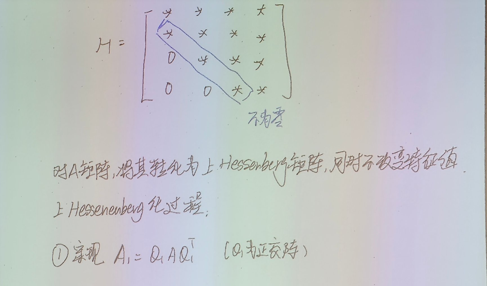
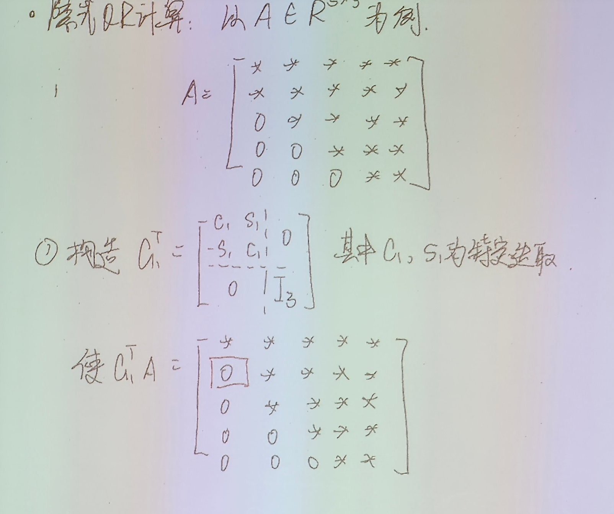
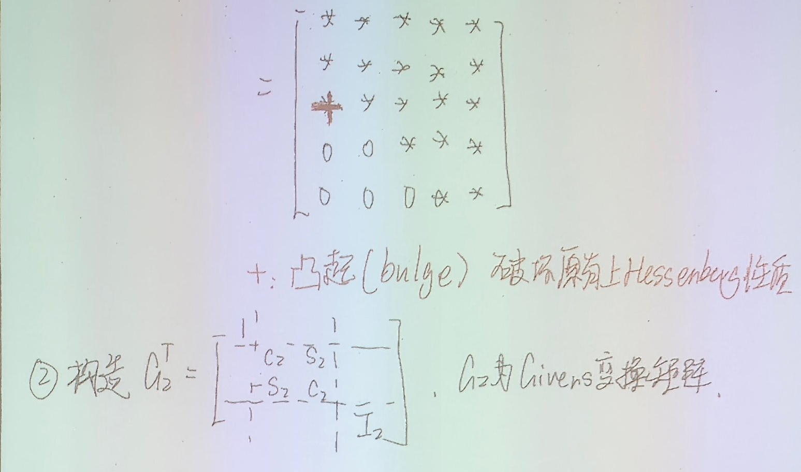
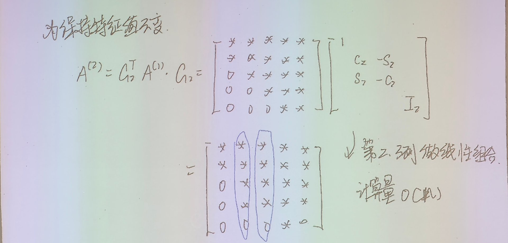
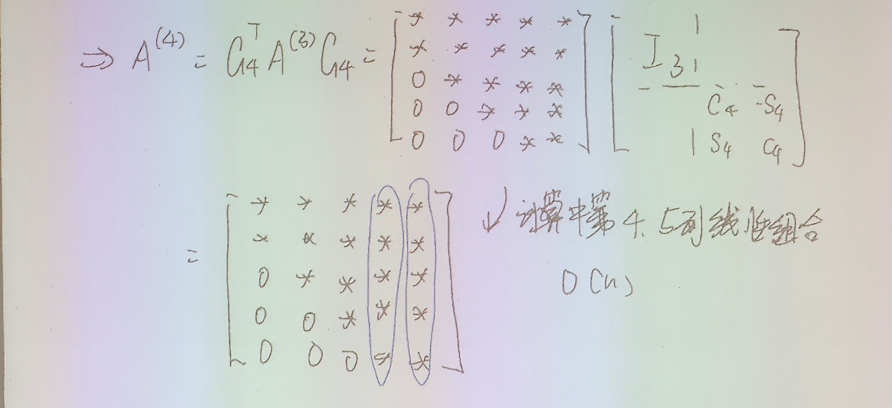

# 8.4 QR 方法

> 上课：11.10（18:36–20:46）+ 板书 19 张
> 原始材料：[课堂录音稿/11.10-QR算法](../原始材料/课堂录音稿/11.10-QR算法/)（原文逐字稿 + 导读 + 整理版逐字稿）；板书原片在 `C:\Users\29469\Desktop\计算方法与优化\计算方法与优化课程实录\11.10\`
> 对应课本：李庆扬《数值分析（第五版）》**§8.4 QR 方法**
> 前置：Householder 与 Givens 变换见 [3.2](../第3章-最小二乘问题/3.2-基于Householder的QR分解与QR最小二乘.md) 与 [3.1](../第3章-最小二乘问题/3.1-最小二乘问题法方程与正交变换.md)；幂法与反幂法见 [8.2](8.2-幂法与反幂法.md)、[8.3](8.3-幂法的加速与收缩方法.md)
> [返回总览](../00-索引.md) ｜ [上一篇：8.3 幂法的加速与收缩方法](8.3-幂法的加速与收缩方法.md)

## 目录

- [[#1. QR 迭代的格式]]
- [[#2. 两条基本性质]]
  - [[#2.1 性质一：每步都是正交相似变换]]
  - [[#2.2 性质二：$\widetilde Q_k\widetilde R_k=A^{k+1}$，与幂法的亲缘]]
- [[#3. 收敛性：形式论证]]
  - [[#3.1 预备：把 $A$ 与 $A^{k+1}$ 拆开]]
  - [[#3.2 中间块趋于单位阵]]
  - [[#3.3 用 QR 分解的唯一性收尾]]
- [[#4. 运算量问题：$O(n^4)$]]
- [[#5. 实用算法：两阶段]]
- [[#6. 第一阶段：上 Hessenberg 化]]
  - [[#6.1 逐列做正交相似变换]]
  - [[#6.2 运算量：为什么是 $O(n^3)$]]
  - [[#6.3 算法流程]]
- [[#7. Hessenberg 结构在 QR 迭代下保持]]
- [[#8. 第二阶段：隐式 QR 迭代]]
  - [[#8.1 起步：$G_1$ 消次对角元]]
  - [[#8.2 bulge 的产生与追赶]]
  - [[#8.3 每次迭代的运算量：$O(n^2)$]]
- [[#9. 隐式 QR 与常规 QR 的等价性]]
  - [[#9.1 隐式 Q 定理]]
  - [[#9.2 第一列确实相同]]
- [[#10. 位移加速与双步位移]]
- [[#11. 小结]]

---

## 1. QR 迭代的格式

正交化方法我们之前见过：把矩阵分解成一个正交矩阵乘一个上三角矩阵，实现时可以用 Gram–Schmidt，也可以用 Householder 变换、Givens 变换。今天把这些工具串成一个迭代，就是 QR 算法。

算法的逻辑非常简单，用程序化的语言写就是两步。设当前矩阵是 $A_k$（$k=0,1,2,\dots$）：

1. 对 $A_k$ 做 QR 分解：$A_k=Q_kR_k$；
2. 交换顺序乘回来：$A_{k+1}:=R_kQ_k$。

不断重复。每一步就这两件事：先分解，再把 $R$、$Q$ 换个位置乘出来。

## 2. 两条基本性质

### 2.1 性质一：每步都是正交相似变换

看一步迭代：

$$
A_{k+1}=R_kQ_k=(Q_k^TQ_k)R_kQ_k=Q_k^T(Q_kR_k)Q_k=Q_k^TA_kQ_k .
$$

中间那个括号正是 $A_k$。再往回逐层拆，$Q_k^TA_kQ_k=Q_k^TQ_{k-1}^TA_{k-1}Q_{k-1}Q_k=\cdots$，一直拆到底：

$$
A_{k+1}=\widetilde Q_k^{\,T}A_0\,\widetilde Q_k,
\qquad
\widetilde Q_k=Q_0Q_1\cdots Q_k .
$$

所以整个迭代过程，相当于对初始矩阵每步在外面包一层正交相似变换。正交矩阵的乘积还是正交矩阵，而相似变换保持特征值——**QR 迭代自始至终特征值不变**。

### 2.2 性质二：$\widetilde Q_k\widetilde R_k=A^{k+1}$，与幂法的亲缘

把每一步的 $R$ 也叠起来，定义 $\widetilde R_k=R_kR_{k-1}\cdots R_0$。那么

$$
\widetilde Q_k\widetilde R_k
=Q_0\cdots Q_{k-1}\,\underbrace{Q_kR_k}_{=\,A_k}\,R_{k-1}\cdots R_0
=\widetilde Q_{k-1}A_k\widetilde R_{k-1},
$$

再把性质一代进去：$A_k=\widetilde Q_{k-1}^{\,T}A\widetilde Q_{k-1}$，于是 $\widetilde Q_{k-1}$ 与自己的转置相乘消掉，上式变成 $A\,\widetilde Q_{k-1}\widetilde R_{k-1}$；同样一层层拆下去，最后得到

$$
\widetilde Q_k\widetilde R_k=A^{k+1}.
$$

也就是说，$A^{k+1}$ 的一个 QR 分解恰好由迭代过程中积累的 $\widetilde Q_k$、$\widetilde R_k$ 给出。

**这暴露了 QR 迭代与幂法的亲缘**：幂法（[8.2](8.2-幂法与反幂法.md)）是反复用 $A$ 乘一个向量，靠 $|\lambda_1|>|\lambda_2|$ 把主方向拉出来；QR 迭代是反复用 $A$ 乘一组向量，只是把这组向量**正交化地**维护着——所以它最后给出的不只是一个特征向量，而是全部特征值。收敛性的证明（§3）正是从 $A^{k+1}$ 的分解入手的。

## 3. 收敛性：形式论证

每步做的事情极简单——分解、交换、乘回来——但重复下去矩阵会发生什么？两条基本性质提供了全部工具。

为简单起见设 $A\in\mathbb R^{n\times n}$ 有 $n$ 个**互不相同**的特征值（复杂情形要用更复杂的论证，这里只看机制）。

### 3.1 预备：把 $A$ 与 $A^{k+1}$ 拆开

把 $A$ 对角化：$A=X\Lambda X^{-1}$，$\Lambda=\operatorname{diag}(\lambda_1,\dots,\lambda_n)$，记 $Y=X^{-1}$，即 $A=X\Lambda Y$。对两个因子分别分解：

$$
X=Q_RR_X\ \text{（QR 分解）},\qquad Y=L_YU_Y\ \text{（LU 分解，取 Doolittle：$L_Y$ 单位下三角）}.
$$

于是

$$
A^{k+1}=X\Lambda^{k+1}Y
=Q_RR_X\,\Lambda^{k+1}L_Y\,\Lambda^{-(k+1)}\,\Lambda^{k+1}U_Y,
$$

中间凭空插进 $\Lambda^{-(k+1)}\Lambda^{k+1}=I$。$\lambda_i\ne0$ 保证 $\Lambda^{-(k+1)}$ 有意义。

### 3.2 中间块趋于单位阵

看 $\Lambda^{k+1}L_Y\Lambda^{-(k+1)}$：左乘对角阵是行缩放、右乘是列缩放，它的 $(i,j)$ 元（$i\ge j$，下三角部分）为

$$
l_{ij}\Big(\frac{\lambda_i}{\lambda_j}\Big)^{k+1}.
$$

由 $|\lambda_1|>|\lambda_2|>\cdots>|\lambda_n|$，当 $i\ne j$ 时 $|\lambda_i/\lambda_j|<1$，这一项随 $k$ 增大趋于零——**所有严格下三角元素都消失**，即 $\Lambda^{k+1}L_Y\Lambda^{-(k+1)}\to D$（对角阵）。由于 $L_Y$ 是 Doolittle 分解的单位下三角、对角元全为 1，所以 $D=I$。

设 $\Lambda^{k+1}L_Y\Lambda^{-(k+1)}=I+E_k$，$k$ 很大时 $E_k$ 是小量。代回 §3.1 的式子：

$$
A^{k+1}=Q_RR_X(I+E_k)\Lambda^{k+1}U_Y
=Q_R\,(I+R_XE_kR_X^{-1})\,(R_X\Lambda^{k+1}U_Y).
$$

- 中间因子 $I+R_XE_kR_X^{-1}$：$E_k$ 小时接近单位阵，对它做 QR 分解记为 $Q_ER_E$，则 $Q_E\to I$；
- 右边因子 $W:=R_X\Lambda^{k+1}U_Y$ 是**上三角**（三个上三角相乘），对角元 $r_{ii}\lambda_i^{k+1}u_{ii}$ 符号可能正负不定。写成 $W=D_W\cdot(D_W^{-1}W)$，$D_W$ 是对角元 $\pm1$ 的对角阵，$D_W^{-1}W$ 是对角元全正的上三角（对应实特征值的情形）。

于是

$$
A^{k+1}=(Q_RQ_ED_W)\cdot(D_W^{-1}W)=:\overline Q_k\,\overline R_k .
$$

### 3.3 用 QR 分解的唯一性收尾

我们本来就有 $A^{k+1}=\widetilde Q_k\widetilde R_k$（性质二）。对角元全正的 QR 分解唯一（QR 分解唯一性的条件，见 [3.2](../第3章-最小二乘问题/3.2-基于Householder的QR分解与QR最小二乘.md)），所以

$$
\overline Q_k=\widetilde Q_k,\qquad \overline R_k=\widetilde R_k .
$$

回到性质一 $A_{k+1}=\widetilde Q_k^TA\widetilde Q_k$：

$$
A_{k+1}=D_WQ_E\,\underbrace{R_X\Lambda R_X^{-1}}_{\text{上三角，对角元为 }\lambda}\,Q_ED_W .
$$

其中 $R_X\Lambda R_X^{-1}$ 是上三角阵（上三角乘对角乘上三角），**对角元恰好是 $\lambda_1,\dots,\lambda_n$**。$k$ 很大时 $Q_E\approx I$，$D_W$ 左右各出现一次、作用相互抵消，所以

$$
A_{k+1}\ \text{收敛于一个上三角矩阵，其对角元收敛于}\ \lambda_1,\dots,\lambda_n .
$$

要强调：这只是一个**形式论证**，不是严格证明——交换分解顺序、把 $E_k$ 当小量处理这些步骤都有可以挑剔的地方。但它把机制看清楚了：只要迭代矩阵往上三角靠拢，对角元取出来就是全部特征值。

## 4. 运算量问题：$O(n^4)$

虽然能算，但直接这么迭代没人用，原因是太贵：

- 每步一次 QR 分解，$O(n^3)$；
- 每步一次 $R_kQ_k$，$n\times n$ 矩阵相乘，也是 $O(n^3)$；
- 一般要迭代 $O(n)$ 步，**总共 $O(n^4)$**。

$n$ 到几千维时这不可接受。怎么把运算量降下来，就是实用 QR 算法要解决的问题。

## 5. 实用算法：两阶段

思路是把整个计算拆成两阶段：

$$
A\ \xrightarrow{\ \text{上 Hessenberg 化}\ \ O(n^3)\ }\ \text{上 Hessenberg 矩阵}\ \xrightarrow{\ \text{隐式 QR 迭代}\ \ O(n^3)\ }\ \text{上三角矩阵}.
$$

**上 Hessenberg 矩阵**：满足 $h_{ij}=0$（$i>j+1$）——比上三角矩阵多一条次对角线。

它为什么好用？

- 对它做 QR 分解，对角线以下每列只有一个非零元，用 Givens 旋转消一个元素就行，每列 $O(n)$、整趟 $O(n^2)$；
- 下面的定理（§7）保证 **Hessenberg 结构在 QR 迭代下保持不变**，不会被破坏。

化 Hessenberg 本身是 $O(n^3)$，迭代每步 $O(n^2)$、做 $O(n)$ 步也是 $O(n^3)$，总共就把 $O(n^4)$ 压到了 $O(n^3)$。

## 6. 第一阶段：上 Hessenberg 化

目标：把 $A$ **正交相似**地变成 Hessenberg 矩阵——每步都用 $Q_kA_{k-1}Q_k^T$ 的形式，特征值不变。每一步用 Householder 变换消掉一列对角线以下的元素。

### 6.1 逐列做正交相似变换

**第一步**。取

$$
Q_1=\begin{pmatrix}I_1&\\&H_1\end{pmatrix},
$$

$I_1$ 是 $1\times1$ 单位块，$H_1$ 是 $(n-1)\times(n-1)$ 的 Householder 矩阵。把 $A$ 按同样的分块拆开：

$$
A_1=Q_1AQ_1^T
=\begin{pmatrix}a_1&\vec a_{12}^TH_1\\ H_1\vec a_{21}&H_1A_{22}H_1\end{pmatrix}.
$$

要达到的目的与 QR 分解里一样，只是方向反了过来：选 $H_1$ 使 $H_1\vec a_{21}=(\alpha,0,\dots,0)^T$——第一列对角线以下的元素**全部挪到对角元上**，其余变零。Householder 矩阵怎么构造，QR 分解里已经讲过，这里没有新东西。

**第二步**。$A_2=Q_2A_1Q_2^T$，其中

$$
Q_2=\begin{pmatrix}I_2&\\&H_2\end{pmatrix},
$$

$H_2$ 是 $(n-2)\times(n-2)$ 的 Householder 矩阵。**关键观察**：$A_1$ 的第一列只有前两个元素非零，其余（分块意义下的 $A_{21}'$ 那一列）已全是零——左乘任何矩阵都不改变零列。所以这一步真正要做的只是：选 $H_2$ 把 $A_{22}$ 的**第一列**变成 $(\alpha,0,\dots,0)^T$，即消掉第二列对角线以下的元素。

照此进行，每步用低一维的 Householder 消下一列。QR 分解要处理 $n-1$ 列，这里**做 $n-2$ 步**就得到 Hessenberg 矩阵（最后两列对角线以下本来就不违反结构）。

拿一个 $5\times5$ 矩阵走第一步，看它"消到哪一行"：

$$
A=\begin{pmatrix}
1&2&3&4&5\\
1&3&1&2&0\\
1&0&2&1&3\\
4&1&0&5&2\\
9&2&1&0&1
\end{pmatrix},
\qquad \vec t=A(2{:}5,1)=(1,1,4,9)^T,\quad \|\vec t\|_2=\sqrt{99}\approx9.9499 .
$$

取 $\vec v=\vec t+\|\vec t\|_2\vec e_1\approx(10.9499,\,1,\,4,\,9)^T$、$\beta=2/(\vec v^{\,T}\vec v)\approx0.009179$，则 $\widetilde H=I-\beta\vec v\vec v^{\,T}$ 把 $\vec t$ 打到 $-\|\vec t\|_2\vec e_1$。拼成 $Q_1=\operatorname{diag}(1,\widetilde H)$ 做正交相似变换：

$$
Q_1AQ_1^T\approx\begin{pmatrix}
1&-6.633&2.212&0.846&-2.096\\
-9.95&3.121&-0.692&-0.254&2.621\\
0&-2.921&1.578&-0.277&0.829\\
0&-2.339&-0.927&2.941&0.177\\
0&2.351&-0.367&-1.761&3.36
\end{pmatrix}.
$$

第一列只剩前两个非零元：第 1 行是原来的 $a_{11}=1$（对角元没动），第 2 行是 $-\|\vec t\|_2$，第 3 行往下全为零。对照 QR 分解的第一步（取的是 $A(:,1)$ 全列、把对角元一起反射）会把第一列变成 $(-10,0,0,0,0)^T$，差别就在**反射时对角元留不留**。另外注意：第 2 到 5 列也全部变了——正交相似变换是整块矩阵一起做的，不是只改一列；只是第一列的零是刻意构造出来的。

### 6.2 运算量：为什么是 $O(n^3)$

虽然 $Q_kA_{k-1}Q_k^T$ 看着是两次矩阵乘法，但 Householder 矩阵 $H_k=I-\beta_k\vec v_k\vec v_k^{\,T}$ 是秩一修正，乘它不需要矩阵乘矩阵，只要矩阵乘向量。按分块把第 $k$ 步展开：

$$
\begin{pmatrix}I_k&\\&H_k\end{pmatrix}
\begin{pmatrix}A_{11}^{k-1}&A_{12}^{k-1}\\ A_{21}^{k-1}&A_{22}^{k-1}\end{pmatrix}
\begin{pmatrix}I_k&\\&H_k\end{pmatrix}
=\begin{pmatrix}A_{11}^{k-1}&A_{12}^{k-1}H_k\\ H_kA_{21}^{k-1}&H_kA_{22}^{k-1}H_k\end{pmatrix}.
$$

- **左乘（$k$ 行与 $n-k$ 行）**：$H_kA_{21}^{k-1}$ 其实只需要算 $A_{21}^{k-1}$ 的**最后一列**——目的就是把这一列 Hessenberg 化——算完把 $\beta_k$、$\vec v_k$ 存下来即可。$H_kA_{22}^{k-1}=A_{22}^{k-1}-\beta_k\vec v_k\big(\vec v_k^{\,T}A_{22}^{k-1}\big)$：先算行向量乘矩阵（$O((n-k)^2)$），再算列向量乘行向量的外积并减掉（$O((n-k)^2)$）。
- **右乘（$k{+}1$ 列到 $n$ 列）**：$A_{12}^{k-1}H_k$ 与 $H_kA_{22}^{k-1}H_k$ 的做法完全一样，量级 $O(k(n-k))$。

每步总计 $O(n^2)$（各块是几个 $\Sigma(n-k)^2$ 量级的和），做 $n-2$ 步，**总共 $O(n^3)$**，按逐项加出来大约是 $\dfrac{16}{3}n^3$（板书 2 的估算）。

### 6.3 算法流程

输入 $A$，循环 $k=1\to n-2$：

1. 取列向量 $\vec t=A(k{+}1{:}n,\,k)$——第 $k$ 列从第 $k{+}1$ 行到第 $n$ 行的元素，这就是要 Householder 化的一列；
2. $\vec v=\vec t-\|\vec t\|_2\vec e_1$（$\vec e_1$ 是 $n-k$ 维的第一个单位向量），于是 $\widetilde H_k\vec t=\|\vec t\|_2\vec e_1$；
3. $\beta=2/(\vec v^{\,T}\vec v)$；
4. $A(k{+}1{:}n,\,k{:}n)\leftarrow A(k{+}1{:}n,k{:}n)-\beta\vec v\big(\vec v^{\,T}A(k{+}1{:}n,k{:}n)\big)$；
5. $A(1{:}n,\,k{+}1{:}n)\leftarrow A(1{:}n,k{+}1{:}n)-\beta\big(A(1{:}n,k{+}1{:}n)\vec v\big)\vec v^{\,T}$；
6. 若需要 $Q$，同步更新 $Q(k{+}1{:}n,1{:}k)$。

**注意**：当 $t_1\approx\|\vec t\|_2$ 时上面这个减法会相消（两个接近的数相减丢有效数字），实际实现取 $\vec v=\vec t+\operatorname{sgn}(t_1)\|\vec t\|_2\vec e_1$，得到 $\widetilde H_k\vec t=-\operatorname{sgn}(t_1)\|\vec t\|_2\vec e_1$——落到 $\vec e_1$ 的哪一侧无所谓，只要后 $n-k$ 个分量为零。反射面选取的细节见 [3.2](../第3章-最小二乘问题/3.2-基于Householder的QR分解与QR最小二乘.md) §5。

注意：**从头到尾没有真正形成过 Householder 矩阵**，只算出 $\vec v_k$ 和 $\beta_k$ 存着，用的时候就是两次矩阵–向量乘法。这也是 Householder 变换好用的地方：构造简单（单位阵减一个秩一项）、乘法快（两次矩阵–向量乘）、正交性免求逆。

## 7. Hessenberg 结构在 QR 迭代下保持

**定理**：设 $A$ 是 $n\times n$ 非奇异上 Hessenberg 矩阵，$A=QR$，则 $A'=RQ$ 也是上 Hessenberg。

思路：分两半，各看一次乘法。

- $Q=AR^{-1}$，$R^{-1}$ 还是上三角。右乘上三角时，第 $j$ 列是前 $j$ 列的线性组合；$A$ 是 Hessenberg，前 $j$ 列的非零元最多到第 $j{+}1$ 行，所以 $Q$ 的第 $j$ 列在第 $j{+}1$ 行以下全为零——$Q$ 也是上 Hessenberg。
- $A'=RQ$：$Q$ 的第 $j$ 列非零元到 $j{+}1$ 行，$R$ 的第 $j{+}1$ 列最长到 $j{+}1$，所以 $A'$ 的第 $j$ 列在第 $j{+}1$ 行以下为零——上 Hessenberg。

这条定理说明：Hessenberg 矩阵做 QR 迭代，结构不会退化；而且对 Hessenberg 做 QR 分解，每列只要消一个元素，用 Givens 旋转就行。

## 8. 第二阶段：隐式 QR 迭代

隐式的意思：计算过程中**不显式做 QR 分解**（不真的拆出 $Q$ 乘 $R$），而是分步做。

### 8.1 起步：$G_1$ 消次对角元

以 $5\times5$ 的 Hessenberg 矩阵 $A$ 为例。第一步构造

$$
G_1^T=\begin{pmatrix}c_1&s_1&&\\-s_1&c_1&&\\&&1&&\\&&&1&\\&&&&1\end{pmatrix},
$$

$c_1,s_1$ 特定选取，目的是使 $G_1^TA$ 的 $(2,1)$ 元变成零——对第一、二行做线性组合。

这一步真正要算的只有前两行的元素，其余照抄。

### 8.2 bulge 的产生与追赶

但相似变换要做全：$A^{(1)}=G_1AG_1$。右乘 $G_1$ 只对前两列做线性组合，算完之后会发现：虽然特征值没变，但**多出来一个东西**——$(3,1)$ 位置冒出一个非零元。我们本来想消掉次对角元，消掉的同时却在更下面产生了一个新的非零元，破坏了 Hessenberg 性质。这个多出来的元素叫**凸起（bulge）**。

下一步的目标明确：把 bulge 赶出去。构造

$$
G_2^T=\begin{pmatrix}1&&&&\\&c_2&s_2&&\\&-s_2&c_2&&\\&&&1&\\&&&&1\end{pmatrix},
$$

它作用在第 2、3 行上，使 $G_2^TA^{(1)}$ 把 $(3,1)$ 的 bulge 消成零。为保持特征值不变再右乘：$A^{(2)}=G_2^TA^{(1)}G_2$，右乘是对第 2、3 列做线性组合。但 bulge 又出现了——从 $(3,1)$ **往斜下方挪了一格**，到了 $(4,2)$。

继续。$G_3$ 作用在第 3、4 行（和第 3、4 列），把 $(4,2)$ 消掉，新的 bulge 出现在 $(5,3)$；$G_4$ 作用在第 4、5 行（和第 4、5 列），把 $(5,3)$ 消掉——而此时 bulge 若再往斜下走就出了矩阵，右乘 $G_4$ 之后最后两列本来就不要求是 Hessenberg 的，**bulge 被赶出了矩阵**，$A^{(4)}$ 恢复上 Hessenberg 性质。

整个过程：

$$
A^{(4)}=G_4^TG_3^TG_2^TG_1^T\,A\,G_1G_2G_3G_4=\widetilde Q^TA\widetilde Q,
\qquad \widetilde Q=G_1G_2G_3G_4 .
$$

每个 $G_i$ 都是正交的，乘起来还是正交阵；整个过程就是一次正交相似变换。

### 8.3 每次迭代的运算量：$O(n^2)$

每步只动两行（左乘）加两列（右乘），参与运算的元素共约 $4n$ 个；这样的步子有 $n-1$ 步（$G_1$ 到 $G_{n-1}$），所以**一次隐式 QR 迭代总共 $O(n^2)$**。对比常规 QR 分解的 $O(n^3)$，这就是两阶段设计省下来的钱。

## 9. 隐式 QR 与常规 QR 的等价性

隐式迭代得到的 $A^{(4)}=\widetilde Q^TA\widetilde Q$；常规 QR 迭代一步得到 $A'=RQ=Q^TAQ$。两个问题：$\widetilde Q$ 和 $Q$ 一样吗？$A^{(4)}$ 和 $A'$ 一样吗？

### 9.1 隐式 Q 定理

**定理**：设 $A$ 是非奇异的不可约上 Hessenberg 矩阵，$P_1=U^TAU$、$P_2=V^TAV$ 都是上 Hessenberg，$U,V$ 正交。若 $U$ 与 $V$ 的第一列相同（$\vec u_1=\vec v_1$），则存在对角阵 $D$（对角元为 $\pm1$）使 $U=VD$，且 $P_1=DP_2D$。

也就是说：**第一列一样，整个过程就本质一样**（最多差行列符号）。

### 9.2 第一列确实相同

常规 QR 中 $Q=AR^{-1}$，第一列是 $A$ 第一列的规范化：

$$
\vec q_1=\frac{(a_{11},a_{21},0,\dots,0)^T}{\sqrt{a_{11}^2+a_{21}^2}} .
$$

隐式 QR 中 $\widetilde Q=G_1G_2G_3G_4$，而 $G_2,G_3,G_4$ 都不动第一行第一列（它们的作用块从第 2 行才开始），所以 $\widetilde Q$ 的第一列就是 $G_1$ 的第一列 $\vec g_1=(c_1,-s_1,0,\dots,0)^T$。而 $G_1^TA$ 消 $(2,1)$ 要求 $s_1a_{11}+c_1a_{21}=0$ 且 $s_1^2+c_1^2=1$，解出

$$
c_1=\frac{a_{11}}{\sqrt{a_{11}^2+a_{21}^2}},\qquad
s_1=-\frac{a_{21}}{\sqrt{a_{11}^2+a_{21}^2}},
\qquad\Longrightarrow\quad
\vec g_1=\frac{(a_{11},a_{21},0,\dots,0)^T}{\sqrt{a_{11}^2+a_{21}^2}}=\vec q_1 .
$$

所以 $\widetilde Q$ 与 $Q$ 第一列相同，由隐式 Q 定理，$A^{(4)}$ 与 $A'$ 本质上相同（最多差符号）。**隐式 QR 完全可以实现常规 QR 的结果，而且每步只要 $O(n^2)$**。

## 10. 位移加速与双步位移

还可以更快。每步不是对 $A$ 做 QR，而是对 $A-\sigma_kI$ 做：分解 $A_k-\sigma_kI=Q_kR_k$，然后

$$
A_{k+1}=R_kQ_k+\sigma_kI .
$$

形式上没有本质区别——减掉一个对角元、算完再加回来，不影响结果，只是迭代路径变了。好处在于：QR 迭代的收敛是**从下往上**的（绝对值最小的特征值对应的元素最先收敛，机制与 [8.2](8.2-幂法与反幂法.md) 幂法的收敛因子分析同源），把位移取在最小特征值附近，收敛立刻加快。实际中 $\sigma_k$ 取矩阵右下角 $2\times2$ 小块的特征值——这一块对应的就是最底层要最先收敛的那对特征值。

一个实际问题：右下 $2\times2$ 块的特征值可能是复数，而实运算不能直接减复位移，否则实矩阵会变复。处理办法是**双步位移**：用相邻两步把一对共轭复位移合并成一步实的隐式变换来做，本质上和复数下的 QR 迭代一模一样，只是把虚部的影响折进实运算里。这部分是技术细节，目的只有一个：让收敛更快。

## 11. 小结

- **QR 迭代**：分解、交换、乘回来。每步是正交相似变换，特征值不变；$\widetilde Q_k\widetilde R_k=A^{k+1}$ 说明它与幂法同源——幂法养一个向量，QR 迭代正交地养一组向量。
- **收敛**（形式论证，要求特征值互异且按模分层）：$A_{k+1}$ 收敛于上三角，对角元给出全部特征值。
- **直接迭代的代价是 $O(n^4)$**，实用算法靠两阶段压到 $O(n^3)$：
  - 先用 Householder 做上 Hessenberg 化（$O(n^3)$，约 $\frac{16}{3}n^3$）；
  - 再对 Hessenberg 矩阵做隐式 QR 迭代（每次 $O(n^2)$，bulge 追赶）。
- **隐式 Q 定理**保证隐式迭代与常规迭代等价：第一列相同就够了。
- **位移**（取右下 $2\times2$ 块的特征值）加速收敛；复位移用双步折成实运算。

两阶段的总运算量是 $O(n^3)$、系数几十的量级——矩阵规模越大，与直接暴算的差距越大。
