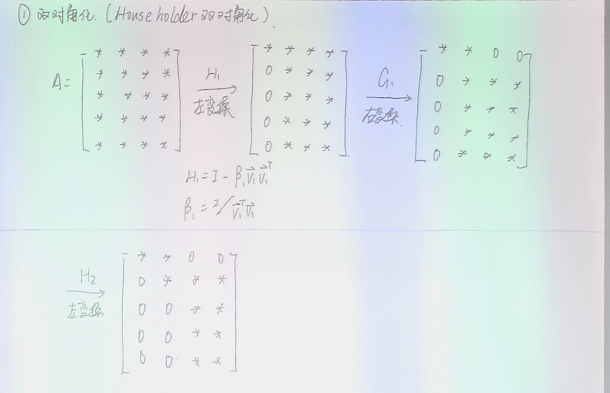
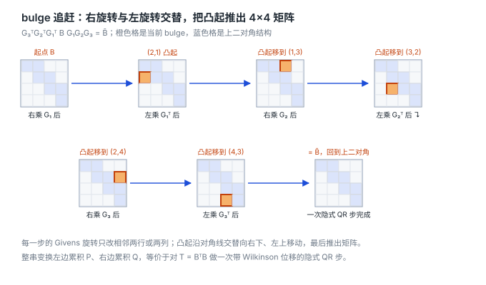
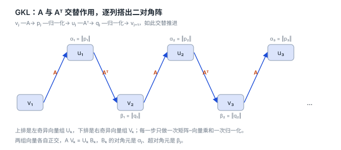

# 8.5 奇异值分解与广义逆

> 上课：11.11（10:00–11:22）+ 板书 9 张
> 续讲：11.17（[课堂录音稿/11.17-奇异值计算方法](../原始材料/课堂录音稿/11.17-奇异值计算方法/)：原文 + 导读 + 整理版逐字稿）；§9–§12 对应教材 §7.6.2–§7.6.3，§13 为课堂补充，教材未讲
> 板书：11.17 课堂板书照片 14 张（用户提供，未入 vault）；§9.1 的 $T$ 矩阵形状、§11.2 的 Givens 旋转具体形式据板书补入
> 原始材料：[课堂录音稿/11.11-奇异值分解](../原始材料/课堂录音稿/11.11-奇异值分解/)（原文逐字稿 + 导读 + 整理版逐字稿）；板书原片在 `C:\Users\29469\Desktop\计算方法与优化\计算方法与优化课程实录\11.11\`
> 对应课本：徐树方《数值线性代数（第二版）》**§7.1 基本性质**（定理 7.1.5 SVD 分解定理，p.203）与 **§7.6 奇异值分解的计算**（p.232：7.6.1 二对角化／7.6.2 SVD 迭代／7.6.3 SVD 算法）；Moore–Penrose 广义逆的定义在同书第三章 p.82。李庆扬《数值分析（第五版）》第 8 章止于 §8.4 QR 方法，未讲 SVD
> 顺序依据：徐树方把 SVD 放在特征值计算章——§6.4 QR 方法（对应本库 [8.4](8.4-QR方法.md)）→ §7.1 SVD 定义 → §7.6 SVD 计算，故本篇排在 8.4 之后、编号 **8.5**。广义逆虽在教材第三章 p.82 定义，但它是本篇的一部分：[3.1](../第3章-最小二乘问题/3.1-最小二乘问题法方程与正交变换.md) 指出列亏秩时解有无穷多，[3.2](../第3章-最小二乘问题/3.2-基于Householder的QR分解与QR最小二乘.md) §17.3／§17.5 留下"最小范数解即广义逆解，工程上做 SVD 截断"的接口，本篇把它展开
> 课本术语：徐树方作**二对角化／二对角阵**（板书作「双对角化／上双对角」），本篇统一用课本术语。Householder 的构造、参数化与秩一更新见 3.2 §5–§7；两阶段与分块两步见 8.4 §5–§6，均不重抄
> [返回总览](../00-索引.md) ｜ [上一篇：8.4 QR 方法](8.4-QR方法.md) ｜ [下一篇：2.1 插值问题与拉格朗日插值](../第2章-插值法/2.1-插值问题与拉格朗日插值.md) ｜ [相关：3.2 秩亏最小二乘](../第3章-最小二乘问题/3.2-基于Householder的QR分解与QR最小二乘.md)

## 目录

- [[#1. SVD 的定义与等价形式]]
  - [[#1.1 定义]]
  - [[#1.2 等价表达：把 $A$ 的作用说出来]]
  - [[#1.3 外积展开：秩一矩阵之和]]
- [[#2. 三种形式：完全、紧凑、截断]]
- [[#3. 理论上的计算路线]]
- [[#4. Moore–Penrose 广义逆]]
- [[#5. 最小范数最小二乘解]]
- [[#6. 为什么理论路线不能用：$\varepsilon$ 的例子]]
- [[#7. Golub–Kahan–Reinsch：还是两阶段]]
  - [[#7.1 左右交替消出二对角]]
  - [[#7.2 算法流程]]
  - [[#7.3 运算量：$O(mn^2)$]]
- [[#8. 小结与预告]]
- [[#9. 从二对角阵到奇异值：形式上引入 $T=B^TB$]]
  - [[#9.1 $T$ 的形状]]
  - [[#9.2 为什么不直接算 $T$]]
  - [[#9.3 为什么不对 $B$ 直接做 QR 迭代]]
  - [[#9.4 可约性：先把大块拆小]]
- [[#10. Wilkinson 位移：只从 $B$ 取四个数]]
- [[#11. 隐式 SVD 迭代：在 $B$ 上追凸起]]
  - [[#11.1 隐式 Q 定理定出第一步]]
  - [[#11.2 bulge chase：右旋、左旋交替]]
  - [[#11.3 为什么便宜]]
  - [[#11.4 整件事的因果链]]
- [[#12. 完整 SVD 算法与收敛]]
  - [[#12.1 收敛准则与分裂]]
  - [[#12.2 运算量与收敛速度]]
  - [[#12.3 与 8.4 的整套对照]]
- [[#13. 大规模稀疏矩阵：GKL 二对角化]]
  - [[#13.1 为什么要换算法]]
  - [[#13.2 递推格式：$A$ 与 $A^T$ 交替作用]]
  - [[#13.3 稀疏矩阵上为什么快]]
  - [[#13.4 停步准则：看 $B_k$ 的奇异值稳不稳]]
  - [[#13.5 为什么 GKL 有效：Krylov 空间与 Gram–Schmidt]]

---

## 1. SVD 的定义与等价形式

### 1.1 定义

特征值只对方阵有定义，日常碰到的矩阵却常常不是方阵——长窄的、宽扁的都有。设 $A\in\mathbb R^{m\times n}$、秩为 $r$：

$$
A=U\Sigma V^T,\qquad U\in\mathbb R^{m\times m},\ V\in\mathbb R^{n\times n}\ \text{正交},\ \Sigma\in\mathbb R^{m\times n}.
$$

$\Sigma$ 只有 $(i,i)$ 位置可能非零，对角元按降序排：

$$
\sigma_1\ge\sigma_2\ge\cdots\ge\sigma_r>0=\sigma_{r+1}=\cdots ,
$$

这些 $\sigma_i$ 称为**奇异值**。存在性有定理保证：任意 $A\in\mathbb R^{m\times n}$ 都有 SVD（课上只声明结论，不给证明）。

### 1.2 等价表达：把 $A$ 的作用说出来

从 $A=U\Sigma V^T$ 右乘 $V$、或转置后右乘 $U$：

$$
AV=U\Sigma,\qquad A^TU=V\Sigma^T .
$$

按列拆开就是

$$
A\vec v_i=\sigma_i\vec u_i,\qquad A^T\vec u_i=\sigma_i\vec v_i,\qquad i=1,\dots,r .
$$

**$A$ 把右奇异向量 $\vec v_i$ 映到左奇异向量 $\vec u_i$，长度放大 $\sigma_i$ 倍**。这条对应关系不只是解释，它还是理论算法里由一侧精确定义另一侧的依据（§3）。

### 1.3 外积展开：秩一矩阵之和

把 $U$、$V$ 写成列向量组、把 $\Sigma$ 展开：

$$
A=\sum_{i=1}^{r}\sigma_i\,\vec u_i\vec v_i^{\,T}.
$$

每一项都是秩一矩阵，权重 $\sigma_i$ 已经按从大到小排好。整条式子说的是：**$A$ 是 $r$ 个秩一矩阵之和，重要性由 $\sigma_i$ 排定**——截断 SVD 与低秩近似都从这里来。

## 2. 三种形式：完全、紧凑、截断

设 $m\ge n$。经典写法 $A=U\Sigma V^T$ 里的 $U$ 是 $m\times m$ 方阵，但外积展开只用到前 $r$ 个 $\vec u_i$，后面的列没有贡献。于是有三种写法：

| 形式 | 表达式 | 形状 |
|---|---|---|
| 完全 SVD | $A=U\Sigma V^T=U_n\Sigma_nV^T$ | $U_n\in\mathbb R^{m\times n}$ 列正交，$\Sigma_n\in\mathbb R^{n\times n}$ |
| 紧凑 SVD | $A=U_r\Sigma_rV_r^T$ | $U_r\in\mathbb R^{m\times r}$，$V_r\in\mathbb R^{n\times r}$，$\Sigma_r\in\mathbb R^{r\times r}$ |
| 截断 SVD | $A\approx U_k\Sigma_kV_k^T$（$k<r$） | $U_k\in\mathbb R^{m\times k}$，$V_k\in\mathbb R^{n\times k}$，$\Sigma_k\in\mathbb R^{k\times k}$ |

截断把求和上限从 $r$ 改成 $k$、等号改成近似号：$\sigma_i$ 很小时 $\sigma_i\vec u_i\vec v_i^T$ 在 $A$ 里的贡献也小，扔掉后面那些项就是**低秩近似**。PCA 一类方法用的就是这件事。

注意表格里三行的 $\Sigma$ 维度不同，但都只有对角元非零；紧凑 SVD 才是"真正只保留有用信息"的那个。

## 3. 理论上的计算路线

按定义算奇异值，可以分五步：

1. **构造 $A^TA$**：不管 $A$ 什么形状，$A^TA$ 都是对称半正定方阵。若 $m<n$（行比列少），先算 $AA^T$（$m\times m$）更省——两者非零特征值相同，只是左右奇异向量的地位互换，最后换回来即可；直接算 $A^TA$ 等于用一个 $n\times n$ 的大矩阵去求一个小矩阵就能给出的信息。
2. **求特征值**：$A^TA$ 是实对称方阵，特征值能算、能排序、全非负，且 $\sigma_i=\sqrt{\lambda_i}$；$\lambda_i=0$ 对应 $\sigma_i=0$。
3. **求特征向量并单位化**：取成标准正交组，构成 $V$ 的前 $r$ 列。
4. **由 $\vec v_i$ 求 $\vec u_i$**：只对 $\sigma_i>0$ 的项，用 §1.2 的 $A\vec v_i=\sigma_i\vec u_i$ 得

$$
\vec u_i=\frac{A\vec v_i}{\sigma_i}.
$$

5. **扩充**：把 $\vec u_1,\dots,\vec u_r$ 补成 $\mathbb R^m$ 的一组标准正交基（Gram–Schmidt：任取向量、减去它在已有方向上的投影、单位化、重复）。

**注意**：不要分别算 $A^TA$ 与 $AA^T$ 的特征向量再"配对"，两边舍入误差不同，配出来会不一致；用第 4 步由一侧精确定义另一侧。

## 4. Moore–Penrose 广义逆

设 $A=U\Sigma V^T$，定义

$$
A^+=V\Sigma^+U^T=\sum_{i=1}^{r}\frac{1}{\sigma_i}\,\vec v_i\vec u_i^{\,T},
$$

其中 $\Sigma^+$ 把 $\Sigma$ 转置后**非零对角元取倒数、零元素仍保持为零**（$\Sigma\in\mathbb R^{m\times n}$，$\Sigma^+\in\mathbb R^{n\times m}$）。

$A^+$ 是满足以下四个条件的唯一矩阵（记 $X=A^+$）：

$$
AXA=A,\qquad XAX=X,\qquad (AX)^T=AX,\qquad (XA)^T=XA .
$$

它起的作用有点像逆矩阵：$AA^+$、$A^+A$ 在相应子空间上表现得像单位阵，但 $A$ 不必是方阵。两个特例：$A$ 列满秩时 $A^+=(A^TA)^{-1}A^T$；$A$ 满秩方阵时 $A^+=A^{-1}$。

第一条正好接上 [3.1](../第3章-最小二乘问题/3.1-最小二乘问题法方程与正交变换.md) 的法方程解：$A$ 列满秩时 $A^+\vec b=(A^TA)^{-1}A^T\vec b$，就是法方程给出的那个解；列亏秩时 $(A^TA)^{-1}$ 不存在，而 $A^+$ 仍然有定义。

## 5. 最小范数最小二乘解

**定理**：对任意 $\vec b\in\mathbb R^m$，$\vec x^+=A^+\vec b$ 在所有使 $\lVert A\vec x-\vec b\rVert_2$ 最小的 $\vec x$ 中，使 $\lVert\vec x\rVert_2$ 最小。

这正是 [3.2](../第3章-最小二乘问题/3.2-基于Householder的QR分解与QR最小二乘.md) §17.3 留的接口：通解里的自由变量 $y_2$ 要选成使 $\lVert\vec x\rVert_2$ 最小的值（那里说可再解一个小的最小二乘问题来定它）。换到 SVD 的坐标下，这个选择变成"自由分量全取零"，不必再解任何方程——SVD 的坐标把答案直接摆出来了，这就是 §17.5 说"工程上直接做 SVD 截断更省事"的原因。

整段只做一件事：把最小二乘问题换到 SVD 的坐标下，让每个分量各自独立。

**先换元**——设 $\vec y=V^T\vec x$、$\vec c=U^T\vec b$。因为 $U,V$ 正交，二范数不变：

$$
\lVert A\vec x-\vec b\rVert_2^2=\lVert U\Sigma V^T\vec x-\vec b\rVert_2^2=\lVert\Sigma\vec y-\vec c\rVert_2^2 .
$$

**再展开**——$\Sigma$ 只有前 $r$ 个对角元非零：

$$
\lVert\Sigma\vec y-\vec c\rVert_2^2=\sum_{i=1}^{r}(\sigma_iy_i-c_i)^2+\sum_{i=r+1}^{m}c_i^2 .
$$

第二项与 $\vec y$、$\vec x$ 都无关，是残差里消不掉的部分——所以"最小二乘"能管的只有第一项。

**控制前 $r$ 项**——逐项取 $y_i=c_i/\sigma_i\ (i\le r)$ 使每个平方为零。于是 $y_1,\dots,y_r$ 被唯一确定，而 $y_{r+1},\dots,y_n$ 根本没出现、可以任取。这正是 $A$ 列亏秩时最小二乘解不唯一的来源。

**最后定 $\vec x$**——$\vec y=V^T\vec x$ 且 $V$ 正交，故 $\lVert\vec x\rVert_2=\lVert\vec y\rVert_2$；要让范数最小，自由分量只能全取零：$y_{r+1}=\cdots=y_n=0$。于是

$$
\vec x=V\vec y=\sum_{i=1}^{r}\frac{c_i}{\sigma_i}\vec v_i=\sum_{i=1}^{r}\frac{\vec u_i^{\,T}\vec b}{\sigma_i}\vec v_i=A^+\vec b .
$$

课上说明这只是把表达式重推一遍，不算严格证明；但它把「$A^+$ 为什么偏偏是那个解」交代清楚了。

## 6. 为什么理论路线不能用：$\varepsilon$ 的例子

§3 那条路线（$A^TA$ → 特征值 → 特征向量 → 拼 $A^+$）只是**理论上有效**。实际数值计算不这么干，有三层原因：

- 求特征值本身不简单，大规模矩阵还要做完整特征分解、逐个求特征向量；
- $A^TA$ 的条件数被平方放大——[3.2](../第3章-最小二乘问题/3.2-基于Householder的QR分解与QR最小二乘.md) §15 已经给出严格等式 $\kappa_2(A^TA)=\kappa_2(A)^2$，[3.1](../第3章-最小二乘问题/3.1-最小二乘问题法方程与正交变换.md) 讲法方程时也提醒过这一点；
- 最致命的是 $A^+$ 里的 $1/\sigma_i$。本该为零的 $\sigma_i$ 在机器里算出来是 $10^{-16}$ 量级的小量，一放到分母上影响就是 $10^{16}$ 倍；而 $\sigma_i=\sqrt{\lambda_i}$，$\sigma_i=10^{-16}$ 对应 $\lambda_i=10^{-32}$，在 $A^TA$ 里根本无法准确表示。

板书上的例子把这件事说死了。取

$$
A=\begin{pmatrix}1&1\\ \varepsilon&0\\ 0&\varepsilon\end{pmatrix}
\ \Longrightarrow\
A^TA=\begin{pmatrix}1+\varepsilon^2&1\\ 1&1+\varepsilon^2\end{pmatrix}
\ \Longrightarrow\
\sigma_1=\sqrt{2+\varepsilon^2},\quad \sigma_2=\varepsilon .
$$

若 $\varepsilon\sim10^{-10}$：它比双精度机器精度（约 $10^{-16}$）还大六个量级，绝不是可忽略的小量；但 $\varepsilon^2\sim10^{-20}$，浮点数里 $\operatorname{fl}(1+\varepsilon^2)=1$，于是 $A^TA$ 变成 $\begin{pmatrix}1&1\\1&1\end{pmatrix}$ 而**直接奇异**，$\sigma_2=\varepsilon$ 完全丢失。

这里丢的不只是精度，而是问题性质：满秩变奇异，连"存在一个很小但不为零的奇异值"都算不出来。所以 [3.1](../第3章-最小二乘问题/3.1-最小二乘问题法方程与正交变换.md) 里那条 $A^TA\vec x=A^T\vec b$ 虽然理论干净，底层数值计算并不用它。

## 7. Golub–Kahan–Reinsch：还是两阶段

实际计算走 Golub–Kahan–Reinsch 算法（教材 §7.6 不点名，只称"计算 SVD 的 QR 方法"）。教材给的动机正好接上 §6：**隐含地对 $A^TA$ 应用对称 QR 方法，但整个过程中不把 $A^TA$ 真正算出来**——二对角化就相当于把 $A^TA$ 三对角化，于是 §6 那个 $\varepsilon$ 例子造成的精度灾难被绕开了。它和 [8.4 QR 方法](8.4-QR方法.md) §5 的实用 QR 迭代是同一个骨架，也是两阶段：

$$
A\in\mathbb R^{m\times n}\ \xrightarrow{\ \text{二对角化}\ \ O(mn^2)\ }\ B\ (\text{上二对角})\ \xrightarrow{\ \text{迭代计算}\ \ O(n^2)\ }\ \Sigma .
$$

第一阶段是预处理：把稠密矩阵变成规模更小、结构更好算的形式；第二阶段再对这个形式做迭代。$B$ 是上二对角方阵（只有主对角线与第一条超对角线可能非零），注意它与 8.4 化出来的**上 Hessenberg 矩阵**不是一回事。

**为什么要求 $m\ge n$**：第一阶段运算量 $O(mn^2)$，列数是平方、行数只是线性；$n>m$ 时先转置再算，奇异值不变。

顺带对照对称特征值问题：对称矩阵做 Hessenberg 化时还要保持对称性，主对角线以上那条也留着，两边合起来就是三对角矩阵——比上 Hessenberg 更少非零元。这里的 $B$ 不要求对称，只是形状相仿。

### 7.1 左右交替消出二对角

第 1 步用 Householder 左变换消第一列对角元以下的元素，第 2 步用右变换消第一行第 3 个元素起的所有元素，第 3 步左变换消第二列、第 4 步右变换消第二行……交替进行：

两条不变式保证前面不白做：

- 左变换 $H_k=\operatorname{diag}(I_{k-1},\widetilde H_k)$ 只动第 $k$ 行以下，前 $k-1$ 行不变；
- 右变换 $G_k=\operatorname{diag}(I_k,\widetilde G_k)$ 只动第 $k+1$ 列以后，前 $k$ 列（包括刚消好的那一列）不变。

右变换可以看成"把矩阵转置之后做一个左变换"：$\widetilde G$ 仍是 Householder 矩阵、对称正交，计算与左变换同一套，只是作用到行上。Householder 向量的构造、$\beta=2/(\vec v^T\vec v)$、以及 $C\leftarrow C-\beta\vec v(\vec v^TC)$ 这条秩一更新，定义都在 [3.2](../第3章-最小二乘问题/3.2-基于Householder的QR分解与QR最小二乘.md) §5–§7，这里不重抄；分块两步的形状与 [8.4](8.4-QR方法.md) §6.1 的 Hessenberg 化完全一样，差别只是每一步多做一次右变换。

### 7.2 算法流程

输入 $A\in\mathbb R^{m\times n}$（$m\ge n$），循环 $k=1\to n$；若 $m=n$ 是方阵，则 $k=1\to n-1$（最后一列只有对角元、下面没有要消的元素）：

1. $[\vec v,\beta]\leftarrow\operatorname{Householder}\big(A[k{:}m,k]\big)$：取第 $k$ 列从第 $k$ 行到第 $m$ 行的元素（长度 $m-k+1$）；$\vec v$ 只需把首分量减去（或按符号加上）向量长度，其余分量照抄。
2. 左变换：

$$
A[k{:}m,k{:}n]\leftarrow A[k{:}m,k{:}n]-\beta\,\vec v\big(\vec v^{\,T}A[k{:}m,k{:}n]\big).
$$

3. 若 $k\le n-2$（右边还有至少两列要处理），$[\vec w,\gamma]\leftarrow\operatorname{Householder}\big(A[k,k{+}1{:}n]^T\big)$：取第 $k$ 行从第 $k{+}1$ 列到第 $n$ 列的元素，转置成列向量来算。
4. 右变换（括号位置与左变换不同）：

$$
A[k{:}m,k{+}1{:}n]\leftarrow A[k{:}m,k{+}1{:}n]-\gamma\big(A[k{:}m,k{+}1{:}n]\vec w\big)\vec w^{\,T}.
$$

循环结束得到上二对角矩阵 $B$。**全程不显式形成 $H_k$、$G_k$**：它们都是单位阵减一个秩一修正，所以矩阵乘矩阵被拆成一次向量–矩阵乘、一次外积、一次矩阵相减——这正是 [8.4](8.4-QR方法.md) §6.2 强调过的省算量写法。

### 7.3 运算量：$O(mn^2)$

- 左变换：先算 $\vec v^{\,T}A[k{:}m,k{:}n]$，得 $1\times(n-k+1)$ 的行向量，运算量 $O\big((m-k+1)(n-k+1)\big)$；乘回 $\vec v$ 外积并相减，同量级。
- 右变换：先算 $A[k{:}m,k{+}1{:}n]\vec w$，得长度 $m-k+1$ 的列向量，运算量 $O\big((m-k+1)(n-k)\big)$；外积与相减同量级。

两边都是 $O\big((m-k+1)(n-k)\big)$，对 $k=1\to n$ 求和，总量 $O(mn^2)$；板书把常数也算出来：$4mn^2-\dfrac43n^3=4n^2\big(m-\dfrac n3\big)$。精细数每步的乘加次数（内积有乘有加、外积再乘常数、最后减法）可以再细化，但量级不变。

另一个好处在截断 SVD：把 $A$ 写成 $k$ 个秩一矩阵之和后，每次 $A$ 乘向量或矩阵都可拆成"先算 $k$ 个内积、再各乘一个向量"，矩阵乘的运算量也降下来了——低秩近似不只省存储，还省计算。

## 8. 小结与预告

- SVD 把任意 $m\times n$ 矩阵写成 $U\Sigma V^T$；外积形式 $A=\sum_{i\le r}\sigma_i\vec u_i\vec v_i^T$ 给出了紧凑 SVD 与截断 SVD 的根据，也是低秩近似的源头。
- 理论路线靠 $A^TA$ 的特征值，能用 $A^+$ 定义列亏秩时的最小范数最小二乘解——这条式子把 [3.1](../第3章-最小二乘问题/3.1-最小二乘问题法方程与正交变换.md) 的法方程解包成了特例。
- 但 $\kappa_2(A^TA)=\kappa_2(A)^2$ 与 $1/\sigma_i$ 让它在实际计算里不可用（$\varepsilon$ 例子：$\varepsilon^2$ 被浮点吞掉，$A^TA$ 直接奇异）。这也解释了为什么 [3.2](../第3章-最小二乘问题/3.2-基于Householder的QR分解与QR最小二乘.md) 的正交变换法才是数值上的常规选择。
- 实用算法是两阶段：先 Householder 二对角化（$O(mn^2)$，左右交替），再对 $B$ 做迭代（$O(n^2)$）。第一阶段与 [8.4](8.4-QR方法.md) §6 的 Hessenberg 化同构，只是每步多一次右变换。

11.11 的课只讲到第一阶段。**后一半**——怎么对上二对角矩阵 $B$ 做隐式 QR 迭代得到 $\Sigma$——在 11.17 续讲，见 §9–§12；它和 8.4 §8 的隐式 QR 非常相像。§13 是同一次课补充的大规模稀疏矩阵算法，针对的是另一类问题。

## 9. 从二对角阵到奇异值：形式上引入 $T=B^TB$

§7 的第一阶段只把 $A$ 化成了上二对角阵 $B$。第二阶段要算出 $B$ 的奇异值，教材 §7.6.2 的办法是**隐含地对 $T=B^TB$ 应用带位移的对称 QR 迭代**，但整个过程不把 $T$ 真正算出来。先说清为什么走这条路，以及为什么 $T$ 不能显式形成。

以下按教材记号：$B$ 的对角元记作 $\delta_j$、第一条超对角元记作 $\gamma_j$（逐字稿里作 $d_j,f_j$），并约定 $\delta_0=\gamma_0=\gamma_n=0$。

### 9.1 $T$ 的形状

由矩阵乘法直接写出 $T=B^TB$：它是对称三对角阵（板书把整个形状写出来了），

$$
T=B^TB=\begin{pmatrix}
\delta_1^2 & \delta_1\gamma_1 \\
\delta_1\gamma_1 & \delta_2^2+\gamma_1^2 & \delta_2\gamma_2 \\
& \ddots & \ddots & \ddots \\
&& \delta_{n-1}\gamma_{n-2} & \delta_{n-1}^2+\gamma_{n-2}^2 & \delta_{n-1}\gamma_{n-1} \\
&&& \delta_{n-1}\gamma_{n-1} & \delta_n^2+\gamma_{n-1}^2
\end{pmatrix},
$$

即

$$
T_{jj}=\delta_j^2+\gamma_{j-1}^2,\qquad T_{j,j+1}=T_{j+1,j}=\delta_j\gamma_j .
$$

$B$ 只是二对角，$T$ 却是三对角的——这正对应"把 $A^TA$ 三对角化"这一步；教材 §7.6.1 明确说，这相当于对 $A^TA$ 应用对称 QR 方法的第一步前置变换，但**不必把 $A^TA$ 算出来**。

### 9.2 为什么不直接算 $T$

§6 的 $\varepsilon$ 例子在这里原样重演：$A^TA$ 把误差平方放大，$\varepsilon=10^{-10}$ 在 $\operatorname{fl}(1+\varepsilon^2)$ 里直接被吞掉，满秩算成奇异。对 $B^TB$ 做显式形成有同样的毛病，而且形成 $T$ 本身还要 $O(n^3)$ 而不是后面迭代的 $O(n)$。所以 $T$ 只是**形式上的对象**：用来说明迭代在做什么，实际只从 $B$ 里取需要的那几个元素。

### 9.3 为什么不对 $B$ 直接做 QR 迭代

两条理由，课堂上各说了一句：

- $B$ 本来就是上三角（上二对角）的，对它做 QR 分解得到的 $R$ 还是上三角，$A_k=R_kQ_k$ 迭代不出新东西；
- 即使能迭代，算出来的是 $B$ 的**特征值**，不是奇异值。非方阵没有特征值；对方阵而言两者含义也不同（§1 的 $A\vec v_i=\sigma_i\vec u_i$ 说明奇异值来自两侧的奇异向量，不是单侧的特征值）。

$T=B^TB$ 则是对称三对角阵，它的特征值 $\lambda_i$ 非负，且 $\sigma_i(B)=\sqrt{\lambda_i(T)}$——这正是 §3 那条理论路线，只是现在借助 $B$ 的结构"隐含地"走。

### 9.4 可约性：先把大块拆小

一次隐式 QR 迭代要求 $T$ **不可约**（次对角元全不为零）。由 $T_{j,j+1}=\delta_j\gamma_j$，条件是

$$
\delta_j\gamma_j\ne0,\qquad j=1,\dots,n-1 .
$$

两种破坏情形对应两种"分裂"：

1. **$\gamma_j=0$**：$B$ 本身就带一个零超对角元，直接写成两个上二对角块 $B=\operatorname{diag}(B_1,B_2)$，两块的 SVD 可以分开算，规模变小。
2. **$\delta_j=0$ 但 $\gamma_j\ne0$**：教材 §7.6.2 给的做法是左乘一串 Givens 变换，把 $B$ 的第 $j$ 行元素全化为零而保持二对角形状，于是也能分裂成两块。例如 $n=5$、$j=2$ 时依次左乘 $G(2,3)$、$G(2,4)$、$G(2,5)$，凸起逐次右移，最后第 2 行被清空。

实际计算里还会把"小到没意义"的非对角元强制置零（§12.1 的收敛准则），所以判断用上式，处理用分裂。

## 10. Wilkinson 位移：只从 $B$ 取四个数

对称 QR 迭代的位移取 $T$ 右下角 $2\times2$ 子块的两个特征值中**更靠近右下角元素** $\delta_n^2+\gamma_{n-1}^2$ 的那个。教材算法 7.6.2 把这个选择写成

$$
\alpha=\delta_n^2+\gamma_{n-1}^2,\qquad
\beta=\delta_{n-1}\gamma_{n-1},
$$

$$
\mu=\alpha-\frac{\beta^2}{\delta+\operatorname{sign}(\delta)\sqrt{\delta^2+\beta^2}},
\qquad \delta=\frac{(\delta_{n-1}^2+\gamma_{n-2}^2)-\alpha}{2}.
$$

这里用到的 $\delta_n,\delta_{n-1},\gamma_{n-1},\gamma_{n-2}$ **全在 $B$ 里**，一个 $T$ 的元素都不用算。

位移式里的 $\delta$ 是中间量，不要与 $B$ 的对角元 $\delta_j$ 混同。

后一式是位移的稳定写法。若直接按"二次公式"写成 $\mu=\alpha-(\delta+\operatorname{sign}(\delta)\sqrt{\delta^2+\beta^2})$，当 $\beta$ 很小、$\delta<0$ 时会出现两个相近数相减；把分子有理化后，相减移到分母上，就成了上面这个式子。这与 7.2 §3.5 的反向推论是同一类"相近数相减"的防范。

## 11. 隐式 SVD 迭代：在 $B$ 上追凸起

### 11.1 隐式 Q 定理定出第一步

8.4 §9.1 的隐式 Q 定理在这里照用：不可约三对角阵经位移后，只要 $Q$ 的第一列定下来，$Q$ 就本质唯一。对 $T-\mu I$，

$$
(T-\mu I)\vec e_1=(\delta_1^2-\mu,\ \delta_1\gamma_1,\ 0,\dots,0)^T .
$$

取一个 Givens 旋转 $G_1=G(1,2,\theta_1)$ 作用在 $B$ 的**右侧**，使 $Q\vec e_1$ 与这个向量平行（相差至多一个符号）。这一步只用到 $\delta_1,\gamma_1$ 和刚算出的 $\mu$，不用 $T$。

### 11.2 bulge chase：右旋、左旋交替

图把"消掉这里、那里又凸出来"摊平成一条轨迹：橙色格的位置决定下一步该转哪两列、哪两行。先看 $n=4$ 的形状变化（教材 §7.6.2 就是拿 $n=4$ 讲的）。右乘 $G_1$ 只在第 1、2 列作线性组合，出现一个（2,1）位置的非零元。接下来交替消凸起：

1. 左乘 $G_1^T$（作用于 1、2 行），消掉（2,1），在（1,3）带出凸起；
2. 右乘 $G_2$（作用于 2、3 列），消掉（1,3），在（3,2）带出凸起；
3. 左乘 $G_2^T$（作用于 2、3 行），消掉（3,2），在（2,4）带出凸起；
4. 右乘 $G_3$（作用于 3、4 列），消掉（2,4），在（4,3）带出凸起；
5. 左乘 $G_3^T$（作用于 3、4 行），消掉（4,3），回到上二对角。

这就是 8.4 §8 那条"凸起被一步一步赶出去"的轨迹，两边的凸起都是左右交替被推出矩阵的。差别在起步一侧：8.4 先**左**乘 $G_1^T$ 消 Hessenberg 阵第一列的次对角元，这里先**右**乘 $G_1$ 作用在 $B$ 的前两列。原因是这里追赶的对象 $T=B^TB$ 从未出现：对 $B$ 右乘一次、左乘一次，合起来才对 $T$ 完成一次相似的 QR 步。

### 11.3 为什么便宜

板书把两种旋转的具体形状也写了出来：右旋转取

$$
G=\begin{pmatrix}c&-s\\s&c\end{pmatrix},\qquad
\begin{pmatrix}c&-s\\s&c\end{pmatrix}\begin{pmatrix}y\\z\end{pmatrix}
=\begin{pmatrix}\sqrt{y^2+z^2}\\0\end{pmatrix},
$$

其中 $y,z$ 取当前要处理的那一列的两个元素；右乘 $G$ 只改第 $k,k{+}1$ 列，并在 $(k{+}1,k)$ 位置带出凸起。左旋转取其转置

$$
G^T=\begin{pmatrix}c&s\\-s&c\end{pmatrix},\qquad
\begin{pmatrix}c&s\\-s&c\end{pmatrix}\begin{pmatrix}y\\z\end{pmatrix}
=\begin{pmatrix}\sqrt{y^2+z^2}\\0\end{pmatrix},
$$

同样只改第 $k,k{+}1$ 行，把下三角的凸起消掉。所以 Givens 变换只涉及两行或两列，非零元只有四个；无论 $B$ 多大，每次旋转只改五六个元素。一次迭代做约 $2(n-1)$ 次旋转，教材数出 **$30n$ 次四则运算和 $2n$ 次开方**——线性代价。这与 [3.2](../第3章-最小二乘问题/3.2-基于Householder的QR分解与QR最小二乘.md) §7 「不显式构造 $H_k$、只做秩一更新」是同一个思想：把隐式 QR 步写成对已有二对角结构的小规模扰动。

**注意左右因子不可混为一谈**：整串变换左边累积成 $P$、右边累积成 $Q$，$P^T(BG_1)Q$ 回到二对角，等价于 $Q^T(G_1^TB^TBG_1)Q$ 完成一次带位移的对称 QR 步且 $Q\vec e_1=\vec e_1$。只算奇异值时左边的部分效果会抵消；要累积 $U$、$V$ 时两侧的 Givens 都要记录（教材算法 7.6.2 的括号里明确写了"记录形成 $Q$／$P$ 的 Givens 变换"）。

### 11.4 整件事的因果链

板书把 $n=4$ 的一次迭代写成

$$
G_3^TG_2^TG_1^TBG_1G_2G_3=\bar B ,
$$

左边累积三组左旋转的转置、右边累积三组右旋转，得到的 $\bar B$ 仍是上二对角阵。写成一般形式就是

$$
\underbrace{P^T(BG_1)Q=\text{二对角阵}}_{\text{对 }B\text{ 左右交替旋转}}
\quad\Longleftrightarrow\quad
\underbrace{Q^T(G_1^TT G_1)Q=T'}_{\text{对 }T\text{ 做一次隐式带位移 QR 步}}
$$

$T$ 从头到尾没被算出来，但它的 QR 迭代效果达到了；而且 $B$ 一直保持二对角，可以立即开始下一轮。

## 12. 完整 SVD 算法与收敛

### 12.1 收敛准则与分裂

教材 §7.6.3 用的判据（$\varepsilon$ 是略大于机器精度的正数）：

$$
\lvert\gamma_i\rvert\le\varepsilon\big(\lvert\delta_i\rvert+\lvert\delta_{i+1}\rvert\big)
\ \Longrightarrow\ \gamma_i:=0,
\qquad
\lvert\delta_i\rvert\le\varepsilon\lVert B\rVert
\ \Longrightarrow\ \delta_i:=0 .
$$

然后把 $B$ 写成 $B=\operatorname{diag}(B_{11},B_{22},B_{33})$：$B_{11}$ 是 $p$ 阶、**$B_{33}$ 是 $q$ 阶对角阵**（已经被读到奇异值），$B_{22}$ 的非对角元都不为零。只对中间的 $B_{22}$ 做隐式迭代；若 $B_{22}$ 还有为零的对角元（最后一个除外），按 §9.4 第 2 条先把对应行消成零、分裂，再继续。

当 $q=n$ 时整个 $B$ 对角化，对角元的绝对值就是所求奇异值，结束。

### 12.2 运算量与收敛速度

教材 §7.6.3 给的数：

| 目标 | 平均运算量 |
| --- | --- |
| 二对角化（算法 7.6.1） | $4mn^2-\dfrac43n^3$ |
| 只算奇异值（含后续迭代） | 同为 $4mn^2-\dfrac43n^3$ 量级 |
| 算整个分解（$U,\Sigma,V$ 全要） | $4m^2n+8mn^2+9n^3$ |

**渐近收敛速度是三次的**——这是教材 §7.6.3 对带 Wilkinson 位移的对称 QR 迭代给出的结论。所以实际迭代步数很少，第二阶段的代价远低于第一阶段；只算奇异值时总代价基本由二对角化决定。

课堂上补了一句：若**只**要奇异值、不要左右奇异向量，还有 dqds（差商平方和）算法可用，课堂未展开；数值软件（如 LAPACK 的 SVD 例程）默认会按选项调用不同算法。

### 12.3 与 8.4 的整套对照

| | 8.4 QR 方法 | 本篇 SVD 的 QR 方法 |
| --- | --- | --- |
| 预处理 | Householder 化上 Hessenberg，$O(n^3)$ | Householder 二对角化，$O(mn^2)$ |
| 隐含对象 | $A$ 本身（相似变换保特征值） | $T=B^TB$（不显式形成） |
| 位移 | 单步／双步 Wilkinson | Wilkinson，只取 $B$ 右下四个数 |
| 迭代 | 隐式 QR + bulge chase | 隐式 QR + 右左交替 bulge chase |
| 收敛 | 次对角元趋于 0，分裂 | 超对角元趋于 0，对角元读出 $\sigma_i$ |
| 速度 | 渐近三次 | 渐近三次 |

两张表对应两套骨架，但"先化成结构简单的中间矩阵、再隐式迭代、逐次分裂"这件事完全同构。

## 13. 大规模稀疏矩阵：GKL 二对角化

**以下内容为 11.17 课堂补充，教材 §7.6 未讲**；它针对的是另一类问题（大规模稀疏、只取前 $k$ 个奇异值），与前面针对稠密矩阵的算法不是同一场景。

### 13.1 为什么要换算法

若 $m$ 有几百万、$n$ 有几万，满矩阵有几亿个元素，内存与读取都成问题；大规模且真正稠密的矩阵反而少见。实际常常只要前 $k$ 个最大奇异值及对应奇异向量（$k\ll n$，例如 $n=10^4$ 只要前 30、50 个）。前面那套做法有两个毛病：

- **存储**：一上来就对 $A$ 做 Householder 变换，还会破坏稀疏性，得到的 $Q$ 可能不再稀疏；
- **浪费**：为得到前 30 个，把九千多个用不到的奇异值全算了。

希望有一个算法在计算过程中同时降维、同时算出前 $k$ 个奇异值。

### 13.2 递推格式：$A$ 与 $A^T$ 交替作用

不预先形成 $U$、$V$ 的全部列，而是逐列生成正交组 $U_k=[\vec u_1,\dots,\vec u_k]$、$V_k=[\vec v_1,\dots,\vec v_k]$，使

$$
A V_k=U_k B_k,\qquad B_k=\begin{pmatrix}\alpha_1&\beta_1&&\\&\alpha_2&\beta_2&\\&&\ddots&\ddots\\&&&\alpha_k\end{pmatrix}
$$

（更完整的关系还含最后一行 $\beta_k\vec v_{k+1}\vec e_k^T$，见下）。

图里上下两排的错位就是 $A$ 与 $A^T$ 交替作用的痕迹，$B_k$ 的对角元与超对角元正是在这两步归一化里产生的。

把 $V_k$、$B_k$ 按列拆开比较第 $j$ 列，左边 $A\vec v_j$、右边只有 $U_kB_k$ 第 $j$ 列的两个非零项，得

$$
\vec p_j=A\vec v_j-\beta_{j-1}\vec u_{j-1},\qquad
\alpha_j=\lVert\vec p_j\rVert_2,\quad \vec u_j=\frac{\vec p_j}{\alpha_j},
$$

$$
\vec q_j=A^T\vec u_j-\alpha_j\vec v_j,\qquad
\beta_j=\lVert\vec q_j\rVert_2,\quad \vec v_{j+1}=\frac{\vec q_j}{\beta_j},
$$

其中 $\beta_0=0$、$\vec u_0=\vec 0$。$j=1$ 时先得 $\alpha_1,\vec u_1$，再得 $\beta_1,\vec v_2$，如此交替。第二式完整写出来是

$$
A^TU_k=V_kB_k^T+\beta_k\vec v_{k+1}\vec e_k^T .
$$

这与 §7.1 的 Householder 二对角化不是一回事：那里用反射一次消掉一整列，这里只做矩阵–向量乘，逐列搭出一个小二对角阵。

### 13.3 稀疏矩阵上为什么快

两条递推只需要 $A\vec v_j$ 和 $A^T\vec u_j$，即**矩阵–向量乘**，而稀疏矩阵擅长这件事。存储不按$m\times n$ 顺序存全部元素，而是对每个非零元只存**数值、行号、列号**三个数。课堂的例子：三对角阵的非零元只有 $3n$ 个，$n=10^6$ 时几乎 99.99% 是零，顺序存储会存大量无效的零。稀疏格式下查找与乘法都快，但直接做矩阵–矩阵乘法不方便。

$\vec u_1,\dots,\vec u_j$ 与 $\vec v_1,\dots,\vec v_j$ 各自两两正交，可用数学归纳法从上面的递推证明（课堂未写出细节），这正是二对角结构能一直维持的原因。

### 13.4 停步准则：看 $B_k$ 的奇异值稳不稳

迭代到 30 或 40 步得到 $B_k$，对它做 §9–§12 那套隐式 QR 迭代、算出前 $k$ 个奇异值。$B_k$ 不是 $A$ 的 $\Sigma$，但可以看作 $A$ 的奇异值的近似，且 $k$ 越大、对前 $k$ 个的近似越好。判断办法：先算 30 步记下前 30 个奇异值，再往后迭代 20 步，若前 30 个变化不大就认为收敛，停止。大规模稀疏矩阵的前几十个奇异值通常收敛很快。

### 13.5 为什么 GKL 有效：Krylov 空间与 Gram–Schmidt

给定 $A$、初始向量 $\vec u$、阶数 $k$，Krylov 空间为

$$
\mathcal K_k(A,\vec u)=\operatorname{span}\{\vec u,A\vec u,A^2\vec u,\dots,A^{k-1}\vec u\}.
$$

其中任一向量可写成 $p(A)\vec u$，$p$ 是次数不超过 $k-1$ 的多项式。若这 $k$ 个向量线性无关，$\mathcal K_k$ 与"次数 $\le k-1$ 的多项式全体"同构：一个多项式由 $k$ 个系数唯一确定，也就对应空间中的一个点。研究迭代可以转为研究相应多项式的性质（课堂上提到 Chebyshev 多项式在这一理论里的角色），这与"特征多项式的根是特征值"是同一个思路。

再把 GKL 与 Gram–Schmidt 对上。对 $H=A^TA$ 做一步 Lanczos 型正交化：先算 $\vec p=H\vec v_1=A^TA\vec v_1$，再把 $\vec p$ 在原有方向上的投影减掉（这就是 [3.2](../第3章-最小二乘问题/3.2-基于Householder的QR分解与QR最小二乘.md) §1 的 Gram–Schmidt 正交化步骤），单位化得 $\vec v_2$。引入中间变量 $\vec p_1=A\vec v_1/\alpha_1$，并用 $\alpha_1=\vec v_1^TH\vec v_1=\lVert A\vec v_1\rVert_2^2$，这个过程正好化成 §13.2 的两条递推。

所以 **GKL 等价于交替使用 $A$ 与 $A^T$ 的两步 Gram–Schmidt 型正交化**：一步用 $A$、一步用 $A^T$，拼起来就是对 $A^TA$（或 $AA^T$）做 Lanczos 正交化；在 $k$ 阶 Krylov 空间里逐步构造 $A$ 的投影，并由 $B_k$ 的奇异值近似 $A$ 的前 $k$ 个奇异值。课堂最后把 $B_k$ 的递推与 Krylov 子空间的基对应起来，说的就是这件事。
