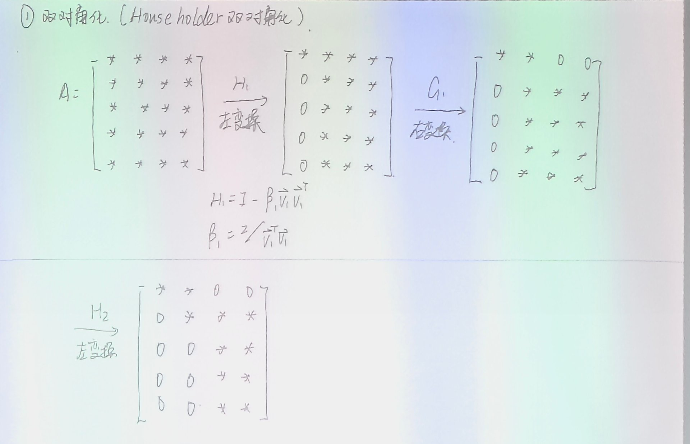

# 8.5 奇异值分解与广义逆

> 上课：11.11（10:00–11:22）+ 板书 9 张
> 原始材料：[课堂录音稿/11.11-奇异值分解](../原始材料/课堂录音稿/11.11-奇异值分解/)（原文逐字稿 + 导读 + 整理版逐字稿）；板书原片在 `C:\Users\29469\Desktop\计算方法与优化\计算方法与优化课程实录\11.11\`
> 对应课本：徐树方《数值线性代数（第二版）》**§7.1 基本性质**（定理 7.1.5 SVD 分解定理，p.203）与 **§7.6 奇异值分解的计算**（p.232：7.6.1 二对角化／7.6.2 SVD 迭代／7.6.3 SVD 算法）；Moore–Penrose 广义逆的定义在同书第三章 p.82。李庆扬《数值分析（第五版）》第 8 章止于 §8.4 QR 方法，未讲 SVD
> 顺序依据：徐树方把 SVD 放在特征值计算章——§6.4 QR 方法（对应本库 [8.4](8.4-QR方法.md)）→ §7.1 SVD 定义 → §7.6 SVD 计算，故本篇排在 8.4 之后、编号 **8.5**。广义逆虽在教材第三章 p.82 定义，但它是本篇的一部分：[3.1](../第3章-最小二乘问题/3.1-最小二乘问题法方程与正交变换.md) 指出列亏秩时解有无穷多，[3.2](../第3章-最小二乘问题/3.2-基于Householder的QR分解与QR最小二乘.md) §17.3／§17.5 留下"最小范数解即广义逆解，工程上做 SVD 截断"的接口，本篇把它展开
> 课本术语：徐树方作**二对角化／二对角阵**（板书作「双对角化／上双对角」），本篇统一用课本术语。Householder 的构造、参数化与秩一更新见 3.2 §5–§7；两阶段与分块两步见 8.4 §5–§6，均不重抄
> [返回总览](../00-索引.md) ｜ [上一篇：8.4 QR 方法](8.4-QR方法.md) ｜ [相关：3.2 秩亏最小二乘](../第3章-最小二乘问题/3.2-基于Householder的QR分解与QR最小二乘.md)

## 目录

- [[#1. SVD 的定义与等价形式]]
  - [[#1.1 定义]]
  - [[#1.2 等价表达：把 $A$ 的作用说出来]]
  - [[#1.3 外积展开：秩一矩阵之和]]
- [[#2. 三种形式：完全、紧凑、截断]]
- [[#3. 理论上的计算路线]]
- [[#4. Moore–Penrose 广义逆]]
- [[#5. 最小范数最小二乘解]]
- [[#6. 为什么理论路线不能用：$\varepsilon$ 的例子]]
- [[#7. Golub–Kahan–Reinsch：还是两阶段]]
  - [[#7.1 左右交替消出二对角]]
  - [[#7.2 算法流程]]
  - [[#7.3 运算量：$O(mn^2)$]]
- [[#8. 小结与预告]]

---

## 1. SVD 的定义与等价形式

### 1.1 定义

特征值只对方阵有定义，日常碰到的矩阵却常常不是方阵——长窄的、宽扁的都有。设 $A\in\mathbb R^{m\times n}$、秩为 $r$：

$$
A=U\Sigma V^T,\qquad U\in\mathbb R^{m\times m},\ V\in\mathbb R^{n\times n}\ \text{正交},\ \Sigma\in\mathbb R^{m\times n}.
$$

$\Sigma$ 只有 $(i,i)$ 位置可能非零，对角元按降序排：

$$
\sigma_1\ge\sigma_2\ge\cdots\ge\sigma_r>0=\sigma_{r+1}=\cdots ,
$$

这些 $\sigma_i$ 称为**奇异值**。存在性有定理保证：任意 $A\in\mathbb R^{m\times n}$ 都有 SVD（课上只声明结论，不给证明）。

### 1.2 等价表达：把 $A$ 的作用说出来

从 $A=U\Sigma V^T$ 右乘 $V$、或转置后右乘 $U$：

$$
AV=U\Sigma,\qquad A^TU=V\Sigma^T .
$$

按列拆开就是

$$
A\vec v_i=\sigma_i\vec u_i,\qquad A^T\vec u_i=\sigma_i\vec v_i,\qquad i=1,\dots,r .
$$

**$A$ 把右奇异向量 $\vec v_i$ 映到左奇异向量 $\vec u_i$，长度放大 $\sigma_i$ 倍**。这条对应关系不只是解释，它还是理论算法里由一侧精确定义另一侧的依据（§3）。

### 1.3 外积展开：秩一矩阵之和

把 $U$、$V$ 写成列向量组、把 $\Sigma$ 展开：

$$
A=\sum_{i=1}^{r}\sigma_i\,\vec u_i\vec v_i^{\,T}.
$$

每一项都是秩一矩阵，权重 $\sigma_i$ 已经按从大到小排好。整条式子说的是：**$A$ 是 $r$ 个秩一矩阵之和，重要性由 $\sigma_i$ 排定**——截断 SVD 与低秩近似都从这里来。

## 2. 三种形式：完全、紧凑、截断

设 $m\ge n$。经典写法 $A=U\Sigma V^T$ 里的 $U$ 是 $m\times m$ 方阵，但外积展开只用到前 $r$ 个 $\vec u_i$，后面的列没有贡献。于是有三种写法：

| 形式 | 表达式 | 形状 |
|---|---|---|
| 完全 SVD | $A=U\Sigma V^T=U_n\Sigma_nV^T$ | $U_n\in\mathbb R^{m\times n}$ 列正交，$\Sigma_n\in\mathbb R^{n\times n}$ |
| 紧凑 SVD | $A=U_r\Sigma_rV_r^T$ | $U_r\in\mathbb R^{m\times r}$，$V_r\in\mathbb R^{n\times r}$，$\Sigma_r\in\mathbb R^{r\times r}$ |
| 截断 SVD | $A\approx U_k\Sigma_kV_k^T$（$k<r$） | $U_k\in\mathbb R^{m\times k}$，$V_k\in\mathbb R^{n\times k}$，$\Sigma_k\in\mathbb R^{k\times k}$ |

截断把求和上限从 $r$ 改成 $k$、等号改成近似号：$\sigma_i$ 很小时 $\sigma_i\vec u_i\vec v_i^T$ 在 $A$ 里的贡献也小，扔掉后面那些项就是**低秩近似**。PCA 一类方法用的就是这件事。

注意表格里三行的 $\Sigma$ 维度不同，但都只有对角元非零；紧凑 SVD 才是"真正只保留有用信息"的那个。

## 3. 理论上的计算路线

按定义算奇异值，可以分五步：

1. **构造 $A^TA$**：不管 $A$ 什么形状，$A^TA$ 都是对称半正定方阵。若 $m<n$（行比列少），先算 $AA^T$（$m\times m$）更省——两者非零特征值相同，只是左右奇异向量的地位互换，最后换回来即可；直接算 $A^TA$ 等于用一个 $n\times n$ 的大矩阵去求一个小矩阵就能给出的信息。
2. **求特征值**：$A^TA$ 是实对称方阵，特征值能算、能排序、全非负，且 $\sigma_i=\sqrt{\lambda_i}$；$\lambda_i=0$ 对应 $\sigma_i=0$。
3. **求特征向量并单位化**：取成标准正交组，构成 $V$ 的前 $r$ 列。
4. **由 $\vec v_i$ 求 $\vec u_i$**：只对 $\sigma_i>0$ 的项，用 §1.2 的 $A\vec v_i=\sigma_i\vec u_i$ 得

$$
\vec u_i=\frac{A\vec v_i}{\sigma_i}.
$$

5. **扩充**：把 $\vec u_1,\dots,\vec u_r$ 补成 $\mathbb R^m$ 的一组标准正交基（Gram–Schmidt：任取向量、减去它在已有方向上的投影、单位化、重复）。

**注意**：不要分别算 $A^TA$ 与 $AA^T$ 的特征向量再"配对"，两边舍入误差不同，配出来会不一致；用第 4 步由一侧精确定义另一侧。

## 4. Moore–Penrose 广义逆

设 $A=U\Sigma V^T$，定义

$$
A^+=V\Sigma^+U^T=\sum_{i=1}^{r}\frac{1}{\sigma_i}\,\vec v_i\vec u_i^{\,T},
$$

其中 $\Sigma^+$ 把 $\Sigma$ 转置后**非零对角元取倒数、零元素仍保持为零**（$\Sigma\in\mathbb R^{m\times n}$，$\Sigma^+\in\mathbb R^{n\times m}$）。

$A^+$ 是满足以下四个条件的唯一矩阵（记 $X=A^+$）：

$$
AXA=A,\qquad XAX=X,\qquad (AX)^T=AX,\qquad (XA)^T=XA .
$$

它起的作用有点像逆矩阵：$AA^+$、$A^+A$ 在相应子空间上表现得像单位阵，但 $A$ 不必是方阵。两个特例：$A$ 列满秩时 $A^+=(A^TA)^{-1}A^T$；$A$ 满秩方阵时 $A^+=A^{-1}$。

第一条正好接上 [3.1](../第3章-最小二乘问题/3.1-最小二乘问题法方程与正交变换.md) 的法方程解：$A$ 列满秩时 $A^+\vec b=(A^TA)^{-1}A^T\vec b$，就是法方程给出的那个解；列亏秩时 $(A^TA)^{-1}$ 不存在，而 $A^+$ 仍然有定义。

## 5. 最小范数最小二乘解

**定理**：对任意 $\vec b\in\mathbb R^m$，$\vec x^+=A^+\vec b$ 在所有使 $\lVert A\vec x-\vec b\rVert_2$ 最小的 $\vec x$ 中，使 $\lVert\vec x\rVert_2$ 最小。

这正是 [3.2](../第3章-最小二乘问题/3.2-基于Householder的QR分解与QR最小二乘.md) §17.3 留的接口：通解里的自由变量 $y_2$ 要选成使 $\lVert\vec x\rVert_2$ 最小的值（那里说可再解一个小的最小二乘问题来定它）。换到 SVD 的坐标下，这个选择变成"自由分量全取零"，不必再解任何方程——SVD 的坐标把答案直接摆出来了，这就是 §17.5 说"工程上直接做 SVD 截断更省事"的原因。

整段只做一件事：把最小二乘问题换到 SVD 的坐标下，让每个分量各自独立。

**先换元**——设 $\vec y=V^T\vec x$、$\vec c=U^T\vec b$。因为 $U,V$ 正交，二范数不变：

$$
\lVert A\vec x-\vec b\rVert_2^2=\lVert U\Sigma V^T\vec x-\vec b\rVert_2^2=\lVert\Sigma\vec y-\vec c\rVert_2^2 .
$$

**再展开**——$\Sigma$ 只有前 $r$ 个对角元非零：

$$
\lVert\Sigma\vec y-\vec c\rVert_2^2=\sum_{i=1}^{r}(\sigma_iy_i-c_i)^2+\sum_{i=r+1}^{m}c_i^2 .
$$

第二项与 $\vec y$、$\vec x$ 都无关，是残差里消不掉的部分——所以"最小二乘"能管的只有第一项。

**控制前 $r$ 项**——逐项取 $y_i=c_i/\sigma_i\ (i\le r)$ 使每个平方为零。于是 $y_1,\dots,y_r$ 被唯一确定，而 $y_{r+1},\dots,y_n$ 根本没出现、可以任取。这正是 $A$ 列亏秩时最小二乘解不唯一的来源。

**最后定 $\vec x$**——$\vec y=V^T\vec x$ 且 $V$ 正交，故 $\lVert\vec x\rVert_2=\lVert\vec y\rVert_2$；要让范数最小，自由分量只能全取零：$y_{r+1}=\cdots=y_n=0$。于是

$$
\vec x=V\vec y=\sum_{i=1}^{r}\frac{c_i}{\sigma_i}\vec v_i=\sum_{i=1}^{r}\frac{\vec u_i^{\,T}\vec b}{\sigma_i}\vec v_i=A^+\vec b .
$$

课上说明这只是把表达式重推一遍，不算严格证明；但它把「$A^+$ 为什么偏偏是那个解」交代清楚了。

## 6. 为什么理论路线不能用：$\varepsilon$ 的例子

§3 那条路线（$A^TA$ → 特征值 → 特征向量 → 拼 $A^+$）只是**理论上有效**。实际数值计算不这么干，有三层原因：

- 求特征值本身不简单，大规模矩阵还要做完整特征分解、逐个求特征向量；
- $A^TA$ 的条件数被平方放大——[3.2](../第3章-最小二乘问题/3.2-基于Householder的QR分解与QR最小二乘.md) §15 已经给出严格等式 $\kappa_2(A^TA)=\kappa_2(A)^2$，[3.1](../第3章-最小二乘问题/3.1-最小二乘问题法方程与正交变换.md) 讲法方程时也提醒过这一点；
- 最致命的是 $A^+$ 里的 $1/\sigma_i$。本该为零的 $\sigma_i$ 在机器里算出来是 $10^{-16}$ 量级的小量，一放到分母上影响就是 $10^{16}$ 倍；而 $\sigma_i=\sqrt{\lambda_i}$，$\sigma_i=10^{-16}$ 对应 $\lambda_i=10^{-32}$，在 $A^TA$ 里根本无法准确表示。

板书上的例子把这件事说死了。取

$$
A=\begin{pmatrix}1&1\\ \varepsilon&0\\ 0&\varepsilon\end{pmatrix}
\ \Longrightarrow\
A^TA=\begin{pmatrix}1+\varepsilon^2&1\\ 1&1+\varepsilon^2\end{pmatrix}
\ \Longrightarrow\
\sigma_1=\sqrt{2+\varepsilon^2},\quad \sigma_2=\varepsilon .
$$

若 $\varepsilon\sim10^{-10}$：它比双精度机器精度（约 $10^{-16}$）还大六个量级，绝不是可忽略的小量；但 $\varepsilon^2\sim10^{-20}$，浮点数里 $\operatorname{fl}(1+\varepsilon^2)=1$，于是 $A^TA$ 变成 $\begin{pmatrix}1&1\\1&1\end{pmatrix}$ 而**直接奇异**，$\sigma_2=\varepsilon$ 完全丢失。

这里丢的不只是精度，而是问题性质：满秩变奇异，连"存在一个很小但不为零的奇异值"都算不出来。所以 [3.1](../第3章-最小二乘问题/3.1-最小二乘问题法方程与正交变换.md) 里那条 $A^TA\vec x=A^T\vec b$ 虽然理论干净，底层数值计算并不用它。

## 7. Golub–Kahan–Reinsch：还是两阶段

实际计算走 Golub–Kahan–Reinsch 算法（教材 §7.6 不点名，只称"计算 SVD 的 QR 方法"）。教材给的动机正好接上 §6：**隐含地对 $A^TA$ 应用对称 QR 方法，但整个过程中不把 $A^TA$ 真正算出来**——二对角化就相当于把 $A^TA$ 三对角化，于是 §6 那个 $\varepsilon$ 例子造成的精度灾难被绕开了。它和 [8.4 QR 方法](8.4-QR方法.md) §5 的实用 QR 迭代是同一个骨架，也是两阶段：

$$
A\in\mathbb R^{m\times n}\ \xrightarrow{\ \text{二对角化}\ \ O(mn^2)\ }\ B\ (\text{上二对角})\ \xrightarrow{\ \text{迭代计算}\ \ O(n^2)\ }\ \Sigma .
$$

第一阶段是预处理：把稠密矩阵变成规模更小、结构更好算的形式；第二阶段再对这个形式做迭代。$B$ 是上二对角方阵（只有主对角线与第一条超对角线可能非零），注意它与 8.4 化出来的**上 Hessenberg 矩阵**不是一回事。

**为什么要求 $m\ge n$**：第一阶段运算量 $O(mn^2)$，列数是平方、行数只是线性；$n>m$ 时先转置再算，奇异值不变。

顺带对照对称特征值问题：对称矩阵做 Hessenberg 化时还要保持对称性，主对角线以上那条也留着，两边合起来就是三对角矩阵——比上 Hessenberg 更少非零元。这里的 $B$ 不要求对称，只是形状相仿。

### 7.1 左右交替消出二对角

第 1 步用 Householder 左变换消第一列对角元以下的元素，第 2 步用右变换消第一行第 3 个元素起的所有元素，第 3 步左变换消第二列、第 4 步右变换消第二行……交替进行：

两条不变式保证前面不白做：

- 左变换 $H_k=\operatorname{diag}(I_{k-1},\widetilde H_k)$ 只动第 $k$ 行以下，前 $k-1$ 行不变；
- 右变换 $G_k=\operatorname{diag}(I_k,\widetilde G_k)$ 只动第 $k+1$ 列以后，前 $k$ 列（包括刚消好的那一列）不变。

右变换可以看成"把矩阵转置之后做一个左变换"：$\widetilde G$ 仍是 Householder 矩阵、对称正交，计算与左变换同一套，只是作用到行上。Householder 向量的构造、$\beta=2/(\vec v^T\vec v)$、以及 $C\leftarrow C-\beta\vec v(\vec v^TC)$ 这条秩一更新，定义都在 [3.2](../第3章-最小二乘问题/3.2-基于Householder的QR分解与QR最小二乘.md) §5–§7，这里不重抄；分块两步的形状与 [8.4](8.4-QR方法.md) §6.1 的 Hessenberg 化完全一样，差别只是每一步多做一次右变换。

### 7.2 算法流程

输入 $A\in\mathbb R^{m\times n}$（$m\ge n$），循环 $k=1\to n$；若 $m=n$ 是方阵，则 $k=1\to n-1$（最后一列只有对角元、下面没有要消的元素）：

1. $[\vec v,\beta]\leftarrow\operatorname{Householder}\big(A[k{:}m,k]\big)$：取第 $k$ 列从第 $k$ 行到第 $m$ 行的元素（长度 $m-k+1$）；$\vec v$ 只需把首分量减去（或按符号加上）向量长度，其余分量照抄。
2. 左变换：

$$
A[k{:}m,k{:}n]\leftarrow A[k{:}m,k{:}n]-\beta\,\vec v\big(\vec v^{\,T}A[k{:}m,k{:}n]\big).
$$

3. 若 $k\le n-2$（右边还有至少两列要处理），$[\vec w,\gamma]\leftarrow\operatorname{Householder}\big(A[k,k{+}1{:}n]^T\big)$：取第 $k$ 行从第 $k{+}1$ 列到第 $n$ 列的元素，转置成列向量来算。
4. 右变换（括号位置与左变换不同）：

$$
A[k{:}m,k{+}1{:}n]\leftarrow A[k{:}m,k{+}1{:}n]-\gamma\big(A[k{:}m,k{+}1{:}n]\vec w\big)\vec w^{\,T}.
$$

循环结束得到上二对角矩阵 $B$。**全程不显式形成 $H_k$、$G_k$**：它们都是单位阵减一个秩一修正，所以矩阵乘矩阵被拆成一次向量–矩阵乘、一次外积、一次矩阵相减——这正是 [8.4](8.4-QR方法.md) §6.2 强调过的省算量写法。

### 7.3 运算量：$O(mn^2)$

- 左变换：先算 $\vec v^{\,T}A[k{:}m,k{:}n]$，得 $1\times(n-k+1)$ 的行向量，运算量 $O\big((m-k+1)(n-k+1)\big)$；乘回 $\vec v$ 外积并相减，同量级。
- 右变换：先算 $A[k{:}m,k{+}1{:}n]\vec w$，得长度 $m-k+1$ 的列向量，运算量 $O\big((m-k+1)(n-k)\big)$；外积与相减同量级。

两边都是 $O\big((m-k+1)(n-k)\big)$，对 $k=1\to n$ 求和，总量 $O(mn^2)$。精细数每步的乘加次数（内积有乘有加、外积再乘常数、最后减法）可以再细化，但量级不变。

另一个好处在截断 SVD：把 $A$ 写成 $k$ 个秩一矩阵之和后，每次 $A$ 乘向量或矩阵都可拆成"先算 $k$ 个内积、再各乘一个向量"，矩阵乘的运算量也降下来了——低秩近似不只省存储，还省计算。

## 8. 小结与预告

- SVD 把任意 $m\times n$ 矩阵写成 $U\Sigma V^T$；外积形式 $A=\sum_{i\le r}\sigma_i\vec u_i\vec v_i^T$ 给出了紧凑 SVD 与截断 SVD 的根据，也是低秩近似的源头。
- 理论路线靠 $A^TA$ 的特征值，能用 $A^+$ 定义列亏秩时的最小范数最小二乘解——这条式子把 [3.1](../第3章-最小二乘问题/3.1-最小二乘问题法方程与正交变换.md) 的法方程解包成了特例。
- 但 $\kappa_2(A^TA)=\kappa_2(A)^2$ 与 $1/\sigma_i$ 让它在实际计算里不可用（$\varepsilon$ 例子：$\varepsilon^2$ 被浮点吞掉，$A^TA$ 直接奇异）。这也解释了为什么 [3.2](../第3章-最小二乘问题/3.2-基于Householder的QR分解与QR最小二乘.md) 的正交变换法才是数值上的常规选择。
- 实用算法是两阶段：先 Householder 二对角化（$O(mn^2)$，左右交替），再对 $B$ 做迭代（$O(n^2)$）。第一阶段与 [8.4](8.4-QR方法.md) §6 的 Hessenberg 化同构，只是每步多一次右变换。

课上只讲到第一阶段。**后一半**——怎么对上二对角矩阵 $B$ 做隐式 QR 迭代得到 $\Sigma$——留到下周一晚的课，它与 8.4 §8 的隐式 QR 非常相像；届时还会讨论大规模稀疏矩阵的 SVD，本篇这套针对的是稠密矩阵。
