# 第十章 系统级 I/O（Unix I/O）

> 依据：CMU 15-213 第 16 讲（`16-io.pptx`，中译版在桌面课件目录）+ 《深入理解计算机系统》原书第 3 版第 10 章 + 课堂录音（"程序内存 + Unix I/O"逐字稿、"程序文件打开相关讲解"逐字稿，2026-10-28）。
> 前面几章分别在存储器层次结构、链接、加载、进程和虚拟内存里接触过 I/O 的某些侧面。这一章把环闭合：讲清楚一个文件从打开到读写的完整链路——Unix I/O 的基本接口、RIO 健壮 I/O 包、文件元数据、文件共享与 I/O 重定向、标准 I/O，以及到底该用哪一套函数。

---

## 目录

- [[#1. 为什么还要学 Unix I/O]]
- [[#2. Unix I/O 概览]]
  - [[#2.1 文件就是一个字节序列]]
  - [[#2.2 一切皆文件]]
  - [[#2.3 Unix I/O 的四个基本操作]]
  - [[#2.4 标准描述符 0、1、2]]
- [[#3. 文件类型]]
  - [[#3.1 普通文件、目录、套接字与其他类型]]
  - [[#3.2 文本文件与文本行：EOL 的差异]]
  - [[#3.3 目录层次结构与路径名]]
- [[#4. 打开和关闭文件]]
  - [[#4.1 open 与 flags]]
  - [[#4.2 mode 与 umask：新文件的权限位]]
  - [[#4.3 close 与"永远检查返回值"]]
- [[#5. 读和写文件]]
  - [[#5.1 read 与 write]]
  - [[#5.2 旁注：ssize_t 和 size_t 有什么区别]]
  - [[#5.3 短计数（short count）]]
- [[#6. RIO 包：健壮地读写]]
  - [[#6.1 两类 RIO 函数]]
  - [[#6.2 无缓冲的 rio_readn 与 rio_writen]]
  - [[#6.3 带缓冲的输入函数]]
  - [[#6.4 内部核心：rio_read 与缓冲区工作方式]]
  - [[#6.5 旁注：RIO 包的起源]]
- [[#7. 读取文件元数据]]
  - [[#7.1 stat 与 fstat]]
  - [[#7.2 struct stat 与 st_mode]]
  - [[#7.3 statcheck 例子]]
- [[#8. 读取目录内容]]
- [[#9. 共享文件]]
  - [[#9.1 内核的三张表]]
  - [[#9.2 两个描述符通过不同表项共享一个文件]]
  - [[#9.3 fork 之后的文件共享]]
  - [[#9.4 练习题 10.2 与 10.3]]
- [[#10. I/O 重定向]]
  - [[#10.1 dup2 函数]]
  - [[#10.2 shell 重定向的两步]]
  - [[#10.3 练习题 10.4 与 10.5]]
- [[#11. 标准 I/O]]
  - [[#11.1 流（stream）]]
  - [[#11.2 缓冲的动机]]
  - [[#11.3 printf 怎么攒到缓冲区里]]
  - [[#11.4 strace 亲眼看到一次 write]]
- [[#12. 我该使用哪些 I/O 函数]]
  - [[#12.1 三层 I/O 的关系]]
  - [[#12.2 Unix I/O 的优缺点]]
  - [[#12.3 标准 I/O 的优缺点]]
  - [[#12.4 选择规则 G1/G2/G3]]
  - [[#12.5 标准 I/O 与网络套接字的冲突]]
  - [[#12.6 处理二进制文件]]
- [[#13. 文件描述符趣题（PPT p49-51）]]
  - [[#13.1 推题前先钉住三件事]]
  - [[#13.2 例一：三次 open 再加一个 dup2]]
  - [[#13.3 例二：fork 之后谁读第二个字节]]
  - [[#13.4 例三：创建、截断、追加与覆盖写]]
  - [[#13.5 归纳：四种情况一张表]]
  - [[#13.6 多进程写同一个文件]]
  - [[#13.7 两个可以借用的类比]]
- [[#14. 小结与家庭作业]]

---

## 1. 为什么还要学 Unix I/O

输入/输出（I/O）是在主存和外部设备（磁盘驱动器、终端、网络）之间复制数据的过程：输入是从设备复制数据到主存，输出是从主存复制数据到设备。所有语言的运行时系统都提供了执行 I/O 的高级工具——ANSI C 有标准 I/O 库（`printf`/`scanf` 这类带缓冲的函数），C++ 用重载的 `<<` 和 `>>`。这些高级函数最终都是通过内核提供的系统级 **Unix I/O 函数**实现的。大多数时候高级函数工作得很好，那为什么还要专门学 Unix I/O？

第一，**I/O 和其他系统概念互相依赖**：I/O 在进程的创建和执行中扮演关键角色，而进程创建又在文件共享中扮演关键角色——要真正理解 I/O 必须理解进程，反之亦然。前面已经学过存储层次、链接、加载、进程和虚拟内存，这一章就能闭合循环。

第二，**有些场合除了 Unix I/O 别无选择**：标准 I/O 库没有读取文件元数据（文件大小、创建时间）的方式；而且标准 I/O 的某些特性和网络编程的要求冲突，用它做网络编程很冒险。

第三，**这一讲的用途比它看起来更直接**。CMU 原课里，第 16 讲当晚就开放 Shell Lab，之后最后的 Web Proxy Lab 还要回头用它——低级 I/O 不是"以后也许会用到"的知识，是马上要动手的东西。老师开场也交代了它的位置：这类内容通常只在课堂上讲，多数教材不涉及（真正面向系统程序员的书又相当深奥），偶尔能在手册里查到，但手册解释 API 抽象的方式相当晦涩。

---

## 2. Unix I/O 概览

### 2.1 文件就是一个字节序列

一个 Linux 文件就是 $m$ 个字节的序列：

$$B_0,\ B_1,\ \ldots,\ B_k,\ \ldots,\ B_{m-1}$$

课堂录音里老师也强调了这个出发点：无论是英文文本、中文文本还是可执行文件，本质都是字节。英文是一个个 ASCII 字符，中文是一个字符占若干字节的统一编码，可执行文件是二进制字节——所以"文件是 N 个字节的序列"这一条贯穿后面的读写。

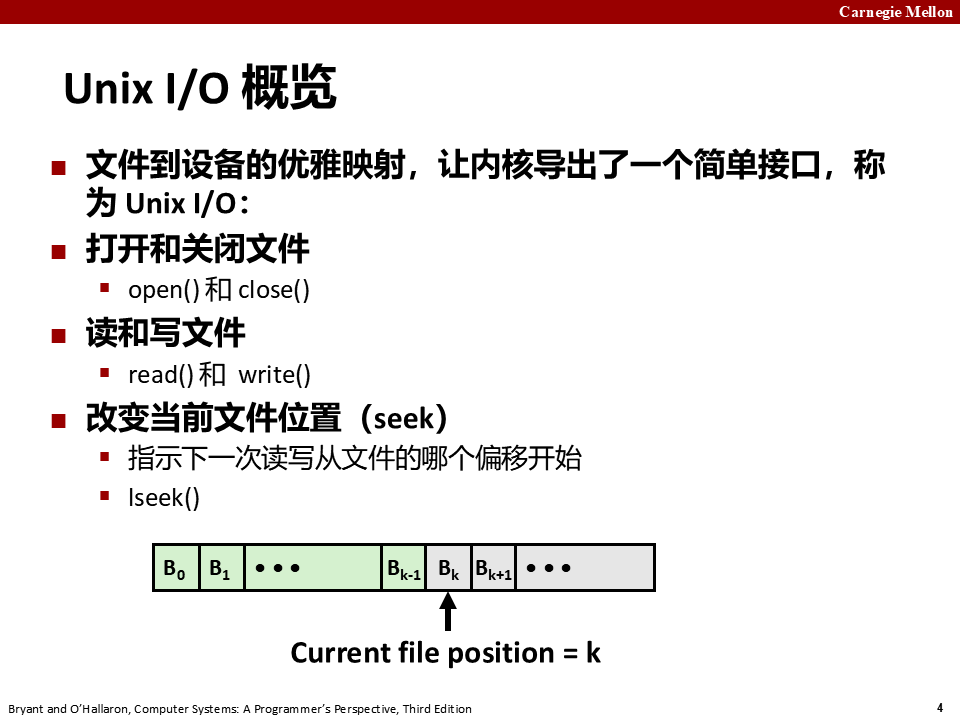

### 2.2 一切皆文件

Unix 把所有 I/O 设备（网络、磁盘、终端）都**模型化为文件**，所有输入输出都被当作对相应文件的读和写。这种优雅的映射让内核导出一个简单、统一的接口。

- 磁盘分区是文件：`/dev/sda2`（`/usr` 磁盘分区）；
- 终端是文件：`/dev/tty2`；
- 甚至内核本身也是文件：`/boot/vmlinuz-3.13.0-55-generic`（内核镜像）、`/proc`（内核数据结构）。

课堂录音把这一节讲得很细：根目录下的 `/dev` 目录里放着各种设备文件，比如 `sda` 指第一块 SCSI/SATA 硬盘（a 表示第一块，一台电脑可以接 a、b、c、d 多块），`sda2` 是这块硬盘的第二个分区。一块硬盘理论上只能有四个主分区，多于四个分区是因为把其中一个主分区变成了扩展分区，再划分更细的逻辑分区——`sda1~4` 是主分区编号，5 以后是扩展分区里的逻辑分区。`/dev/tty` 对应终端输入：你远程连一台电脑或在自己电脑上进 Linux，都会有一个终端、对应一个设备文件。`vmlinuz` 是内核映像，版本号第二位是偶数的通常是稳定版，奇数是开发版。`/proc` 目录和进程相关，可以在里面查看内存、CPU 等信息。整个 Unix 就是把各种设备当作文件来管理，把设备和文件建立映射关系，从而简化内核对外部设备的管理。顺带一提 Unix 的来龙去脉：Linux 和 Mac OS 同源于 Unix，Mac OS 来自 BSD（Berkeley Software Distribution，伯克利软件发行版，完全免费；RISC 指令集也是伯克利搞的）；Linux 免费提供的是内核，发行版有的免费（Ubuntu）、有的收费（红帽企业版 RHEL），中国曾经有个版本叫红旗。

### 2.3 Unix I/O 的四个基本操作

- **打开和关闭文件**：`open()` 和 `close()`；
- **读和写文件**：`read()` 和 `write()`；
- **改变当前文件位置（seek）**：`lseek()`，指示下一次读写从文件的哪个偏移开始。

录音里对"文件位置"有很直观的比喻：文件打开以后默认有个指针指向开头，读一个文件指针就往后移；读到某个地方想回过头来往前读，可以用 `lseek` 往前或往后移动。比如打开文件不想从头读、想读第 1000 字节以后的内容，把指针移过去就行；跳过前面 1000 个字节不写、从第 1000 字节以后开始写也可以。内核为每个打开的文件维护一个文件位置 $k$，初始为 0，是从文件开头起的字节偏移量；读操作从位置 $k$ 复制 $n>0$ 个字节到内存，再把 $k$ 增加到 $k+n$。给定一个 $m$ 字节的文件，当 $k \ge m$ 时读操作触发 **end-of-file（EOF）** 条件——注意文件结尾并没有一个明确的"EOF 符号"，EOF 只是一个可由应用检测的状态。

`lseek` 的第三个参数 `whence` 指定偏移的参考点，有三种取值：`SEEK_SET` 把指针移到绝对位置（`offset` 是几就移到第几个字节）；`SEEK_CUR` 相对当前指针前后移动，`offset` 可正可负，正是往后移、负是往前移；`SEEK_END` 从文件末尾开始算，此时 `offset` 一般取负值，因为往后移就没有内容了。这个指针相当于一个书签：读多少字节指针就往后移多少，下次读写从标记处继续；`lseek` 是改变指针位置的最底层函数，`fseek` 是它的更高级封装，`ftell` 用于获取指针当前位置（man 手册的 See also 里会把它们列在一起）。

但不是所有文件都有文件位置。终端可以顺序读写却不能 seek——已经读走的字符退不回去重读，还没敲进来的字符也没法提前读；网络套接字连"位置"这个概念都不存在，数据到达时被读走，过了就没了，你无法在时间上跳转。所以"文件位置是打开文件的一部分"这个说法，准确讲是"**部分**打开文件有文件位置"。

### 2.4 标准描述符 0、1、2

Linux shell 创建的每个进程开始时都有三个打开的文件：标准输入（描述符 0）、标准输出（描述符 1）和标准错误（描述符 2）。头文件 `<unistd.h>` 定义了常量 `STDIN_FILENO`、`STDOUT_FILENO`、`STDERR_FILENO` 可用来代替显式的 0、1、2。

录音里对应着讲：默认情况下标准输入、标准输出、标准错误分别对应描述符 0、1、2；你往键盘里敲数据其实就是从标准输入读，你 `printf` 打印其实就是往标准输出写。还有 `/dev/stdin`、`/dev/stdout`、`/dev/stderr` 分别是指向标准输入、标准输出、标准错误的链接。

文件描述符是小整数，因为它就是**描述符表的下标**，按序分配。数量有上限：在 shell 里敲 `ulimit -n`（或 `ulimit -a` 里看 `open files`），典型值是 1024，意思是这个进程同时最多打开 1024 个文件。真撞到这个上限，通常不是需求大，而是忘了 `close`——文件描述符泄漏。

---

## 3. 文件类型

### 3.1 普通文件、目录、套接字与其他类型

每个 Linux 文件都有一个类型（type）表明它在系统中的角色：

- **普通文件（regular file）**：包含任意数据；
- **目录（directory）**：包含一组链接的文件，每个链接把一个文件名映射到一个文件；
- **套接字（socket）**：用于与另一台机器上的进程跨网络通信（11.4 节详讲）；
- 其他类型（本书不讨论）：命名管道（FIFO）、符号链接、字符设备和块设备。

目录是一种文件，它的作用是"把一组文件管理起来"。每个目录至少含两个条目：`.` 是到该目录自身的链接，`..` 是到目录层次结构中父目录的链接。操作目录的命令：`mkdir` 创建空目录、`ls` 查看内容、`rmdir` 删除空目录。

录音补充了一个快速辨认文件类型的技巧：用 `ls -al` 详细查看时，最左边第一个字母就代表类型——`-` 是普通文件（可执行文件、库文件、汇编文件都是普通文件），`d` 是目录，`l` 是符号链接（会显示它链接到哪里去，库文件目录里这种链接特别多），`c` 是字符设备，`p` 是命名管道，`s` 是套接字。常见的文件就是普通文件和目录这两类。`/dev` 目录上的设备很多是字符设备，比如 `tty1`、`tty2`、`tty3`……因为终端主要输入的是字符。

符号链接可以类比 Windows 桌面的快捷方式：桌面上的快捷方式图标只是指向程序的一个链接，删掉快捷方式不会删掉程序本身，重新创建一个链接指向同一个程序，程序还是原来那个。Linux 里的动态链接库大量使用这种机制做版本管理：库文件往往带版本号（如 `libxxx.so.1.08`），旧版本不能随手删掉，因为可能还有老程序在依赖旧版本；新库通常保持接口不变、只换内部实现，这样所有调用方都不用重新编译——就像 USB 接口标准不变，插 U 盘、鼠标、键盘都能用，设备内部怎么实现不用管。除了 `-`、`d`、`l`，`c` 字符设备对应键盘、鼠标、显示器这类按字符流输入输出的设备，`b` 块设备对应硬盘这类按块读写的设备，`p` 命名管道是在文件系统上创建的进程间通信通道，`s` 套接字用于网络通信。

### 3.2 文本文件与文本行：EOL 的差异

普通文件包含任意数据，应用通常区分**文本文件**（只含 ASCII 或 Unicode 字符）和**二进制文件**（其他一切，如目标文件、JPEG 图片）。**内核并不区分两者**——对内核来说文本和二进制没有区别。

文本文件是**文本行**的序列，文本行是以换行符 `\n` 结尾的字符序列。换行符是 `0xa`，即 ASCII 的换行符（LF）。其他系统的行尾（EOL）标记不同：

- Linux 和 Mac OS：`\n`（0xa），即 LF；
- Windows 和 Internet 协议：`\r\n`（0xd 0xa），即回车（CR）加换行（LF）。

为什么需要两个字符？因为它对应机械打字机上的两个动作：字车打到行尾后，先要把滚筒推回左边（carriage return，回车），再转动旋钮把纸卷上一行（line feed，换行）。在电传打字机上这是两个独立操作，ASCII 于是各留了一个码位；今天用 `\n` 一个字符就够，Windows 保留 `\r\n` 是为兼容那个年代。

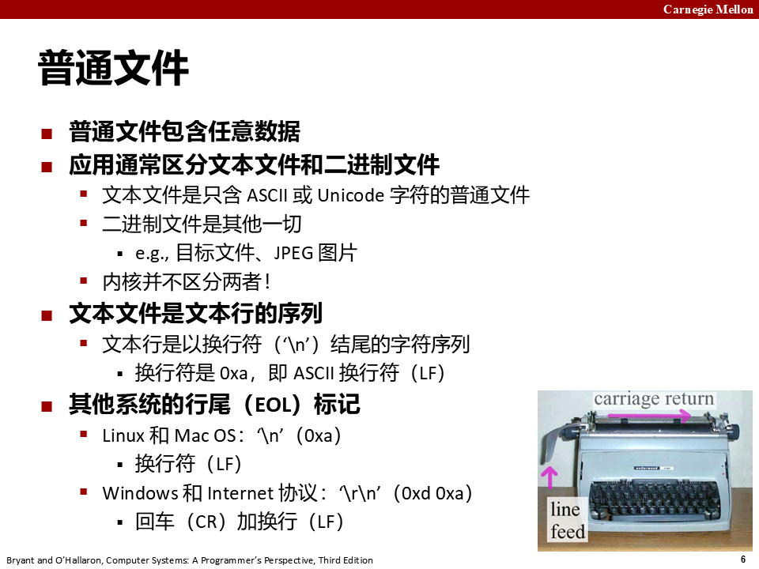

### 3.3 目录层次结构与路径名

Linux 内核把所有文件组织成一个**目录层次结构**，由根目录 `/`（斜杠）确定，系统中每个文件都是根目录的直接或间接后代。每个进程都有**当前工作目录（cwd）** 来确定它在层次结构中的当前位置，可以用 `cd` 命令修改。

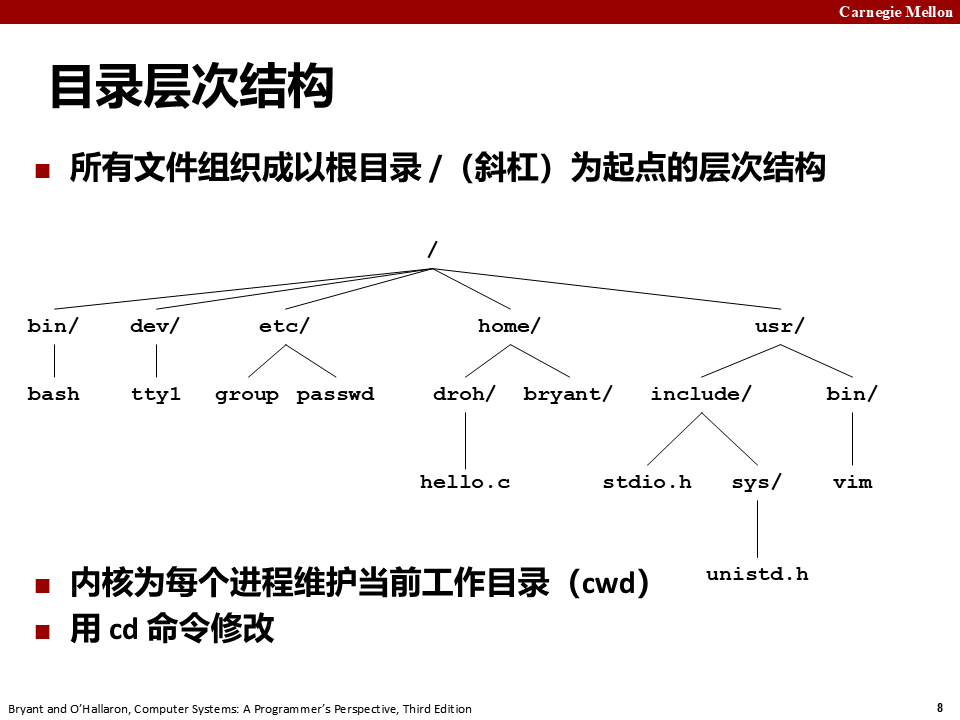

层次结构中文件的位置用**路径名**指定，路径名是一个字符串：一个可选斜杠后紧跟一系列用斜杠分隔的文件名。有两种形式：

- **绝对路径名**：以 `/` 开头，表示从根节点开始的路径，例如 `/home/droh/hello.c`；
- **相对路径名**：以文件名开头，表示从当前工作目录开始的路径。若当前目录是 `/home/droh`，`hello.c` 的相对路径名是 `./hello.c`；若当前目录是 `/home/bryant`，相对路径名是 `../home/droh/hello.c`。

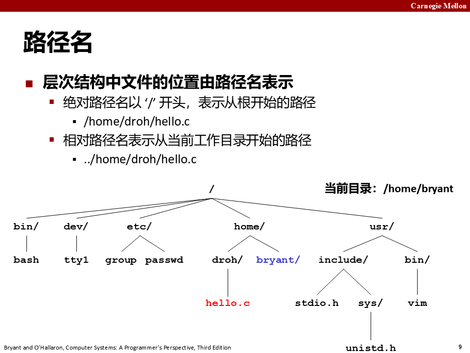

Linux 根目录下有一些约定俗成的子目录：`/home` 放普通用户的主目录，`/root` 是 root 用户的主目录；`/dev` 放设备文件（键盘、鼠标、显示器、硬盘分区都在这里）；`/proc` 是内核暴露给用户的进程与系统信息（进程的 PID 编号就体现在 `/proc` 下，读 `/proc/cpuinfo` 能看 CPU 信息）；`/etc` 放系统配置文件（如 `/etc/passwd` 记录用户信息）；`/tmp` 放临时文件；`/mnt` 和 `/media` 用于挂载外部存储（U 盘插上后通常出现在 `/media` 下）；`/lost+found` 是系统断电或崩溃后，`fsck` 校验时找不到归属的碎片文件会被放在这里的"失物招领处"。

路径的写法存在平台差异：Linux 用正斜杠 `/` 分隔目录，Windows 用反斜杠 `\`，两者含义相同但写法不同。写可移植代码时不要硬编码分隔符，应该用编程语言提供的路径分隔符常量（如 C 的 `DIR_SEPARATOR` 或各种语言标准库的 separator 变量），程序在任何平台都能正确拼路径。运行当前目录下的程序时要显式写 `./hello`，不能只写 `hello`——因为系统只在 `PATH` 环境变量列出的目录里找命令，当前目录通常不在其中，`./` 就是在明确告诉系统"程序就在当前目录"。

目录相关的常用命令：`mkdir` 创建目录，`ls` 查看内容，`rmdir` 只能删除空目录，`rm -rf` 可以递归强制删除目录及其中所有内容——这个命令极其危险，路径写错（比如多敲一个空格）就可能把整个系统删掉，使用前务必确认路径。以 `.` 开头的文件名默认被隐藏（`ls` 不显示），要加 `-a` 参数才能看到；`.bashrc` 之类的配置文件都是这种隐藏文件。

---

## 4. 打开和关闭文件

### 4.1 open 与 flags

进程通过调用 `open` 打开一个已存在的文件或创建一个新文件：

```c
#include <sys/types.h>
#include <sys/stat.h>
#include <fcntl.h>

int open(char *filename, int flags, mode_t mode);
/* 返回：若成功则为新文件描述符，若出错则为 -1 */
```

`open` 把 `filename` 转换为一个文件描述符并返回描述符数字。**返回的描述符总是在进程中当前没有打开的最小描述符**（这条性质是后面很多练习题的关键）。`flags` 参数指明进程打算如何访问这个文件：

- `O_RDONLY`：只读；
- `O_WRONLY`：只写；
- `O_RDWR`：可读可写。

例如 `fd = Open("foo.txt", O_RDONLY, 0);` 以读方式打开一个已存在文件。`flags` 也可以是一个或多个位掩码的或，提供额外指示：

- `O_CREAT`：如果文件不存在，就创建它的一个截断的（空）文件；
- `O_TRUNC`：如果文件已经存在，就截断它；
- `O_APPEND`：在每次写操作前，把文件位置设置到文件结尾处。

例如 `fd = Open("foo.txt", O_WRONLY|O_APPEND, 0);` 打开已存在文件并在后面追加数据。

**`flags` 是一组位，不是一个枚举**。`|` 之所以能拼，是因为这些宏各自占着互不重叠的位。Linux 上的实际取值：

| 宏 | 八进制 | 含义 |
|---|---|---|
| `O_RDONLY` | `0` | 只读 |
| `O_WRONLY` | `01` | 只写 |
| `O_RDWR` | `02` | 可读可写 |
| `O_CREAT` | `0100` | 不存在则创建 |
| `O_EXCL` | `0200` | 与 `O_CREAT` 合用，已存在则报错 |
| `O_TRUNC` | `01000` | 已存在则截断为长度 0 |
| `O_APPEND` | `02000` | 每次写之前定位到文件末尾 |

读法分两组：低两位（`O_ACCMODE = 3`）是三选一的**访问模式**，`flags & 3` 得 0/1/2 分别对应只读、只写、读写；从 `O_CREAT` 起每个宏各占一个独立的位，是**附加标志**，内核用 `flags & O_CREAT` 这样逐位测试就知道你要什么。课堂上举的 `O_WRONLY|O_CREAT|O_TRUNC` 就是 `01 | 0100 | 01000 = 01101`——数值不必背，要记住的是它们本来就按位设计。

注意：`O_RDONLY` 的值是 0，一个位都不占，所以它跟谁或都等于对方——`O_RDONLY|O_WRONLY` 算出来是 1，跟只写完全一样。访问模式这一组是互斥取一，能叠加的只有 `O_CREAT`、`O_TRUNC`、`O_APPEND` 这些附加位。

PPT 上的打开文件代码长这样：`open("/etc/hosts", O_RDONLY)` 返回一个小整数作为标识，叫**文件描述符**；`fd == -1` 表示出错，此时用 `perror("open")` 打印错误并 `exit(1)`。录音里问过一个很自然的问题：**为什么不直接通过文件名访问，而要用描述符这个编号？** 因为通过文件名打开、拿到描述符的那一刻，系统已经做了一次判断——你有没有权限访问这个文件。此后所有操作都只凭这个非负整数描述符，内核在内部记录这个打开文件的所有信息，应用程序只需记住描述符。也正因如此，第一个自己打开的文件描述符通常是 3：0、1、2 已经被标准输入、标准输出、标准错误占用了，新描述符从 3 开始往后分配，用完关闭后这个数字还能被后续的 `open` 复用。

### 4.2 mode 与 umask：新文件的权限位

`mode` 参数指定新文件的访问权限位，符号名如图：

| 掩码 | 描述 |
|---|---|
| S_IRUSR | 使用者（拥有者）能够读这个文件 |
| S_IWUSR | 使用者（拥有者）能够写这个文件 |
| S_IXUSR | 使用者（拥有者）能够执行这个文件 |
| S_IRGRP | 拥有者所在组的成员能够读这个文件 |
| S_IWGRP | 拥有者所在组的成员能够写这个文件 |
| S_IXGRP | 拥有者所在组的成员能够执行这个文件 |
| S_IROTH | 其他人（任何人）能够读这个文件 |
| S_IWOTH | 其他人（任何人）能够写这个文件 |
| S_IXOTH | 其他人（任何人）能够执行这个文件 |

（在 `sys/stat.h` 中定义）

作为上下文的一部分，每个进程都有一个 `umask`（通过 `umask` 函数设置）。当进程通过带某个 `mode` 的 `open` 调用创建新文件时，文件的访问权限位被设置为：

$$mode\ \&\ \sim umask$$

教材例子：给定默认值 `#define DEF_MODE S_IRUSR|S_IWUSR|S_IRGRP|S_IWGRP|S_IROTH|S_IWOTH` 和 `#define DEF_UMASK S_IWGRP|S_IWOTH`，那么

```c
umask(DEF_UMASK);
fd = Open("foo.txt", O_CREAT|O_TRUNC|O_WRONLY, DEF_MODE);
```

创建出的新文件拥有者有读写权限，其他所有用户都有读权限（`S_IWGRP` 和 `S_IWOTH` 被 umask 屏蔽掉了）。

### 4.3 close 与"永远检查返回值"

进程通过 `close` 关闭一个打开的文件：

```c
#include <unistd.h>

int close(int fd);
/* 返回：若成功则为 0，若出错则为 -1 */
```

关闭一个已关闭的描述符会出错。PPT 特别强调了教训：**永远检查返回值，哪怕是 `close()` 这种看起来无害的函数**——在多线程程序中关闭一个已经关闭的文件会引发灾难（后面会详谈）。正确写法是 `if ((retval = close(fd)) < 0) { perror("close"); exit(1); }`。

---

## 5. 读和写文件

### 5.1 read 与 write

应用通过 `read` 和 `write` 执行输入输出：

```c
#include <unistd.h>

ssize_t read(int fd, void *buf, size_t n);
/* 返回：若成功则为读的字节数，若 EOF 则为 0，若出错则为 -1 */

ssize_t write(int fd, const void *buf, size_t n);
/* 返回：若成功则为写的字节数，若出错则为 -1 */
```

`read` 从描述符 `fd` 的当前文件位置复制最多 `n` 个字节到内存位置 `buf`；`write` 从 `buf` 复制至多 `n` 个字节到 `fd` 的当前文件位置。PPT 的代码模板强调 `nbytes < 0` 表示出错，且**短计数（`nbytes < sizeof(buf)`）是可能的、不是错误**。

最简单的例子（图 10-3，`cpstdin.c`）：一次一个字节地把标准输入复制到标准输出：

```c
#include "csapp.h"

int main(void)
{
    char c;

    while(Read(STDIN_FILENO, &c, 1) != 0)
        Write(STDOUT_FILENO, &c, 1);
    exit(0);
}
```

这段代码正确，但很糟。每次 `read`/`write` 都是一次系统调用：陷入内核、切换上下文、执行、再切回来，**一次要花 20,000~40,000 个时钟周期**。现代 CPU 一个周期不到 1 ns，单次看着只要十几微秒，可复制几 MB 的文件就是几百万次调用——时间几乎全耗在进出内核上，而不是搬数据。

课上用 `strace` 现场看过这件事：`strace -e write ./cpstdin`，敲一行字，输出会变成一串每次 1 字节的 `write(1, "x", 1)`。还有个容易误判的现象——它看起来像"读完一整行才输出"，其实是**终端驱动的行缓冲**在起作用：终端要等你按回车才把这一行交给 `read`，跟程序按字节处理没有关系。

`read`/`write` 的参数都是描述符而不是文件名，原因在 open 一节已经讲过：权限判断在 open 时做一次就够了，之后每次读写只凭描述符编号，内核自己知道这个编号对应哪个文件、当前位置在哪。这里还可以看出 `read` 的第三个参数是"最多读多少字节"——它读取时按 `buf` 容量传入希望读的字节数，返回的是实际读到的字节数，两者可能不同。举一个能体现"读写就是字节搬运"的例子：终端输入密码时默认不显示任何字符，是为了防止旁人通过密码的位数猜出长度；如果想做成回显星号，就每读到一个字符（`read(STDIN_FILENO, &c, 1)`），向标准输出写一个 `'*'` 而不是原字符——这正是"从文件读、往文件写"的最朴素用法。

### 5.2 旁注：ssize_t 和 size_t 有什么区别

`read` 有一个 `size_t` 输入参数和一个 `ssize_t` 返回值。在 x86-64 系统中，`size_t` 被定义为 `unsigned long`，而 `ssize_t`（有符号的大小）被定义为 `long`。`read` 返回有符号大小而不是无符号大小，是因为**出错时它必须返回 -1**。有趣的是，返回 -1 的可能性使 `read` 能返回的最大值减小了一半。

### 5.3 短计数（short count）

某些情况下 `read` 和 `write` 传送的字节比应用要求的少，这些**不足值（short count）不表示错误**。发生的原因：

- **读时遇到 EOF**：比如从当前文件位置开始只剩 20 多个字节，而按 50 字节的片读取，下一次 `read` 返回的不足值是 20，此后的 `read` 通过返回不足值 0 发出 EOF 信号；
- **从终端读文本行**：如果打开的文件与终端关联，每个 `read` 一次传送一个文本行，返回的不足值等于文本行大小；
- **读和写网络套接字**：内部缓冲约束和较长的网络延迟会引起不足值；对 Linux 管道调用 `read`/`write` 也可能出现不足值。

第一条值得单独说清，因为它是**唯一能用返回值断定结果**的情况。假设文件还剩 100 字节，你按 200 字节读：第一次 `read` 返回 100（不足值），第二次 `read` 返回 0。只要 `n > 0`，**返回 0 的唯一可能就是到了文件末尾**（或连接已被对端关闭），不可能出现"这次恰好读到 0 字节"这种正常情况。其余几种不足值都不给这种确定性——从终端读到 3 字节的短行，下一次调用照样能继续读。

反过来，**短计数在这些情况下绝不会发生**：从磁盘文件读（除了 EOF）和往磁盘文件写。但要想写出健壮的（如 Web 服务器这样的）网络应用，就必须通过反复调用 `read`/`write` 处理不足值，直到所有需要的字节都传送完毕。PPT 的总结是：**最佳实践——永远要考虑短计数**。

---

## 6. RIO 包：健壮地读写

RIO（Robust I/O，健壮的 I/O）包是一组包装函数，在会遇到短计数的应用（如网络程序）里提供方便、健壮、高效的 I/O。RIO 提供两类函数：

为什么"健壮"在这里特别重要？关键在于**网络是流，不是定长的文件**。磁盘文件的大小是固定的，`read` 想要多少就有多少（直到 EOF）；而网络数据会被拆包：一个 2 KB 的包可能先收到 1.5 KB、再收到剩下的 0.5 KB，也可能一次收到半个包，接收方必须自己把碎片拼回完整消息。这引出一个通用做法——设计应用层协议时，在数据前面加一个**包头**：比如先约定 2 字节的标记（用于校验是不是自己协议的数据）+ 4 字节的包体长度，后面再跟包体内容。接收时先 `read` 满 6 字节头部，检查标记、解析出长度 N，再继续读 N 字节的包体，这样无论底层怎么拆包，应用层都能拼出完整消息；包体内部还可以再放命令类型字段（如 1 表示登录、2 表示发消息、3 表示加好友），让接收方知道这段数据该怎么处理。由于网络传输可能错一个字节就导致后面全部错位，协议往往还会附加 CRC 校验或 checksum，校验不过的包直接丢弃，避免错误继续扩散。RIO 的 `rio_readn` 正是把"循环读直到凑够 N 字节"这个琐碎过程封装好的现成工具。

- **无缓冲的输入输出函数**：直接在内存和文件之间传送数据，没有应用级缓冲，对把二进制数据读写到网络尤其有用；
- **带缓冲的输入函数**：允许高效地从文件中读取文本行和二进制数据，内容缓存在应用级缓冲区里，类似于 `printf` 这类标准 I/O 函数提供的缓冲区。与 Stevens 书中的带缓冲例程不同，带缓冲的 RIO 输入函数是**线程安全**的（12.7.1 节），可以在同一个描述符上交错调用——例如先读一些文本行，再读一些二进制数据，接着再多读一些文本行。

RIO 源码从 http://csapp.cs.cmu.edu/3e/code.html 下载（`src/csapp.c` 和 `include/csapp.h`）。

### 6.1 两类 RIO 函数

```c
#include "csapp.h"

ssize_t rio_readn(int fd, void *usrbuf, size_t n);
ssize_t rio_writen(int fd, void *usrbuf, size_t n);
/* 返回：若成功则为传送的字节数，若 EOF 则为 0（只对 rio_readn 而言），若出错则为 -1 */
```

以及带缓冲的一组：

```c
#include "csapp.h"

void rio_readinitb(rio_t *rp, int fd);              /* 返回：无 */
ssize_t rio_readlineb(rio_t *rp, void *usrbuf, size_t maxlen);
ssize_t rio_readnb(rio_t *rp, void *usrbuf, size_t n);
/* 返回：若成功则为读的字节数，若 EOF 则为 0，若出错则为 -1 */
```

### 6.2 无缓冲的 rio_readn 与 rio_writen

`rio_readn` 从描述符 `fd` 的当前文件位置最多传送 `n` 个字节到 `usrbuf`；`rio_writen` 从 `usrbuf` 传送 `n` 个字节到 `fd`。`rio_readn` 遇到 EOF 时只能返回一个不足值；`rio_writen` 决不返回不足值。对同一个描述符，可以任意交错调用 `rio_readn` 和 `rio_writen`。

实现（图 10-4）的关键：循环直到传完，且**被信号处理程序返回中断时手动重启** `read`/`write`（`errno == EINTR` 时把 `nread` 置 0 再调用一次）：

```c
ssize_t rio_readn(int fd, void *usrbuf, size_t n)
{
    size_t nleft = n;
    ssize_t nread;
    char *bufp = usrbuf;

    while (nleft > 0) {
        if ((nread = read(fd, bufp, nleft)) < 0) {
            if (errno == EINTR) /* Interrupted by sig handler return */
                nread = 0;      /* and call read() again */
            else
                return -1;      /* errno set by read() */
        }
        else if (nread == 0)
            break;              /* EOF */
        nleft -= nread;
        bufp += nread;
    }
    return (n - nleft);         /* Return >= 0 */
}
```

`rio_writen` 的结构一样，只是循环条件是 `nwritten <= 0` 时对 EINTR 重启、最终返回 `n`。

把 `rio_readn` 的循环逐行看一遍就能理解它的健壮性：`nleft` 记录"还剩多少字节没读"；`bufp` 指向用户缓冲区中当前要写入的位置，每读一批字节就 `bufp += nread` 往后推，保证后续数据不会覆盖前面已读的内容；`read` 返回 `nread == 0` 时立即 `break`，这是 EOF 信号——如果不加这个判断，在磁盘文件上循环可能永远等不到"读满 n 字节"而陷入死循环；返回值 `n - nleft` 就是实际传送的字节数。`ssize_t` 是带符号的整数类型（可理解为 `signed size_t`），`read`/`rio_readn` 必须用它作返回值，因为出错时要返回 -1，而 `size_t` 是无符号类型表达不了负数。

### 6.3 带缓冲的输入函数

假设要写程序统计文本文件中的行数：一种办法是用 `read` 一次一个字节地传送并检查换行符，缺点是每读一个字节都要陷入内核一次，效率很低。更好的办法是调用包装函数 `rio_readlineb`：它从一个内部读缓冲区复制一个文本行，缓冲区变空时自动调用 `read` 重新填满。对于既含文本行也含二进制数据的文件（如 HTTP 响应），`rio_readnb` 从同一个读缓冲区传送原始字节。

`rio_readlineb` 从文件 `rp` 读出下一个文本行（含结尾换行符），复制到 `usrbuf` 并用 NULL（零）字符结束；最多读 `maxlen - 1` 个字节，余下一个字符留给结尾 NULL；超过 `maxlen - 1` 字节的文本行被截断。`rio_readnb` 从 `rp` 最多读 `n` 个字节。对同一描述符，`rio_readlineb` 和 `rio_readnb` 的调用可以任意交叉进行；**但带缓冲函数不应与无缓冲的 `rio_readn` 交叉使用**（PPT p21 明确警告）。

每打开一个描述符都要调用一次 `rio_readinitb`，把描述符 `fd` 和地址 `rp` 处的 `rio_t` 读缓冲区联系起来：

```c
#define RIO_BUFSIZE 8192
typedef struct {
    int rio_fd;                /* Descriptor for this internal buf */
    int rio_cnt;               /* Unread bytes in internal buf */
    char *rio_bufptr;          /* Next unread byte in internal buf */
    char rio_buf[RIO_BUFSIZE]; /* Internal buffer */
} rio_t;

void rio_readinitb(rio_t *rp, int fd)
{
    rp->rio_fd = fd;
    rp->rio_cnt = 0;
    rp->rio_bufptr = rp->rio_buf;
}
```

四个成员各司其职：`rio_fd` 记住这个缓冲区关联的是哪个文件描述符；`rio_cnt` 是当前缓冲区里还没被用户读走的字节数；`rio_bufptr` 指向缓冲区中下一个要被读出的字节位置；`rio_buf` 是真正的 8192 字节缓冲数组。用户调用 `rio_readlineb`/`rio_readnb` 时先从这个内存缓冲区取数据，缓冲区空了才触发一次底层 `read` 把缓冲区重新填满——这就是"带缓冲"的含义：把多次小的读合并成一次大的系统调用，省去反复陷入内核的开销。

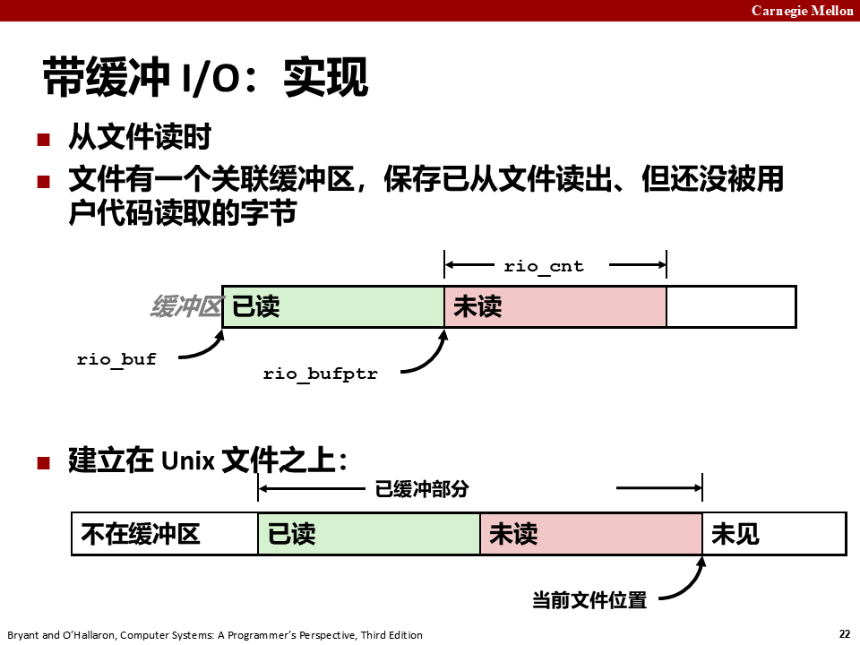

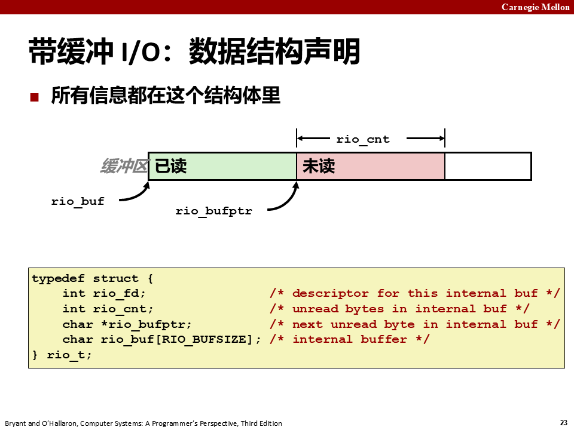

RIO 例子的完整形态（图 10-5，`cpfile.c`）——把标准输入按行复制到标准输出：

```c
#include "csapp.h"

int main(int argc, char **argv)
{
    int n;
    rio_t rio;
    char buf[MAXLINE];

    Rio_readinitb(&rio, STDIN_FILENO);
    while((n = Rio_readlineb(&rio, buf, MAXLINE)) != 0)
        Rio_writen(STDOUT_FILENO, buf, n);
    exit(0);
}
```

### 6.4 内部核心：rio_read 与缓冲区工作方式

RIO 读程序的核心是 `rio_read`（图 10-7）——Linux `read` 的带缓冲版本。调用 `rio_read` 要求读 `n` 个字节时：若读缓冲区里有 `rp->rio_cnt` 个未读字节，就直接从缓冲区复制 `n` 和 `rp->rio_cnt` 中较小的值到用户缓冲区并返回；若缓冲区为空，则调用 `read` 重新填满（收到不足值不是错误，只是缓冲区填充了一部分）。

```c
static ssize_t rio_read(rio_t *rp, char *usrbuf, size_t n)
{
    int cnt;

    while (rp->rio_cnt <= 0) { /* Refill if buf is empty */
        rp->rio_cnt = read(rp->rio_fd, rp->rio_buf,
                           sizeof(rp->rio_buf));
        if (rp->rio_cnt < 0) {
            if (errno != EINTR) /* Interrupted by sig handler return */
                return -1;
        }
        else if (rp->rio_cnt == 0) /* EOF */
            return 0;
        else
            rp->rio_bufptr = rp->rio_buf; /* Reset buffer ptr */
    }

    /* Copy min(n, rp->rio_cnt) bytes from internal buf to user buf */
    cnt = n;
    if (rp->rio_cnt < n)
        cnt = rp->rio_cnt;
    memcpy(usrbuf, rp->rio_bufptr, cnt);
    rp->rio_bufptr += cnt;
    rp->rio_cnt -= cnt;
    return cnt;
}
```

对应用程序而言，`rio_read` 和 Linux `read` 有同样的语义：出错返回 -1 并设置 `errno`，EOF 返回 0，要求的字节数超过缓冲区内未读字节数时返回不足值。正因为两个函数相似，很容易用 `rio_read` 代替 `read` 构造各种带缓冲的读函数：`rio_readnb` 与 `rio_readn` 有相同结构（把 `read` 换成 `rio_read`）；`rio_readlineb` 最多调用 `maxlen - 1` 次 `rio_read`，每次从缓冲区取一个字节并检查是否是换行符。

### 6.5 旁注：RIO 包的起源

RIO 函数灵感来自 W. Richard Stevens 经典网络编程作品 [110] 中的 `readline`、`readn` 和 `writen` 函数。`rio_readn` 和 `rio_writen` 与 Stevens 的 `readn`、`writen` 完全一样；但 Stevens 的 `readline` 有两个局限，在 RIO 中得到了纠正：第一，`readline` 带缓冲而 `readn` 不带，两者不能在同一描述符上一起使用；第二，它使用一个 `static` 缓冲区，因此不是线程安全的，Stevens 不得不引入另一个线程安全版本 `readline_r`。RIO 的 `rio_readlineb` 和 `rio_readnb` 修掉了这两个缺陷，互相兼容且线程安全。

---

## 7. 读取文件元数据

### 7.1 stat 与 fstat

应用程序通过 `stat` 和 `fstat` 检索关于文件的信息（文件的**元数据**）：

```c
#include <unistd.h>
#include <sys/stat.h>

int stat(const char *filename, struct stat *buf);
int fstat(int fd, struct stat *buf);
/* 返回：若成功则为 0，若出错则为 -1 */
```

`stat` 以文件名作为输入，填写一个 `struct stat`；`fstat` 类似，但以文件描述符作为输入。后面写 Web 服务器时会用到 `st_mode` 和 `st_size` 成员。

查文档时注意手册分节：`man stat` 给的是 shell 命令 `stat`（直接 `stat .` 就能看到当前目录的元数据），`man 2 stat` 才是系统调用那一页。Unix 手册第 2 章专放系统调用、第 3 章放库函数，这个约定对所有 Unix I/O 函数都适用。

### 7.2 struct stat 与 st_mode

```c
/* Metadata returned by the stat and fstat functions */
struct stat {
    dev_t         st_dev;      /* Device */
    ino_t         st_ino;      /* inode */
    mode_t        st_mode;     /* Protection and file type */
    nlink_t       st_nlink;    /* Number of hard links */
    uid_t         st_uid;      /* User ID of owner */
    gid_t         st_gid;      /* Group ID of owner */
    dev_t         st_rdev;     /* Device type (if inode device) */
    off_t         st_size;     /* Total size, in bytes */
    unsigned long st_blksize;  /* Block size for filesystem I/O */
    unsigned long st_blocks;   /* Number of blocks allocated */
    time_t        st_atime;    /* Time of last access */
    time_t        st_mtime;    /* Time of last modification */
    time_t        st_ctime;    /* Time of last change */
};
```

`st_size` 是文件字节数大小；`st_mode` 编码了文件访问许可位（见 4.2 的权限位表）和文件类型。Linux 在 `sys/stat.h` 中定义宏谓词来确定 `st_mode` 的文件类型：

- `S_ISREG(m)`：这是一个普通文件吗？
- `S_ISDIR(m)`：这是一个目录文件吗？
- `S_ISSOCK(m)`：这是一个网络套接字吗？

几个字段可以对应到实际概念：`st_dev` 是文件所在设备的编号；`st_ino` 是 inode（索引节点）编号，inode 才是"文件本身"在磁盘上的身份标识，一个文件名只是一个指向 inode 的链接——这正是硬链接的原理：多个文件名指向同一个 inode，硬盘上只有一份数据，`st_nlink` 记录着指向这个 inode 的链接数，只有当链接数减到 0 时文件数据才会真正被释放。所以用硬链接做备份很巧妙：多个名字共享同一份数据，任何一个名字都能访问；而软链接（符号链接）不同，它是一个独立的小文件，内容是"指向另一个路径"，原文件删了链接就失效，就像快捷方式指向的程序被卸载了。`st_atime` 是最后一次访问时间（Access，读它算访问），`st_mtime` 是最后一次修改内容的时间（Modify，改内容算修改），`st_ctime` 是最后一次状态改变的时间（Change，权限、属主、链接数变化也算）——实际交作业判断两份文件谁新谁旧，靠的就是这些时间戳。判断文件类型不用记 `st_mode` 的具体位值，直接用 `S_ISREG`/`S_ISDIR` 这些宏即可，就像用 π 时不需要记住它全部小数位，按精度需求取近似值就行。

### 7.3 statcheck 例子

图 10-10（`statcheck.c`）展示了用 `stat` 和这些宏读取并解释 `st_mode` 位：

```c
#include "csapp.h"

int main (int argc, char **argv)
{
    struct stat stat;
    char *type, *readok;

    Stat(argv[1], &stat);
    if (S_ISREG(stat.st_mode))     /* Determine file type */
        type = "regular";
    else if (S_ISDIR(stat.st_mode))
        type = "directory";
    else
        type = "other";
    if ((stat.st_mode & S_IRUSR))  /* Check read access */
        readok = "yes";
    else
        readok = "no";

    printf("type: %s, read: %s\n", type, readok);
    exit(0);
}
```

运行效果：

```
linux> ./statcheck statcheck.c
type: regular, read: yes
linux> chmod 000 statcheck.c
linux> ./statcheck statcheck.c
type: regular, read: no
linux> ./statcheck ..
type: directory, read: yes
```

---

## 8. 读取目录内容

应用程序可以用 `readdir` 系列函数读取目录内容：

```c
#include <sys/types.h>
#include <dirent.h>

DIR *opendir(const char *name);
/* 返回：若成功，则为处理的指针；若出错，则为 NULL */
```

`opendir` 以路径名为参数，返回指向**目录流**（directory stream）的指针。流是对条目有序列表的抽象，这里就是目录项的列表。

```c
#include <dirent.h>

struct dirent *readdir(DIR *dirp);
/* 返回：若成功，则为指向下一个目录项的指针；若没有更多的目录项或出错，则为 NULL */
```

每次 `readdir` 调用返回指向流 `dirp` 中下一个目录项的指针，没有更多目录项则返回 NULL。每个目录项是一个结构：

```c
struct dirent {
    ino_t d_ino;    /* inode number */
    char d_name[256]; /* Filename */
};
```

虽然有些 Linux 版本包含其他成员，但只有这两个成员对所有系统来说是标准的：`d_name` 是文件名，`d_ino` 是文件位置。

**区分错误与流结束**：如果出错，`readdir` 返回 NULL 并设置 `errno`。唯一能区分错误和流结束的方法是检查自调用 `readdir` 以来 `errno` 是否被修改过（所以循环前先把 `errno = 0`）。`closedir` 关闭流并释放所有资源。图 10-11（`readdir.c`）完整例子：

```c
#include "csapp.h"

int main(int argc, char **argv)
{
    DIR *streamp;
    struct dirent *dep;

    streamp = Opendir(argv[1]);

    errno = 0;
    while ((dep = readdir(streamp)) != NULL) {
        printf("Found file: %s\n", dep->d_name);
    }
    if (errno != 0)
        unix_error("readdir error");

    Closedir(streamp);
    exit(0);
}
```

PPT p52 也给了同样的模式：`opendir` → `while ((de = readdir(directory)))` 打印 `de->d_name` → `closedir`。对目录唯一推荐的操作就是读取它的条目。

---

## 9. 共享文件

### 9.1 内核的三张表

Linux 内核用三个相关的数据结构来表示打开的文件。除非很清楚内核如何表示打开的文件，否则文件共享的概念相当难懂：

- **描述符表（descriptor table）**：每个进程都有独立的描述符表，表项由进程打开的文件描述符索引；每个打开的描述符表项指向文件表中的一个表项；
- **文件表（file table）**：所有进程共享；每个表项包括当前文件位置、引用计数（refcnt，即当前指向该表项的描述符表项数），以及指向 v-node 表对应表项的指针。关闭一个描述符会减少相应表项的引用计数，内核不会删除这个文件表项直到引用计数为零；
- **v-node 表（v-node table）**：所有进程共享；每个表项包含 `stat` 结构中的大多数信息，包括 `st_mode` 和 `st_size`。

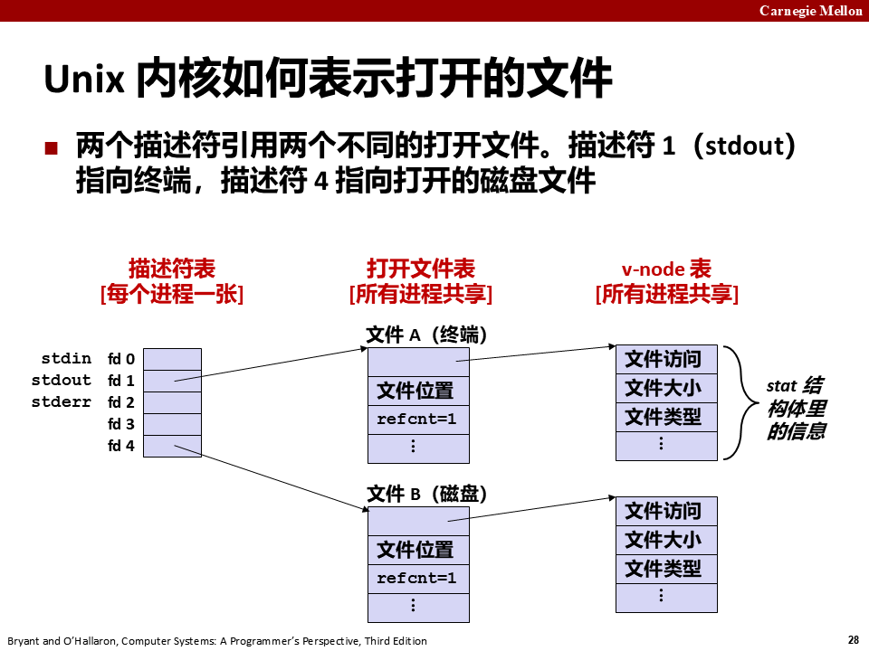

### 9.2 两个描述符通过不同表项共享一个文件

多个描述符可以通过不同的文件表表项引用同一个文件——例如用同一个文件名调用 `open` 两次。**关键思想：每个描述符都有它自己的文件位置，所以对不同描述符的读操作可以从文件的不同位置获取数据。**

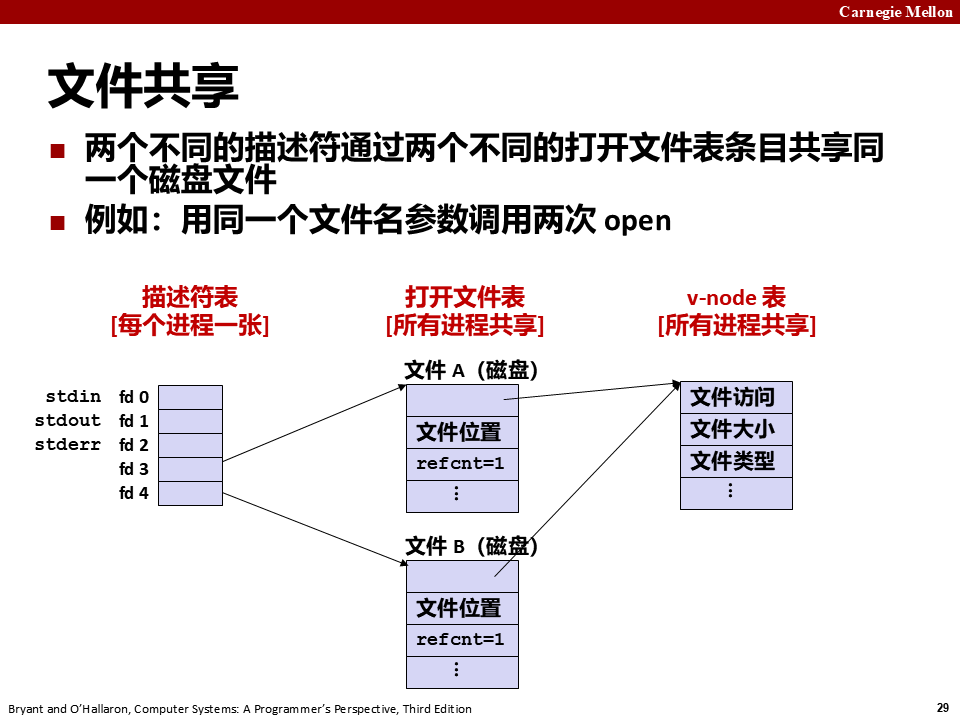

### 9.3 fork 之后的文件共享

假设 fork 前父进程有图 10-12 那样的打开文件。调用 fork 后：子进程得到父进程描述符表的**副本**，父子进程**共享相同的打开文件表集合，因此共享相同的文件位置**。一个重要结果：在内核删除相应文件表项之前，父子进程必须都关闭了它们的描述符。PPT 特别提醒：**exec 函数不改变这个状态**（要改得用 `fcntl`）。

这里要分清共享发生在哪一级：父子共享的是**打开文件表项**，不是"文件"这个对象。文件本身（v-node）本来就是全系统共享的，任何进程打开同一个文件都指向同一个 v-node；fork 的特殊之处在于连"读到哪儿了"这一层也一起共享了——父进程读走 3 个字节，位置前移到 3，子进程再读就从第 3 个字节开始。如果父子各自 `open` 同一个文件，得到的是两个表项、两个位置，互不干扰（练习题 10.2 与 10.3 的差别就在于此）。

这个共享特性正是管道（pipe）的底层基础：父进程打开一个管道文件后，父子各持有两个描述符（读端、写端），只要约定好各自关掉一端——比如父进程关掉读端只留写端、子进程关掉写端只留读端——数据就只能从父进程单向流向子进程；两个这样的管道一拼，就得到父子之间互发的双向通道。因为父子共享同一个打开文件表，父写的内容子能读到，文件位置也被两边共同推进。

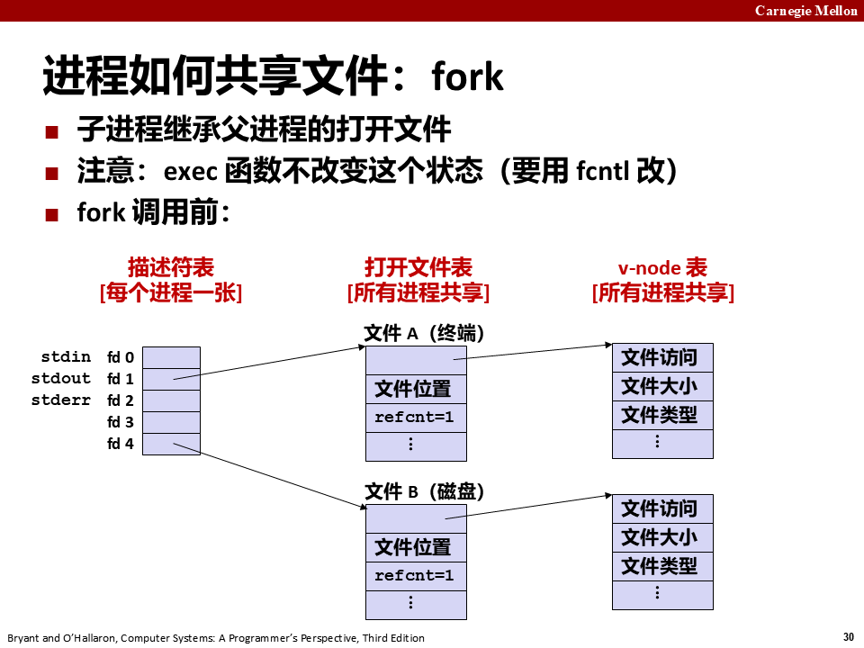

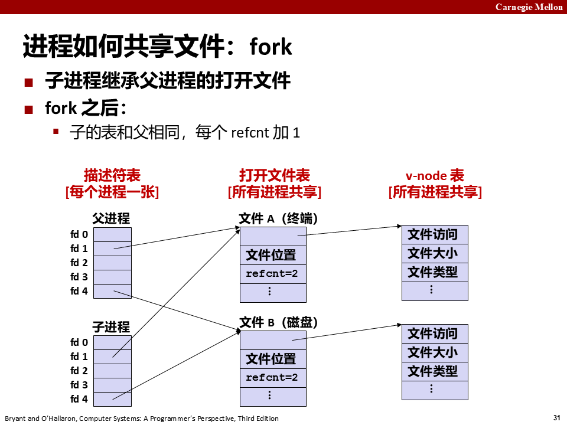

### 9.4 练习题 10.2 与 10.3

**练习题 10.2**：磁盘文件 `foobar.txt` 由 6 个 ASCII 字符 "foobar" 组成，程序输出什么？

```c
#include "csapp.h"

int main()
{
    int fd1, fd2;
    char c;

    fd1 = Open("foobar.txt", O_RDONLY, 0);
    fd2 = Open("foobar.txt", O_RDONLY, 0);
    Read(fd1, &c, 1);
    Read(fd2, &c, 1);
    printf("c = %c\n", c);
    exit(0);
}
```

**答案**：`c = f`。描述符 `fd1` 和 `fd2` 各有自己的打开文件表表项（两次 `open`），每个描述符对 `foobar.txt` 有自己的文件位置。从 `fd2` 的读操作读的是 `foobar.txt` 的第一个字节，而不是你一开始可能以为的第二个（`c = o`）。

**练习题 10.3**：同样的 `foobar.txt`，下面程序的输出？

```c
#include "csapp.h"

int main()
{
    int fd;
    char c;

    fd = Open("foobar.txt", O_RDONLY, 0);
    if (Fork() == 0) {
        Read(fd, &c, 1);
        exit(0);
    }
    Wait(NULL);
    Read(fd, &c, 1);
    printf("c = %c\n", c);
    exit(0);
}
```

**答案**：`c = o`。子进程继承父进程的描述符表，且所有进程共享同一个打开文件表，所以 `fd` 在父子进程中指向**同一个打开文件表表项**。子进程读第一个字节后文件位置加 1，父进程因此读到第二个字节。

---

## 10. I/O 重定向

### 10.1 dup2 函数

Linux shell 提供 I/O 重定向操作符，把磁盘文件和标准输入输出联系起来。例如 `linux> ls > foo.txt` 让 shell 加载执行 `ls` 时把标准输出重定向到磁盘文件 `foo.txt`。Web 服务器替客户端运行 CGI 程序时也做类似的重定向。实现方式之一是用 `dup2`：

```c
#include <unistd.h>

int dup2(int oldfd, int newfd);
/* 返回：若成功则为非负的描述符，若出错则为 -1 */
```

`dup2` 复制描述符表项 `oldfd` 到描述符表项 `newfd`，覆盖 `newfd` 以前的内容；如果 `newfd` 已经打开，`dup2` 会在复制前关闭它。调用 `dup2(4,1)` 后：两个描述符都指向文件 B（原 fd4 指向的磁盘文件），文件 A（原 fd1 指向的终端）被关闭、它的文件表和 v-node 表项被删除，文件 B 的引用计数增加。此后任何写到标准输出的数据都被重定向到文件 B。

日志文件就是重定向的典型应用：服务器程序往往在后台长时间运行，如果让 `printf` 直接往终端写，程序一退出或者终端一关，输出就全丢了，还会抢占前台界面；于是启动时用 `dup2` 把标准输出重定向到一个日志文件，此后程序所有打印都自动落进文件里，既不影响前台，退出后也能回看。`ls > foo.txt` 这类 shell 重定向命令底层做的正是同样的两步操作。

`dup2` 强大但危险，危险来自引用计数。shell 做重定向时，`dup2(4,1)` 之后 fd 4 仍然开着，必须补一句 `close(4)`；否则那个文件表项的引用计数永远挂着 1，即使命令执行完、fd 1 也关了，内核仍然不会释放它。多进程程序里"谁该关哪个描述符"理不清，就会同时踩到文件泄漏和"关掉了别人还在用的 fd"两类错误。

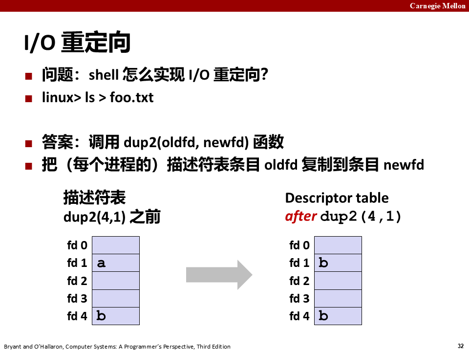

### 10.2 shell 重定向的两步

第 1 步：**打开要把 stdout 重定向到的文件**——在子进程执行 shell 代码时、`exec` 之前完成（此时 shell fork 出的子进程已有父进程描述符表的副本，`fd1` 仍指向终端，`open` 返回新的 `fd4` 指向磁盘文件）。

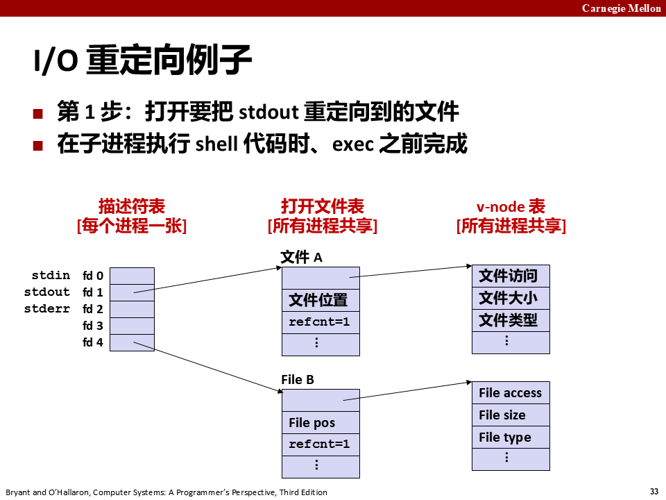

第 2 步：**调用 `dup2(4,1)`**——让 `fd1`（stdout）指向 `fd4` 指向的磁盘文件。结果是 `fd1` 和 `fd4` 都指向文件 B（refcnt 变成 2），文件 A 的 refcnt 归零。

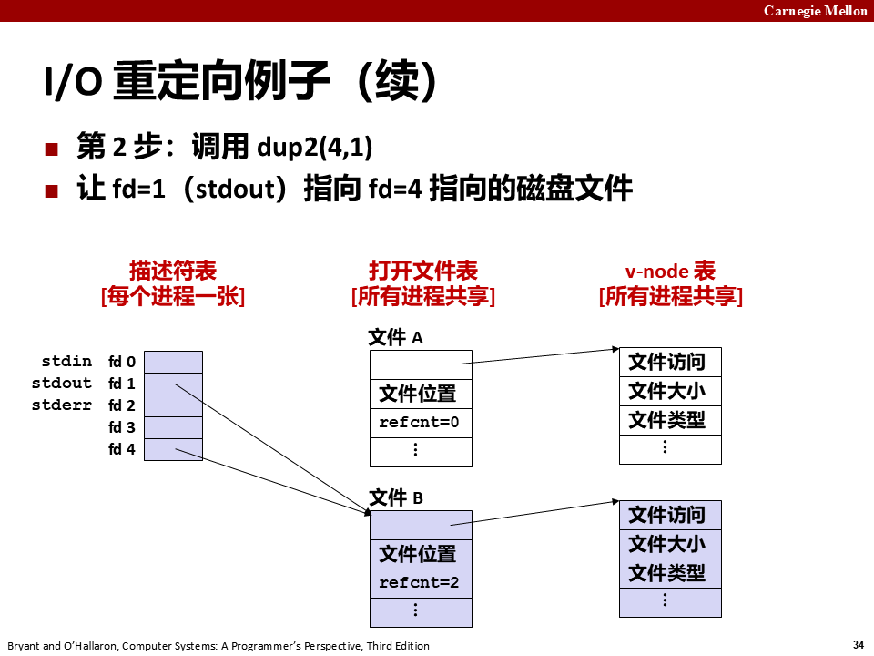

### 10.3 练习题 10.4 与 10.5

**练习题 10.4**：如何用 `dup2` 将标准输入重定向到描述符 5？——调用 `dup2(5,0)` 或等价地 `dup2(5,STDIN_FILENO)`。

**练习题 10.5**：`foobar.txt` 由 "foobar" 组成，下面程序的输出？

```c
#include "csapp.h"

int main()
{
    int fd1, fd2;
    char c;

    fd1 = Open("foobar.txt", O_RDONLY, 0);
    fd2 = Open("foobar.txt", O_RDONLY, 0);
    Read(fd2, &c, 1);
    Dup2(fd2, fd1);
    Read(fd1, &c, 1);
    printf("c = %c\n", c);
    exit(0);
}
```

**答案**：`c = o`。第一眼可能以为输出 `c = f`，但 `Dup2(fd2, fd1)` 把 `fd1` 重定向到了 `fd2`——此时 `fd1` 和 `fd2` 共享同一个打开文件表表项和同一个文件位置。`Read(fd2, &c, 1)` 先读走 'f'，文件位置到 1；再 `Read(fd1, ...)` 读的是第二个字节 'o'。

（教材旁注：为了避免和其他括号类型操作符如 `]`、`[` 混淆，常把 shell 的 `>` 操作符称为"右 hoinky"，`<` 称为"左 hoinky"。）

---

## 11. 标准 I/O

### 11.1 流（stream）

C 语言定义了一组高级 I/O 函数，称为**标准 I/O 库**（libc），是 Unix I/O 的较高级替代：打开关闭文件（`fopen`/`fclose`）、读写字节（`fread`/`fwrite`）、读写字符串（`fgets`/`fputs`）、格式化 I/O（`scanf`/`printf`）。

标准 I/O 库把打开的文件模型化为**流**：对程序员而言，流就是一个指向 `FILE` 类型结构的指针。每个 ANSI C 程序开始时都有三个打开的流 `stdin`、`stdout`、`stderr`，分别对应标准输入、标准输出、标准错误（描述符 0、1、2）：

```c
#include <stdio.h>

extern FILE *stdin;   /* Standard input (descriptor 0) */
extern FILE *stdout;  /* Standard output (descriptor 1) */
extern FILE *stderr;  /* Standard error (descriptor 2) */
```

`FILE` 类型的流是对**文件描述符和流缓冲区**的抽象。流缓冲区的目的和 RIO 读缓冲区一样：让开销较高的 Linux I/O 系统调用数量尽可能小。

### 11.2 缓冲的动机

应用经常一次读/写一个字符（`getc`、`putc`、`ungetc`、`gets`、`fgets`——一次读一个字符地读文本行直到换行）。用 Unix I/O 调用来实现很昂贵：**`read` 和 `write` 都要进入 Unix 内核，一次调用 > 10,000 个时钟周期**。解决方案是带缓冲读：用 Unix `read` 抓一块字节放进缓冲区，用户输入函数一次从缓冲区拿一个字节，缓冲区空了再重新填充。

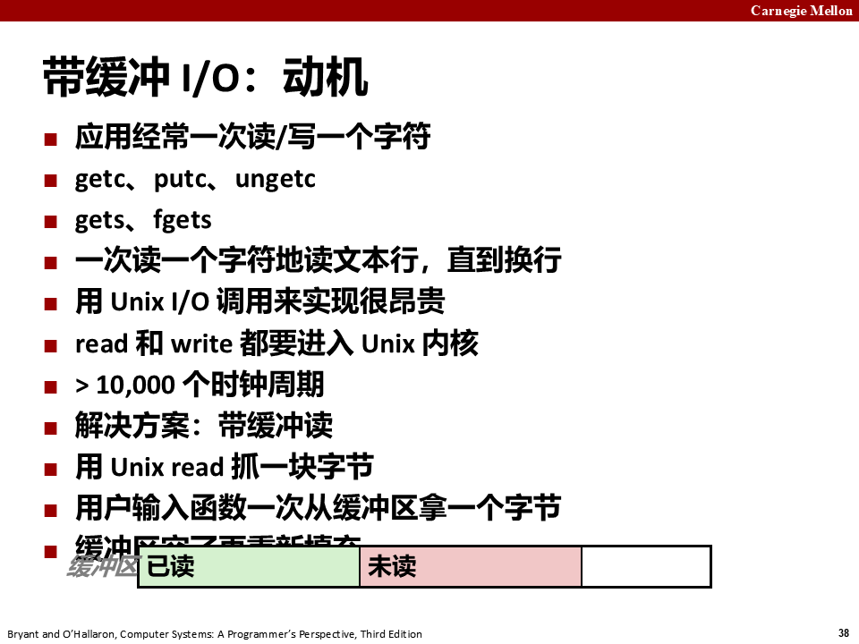

### 11.3 printf 怎么攒到缓冲区里

标准 I/O 函数使用带缓冲 I/O：连续 `printf("h"); printf("e"); printf("l"); printf("l"); printf("o"); printf("\n");` 并不会触发六次 `write`——字符先攒进 `buf`，直到遇到 `\n` 才触发一次 `write(1, buf, 6)`。缓冲区在遇到 `\n`、调用 `fflush`、`exit` 或从 `main` 返回时刷到输出 fd。

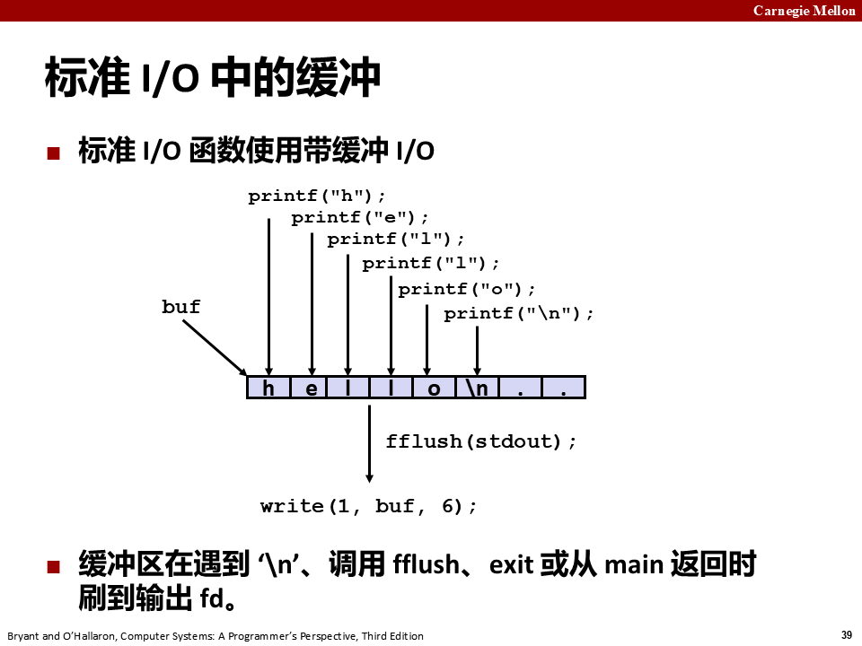

### 11.4 strace 亲眼看到一次 write

可以用 Linux 的 `strace` 程序亲眼看到这个缓冲过程：

```
linux> strace ./hello
execve("./hello", ["hello"], [/* ... */]).
...
write(1, "hello\n", 6)               = 6
...
exit_group(0)                        = ?
```

尽管 `hello.c` 里写了六个 `printf`（`h`、`e`、`l`、`l`、`o`、`\n`），`strace` 显示最终只有**一次** `write` 系统调用，一次写走 6 个字节——这就是行缓冲的效果。写轮询/忙等代码时这个直觉也很有用：纯 `while(1);` 会让 CPU 占用率飙到近 100%，循环里加一句 `sleep` 让进程"喘口气"就不会空转烧 CPU。

---

## 12. 我该使用哪些 I/O 函数

### 12.1 三层 I/O 的关系

Unix I/O 模型在内核中实现，应用通过 `open`、`close`、`lseek`、`read`、`write`、`stat` 访问。较高级的 RIO 和标准 I/O 函数都**基于（使用）Unix I/O 函数实现**：RIO 是专为本书开发的 `read`/`write` 健壮包装函数，自动处理不足值并提供高效的带缓冲文本行读取；标准 I/O 是 Unix I/O 更完整的带缓冲替代品，包括 `printf`/`scanf` 这样的格式化 I/O。

```
C 应用程序
  ├── 标准 I/O 函数：fopen fdopen | fread fwrite fscanf fprintf sscanf sprintf fgets fputs fflush fseek fclose
  ├── RIO 函数：rio_readn rio_writen rio_readinitb rio_readlineb rio_readnb
  └── Unix I/O 函数（通过系统调用访问）：open read write lseek stat close
```

三层的边界不能越：**标准 I/O 和 RIO 不能混用**。它们各自维护自己的缓冲区，彼此不知道对方读走了多少——先用 `rio_readlineb` 从 fd 读一行，再用 `fgets` 从同一个 fd 读，两边认定的"下一个字节"完全不同，数据会错位甚至丢失。选定一层就一直用那一层；中间确实要换，必须先把缓冲刷干净并重新对齐文件位置。

### 12.2 Unix I/O 的优缺点

- 优点：最通用、开销最小的 I/O 形式；其他所有 I/O 包都是用它实现的；提供访问文件元数据的函数；Unix I/O 函数是**异步信号安全**的，可以在信号处理程序里安全使用。
- 缺点：处理短计数很棘手、容易出错；高效读文本行需要某种缓冲机制，同样棘手、容易出错——这两个问题都由标准 I/O 和 RIO 包解决。

### 12.3 标准 I/O 的优缺点

- 优点：缓冲减少了 `read`/`write` 系统调用次数、提高效率；短计数自动处理。
- 缺点：不提供访问文件元数据的函数；标准 I/O 函数**不是异步信号安全**的，不适合信号处理程序；标准 I/O 不适合在网络套接字上做输入输出——流上有一些文档不详的限制，和套接字限制冲突（10.11 节）。

### 12.4 选择规则 G1/G2/G3

- **G1：只要有可能就使用标准 I/O**。对磁盘和终端设备 I/O 来说标准 I/O 是首选；大多数 C 程序员整个职业生涯只使用标准 I/O（可能 `stat` 除外，标准 I/O 库没有对应函数）。
- **G2：不要使用 `scanf` 或 `rio_readlineb` 来读二进制文件**。这类函数专为文本文件设计；学生常犯的错误是用它们读二进制文件导致诡异失败——比如二进制文件可能散布很多 `0xa` 字节，而这些字节与终止文本行无关。
- **G3：对网络套接字的 I/O 使用 RIO 函数**。Linux 对网络的抽象是套接字文件类型，由套接字描述符引用；标准 I/O 用在网络上会碰到下面说的限制。

PPT 的总结规则：一般规则是尽可能用最高层的 I/O 函数；操作磁盘或终端文件时用标准 I/O；在信号处理程序里用原生 Unix I/O（异步信号安全）；少数需要极致性能的场合用原生 Unix I/O；读和写网络套接字时用 RIO——**不要在套接字上用标准 I/O**。

### 12.5 标准 I/O 与网络套接字的冲突

标准 I/O 流从某种意义上说是全双工的（同一流上能执行输入也能执行输出），但对流的限制和对套接字的限制有时会互相冲突，且极少有文档描述：

- **限制一：跟在输出函数之后的输入函数**。如果中间没有插入对 `fflush`、`fseek`、`fsetpos` 或 `rewind` 的调用，输入函数不能跟随在输出函数之后（`fflush` 清空流缓冲区，后三个函数用 `lseek` 重置当前文件位置）。
- **限制二：跟在输入函数之后的输出函数**。如果中间没有插入 `fseek`、`fsetpos` 或 `rewind`，输出函数不能跟随在输入函数之后，除非该输入函数遇到了文件结束。

这些限制给网络应用带来问题，因为**对套接字使用 `lseek` 是非法的**。限制一可以通过"每个输入操作前刷新缓冲区"满足；满足限制二的办法是**对同一个打开的套接字描述符打开两个流**，一个读一个写：

```c
FILE *fpin, *fpout;
fpin = fdopen(sockfd, "r");
fpout = fdopen(sockfd, "w");
```

但这样又要求应用在两个流上都调用 `fclose` 才能释放内存资源、避免内存泄漏：

```c
fclose(fpin);
fclose(fpout);
```

这些操作中的每一个都试图关闭同一个底层套接字描述符，所以第二个 `close` 会失败。顺序程序里这不是问题，但在线程化程序里关闭一个已关闭的描述符会导致灾难（12.7.4 节）。

因此教材建议：**在网络套接字上不要用标准 I/O，改用健壮的 RIO 函数**。需要格式化输出时，用 `sprintf` 在内存里格式化字符串，再用 `rio_writen` 发送；需要格式化输入时，用 `rio_readlineb` 读完整文本行，再用 `sscanf` 从文本行提取字段。

### 12.6 处理二进制文件

永远不要对二进制文件使用面向文本的函数（`fgets`、`scanf`、`rio_readlineb`），因为它们会解释 EOL 字符；应该用 `rio_readn` 或 `rio_readnb` 这类函数。字符串函数（`strlen`、`strcpy`、`strcat`）同样危险，因为它们把字节值 0（字符串结束符）解释为特殊含义——而二进制数据里到处都是 0 字节。

字符串函数的不安全还有一层更常见的原因：`strcpy`/`strcat` 这类函数不知道目标缓冲区有多长，只能一路拷贝到碰上 `\0` 为止；如果源字符串结尾的 `\0` 迟迟不出现，它会越过缓冲区边界继续写，造成缓冲区溢出。所以工程上常改用带长度上限的 `strncpy`/`strncat`，把"最多复制 N 个字节"作为硬约束传进去。

---

## 13. 文件描述符趣题（PPT p49-51）

这一节把课堂 2026-10-28 讲的那三个程序逐行推完。三题表面上各问各的，实际问的是同一件事：**文件位置存在哪一层，所以什么时候被共享、什么时候各走各的**。

### 13.1 推题前先钉住三件事

**fd 是描述符表的下标**。`int fd` 里的数字不是什么句柄对象，就是进程描述符表的下标；下标指向的那一格，才存着通往内核打开文件表项的指针。进程一出生就占着 0、1、2 三格，所以自己第一个 `open` 拿到的必然是 3。推题的第一个动作永远是：**数它开了几个文件、fd 从几开始，再画表。**

**位置只有一份，而且住在内核**。读和写共用同一个 current file position，不是一个读指针加一个写指针。打开时置 0（`O_APPEND` 是特例，见 [[#13.4 例三：创建、截断、追加与覆盖写]]），每次 `read`/`write` 按实际传输的字节数推进它。它存在**打开文件表项**里，所以"共不共享表项"和"共不共享位置"是同一句话——`fork` 出来的子进程即使拿到完全相同的 `fd` 数值，也不代表它有一份独立的位置，**数值相同只是下标相同，下标指向哪一格才是关键**。

**共享与否看表项，不看文件名**。两个描述符都打开同一个文件，只要 `open` 了两次就是两个表项、两个位置（§9.2）；只有落到同一个表项上才共享（§9.3、§10.1）。

### 13.2 例一：三次 open 再加一个 dup2

**趣题 1（ffiles1.c）**：文件内容为 "abcde"，打印什么？

```c
#include "csapp.h"

int main(int argc, char *argv[])
{
    int fd1, fd2, fd3;
    char c1, c2, c3;
    char *fname = argv[1];

    fd1 = Open(fname, O_RDONLY, 0);
    fd2 = Open(fname, O_RDONLY, 0);
    fd3 = Open(fname, O_RDONLY, 0);
    Dup2(fd2, fd3);
    Read(fd1, &c1, 1);
    Read(fd2, &c2, 1);
    Read(fd3, &c3, 1);
    printf("c1 = %c, c2 = %c, c3 = %c\n", c1, c2, c3);
    return 0;
}
```

逐行推：

| 时刻 | 描述符表（3 号格起） | 各表项位置 | 本次读出 |
|---|---|---|---|
| 三次 `Open` 之后 | fd1→表项 A，fd2→表项 B，fd3→表项 C | 0 / 0 / 0 | — |
| `Dup2(fd2, fd3)` | fd1→A，fd2→B，fd3→**B**（C 被关掉） | 0 / 0 | — |
| `Read(fd1, &c1, 1)` | 不变 | A：0→1 | `c1 = a` |
| `Read(fd2, &c2, 1)` | 不变 | B：0→1 | `c2 = a` |
| `Read(fd3, &c3, 1)` | 不变 | B：1→2 | `c3 = b` |

**答案：`c1 = a, c2 = a, c3 = b`。** 课堂逐字稿里老师说得同样直白：前两个都是 A，第三个是 B。

最容易错的地方在于把"指向同一个文件"读成"指向同一个表项"。三次 `Open` 是**三个独立的表项**，它们只在最底下那个 **v-node**（磁盘上的文件）处汇合，所以前两次读各自从 0 开始，都拿到 `'a'`。


`Dup2(fd2, fd3)` 干的事只有两步：先关掉 `fd3` 原来指向的表项 C（引用计数减到 0，内核把它删掉），再把描述符表第 3 格改成指向 B，B 的引用计数加 1。**它复制的是下标里的那个指针，不是文件，也不是位置。** 此后 fd2 和 fd3 是同一份位置的两种叫法。


（程序直接用了 `argv[1]` 没检查 `argc`，课堂演示可以这么写，作业里必须判——`argc < 2` 时 `argv[1]` 是 NULL，`open` 拿到空指针直接崩。）

### 13.3 例二：fork 之后谁读第二个字节

**趣题 2（ffiles2.c）**：内容为 "abcde"，父进程 `getpid() & 0x1` 决定谁先睡，打印什么？

```c
#include "csapp.h"

int main(int argc, char *argv[])
{
    int fd1;
    int s = getpid() & 0x1;
    char c1, c2;
    char *fname = argv[1];

    fd1 = Open(fname, O_RDONLY, 0);
    Read(fd1, &c1, 1);
    if (fork()) { /* Parent */
        sleep(s);
        Read(fd1, &c2, 1);
        printf("Parent: c1 = %c, c2 = %c\n", c1, c2);
    } else { /* Child */
        sleep(1-s);
        Read(fd1, &c2, 1);
        printf("Child: c1 = %c, c2 = %c\n", c1, c2);
    }
    return 0;
}
```

**`s = getpid() & 0x1` 在干什么**：取进程号的最低位，也就是**奇偶**。父进程睡 `s` 秒、子进程睡 `1-s` 秒，两者必定一个睡 0 秒、一个睡 1 秒——**先后顺序被钉死，而且每跑一次翻一次面**。不用 `rand()` 的理由是：进程号在奇偶上本来就均匀，而且"父子互补"这一点是确定的，`rand()` 还得手动保证两个值不同；否则谁先跑完全交给调度器，同一份程序跑两次答案不同，没法当例子讲。

**c1 为什么两边都是 a**：`Read(fd1, &c1, 1)` 发生在 `fork()` **之前**。`c1` 是普通局部变量，fork 时被复制一份给子进程（写时复制，父子各一份、值相同）。

**c2 为什么是 b 和 c 各一个**：`fd1` 这个数值在 fork 后被复制了两份，但**两份表项都指向同一个打开文件表项**——位置只有一份，停在 1。谁先醒谁读走 `'b'` 并把位置推到 2，后醒的只能读 `'c'`。


| 若 `s = 0`（父 PID 为偶） | 若 `s = 1`（父 PID 为奇） |
| --- | --- |
| `Parent: c1 = a, c2 = b` | `Parent: c1 = a, c2 = c` |
| `Child: c1 = a, c2 = c` | `Child: c1 = a, c2 = b` |

这一题本质就是练习题 10.3，只是那里用 `Wait(NULL)` 强制"子先读、父后读"，答案固定成 `c = o`；这里换成 sleep 让顺序随 PID 翻转，考的是同一个机制。

注意同一段代码里**两种语义并存**：`c1` 走的是"变量复制"（两份），位置走的是"表项共享"（一份）。这就是这道题的杀伤力所在。

### 13.4 例三：创建、截断、追加与覆盖写

**趣题 3（ffiles3.c）**：最终文件内容是什么？

```c
#include "csapp.h"

int main(int argc, char *argv[])
{
    int fd1, fd2, fd3;
    char *fname = argv[1];

    fd1 = Open(fname, O_CREAT|O_TRUNC|O_RDWR, S_IRUSR|S_IWUSR);
    Write(fd1, "pqrs", 4);
    fd3 = Open(fname, O_APPEND|O_WRONLY, 0);
    Write(fd3, "jklmn", 5);
    fd2 = dup(fd1);  /* Allocates descriptor */
    Write(fd2, "wxyz", 4);
    Write(fd3, "ef", 2);
    return 0;
}
```

逐行推：

| 步骤 | 文件内容 | fd1 位置 | fd3 位置 | 说明 |
|---|---|---|---|---|
| `Open(O_CREAT\|O_TRUNC\|O_RDWR)` | （空，原内容已被清掉） | 0 | — | 不存在就建，存在就清零 |
| `Write(fd1,"pqrs")` | `pqrs` | 4 | — | 写到哪，位置推到哪 |
| `Open(O_APPEND\|O_WRONLY)` → fd3 | `pqrs` | 4 | 0 | 新表项，位置从 0 起 |
| `Write(fd3,"jklmn")` | `pqrsjklmn` | 4 | 9 | append 先跳到末尾再写 |
| `fd2 = dup(fd1)` | 同上 | 4 | 9 | fd2 与 fd1 共用位置 4 |
| `Write(fd2,"wxyz")` | `pqrswxyzn` | 8 | 9 | 从 4 开始**覆盖**了 `jklm` |
| `Write(fd3,"ef")` | `pqrswxyznef` | 8 | 11 | 又跳到末尾追加 |

**答案：`pqrswxyznef`。**

三个标志各管一段，别混：

- **`O_CREAT`**：文件不存在时创建它。只在"新建"时生效，已有文件时不起作用（要配合 `O_EXCL` 才能在已存在时报错）。
- **`O_TRUNC`**：文件存在就把长度截成 0。**这是立刻生效的**——`open` 返回时文件已经空了，不需要等到第一次写。想清空一个日志文件，`open(path, O_WRONLY|O_TRUNC)` 再 `close` 就够。
- **`O_APPEND`**：这不是"打开时把位置移到末尾"，而是**每次 `write` 之前**把位置挪到末尾。注意 fd3 打开时位置还是 0，是第一次写的时候跳到 9 的。Linux 上这个"定位 + 写"是原子的，所以多个进程各自 `open` 同一文件做追加也不会互相覆盖（见 [[#13.6 多进程写同一个文件]]）。

还有一个只在创建时才有意义的参数：`S_IRUSR|S_IWUSR`（第三个参数）。文件已存在时它被忽略；新建时还要再被 `umask` 削一刀，最终权限是 $mode\ \&\ \sim umask$（§4.2）。

最后那两行是本例的重点：`dup(fd1)` 时 fd2 还空着，所以不需要关任何东西，直接把描述符表那一格指向 `fd1` 的表项（fd1 是 3、fd3 是 4，所以 fd2 拿到 5）。于是 `fd2` 从**位置 4** 开始写，把 `jklm` 覆盖成了 `wxyz`，第 8 位的 `n` 仍然留着——文件长度没变，内容被改了。**同一份位置，谁写谁推，另一个人接着往下走。**

（课堂上把这一行写成了 `Dup2(fd1, fd2)`、内容用大写的 `PQRS`/`JKLMN`/`WXYZ`/`EF`，两者结构完全一致，答案 `PQRSWXYZNEF`。）

### 13.5 归纳：四种情况一张表

| 场景 | 描述符表 | 打开文件表项 | 文件位置 |
|---|---|---|---|
| 同一文件 `open` 两次 | 两个独立格 | **两个** | 各自独立 |
| `dup` / `dup2` | 两个格 | **同一个**（引用计数 +1） | **共享** |
| `fork` | 子进程复制整张表 | 指向同样的表项（计数 +1） | **共享** |
| `execve` | 表被保留 | 不变 | **共享**（除非该 fd 设了 `FD_CLOEXEC`） |

一句话：**位置跟着表项走，表项跟着"谁 open 的"走；`fd` 的数值相同不代表位置相同，只有落到同一个表项上才共享。**

也可以反过来记：这几个操作里只有 `open` 会造出新表项，`dup`、`fork`、`execve` 都只是让更多格子指向已有的表项。

### 13.6 多进程写同一个文件

这个问题是从例三的覆盖写引出来的：两个人同时往一个文件里写，会怎样？

- **各自 `open`**：两个表项、两个位置，都从 0 开始，谁后写谁覆盖前面的。这就是"内容莫名其妙少了"的来源。
- **`fork` 出来的父子、或者 `dup` 出来的两个描述符**：共享一份位置，写是接续的，不会互相覆盖，但顺序取决于调度，交错位置不可控。
- **`O_APPEND`**：即使各自打开，每次写前都原子地定位到末尾，于是变成"各自接在尾巴上写"，不会覆盖。
- **要真正的互斥**：得用文件锁（`fcntl` 的记录锁、`flock`），这是 `O_APPEND` 给不了的——它只保证单次 `write` 的"定位 + 写"不被打断，不保证你连着两次 `write` 之间没人插进来。所以它能保证"不覆盖"，保证不了"内容成块"。

课堂上说得更朴素：多人协作要么共享同一份东西（顺序接续），要么各拿一份副本（会覆盖），要么加锁。三种方案对应三种场景，没有优劣之分。

### 13.7 两个可以借用的类比

**指针变量复制**。`int *p = q;` 复制的是地址这个值，两个指针指向同一块内存。`fork` 复制描述符表就是这个结构——表里每一格都是指针，复制之后两个格子指向同一个表项。而普通的 `int c1` 复制一份就是两份独立的值，谁也影响不到谁。例二里 `c1` 和"文件位置"的分野，本质就是这两种复制的分野。

**描述符表是一个数组**。`fd` 是下标，元素是指针。`dup2(a, b)` 就是 `tbl[b] = tbl[a]`（外加把 `b` 原来指向的东西关掉）。`fork` 就是把整个数组 `memcpy` 一份——**数组复制了，但数组里的指针指向的还是原来那些对象**。

两个类比合起来就够推所有这类题了：先画数组，再画指针指向的几个框，最后看哪几格落在同一个框上。

---

## 14. 小结与家庭作业

Linux 提供了少量基于 Unix I/O 模型的系统级函数，允许应用打开、关闭、读和写文件、提取元数据、执行 I/O 重定向。Linux 的读写会出现不足值，应用必须能正确处理。**应用不应直接调用 Unix I/O 函数，而应使用 RIO 包**——RIO 通过反复读写直到传完所有请求数据，自动处理不足值。

Linux 内核用三个相关数据结构表示打开的文件：描述符表（每进程一张）→ 打开文件表（所有进程共享，含文件位置和引用计数）→ v-node 表（所有进程共享，含 `stat` 信息）。理解这些结构就能清楚地理解文件共享和 I/O 重定向。

标准 I/O 库基于 Unix I/O 实现，对大多数应用是更简单、更优的选择；但因为标准 I/O 和网络文件之间相互不兼容的限制，**网络应用更应该用 Unix I/O（RIO）**。

延伸阅读（PPT p47）：Unix 圣经是 Stevens & Rago《Advanced Programming in the Unix Environment》第 2 版（Addison Wesley, 2005）；Linux 圣经是 Kerrisk《The Linux Programming Interface》（No Starch Press, 2010）。

家庭作业（教材 10.6–10.10）：

- \* 10.6：`Open("foo.txt", O_RDONLY, 0)` → fd1；`Open("bar.txt", ...)` → fd2；`Close(fd2)` 释放 4；`Open("baz.txt", ...)` 拿到最小未用描述符，输出 `fd2 = 4`（取决于初始打开数，关键是 open 返回最小空闲描述符）；
- \* 10.7：修改图 10-5 的 cpfile，用 RIO 函数从标准输入复制到标准输出，一次 MAXBUF 字节；
- \*\* 10.8：写 statcheck 的版本 `fstatcheck`，从命令行取得描述符数字而不是文件名；
- \*\* 10.9：`fstatcheck 3 < foo.txt` 失败返回"坏的文件描述符"——shell 在 fork 和 execve 之间必须执行 `dup2(3, STDIN_FILENO)` 之类的重定向伪代码；
- \*\* 10.10：修改 cpfile 支持可选命令行参数 `infile`，两种情况下都复用原来的复制循环（只允许插入代码，不允许改已存在代码）。
