# 第十一章 网络编程

> 依据：CMU 15-213 第 21 讲（Network Programming Part 1，官方中英字幕归档在 `原始材料/Lecture21_NetworkProg1_中英精校.ass`）+ `21-netprog1_中文.pptx` p2–p46 + 第 22 讲（Network Programming Part 2，`22-netprog2-中文翻译.pptx` p13–p29）+ 《深入理解计算机系统》第 3 版第 11 章 §11.1–§11.4.9（图 11-15 至图 11-22）+ 课堂录音《程序文件打开相关讲解》整理稿后半段（2026-10-28，第四~六节）+ 课堂录音《网络传输相关技术介绍》整理稿（2026-11-04，见 `原始材料/课堂录音稿/2026-11-04-网络传输相关技术介绍/整理稿.md`）。
> 上一章结尾留了一句话："网络应用更应该用 Unix I/O。"这一章回到同一套 fd / `read` / `write` 上，只是把"文件"换成了"连接"：先讲网络在硬件和概念上是什么，再一路往下到套接字 API。

---

## 目录

- [[#目录]]
- [[#1. 从文件描述符到套接字]]
- [[#2. 客户端—服务器模型]]
  - [[#2.1 一次事务：请求与响应]]
  - [[#2.2 服务器常开，客户端随用随关]]
  - [[#2.3 一对多，而且"分区"通常是逻辑的]]
  - [[#2.4 B/S 只是 C/S 的一层皮]]
- [[#3. P2P：角色被摊薄的那种网络]]
- [[#4. 从硬件看网络：网卡也是一个 I/O 设备]]
- [[#5. 网络按覆盖范围分类]]
  - [[#5.1 SAN、LAN、WAN、PAN]]
- [[#6. 网络是怎么一层层连起来的]]
  - [[#6.1 局域网与以太网段]]
  - [[#6.2 集线器：一个会广播的转发器]]
  - [[#6.3 网桥与交换机：按地址选择性转发]]
  - [[#6.4 路由器与互联网络]]
  - [[#6.5 三种设备的分工]]
- [[#7. internet 与 Internet]]
- [[#8. 协议与封装]]
  - [[#8.1 协议至少要解决两件事]]
  - [[#8.2 数据包]]
  - [[#8.3 封装：一层套一层的信封]]
- [[#9. IP、UDP、TCP：保证的层级]]
  - [[#9.1 IP：尽力而为]]
  - [[#9.2 UDP：只加一层端口]]
  - [[#9.3 TCP：把不可靠变成可靠]]
- [[#10. IPv4 地址与字节序]]
  - [[#10.1 点分十进制]]
  - [[#10.2 地址分类与子网（历史划分）]]
  - [[#10.3 网络字节序：为什么必须是大端]]
  - [[#10.4 IPv6 与私有地址]]
- [[#11. 域名与 DNS]]
  - [[#11.1 层次命名]]
  - [[#11.2 多对多映射]]
  - [[#11.3 DNS 被当成负载均衡器用]]
  - [[#11.4 nslookup 与 dig]]
- [[#12. 端口：一台机器上的多个服务]]
  - [[#12.1 端口是 16 位整数]]
  - [[#12.2 知名端口与临时端口]]
  - [[#12.3 四元组才是一条连接]]
- [[#13. 套接字接口]]
  - [[#13.1 五个调用：先看一张总表]]
  - [[#13.2 sockaddr：一套通用的地址结构]]
  - [[#13.3 每个调用各自做什么]]
  - [[#13.4 监听 fd 与连接 fd 为什么要分开]]
  - [[#13.5 一次完整的事务]]
  - [[#13.6 为什么不能复用 open]]
- [[#14. getaddrinfo：不要手填地址]]
  - [[#14.1 老接口的问题]]
  - [[#14.2 addrinfo 是一条链表]]
  - [[#14.3 反查：getnameinfo]]
- [[#15. 两个辅助函数：open_clientfd 与 open_listenfd]]
- [[#16. echo 客户端与服务器：教材的完整示例]]
  - [[#16.1 连接中的 EOF 是什么意思]]
  - [[#16.2 为什么不用 telnet 之外的办法测]]
- [[#17. 小结]]

---

## 1. 从文件描述符到套接字

课堂在转入网络之前先提了一句上一章的尾巴：系统级的程序本来就难写，一个进程里多个描述符同时读写会出各种问题——**换成网络编程，同样的问题全都在，而且更麻烦**，因为对端随时可能断、可能慢、可能只写了一半。

但别把网络编程当成另一个世界。它从头到尾只有一件事：**拿到一个文件描述符，然后 `read` / `write` / `close`**。变化的只是"怎么拿到这个 fd"——文件用 `open`，网络用 `socket` 加一串连接动作（§13）。教材把这句话写在最前面，第 11 章后面所有代码都是它的展开。

---

## 2. 客户端—服务器模型

教材的定义：一个网络应用由**一个服务器进程**和**一个或多个客户端进程**组成。服务器管理某种资源，并通过操作这个资源为客户端提供服务。课堂用自动售货机类比（课件 p2）：机器守在那儿管理商品，你投币选货、它掉出来——投币就是请求，掉货就是响应。

### 2.1 一次事务：请求与响应

客户端和服务器之间的一次完整交互叫**事务（transaction）**，固定四步：

1. 客户端向服务器发送**请求**；
2. 服务器收到请求、处理它（可能读写磁盘、查数据库、算一会儿）；
3. 服务器向客户端发送**响应**，并等待下一个请求；
4. 客户端收到响应。

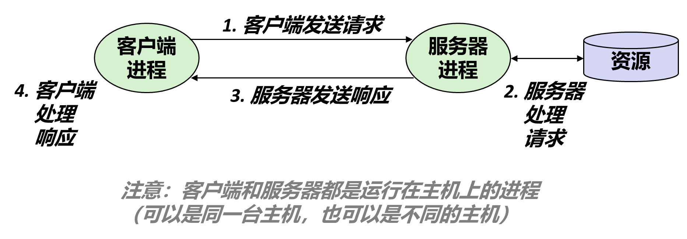

最要紧的一条限定：**客户端和服务器是进程，不是机器**。同一台主机上完全可以同时跑这两个进程（浏览器和本机 Web 服务器就是这样），判断角色看两件事——谁管理资源、谁先发起请求。

### 2.2 服务器常开，客户端随用随关

服务器不知道请求什么时候来（课堂上那句"你凌晨三点起来打游戏，服务器还开着"），所以它必须一直跑着；客户端则是启动、用一会儿、关掉。

这条差异带来两个后果：

- **服务器的寿命长于任何单个客户端**，所以它必须能同时应付多个客户端，否则第一个连上的人就把整个服务独占了。
- **请求一定由客户端先发起**。课堂的打饭类比：你不开口，阿姨不会主动给你打饭。这直接决定了后面 socket 调用的分工——客户端主动 `connect`，服务器只能被动 `accept`（§13.1）。

### 2.3 一对多，而且"分区"通常是逻辑的

一个服务器进程服务多个客户端，是**多对一**的关系。所谓"分区"多半是**逻辑分区**，物理上可能还是同一台机器上的一组服务进程。

技术上怎么做到一对多、每个客户端一个 fd，是第 11 章后半（并发服务器）的内容，这里只需要记住结论：**监听的那个 fd 和每条连接用的 fd 不是同一个**。

### 2.4 B/S 只是 C/S 的一层皮

**B/S（browser-server）** 指浏览器当客户端，底层仍然是 C/S——浏览器是个通用客户端，不专为某个服务而写，而是笼统地去取"资源"。它在 Web 里的具体形态（URL 指向资源、请求就是"把那个资源给我"）要等讲 HTTP 才看得清，现在只要知道 B/S 不是第四种模型。

---

## 3. P2P：角色被摊薄的那种网络

**P2P（peer-to-peer）** 没有固定的客户端与服务器分工：每个节点既向别人要数据，也向别人提供数据。课堂的说法是"人人为我，我为人人"。

严格说它不是"没有服务器"，而是**服务器的角色被摊薄了**：索引与发现仍可能由某个中心节点做，但**内容不经它转发**——文件切成片段，中心节点只存一张"谁有哪几片"的目录，传输全在用户之间。

对写程序的人，它的意义只有一条：**"客户端"和"服务器"是进程在这次交互里扮演的角色，不是机器的属性**。判断依据始终是谁请求、谁提供，与部署在哪台机器上无关（§2.1）。

---

## 4. 从硬件看网络：网卡也是一个 I/O 设备

课件 p3 那张主机结构图把网络放在了它该在的位置上：网络适配器（**网卡**）和磁盘控制器、图形适配器、USB 控制器一样，都挂在 I/O 总线上，由 I/O 桥接器连到内存和 CPU。

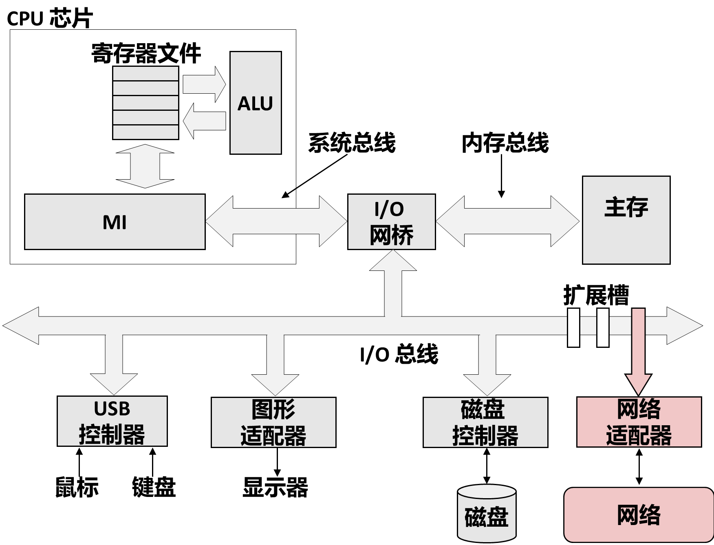

物理介质分三种：**双绞线**（RJ-45 水晶头，每对线绞在一起以抵消干扰）、**光纤**、**无线电**（WiFi 适配器）。

**光纤靠全反射走远路**。光在纤芯与包层的界面上不断全反射前进，损耗极小，几十公里才需要一次放大。电信号不行——它在铜线里随距离衰减，代表 1 的高电平掉到门限以下就变成了 0，所以每隔一公里就得加一个**中继器**把波形重新整形。海底光缆尤其看重这一点：海底的中继器要供电、要维护，能少一个就少一个。这也是当年"用电力线传网络信号"的方案没能落地的原因——每家每户都有电线，基础设施几乎不用改，但干扰与衰减两关都过不去。

**微波是另一类无线**，两个波对着照就能通信，但波长很短、衍射能力差，只能沿直线走，所以必须两端对视、中间不能有建筑阻挡。长波能绕过障碍传很远（早期广播就是这样），短波与微波则只能覆盖视距范围。

**带宽需求把光纤一路推到了机房里**。以前机房里服务器之间 1G 的电缆就够用，现在不够了：大模型是分布式部署的，一个模型要多个主机组成集群共同训练或推理，主机之间的通信量要 10G、100G 甚至更高，电缆撑不住。于是光纤从主干网一路往下走——光纤入户已经很普遍，「光纤入室」也在推。

结论只有一句，但它是后面所有内容的根据：**网络在操作系统眼里就是一块 I/O 设备**。往外发数据 = 往它写；从网上收数据 = 从它读。

---

## 5. 网络按覆盖范围分类

课件 p4 的定义值得照抄：网络是一个**按地理远近组织的、由盒子和连线构成的分层系统**。

### 5.1 SAN、LAN、WAN、PAN

| 缩写  | 全称                          | 覆盖范围           | 典型形态                        |
| --- | --------------------------- | -------------- | --------------------------- |
| SAN | System Area Network，系统区域网   | 一个机柜、一个机房、一个集群 | 集群内部互联（Quadrics、InfiniBand） |
| LAN | Local Area Network，局域网      | 一栋楼、一个园区       | 以太网、WiFi                    |
| WAN | Wide Area Network，广域网       | 一个国家、一个洲       | 运营商骨干、教育网主干                 |
| PAN | Personal Area Network，个人区域网 | 一个人身上          | 蓝牙耳机、手表、AI 眼镜               |

前三级是教材给的（课件 p4 的"分层系统"就是这三级），**PAN 是课堂补的**：手机、耳机、手表、眼镜用蓝牙或超宽带连成一个小网，人体本身就是一个 PAN 的边界。

界限是模糊的，别当成定量标准——课堂专门强调过它"没有完全定量的划分标准"，只是范围上的大致描述。

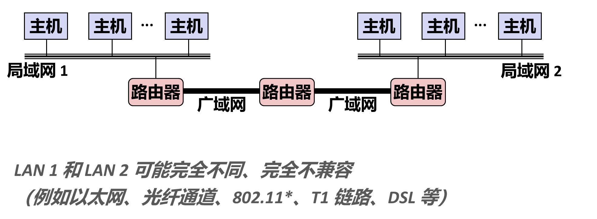

---

## 6. 网络是怎么一层层连起来的

### 6.1 局域网与以太网段

**局域网（LAN，Local Area Network）** 是覆盖一栋楼、一个园区的网络，它由若干**以太网段（Ethernet segment）** 拼成。一个以太网段就是"一组主机，通过一台集线器或交换机连在一起"，段内的主机可以直接互相发帧。

支撑以太网的是**适配器（网卡，NIC）**：它负责把主机内存里的数据变成线上的电信号，反过来也把收到的信号还原成数据。每个适配器出厂时带一个 **MAC 地址**（48 位，6 字节），局域网内用它来标识"哪块网卡"。

这里要分清两套地址，后面所有内容都靠这个区分：

| 地址 | 长度 | 谁在用 | 作用范围 |
|---|---|---|---|
| MAC 地址 | 48 位 | 网卡、交换机 | **同一个以太网段内** |
| IP 地址 | 32 位（IPv4） | 主机、路由器 | **整个互联网** |

MAC 地址是"这块硬件的名字"，IP 地址是"这台主机在网络拓扑里的位置"。跨网段通信时，MAC 地址会被逐段改写，IP 地址始终不变——这是理解路由的前提。

### 6.2 集线器：一个会广播的转发器

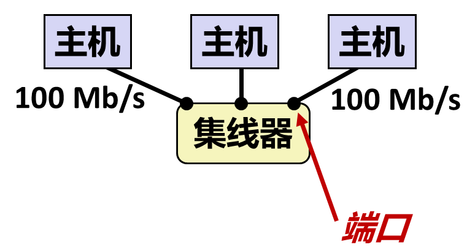

最原始的连接设备是**集线器（hub）**。它做的事简单到粗暴：从任何一个端口收到一位，就复制到**其他所有端口**。

后果是三条：

- 段内所有主机共享同一条通信信道，同一时刻只能有一台在发；
- 两台同时发就**冲突**，双方都得退避重发（CSMA/CD 就是这么来的）；
- 任何一台机器发出的数据，**同段所有机器都能收到**——这既是安全隐患（抓包即可窃听），也是"广播"这个机制的基础。

因为共享信道，集线器的规模上不去：主机一多，冲突概率飙升，有效带宽反而下降。这决定了它只能用在很小的范围。

### 6.3 网桥与交换机：按地址选择性转发

**网桥（bridge）** 换了个思路：不再无脑复制，而是看帧头里的 MAC 地址，只往"目标在那个方向"的端口转发。现代设备叫**交换机（switch）**，本质是带多个端口的网桥。

交换机还有一项能力叫**自学习**：它记录"哪个 MAC 地址出现在哪个端口上"，形成一张转发表。所以不需要人工配置，插上线跑一会儿表就建好了。

交换机把一个大冲突域切成若干个小的，每段内部仍然共享，段与段之间不再互相干扰。但它仍然工作在**同一个网络内**——转发表里只有 MAC 地址，它不知道"网络"这个概念。

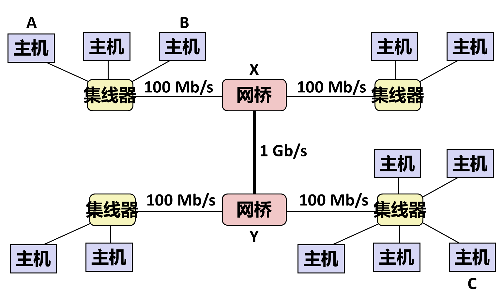

### 6.4 路由器与互联网络

要把**不同的网络**连起来，得用**路由器（router）**。它同时接在多个网络上，按 **IP 地址**决定往哪个口转发。

这里出现了本章最重要的一个词：**互联网络（internetwork，简称 internet）**——用路由器把多个不兼容的网络连成一个整体。小写的 internet 是通用概念，大写的 Internet 是其中最大的那个实例（[[#7. internet 与 Internet]]）。

路由器转发时做的事，比交换机多一层：

```
收到一个包 → 看目标 IP → 查路由表 → 决定下一跳 → 从对应端口发出
```

包在每一跳都会被重新封装成该段能传输的帧，**MAC 地址换成下一跳路由器的**，IP 地址原样不动。所以一路上变的是"信封上的收发件人（链路层）"，不变的是"信里写的最终地址（网络层）"。

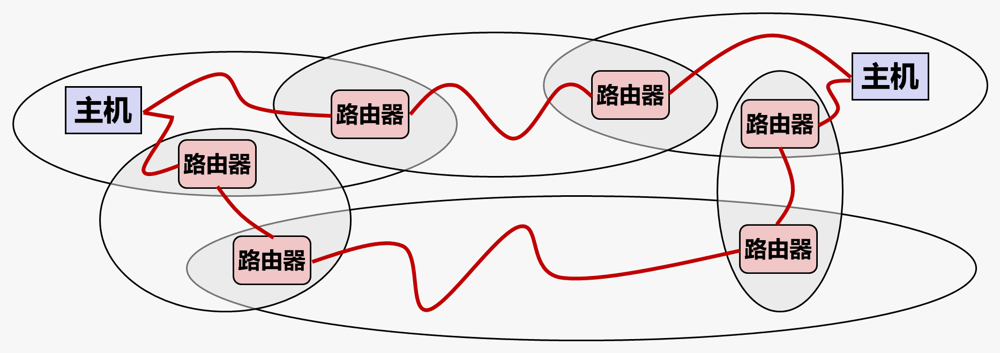

### 6.5 三种设备的分工

| 设备 | 依据什么转发 | 覆盖范围 | 一句话 |
|---|---|---|---|
| 集线器 | 不判断，全部广播 | 一个冲突域 | 物理层的中继器 |
| 交换机 / 网桥 | MAC 地址 | 一个局域网 | 把冲突域切小 |
| 路由器 | IP 地址 | 连接多个网络 | 把网络拼成互联网 |

这张表解释了为什么"网络是分层的"：每一层解决自己那一层的问题，上层的设备不需要知道下层怎么实现。

---

## 7. internet 与 Internet

这两个词只差一个大写字母，含义差得很远：

- **internet（小写）**：把多个网络用路由器连起来形成的**互联网络**，是描述性概念，`internetworking` 的缩写。你家里的内网、公司的专网，都是某个 internet。
- **Internet（大写）**：那个全球的、基于 TCP/IP 协议族的**因特网**，是专有名词。

关系一句话：**Internet 是现在最大的一个 internet，但不是唯一的一个。**

那个最大的是怎么组织起来的？**它是一棵按客户规模分层的商业树——谁连谁由合同决定，不由技术决定。**

| 层 | 全称 | 是什么 |
|---|---|---|
| IXP | Internet Exchange Point，交换点 | 多家骨干网在此互换流量，省得各自铺设跨境线路 |
| Backbone | 骨干网、主干网 | 国家级、洲际的高速链路，握在少数几家运营商手里 |
| POP | Point of Presence，入网点 | 某家网络在某座城市设的接入点，本地流量从这里上下骨干 |
| Regional net | 地区网 | 省级或城市级网络 |
| ISP | Internet Service Provider | 直接卖宽带给终端用户的运营商 |

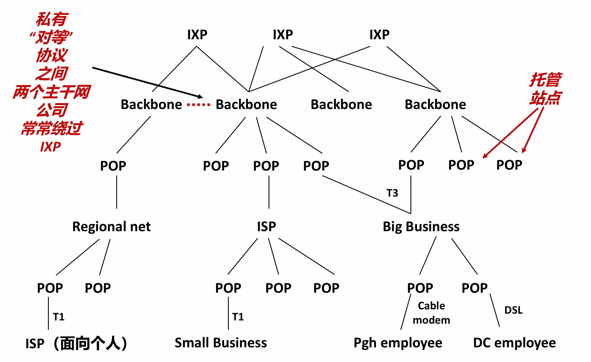

`POP` 在图上出现了两次（骨干网下面一层，地区网和 ISP 下面还有一层），这不是画重了：它指的是**角色**——"某家网络在某地的接入点"，不是某种特定设备。层次和带宽是对应的：底层面向个人的 ISP 用 `T1`（1.544 Mb/s），右侧的大企业用 `T3`（45 Mb/s）。这两个数字是北美的老专线标准，今天基本被光纤取代，但"越靠上越宽"的关系没变。

图里两处红字标的是**商业行为**，跟协议无关，但能解释不少实际体验：

- **骨干网之间绕过 IXP 私有直连**（中间那条红虚线）：两家大运营商之间流量太大时，会直接拉一根线互联，省掉 IXP 的端口费和中间一跳；
- **托管站点**（右侧箭头指向 POP）：大内容商（Google、Netflix、各类 CDN）把服务器直接搬进 ISP 的机房，用户的请求在本地 POP 就被响应完，根本不必上行到骨干网——这是"有些网站特别快"的原因之一。

所以这张图回答的是：**"网络是分层组织"这句话，落到钱和合同上就是这个样子。** 协议只规定包怎么走，谁愿意接谁的包是另一回事。

---

## 8. 协议与封装

### 8.1 协议至少要解决两件事

一堆由不同厂商制造、由不同机构管理的主机，凭什么能互相通信？靠**协议（protocol）**——一组双方都认的约定。教材给的定义很短，但要求不低：

- **命名机制（naming scheme）**：我怎么指定"要发给谁"。这就是 IP 地址；
- **投递机制（delivery mechanism）**：数据怎么从 A 走到 B。这就是路由与转发。

还要额外约定"出错怎么办""包丢了要不要重发""字节序谁在前"——这些都在后面的层里逐个出现。

### 8.2 数据包

协议不把整条消息一次性发出去，而是切成**数据包（packet）**，每个包通常一千多字节（以太网的 MTU 是 1500 字节）。

这样做的好处：一条长消息不必独占线路，多个会话的包可以交错传输；某个包丢了只重发那一个，不必重传整条消息。这和传统电话系统正好相反——电话是**面向连接**的，通话期间整条线路为你独占。

包的结构永远是"**头 + 负载**"：

```
┌────────────┬──────────────────────┐
│  header    │  payload（数据本身）   │
└────────────┴──────────────────────┘
```

头里放的是"这一层需要的信息"：目标地址、来源地址、长度、校验和、序号……

### 8.3 封装：一层套一层的信封

一个应用消息从发出到上线，要依次被加上好几层头，这叫**封装（encapsulation）**：

```
应用数据                    "GET /index.html HTTP/1.1"
  ↓ TCP 加头
TCP 段          [TCP头][应用数据]          端口、序号、校验和
  ↓ IP 加头
IP 数据报       [IP头][TCP头][应用数据]     源/目的 IP 地址
  ↓ 以太网加头
以太网帧  [帧头][IP头][TCP头][应用数据][帧尾] 源/目的 MAC
  ↓
物理线路上的比特流
```

接收端反过来一层层剥：网卡剥帧头 → 内核剥 IP 头 → 传输层剥 TCP 头 → 交付给应用。**每一层只关心自己的头，把剩下的当成不透明的载荷**——这就是分层最实际的收益：换掉链路层（换成 WiFi）不影响上面的 TCP/IP，因为中间那几层根本没看见过 WiFi 的帧长什么样。

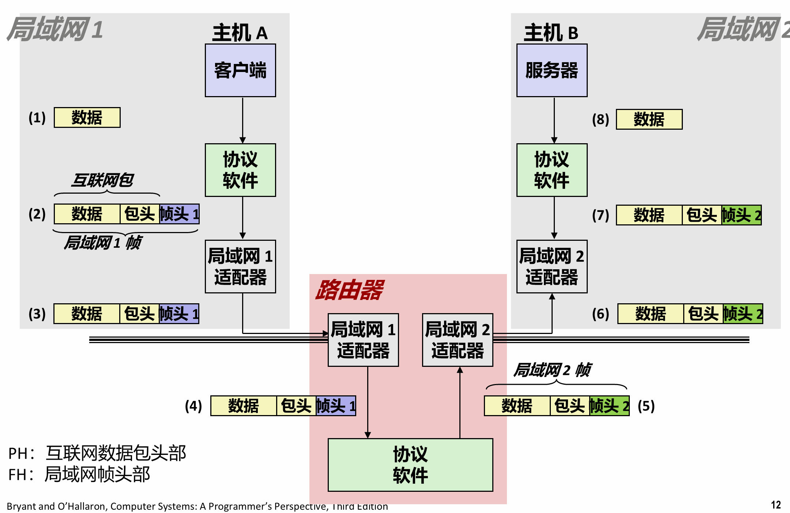

---

## 9. IP、UDP、TCP：保证的层级

### 9.1 IP：尽力而为

**IP（Internet Protocol）** 提供的是"主机到主机"的**不可靠数据报**投递。不可靠的含义在第 11 章第一篇之前的问答里已经展开过：不保证送达、不保证顺序、不保证不重复、不保证内容无误。链路上任何一处拥塞或干扰，路由器能做的只有一件事——**丢掉这个包**。

值得记的是这么设计的理由：如果每个中间设备都要保证可靠，它就得存数据、等确认、超时重传，成本和复杂度会摊到全网每一台路由器上。把这些推到**两端的主机**去做，中间的设备就可以做到极简、极快、极便宜。这就是常说的**端到端原则**——可靠性属于端点，不属于网络。

### 9.2 UDP：只加一层端口

**UDP（User Datagram Protocol）** 在 IP 上加的东西很少：主要是**端口号**，把"主机到主机"细化成"进程到进程"。它仍然不可靠。

它的用处是"宁可丢也不要等"：实时语音、视频、游戏状态同步。丢一帧画面没人察觉，等一次 200 ms 的重传反而毁了体验。

UDP 还支持 TCP 做不到的一件事：**广播与组播**。一个包发给网段内所有主机，或者发给加入某个组的一批主机。局域网里的时间服务器就用广播——它把当前时间喊一遍，网内主机据此对时；时间是很多功能的前提，而这件事不需要逐台确认，所以用 UDP 正合适。

### 9.3 TCP：把不可靠变成可靠

**TCP（Transmission Control Protocol）** 承载了今天绝大部分流量。它在 IP 之上补齐了可靠性：

| 问题 | TCP 的处理 |
|---|---|
| 丢包 | 序号 + 确认 + 超时重传 |
| 乱序 | 接收端按序号重组 |
| 重复 | 按序号去重 |
| 发送方压垮接收方 | 流量控制（滑动窗口） |
| 压垮网络 | 拥塞控制 |

对应用来说，它提供的是一条**可靠的字节流**：你写进去多少字节、什么顺序，对面就读到多少字节、什么顺序。中间怎么切包、怎么重传、怎么重排，应用完全看不见——**这就是"套接字看起来像文件"的由来**。

**课件 p25 给「连接」下了三条定义**，与教材 §11.3.3 一致：**点对点**（连接一对进程）、**全双工**（数据可以同时双向流动）、**可靠**（源发出的字节流最终按发送顺序到达）。前两条说的是"连的是谁"和"能不能同时说"，第三条才是 TCP 在上面补出来的东西。

**按方向划分，通信有三种模式**，TCP 属于其中的全双工：

| 模式 | 能力 | 典型例子 |
|---|---|---|
| 单工 | 只能单向发送 | 广播电台：电台发，听众只能收 |
| 半双工 | 两个方向都能传，但不能同时 | 对讲机 |
| 全双工 | 两个方向同时收发 | 电话、TCP 连接 |

对讲机是半双工的标准样本：按下说话键就占住了信道，对方只能听；说完放开，对方才能说。所以通话结尾习惯加一句 `over`——它的作用不是礼貌，而是宣告"我说完了，信道交给你"。不说的话，对方会以为你只是停顿，两边一起沉默。

TCP 是全双工的，所以一条连接上可以一边发请求一边收响应，这也是后面"服务器和客户端各自 read/write"能同时成立的前提。

---

## 10. IPv4 地址与字节序

### 10.1 点分十进制

IPv4 地址是 **32 位无符号整数**，习惯写成**点分十进制（dotted-decimal）**：四个 0–255 的十进制数，用点隔开。每个数正好是一个字节。

```
128.2.194.242   →   0x8002C2F2
 ↑   ↑   ↑   ↑
 最高字节              最低字节
```

0–255 这个范围不是随便定的，是因为每段就是一个字节。CMU 拥有 `128.2.0.0/16` 这一段，所以校园里的地址都以 `128.2` 开头。

**字符串与二进制之间怎么换**（教材 §11.3.1）：点分十进制是给人看的，程序里存的是网络字节序的 32 位整数，用一对函数互换：

```c
#include <arpa/inet.h>
int inet_pton(AF_INET, const char *src, void *dst);
const char *inet_ntop(AF_INET, const void *src, char *dst, socklen_t size);
```

名字里 `n` 是 network、`p` 是 presentation（表示形式）。`inet_pton` 返回 1 表示转换成功、0 表示 `src` 不是合法的点分十进制串、-1 表示出错并设 `errno`。把第一个参数换成 `AF_INET6` 就能处理 128 位地址——这也是它们取代老接口 `inet_aton` 的原因。

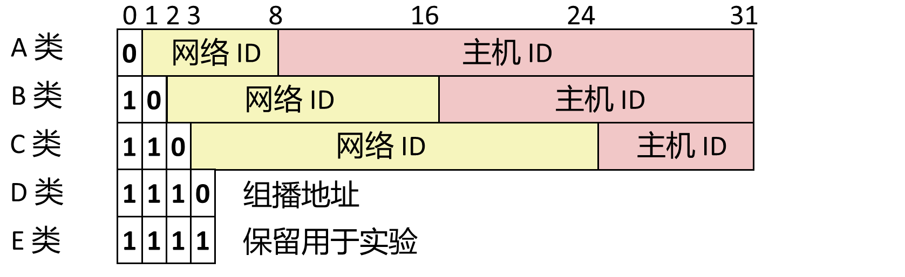

### 10.2 地址分类与子网（历史划分）

图上那些"类别"，是按**网络号 / 主机号**的切分方式分档的：看最高几位是几，就知道前多少位是网络号、后多少位是主机号。

| 类别  | 最高位    | 网络号位数     | 主机号位数 | 网络个数           | 每网主机数            |
| --- | ------ | --------- | ----- | -------------- | ---------------- |
| A   | `0`    | 8（可用 7）   | 24    | $2^7-2=126$    | $2^{24}-2$       |
| B   | `10`   | 16（可用 14） | 16    | $2^{14}=16384$ | $2^{16}-2=65534$ |
| C   | `110`  | 24（可用 21） | 8     | $2^{21}$       | $2^8-2=254$      |
| D   | `1110` | —         | —     | 组播地址           | —                |
| E   | `1111` | —         | —     | 保留未用           | —                |

**每类都要减 2**：主机号**全 0** 表示这个网络本身，**全 1** 是广播地址，两者都不能分配给具体主机。所以一个 C 类网最多放 254 台机器，而不是 256 台；A 类之所以是 126 个网，也是减掉了全 0 和 `127` 回环那一段。

**算容量时先数总共要多少地址**。比如想划 256 个子网、每个子网还要能放 256 台主机，一共需要 $2^8 \times 2^8 = 2^{16}$ 个地址，正好是 B 类主机号 16 位能提供的量；C 类总共才 256 个地址，怎么切都不够。反过来，只是要一个 56–256 台主机的普通局域网，C 类的 254 就够用。

**这是历史叫法，今天用 CIDR**。教材 §11.3.1 只讲了"IP 地址是 32 位无符号整数"与点分十进制，**并没有展开分类**——A/B/C 这一套是按课件 p47 和课堂补的。实际分配地址早已改用 **CIDR** 记法 `a.b.c.d/x`，`/x` 直接给网络号位数，前缀长度可以任意，不再受固定分档限制：`192.168.1.0/24` 相当于一个 C 类网，但 `/26`、`/30` 只有 CIDR 能表达。两种口径的共同点只有"网络号 + 主机号"这个划分；做题时看清题面给的是哪一套。

### 10.3 网络字节序：为什么必须是大端

同一个 32 位整数，不同机器往内存里放的方式可能相反：

- **小端（little-endian）**：低字节放低地址。x86 是这样；
- **大端（big-endian）**：高字节放低地址。

如果发送方按小端发、接收方按大端读，`0x8002C2F2` 会被读成 `0xF2C20280`，地址完全错。所以协议规定了统一的**网络字节序（network byte order）**，取的是**大端**。

不管你的机器是什么序，进出网络时都要转换。为此有一组固定函数：

| 函数 | 方向 | 作用 |
|---|---|---|
| `htons` | 主机 → 网络 | 16 位（端口） |
| `htonl` | 主机 → 网络 | 32 位（IPv4 地址） |
| `ntohs` | 网络 → 主机 | 16 位 |
| `ntohl` | 网络 → 主机 | 32 位 |

命名规则是 `h`=host、`n`=network、`s`=short(16)、`l`=long(32)。在小端机器上它们真的会做字节交换，在大端机器上则是空操作——**调用方不需要知道自己是哪种**，这正是这套函数存在的意义。

顺带一个事实：这套接口里**没有 64 位的版本**。要传 64 位整数得自己写或者绕开。

### 10.4 IPv6 与私有地址

32 位地址只有约 43 亿个，而今天手机、电脑、手表、家电都要地址。**IPv6** 把地址扩到 **128 位**，写法是八组十六进制数（`2001:0db8:85a3::8a2e:0370:7334`）。

IPv6 被称作"未来的技术"已经二十多年了，迟迟没有全面铺开，原因是过渡成本太高、而 IPv4 又被各种补丁（NAT、地址复用）硬撑了下来。写代码时要注意：**地址长度不再固定是 4 字节**，所以不能再用 `sizeof(struct sockaddr_in)` 这种写死的写法——这也是后面 `getaddrinfo` 存在的重要原因。

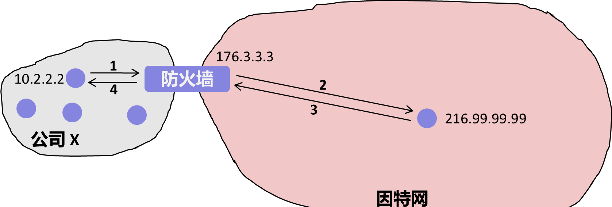

**43 亿个地址为什么到今天还够用**：因为并不是每台主机都需要一个**公网 IP**。内网用私有地址，出去时由网关做 NAT 换成公网地址。你家的 `192.168.1.3` 和别人家的 `192.168.1.3` 完全不冲突，就像不同目录下的两个同名文件。保留给内网与特殊用途的段：

| 地址段 | 用途 |
|---|---|
| `10.0.0.0/8` | 大型内网 |
| `172.16.0.0/12` | 中型内网 |
| `192.168.0.0/16` | 家用、小型局域网 |
| `127.0.0.0/8` | 回环，`127.0.0.1` 指本机 |

**地址怎么来**：动态分配（DHCP）由网络自动挑一个空闲地址给你，家用和校园网都走这条；静态指定则手工配置，前提是确认这个地址没被别人占——谁先占用就是谁的，后者配上去会失效。服务器、打印机这类需要固定位置的设备才用静态。

**防火墙只做两件事**：白名单放行列表里的 IP 与端口，黑名单拦掉列表里的 IP 与端口。公司里能打开内网页面却打不开淘宝，就是把那些地址与端口放进了黑名单。有些机构把 ICMP 关掉，于是你 ping 不通它，误以为它不在线。

---

## 11. 域名与 DNS

### 11.1 层次命名

IP 地址难记，所以有了**域名（domain name）**：一串用点分隔的单词，比如 `www.cs.cmu.edu`。它是一套**层次命名系统**，从右往左逐级变具体：

```
        .（根）
        ├── edu        教育机构
        │   └── cmu    卡内基梅隆
        │       └── cs 计算机学院
        │           └── www   Web 服务器
        ├── com        商业机构
        ├── net        网络机构
        └── cn / de / jp …   国家与地区后缀
```

最右边那一级叫**一级域名（top-level domain）**。`.edu`、`.com`、`.net` 是通用后缀，`.cn`、`.de`、`.jp` 是国家与地区后缀。

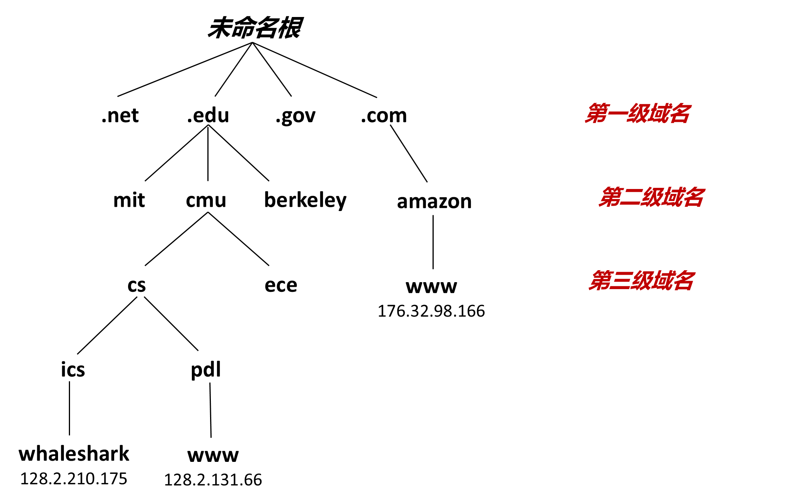

**子域（subdomain）**是教材 §11.3.2 的定义：域名树里某个节点往下的**整棵子树**。它是相对的称呼——`cmu.edu` 是 `edu` 的子域，`cs.cmu.edu` 又是 `cmu.edu` 的子域。组织一旦拿到二级域名，就能在自己这个子域里随意创建新名字（`www`、`mail`、`a.b.c`），不必再向上面申请；所以子域真正的意义是**命名空间的所有权边界**。

### 11.2 多对多映射

域名和 IP 不是一对一，而是**多对多**：

- 一个域名可以对应**多个 IP**（`twitter.com` 解析出四个地址）；
- 多个域名可以指向**同一个 IP**；
- 还有些域名在层级里存在，但**不指向任何主机**：`edu`、`cmu.edu`、`cs.cmu.edu` 这类中间节点只负责划分命名空间、用 **NS 记录**把查询委托给下一级，本身可以没有 A 记录；真正带 IP 的是末端的**主机名**（如 `www.cs.cmu.edu`）。反过来，裸域 `example.com` 也完全可以配 A 记录——"不指向主机"是可能，不是必须。

把域名翻成 IP 的系统叫 **DNS（Domain Name System）**：一个巨大的、分布式的数据库。唯一集中的部分只在最顶层——每个一级域名有一组权威服务器管着自己的那一段，`cmu.edu` 及以下由 CMU 自己维护。所以查 `www.cs.cmu.edu` 时，请求会一层层被转交到 CMU 自己的 DNS 服务器。

**缓存决定"第一次慢、之后快"**。刚注册的域名在下层服务器里可能还没有记录：本地查不到就往所属区域的服务器查，再往一级域名服务器查——注册一定是在上层完成的，所以往上最终一定能找到。查到之后，这条"域名 → IP"的映射会**缓存**在沿途各层，下次直接命中。

**连长期服务一律用域名，不要写死 IP**：服务器换机房、换运营商，IP 段就变了，域名却可以不变，改一下映射即可。反过来，本机也有一张优先于 DNS 的映射表 `hosts`；把某个域名改成指向 `127.0.0.1`，程序就再也连不上它的验证服务器——不少软件破解走的就是这条路。

### 11.3 DNS 被当成负载均衡器用

既然一个域名能对应多个 IP，服务方就能拿它做文章：

- **多机分流**：一次解析返回四个地址，客户端通常按顺序试第一个（失败了再试下一个），压力自然摊到多台机器；
- **就近接入**：DNS 根据请求来源的地理位置返回不同的地址，把你引到最近的机房；
- **故障切换**：某台机器挂了，把它从解析结果里摘掉即可。

所以"访问 google.com"从来不是连到某台固定的机器，而是连到"DNS 此刻认为离你最近的那一台"。大型服务对 DNS 的更新是持续进行的。

### 11.4 nslookup 与 dig

查域名与 IP 的对应关系，用 `nslookup` 或 `dig`：

```
linux> nslookup www.cs.cmu.edu
Name:    WEB-LB.SRV.cmu.edu
Address: 128.2.194.242
```

输出里还能看出两件事：真正的规范名（canonical name）往往不是你以为的那个（`WEB-LB.SRV.cmu.edu` 里的 LB 就是 load balancer）；一个名字背后可能是别名套别名。

`localhost` 是个特例，永远指"本机"，地址固定为 **127.0.0.1**。开发时把客户端和服务器都跑在自己机器上、连 `localhost`，是最省事的调试方式。

---

## 12. 端口：一台机器上的多个服务

### 12.1 端口是 16 位整数

一台主机只有一个 IP 地址，但它同时可以跑 SSH、Web 服务器、邮件服务器。区分这些服务的，是**端口号（port）**：一个 16 位无符号整数，范围 0–65535。

于是"一个套接字"的完整标识是 **IP 地址 + 端口号**。IP 定位到机器，端口定位到机器上的哪个进程。

### 12.2 知名端口与临时端口

端口分两段用：

| 类型 | 范围 | 谁分配 | 例子 |
|---|---|---|---|
| 知名端口（well-known） | 0–1023 | IANA 统一分配，需特权 | 80 HTTP、443 HTTPS、22 SSH、25 SMTP、21 FTP |
| 临时端口（ephemeral） | 通常 32768–60999 | 内核在连接时动态分配 | 客户端每次连接用的那个 |

客户端不需要固定端口——它连出去时内核随手给一个，连接关了端口就收回。服务器必须用知名端口，否则客户端不知道往哪连。

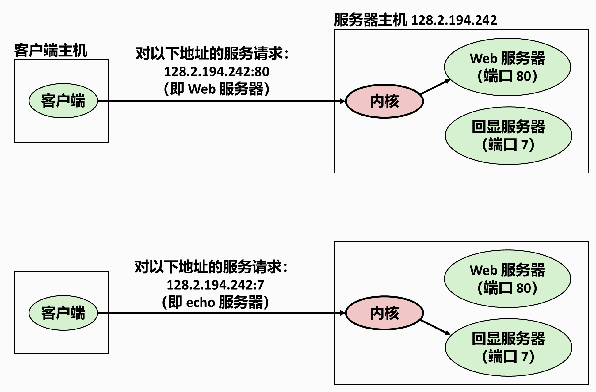

服务名与端口的这张对应表就放在 **`/etc/services`** 里，可以直接查。同一个端口号会同时出现在 TCP 与 UDP 两栏——说明两种传输层协议各自独立编号，互不占用。历史上还有 `telnet`（23）这类明文远程登录，现在基本被 SSH（22）取代。

（临时端口的范围可以在 `/proc/sys/net/ipv4/ip_local_port_range` 里看到，不同系统不一样。）

### 12.3 四元组才是一条连接

一条 TCP 连接由**四个值**唯一确定：

```
（客户端 IP，客户端端口，服务器 IP，服务器端口）
```

所以一台服务器在 80 端口上可以同时服务成千上万个客户端——它们的客户端 IP 或端口各不相同，四元组互不冲突。反过来，同一个客户端连着同一个服务器的两个服务（比如同时开两个网页），端口不同，也是两条独立连接。

内核正是靠这个四元组，把到达的包分派给正确的进程。

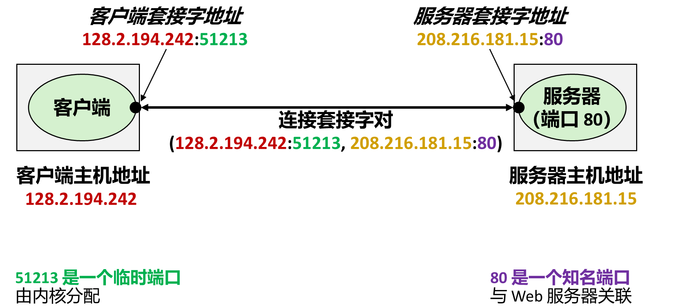

---

## 13. 套接字接口

IP、UDP、TCP 这套协议栈跑在**内核**里，应用程序碰不到。应用程序与内核之间只隔着一层接口——**套接字接口**，它由一组系统调用组成：用户代码调 `socket`、`connect`，内核替它建连接、发字节；数据到达时网卡发中断，内核收进来放进缓冲区，等用户代码 `read`。

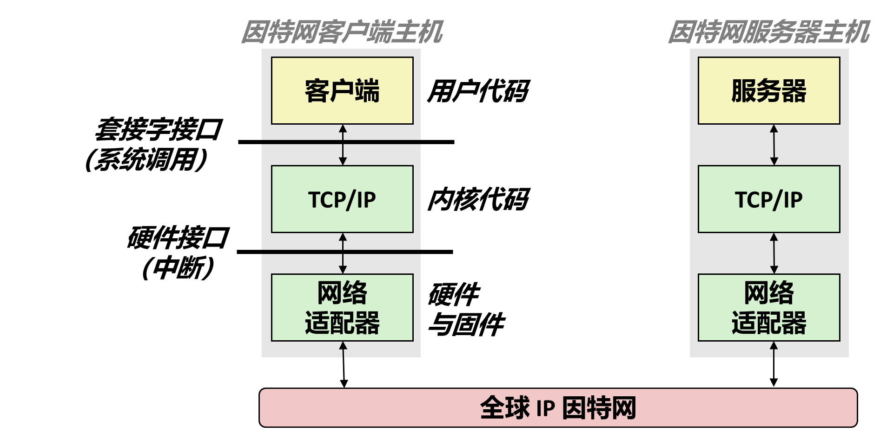

### 13.1 五个调用：先看一张总表

| 谁调用 | 函数          | 作用                           |
| --- | ----------- | ---------------------------- |
| 双方  | `socket()`  | 创建一个通信端点，返回一个 fd（套接字描述符）     |
| 客户端 | `connect()` | 主动连向服务器的地址                   |
| 服务器 | `bind()`    | 把这个 fd 绑定到某个 IP + 端口         |
| 服务器 | `listen()`  | 声明"我开始等连接了"，fd 变成被动套接字       |
| 服务器 | `accept()`  | 从已完成连接的队列里取出一个，返回**一个新的** fd |

连上之后，两边各有一个 fd，接下来的 `read` / `write` / `close` 与普通文件完全一样——这就是上一章那句"网络应用更应该用 Unix I/O"的落点。

注意 `accept` 返回的是**新 fd**：监听用的那个 fd 继续听，新 fd 专供这一条连接。它和 `dup` 不是一回事：`dup` 让两个描述符指向**同一个**打开文件表项，`accept` 造的是一个**新表项**（详见 [[01_系统级IO_UnixIO#13.5 归纳：四种情况一张表|第十章 §13.5]]）。先记住顺序：**socket → 客户端 connect / 服务器 bind+listen+accept**，§13.3 起逐个展开。

### 13.2 sockaddr：一套通用的地址结构

问题来了：IPv4 地址是 4 字节，IPv6 是 16 字节，还有别的协议族。如果每个函数都为每种地址写一个版本，接口会爆炸。解决办法是用一个**通用结构**：

```c
struct sockaddr {          /* 16 字节的"通用地址" */
    uint16_t sa_family;    /* 地址族：AF_INET / AF_INET6 … */
    char     sa_data[14];  /* 具体地址，按族解释 */
};
```

前 2 个字节说明"这是哪种地址"，剩下的按族解释。实际使用时填的是具体版本：

```c
struct sockaddr_in {              /* IPv4 专用 */
    uint16_t       sin_family;    /* AF_INET */
    uint16_t       sin_port;      /* 端口，必须是网络字节序 */
    struct in_addr sin_addr;      /* 32 位 IP 地址，网络字节序 */
    unsigned char  sin_zero[8];   /* 填充到 16 字节，不用 */
};
```

教材 §11.3.1 给 `struct in_addr` 下过一句评价：把一个标量地址塞进结构体，是套接字接口早期实现的**不幸产物**，定义成标量类型本来更合理，但大量应用已经依赖它，改不动了。它里面只有一个成员 `uint32_t s_addr`，所以填地址时要写 `sin_addr.s_addr`。

`sin_zero` 那 8 个字节纯粹是为了让 `sockaddr_in` 和 `sockaddr` 一样长（16 字节），这样函数接收 `struct sockaddr *` 时，传 `sockaddr_in` 的指针也能用。C 里没有继承，这是模拟"子类"的经典手法——**结构体前几个字段布局一致，就可以互相强转指针**。

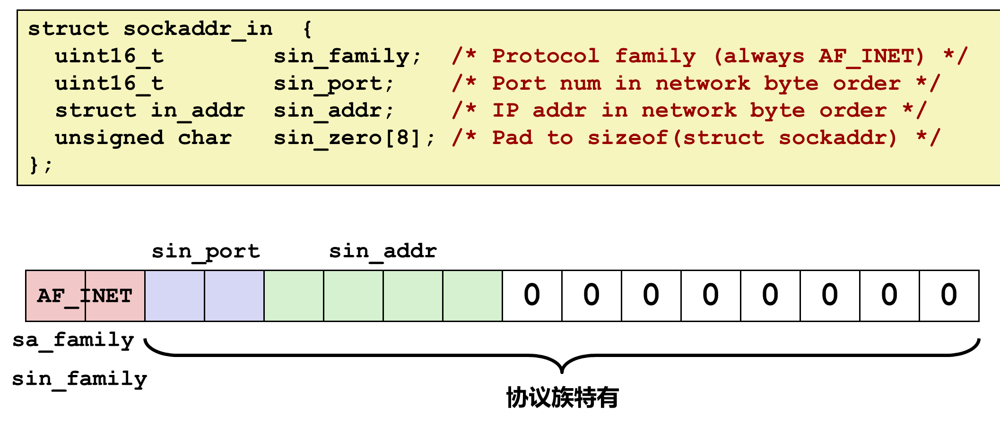

### 13.3 每个调用各自做什么

§13.1 给过一张总表，§13.5 会把五个调用按时间串成一条完整事务。这一节补中间那一层：**每个调用的签名、参数，以及它把内核里的状态改成了什么**。顺序按"两边都要做 → 服务器专属 → 客户端专属"排，先讲双方共用的那个 `socket()`。

```c
int socket(int domain, int type, int protocol);
```

客户端和服务器都要先调它，拿到的 fd 后面每个操作都要用：

```c
int fd = socket(AF_INET, SOCK_STREAM, 0);
```

三个参数分别回答"用哪个地址族""要什么传输语义""族里具体哪个协议"：

| 参数 | 常用取值 | 含义 |
|---|---|---|
| `domain` | `AF_INET` / `AF_INET6` | IPv4 / IPv6 地址族 |
| `type` | `SOCK_STREAM` / `SOCK_DGRAM` | 字节流（TCP） / 数据报（UDP） |
| `protocol` | 0 | 让内核按前两个参数选默认协议；同族里有多个协议可选时才需要明确写 |

**这一步进内核，但不发包**。`socket()` 是系统调用，内核会分配一个端点对象、挂上对应协议族的操作函数表、在描述符表里占一格，再把 fd 返回给进程。所以端点这个对象**在内核里**，进程手上只有一个整数。它没做的事同样重要：此时一个字节都没发出去，本地端口还没绑定，对端是谁也不知道，三次握手更没开始（那要等 `connect()` 与 `accept()`，见 §13.5）。这正是它和 `open()` 的区别——打开文件是"打开即可用"，打开套接字只是"领到一个还没接线的插座"（§13.6 会展开）。

```c
int bind(int sockfd, const struct sockaddr *addr, socklen_t addrlen);
```

把 fd 绑定到"本机的某个 IP + 某个端口"。服务器必须做，客户端一般不做（内核会替它选临时端口）。

```c
int listen(int sockfd, int backlog);
```

把主动套接字转成**监听套接字**：告诉内核"这个 fd 用来等别人连进来"，`backlog` 是排队上限。`bind` 和 `listen` 的顺序不能颠倒。

```c
int accept(int listenfd, struct sockaddr *addr, socklen_t *addrlen);
```

**阻塞**等待一个连接到来；来了就返回一个**新的 fd**（连接描述符），后续所有读写都用这个新 fd。同时把对端的地址填进 `addr`。

```c
int connect(int sockfd, const struct sockaddr *addr, socklen_t addrlen);
```

客户端用：向指定地址发起连接，成功后 `sockfd` 就代表这条连接。它也是**阻塞**的，三次握手就发生在这一步与服务器的 `accept()` 之间（§13.5）。客户端一般不 `bind`——内核在连接时自动给它分配一个临时端口。

### 13.4 监听 fd 与连接 fd 为什么要分开

这是初学最容易糊涂的一处。服务器上有两种 fd，职责完全不同：

| | 监听 fd（listenfd） | 连接 fd（connfd） |
|---|---|---|
| 来源 | `socket()` 创建，`bind`+`listen` 后待命 | `accept()` 返回 |
| 数量 | 一个服务一个 | **每个客户端一个** |
| 用途 | 只用来 `accept` | 只用来 `read`/`write` |
| 关闭 | 服务停止时关 | 这个客户端断开时关 |

分开的原因就一句话：**服务器要同时服务多个客户端**。如果 `accept` 复用监听 fd，那这条连接一占用，就再也接不了新连接了。分成两个之后，监听 fd 永远空着等下一个，每条连接各占一个 connfd，彼此不干扰——这也是后面并发服务器（多进程/多线程/IO 多路复用）能成立的结构基础。

`accept` 造的是**新的打开文件表项**，不是 `dup` 那种"两个描述符指向同一个表项"。这一点在推描述符题时要分清（[[01_系统级IO_UnixIO#13.5 归纳：四种情况一张表|第十章 §13.5]]）。

### 13.5 一次完整的事务

把上面的调用串起来，就是一次标准事务：

```
服务器                                    客户端
─────────────────────────────────────────────────────────
socket()    → listenfd
bind()      绑定 IP:端口
listen()    转为监听
accept()    ← 阻塞等待 ────────────────  socket()   → fd
            ←──────────────────────────  connect()
            返回 connfd
read(connfd) ←────── "GET / HTTP/1.1" ────  write(fd, …)
write(connfd) ────── "HTTP/1.1 200 …" ───→  read(fd, …)
close(connfd) ←────── 客户端关闭 ────────  close(fd)
accept()    再次阻塞，等下一位
```

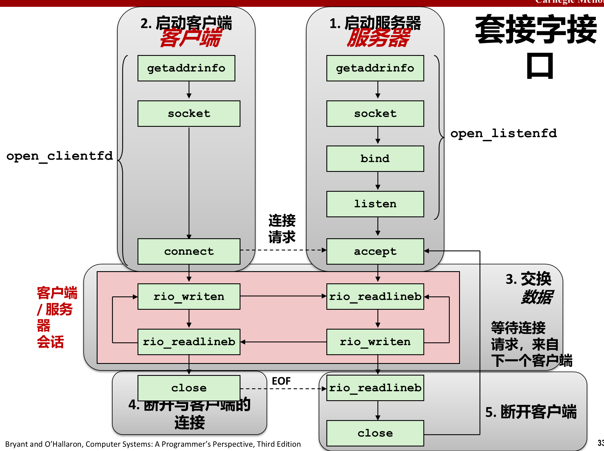

**`connect()` 与 `accept()` 之间发生的是三次握手**：客户端发 SYN「我要连你」→ 服务器回 SYN+ACK「好，我同意」→ 客户端再回 ACK「收到，确认」。

为什么要三次而不是两次？因为**每个包都可能丢**。客户端的 SYN 丢了，超时重发；服务器回的 SYN+ACK 丢了，客户端会认为对方不可达；最后那个 ACK 丢了，服务器就无法确认客户端是否收到了自己的同意——它不知道丢没丢，只能等一个确认。所以必须有一次「对确认的确认」，双方才能都确定对方在线、且收到了自己发的那一步。三次是达成这个共识的最小次数。UDP 不做这一步：它不管包到不到，直接发；TCP 要保证可靠，就得先建一条双方都确认过的通道。

顺带一个容易忽略的性质：`connect()` 连不上会一直等，`accept()` 没有客户端来也一直等，**两者都是阻塞调用**。

几个值得注意的细节：

- 客户端一 `close`，服务器端 `read` 就会返回 **0**（EOF），这就是它判断"对方走了"的方式——和第十章文件读到底的处理完全一样；
- 服务器处理完一个客户端后回到 `accept`，这种一次只服务一个连接的模型叫**迭代服务器（iterative server）**；要真正并发，得 `fork` 子进程或开线程，那是第 12 章的内容；
- 两边都是普通 fd，所有 I/O 用 `read`/`write`，来自上一章的 `rio_readn`/`rio_writen` 在这里正好派上用场（网络会短计数）。

---

### 13.6 为什么不能复用 open

按"打开文件"的思路硬套，会发现四处对不上：

| 维度 | 打开文件 | 打开连接 |
|---|---|---|
| 定位对象 | 路径名 | IP 地址 + 端口（或域名） |
| 打开后状态 | 立刻可用 | 还没连上，要 `connect` 或 `accept` 才算通 |
| 传输语义 | 只有一种 | TCP / UDP / 原始套接字，必须先选 |
| 方向 | 读权限、写权限 | 双向字节流（全双工） |

历史原因也简单：Unix 的 `open` 语义在 1970 年代就定型了，TCP/IP 普及要到 1980 年代，BSD 套接字接口（1983）是后来加的，改不动 `open`，只能另造一套名字。但它的形状是**故意模仿文件**的——同样返回一个非负整数，同样用 `read` / `write` / `close`，这样网络就能直接复用已有的 I/O 机制。

一句话：**网络编程 = 换一种打开方式 + 原来的读写。**

---

## 14. getaddrinfo：不要手填地址

### 14.1 老接口的问题

早期写网络程序，得自己调 `gethostbyname` 把域名翻成 IP，再手工填 `sockaddr_in`。这套老接口有三个硬伤：

1. **只支持 IPv4**，写死在结构里；
2. **不可重入**：返回值指向一个静态缓冲区，多线程同时调用会互相覆盖；
3. 域名 → IP 与 IP → 域名的函数是两套，参数风格还不一致。

`getaddrinfo` 就是来替它们的：一套接口同时处理 IPv4/IPv6、返回值由调用方释放（线程安全）、并且直接把"该传给 `socket`/`connect`/`bind` 的参数"都准备好。

### 14.2 addrinfo 是一条链表

```c
int getaddrinfo(const char *host, const char *service,
                const struct addrinfo *hints, struct addrinfo **result);
```

- `host`：域名或点分十进制地址；也可以是 `NULL`（此时不想做域名转换）；
- `service`：端口号或服务名（`"http"` 等价于 80）；也可以是 `NULL`；
- `hints`：告诉它你想要什么（`ai_family` 选 IPv4/IPv6，`ai_socktype` 选 TCP/UDP）；
- `result`：返回一条**链表**，因为一个名字可能对应多个地址。

`host` 和 `service` 里至少要指定一个，否则没有可查的东西。返回值是 `getaddrinfo` 自己的错误码（不是 `errno`），非 0 时用 `gai_strerror(code)` 翻译成文字。

**四个参数的方向不一样**：`host`、`service`、`hints` 是输入，`result` 是输出。

`hints` 只能设置四个字段——`ai_family`、`ai_socktype`、`ai_protocol`、`ai_flags`，其余字段必须置为 `NULL`。实际写法是先把整个结构清零，再有选择地设其中几个：

```c
struct addrinfo hints;
memset(&hints, 0, sizeof(struct addrinfo));
hints.ai_family   = AF_INET;        /* 只要 IPv4 */
hints.ai_socktype = SOCK_STREAM;    /* 只要连接 */
```

清零这一步不是可有可无的：`ai_family` 被清成 0 也就是 `AF_UNSPEC`，意思是"IPv4 和 IPv6 都返回"，这正是默认行为。

**`ai_flags` 是位掩码**，教材列出四个有用的值：

| 标志 | 作用 |
|---|---|
| `AI_ADDRCONFIG` | 只返回本机确实配置了的地址族；用在连接上 |
| `AI_CANONNAME` | 把列表中第一个 `addrinfo` 的 `ai_canonname` 指向 `host` 的权威名字 |
| `AI_NUMERICSERV` | 强制 `service` 是端口号，不接受服务名 |
| `AI_PASSIVE` | 返回的地址用于服务器监听，此时 `host` 应为 `NULL`，地址字段是通配符地址 |

其中 `AI_ADDRCONFIG` 和 `AI_NUMERICSERV` 是 `open_clientfd` 用的，`AI_PASSIVE` 和 `AI_NUMERICSERV` 是 `open_listenfd` 用的。

**`result` 是二级指针，因为它要回填一个指针。** C 按值传参，函数只能修改"传进来的那块内存"；要修改调用方的 `listp` 变量本身，就必须拿到它的地址，于是参数类型是 `struct addrinfo **`，调用方传 `&listp`。函数内部做的是 `*result = listp_head`，也就是把链表头的地址写进去。

链表节点长这样：

```c
struct addrinfo {
    int              ai_flags;
    int              ai_family;     /* AF_INET / AF_INET6 */
    int              ai_socktype;   /* SOCK_STREAM / SOCK_DGRAM */
    int              ai_protocol;
    size_t           ai_addrlen;    /* 地址长度，传给 socket 系列函数 */
    struct sockaddr *ai_addr;       /* 关键：已经填好的地址结构 */
    char            *ai_canonname;  /* 规范名 */
    struct addrinfo *ai_next;       /* 下一条 */
};
```

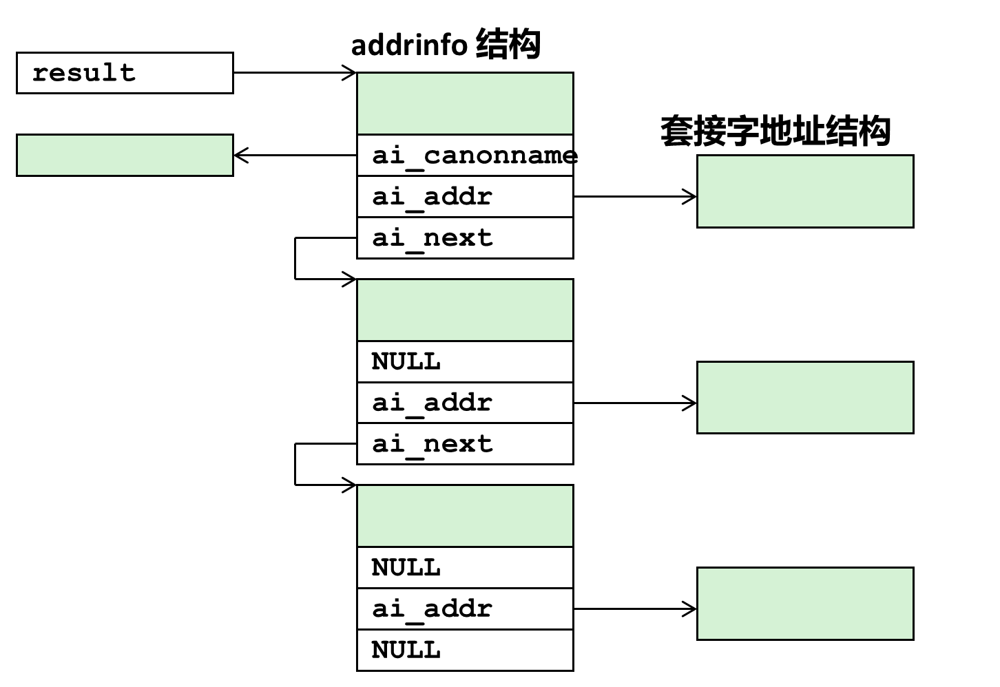

`getaddrinfo` 建立输出列表时会填好每个字段（`ai_flags` 除外）：`ai_addr` 指向一个套接字地址结构，`ai_addrlen` 给出这个结构的大小，`ai_next` 指向下一个节点。

这里有一个很有用的性质：**这些字段是不透明的，应用程序不需要再做任何处理**。`ai_family`、`ai_socktype`、`ai_protocol` 可以直接传给 `socket`，`ai_addr` 和 `ai_addrlen` 可以直接传给 `connect` 和 `bind`。所以写出来的代码与具体版本的 IP 协议无关。

标准用法是**遍历链表、逐个尝试**：

```c
for (p = result; p; p = p->ai_next) {
    sockfd = socket(p->ai_family, p->ai_socktype, p->ai_protocol);
    if (sockfd < 0) continue;
    if (connect(sockfd, p->ai_addr, p->ai_addrlen) == 0) break;  /* 成功 */
    close(sockfd);
}
freeaddrinfo(result);   /* 必须释放，否则内存泄漏 */
```

客户端是遍历到 `socket` 和 `connect` 都成功为止，服务器则是遍历到 `socket` 和 `bind` 都成功为止。三步要点：**用 `ai_addr` 而不是自己拼地址**；**失败就换下一条**（多 IP 主机的意义就在这）；**用完 `freeaddrinfo`**——链表是 `getaddrinfo` 分配的，不释放就是内存泄漏。

### 14.3 反查：getnameinfo

反过来，手里有 `sockaddr` 想得到域名，用：

```c
int getnameinfo(const struct sockaddr *sa, socklen_t salen,
                char *host, size_t hostlen,
                char *serv, size_t servlen, int flags);
```

因为它也要兼容两种地址族，参数同样是"通用结构 + 长度"的形式。写一个简化版 `nslookup` 就用它。

---

## 15. 两个辅助函数：open_clientfd 与 open_listenfd

§14 那套 `getaddrinfo` 加遍历链表的手写起来很啰嗦，教材 §11.4.8 把客户端和服务器各自封装成了一个函数。客户端这个叫 **`open_clientfd`**——**建立与服务器的连接，返回一个已经连好的套接字描述符**，可以直接拿它做 `read`/`write`：

```c
int open_clientfd(char *hostname, char *port);
```

出错返回 -1。它是**可重入且与协议无关**的。

```c
int open_clientfd(char *hostname, char *port)
{
    int clientfd;
    struct addrinfo hints, *listp, *p;

    /* Get a list of potential server addresses */
    memset(&hints, 0, sizeof(struct addrinfo));
    hints.ai_socktype = SOCK_STREAM;      /* Open a connection */
    hints.ai_flags     = AI_NUMERICSERV;  /* ...using a numeric port arg. */
    hints.ai_flags    |= AI_ADDRCONFIG;   /* Recommended for connections */
    Getaddrinfo(hostname, port, &hints, &listp);

    /* Walk the list for one that we can successfully connect to */
    for (p = listp; p; p = p->ai_next) {
        /* Create a socket descriptor */
        if ((clientfd = socket(p->ai_family, p->ai_socktype, p->ai_protocol)) < 0)
            continue;                     /* Socket failed, try the next */
        /* Connect to the server */
        if (connect(clientfd, p->ai_addr, p->ai_addrlen) != -1)
            break;                        /* Success */
        Close(clientfd);                  /* Connect failed, try another */
    }

    /* Clean up */
    Freeaddrinfo(listp);
    if (!p)                               /* All connects failed */
        return -1;
    else                                  /* The last connect succeeded */
        return clientfd;
}
```

**这段代码就是 `&hints, &listp` 的出处**——`hints` 是输入（`memset` 清零后只设 `ai_socktype` 与 `ai_flags`，`ai_family` 保持 `AF_UNSPEC`，所以 IPv4 和 IPv6 都会试），`listp` 是输出（`getaddrinfo` 填好后函数遍历它，最后 `Freeaddrinfo` 释放）。

`ai_flags` 里那两个值是有讲究的：`AI_NUMERICSERV` 表示 `port` 参数是数字端口号而非服务名；`AI_ADDRCONFIG` 要求只返回本机确实配置了的地址族——教材说它**在连接场景下是推荐使用的**。

服务器那边的 **`open_listenfd`** 风格类似，区别有三处：

```c
int open_listenfd(char *port)
{
    struct addrinfo hints, *listp, *p;
    int listenfd, optval = 1;

    memset(&hints, 0, sizeof(struct addrinfo));
    hints.ai_socktype = SOCK_STREAM;              /* Accept connections */
    hints.ai_flags     = AI_PASSIVE | AI_ADDRCONFIG;  /* ...on any IP address */
    hints.ai_flags    |= AI_NUMERICSERV;          /* ...using port number */
    Getaddrinfo(NULL, port, &hints, &listp);

    for (p = listp; p; p = p->ai_next) {
        if ((listenfd = socket(p->ai_family, p->ai_socktype, p->ai_protocol)) < 0)
            continue;
        /* Eliminates "Address already in use" error from bind */
        Setsockopt(listenfd, SOL_SOCKET, SO_REUSEADDR,
                   (const void *)&optval, sizeof(int));
        if (bind(listenfd, p->ai_addr, p->ai_addrlen) == 0)
            break;                                 /* Success */
        Close(listenfd);                           /* Bind failed, try the next */
    }

    Freeaddrinfo(listp);
    if (!p)                                       /* No address worked */
        return -1;
    /* Make it a listening socket ready to accept connection requests */
    if (listen(listenfd, LISTENQ) < 0) {
        Close(listenfd);
        return -1;
    }
    return listenfd;
}
```

三处区别：

- **`host` 传 `NULL` 并加上 `AI_PASSIVE`**：得到的套接字地址里地址字段是**通配符地址**，意思是"接受送到本主机所有 IP 地址的请求"；
- **试的是 `bind` 而不是 `connect`**；
- **多了一步 `setsockopt` 设 `SO_REUSEADDR`**：不加它，一个被终止的服务器重启后大约 30 秒内会拒绝客户端连接，因为它还占着那个端口；加上之后端口可以立即复用。

最后才调 `listen`，把它变成监听描述符。

**这两个函数的价值就是"干净可移植"**：教材原话是"所有的代码都与任何版本的 IP 无关"。`socket` 和 `connect` 的参数全部由 `getaddrinfo` 自动产生，程序里一个 IP 地址的格式都没有——换成 IPv6 不用改代码。

CSAPP 提供的 `csapp.h` 里还有一层大写包装：`Open_clientfd` / `Open_listenfd`，它们调用小写版本，出错就 `unix_error` 直接退出。这与 `Open` / `Read` / `Write` 那一套风格一致。

---

## 16. echo 客户端与服务器：教材的完整示例

教材 §11.4.9 用一对程序把上面所有东西串起来。客户端的完整代码（就是前面那段）：

```c
#include "csapp.h"

int main(int argc, char **argv)
{
    int clientfd;
    char *host, *port, buf[MAXLINE];
    rio_t rio;

    if (argc != 3) {
        fprintf(stderr, "usage: %s <host> <port>\n", argv[0]);
        exit(0);
    }
    host = argv[1];
    port = argv[2];

    clientfd = Open_clientfd(host, port);
    Rio_readinitb(&rio, clientfd);
    while (Fgets(buf, MAXLINE, stdin) != NULL) {
        Rio_writen(clientfd, buf, strlen(buf));
        Rio_readlineb(&rio, buf, MAXLINE);
        Fputs(buf, stdout);
    }
    Close(clientfd);
    exit(0);
}
```

教材对它的说明：客户端建立连接后进入循环，**反复从标准输入读取文本行、发送给服务器、从服务器读回送的行、输出到标准输出**。当 `fgets` 在标准输入上遇到 EOF——用户按下 Ctrl+D，或者重定向的输入文件被读完了——循环就终止。

循环终止后客户端关闭描述符，**这会导致发送一个 EOF 通知到服务器**，服务器从它的 `rio_readlineb` 收到一个为零的返回码时就检测到了。教材还点出一件事：进程终止时内核会自动关闭所有打开的描述符，所以那句 `Close(clientfd)` 严格说不是必需的，但**显式地关闭已经打开的任何描述符是良好的编程习惯**。

服务器那边，迭代版本的 `echo` 函数：

```c
void echo(int connfd)
{
    size_t n;
    char buf[MAXLINE];
    rio_t rio;

    Rio_readinitb(&rio, connfd);
    while ((n = Rio_readlineb(&rio, buf, MAXLINE)) != 0) {
        printf("server received %d bytes\n", (int)n);
        Rio_writen(connfd, buf, n);
    }
}
```

服务器主程序里有一处细节值得注意：`accept` 用来回填对端地址的结构体声明成 **`struct sockaddr_storage`**，而不是 `sockaddr_in`。教材解释：按定义 `sockaddr_storage` 足够大，能够装下任何类型的套接字地址，**以保持代码的协议无关性**。

**这种服务器一次只能处理一个客户端**，教材称之为**迭代服务器（iterative server）**：一次一个地在客户端之间迭代。第 12 章会讲怎么建立能同时处理多个客户端的并发服务器。

### 16.1 连接中的 EOF 是什么意思

教材在这里有一个旁注，专门澄清一个常见困惑：**其实并不存在像 EOF 字符这样的东西**。EOF 是内核检测到的一种条件——应用程序在 `read` 返回零时才察觉它。

- 对**磁盘文件**：当前文件位置超出文件长度时发生 EOF；
- 对**因特网连接**：当一个进程关闭连接它的那一端时发生 EOF，连接另一端的进程在试图读取流中最后一个字节之后的字节时就会看到它。

这和第十章 §5.3 讲的完全一致：EOF 是 `read` 返回 0，不是文件里的某个字节。

### 16.2 为什么不用 telnet 之外的办法测

教材建议用 `telnet` 测试回显服务器：`telnet <host> <portnumber>` 就能和服务器建立连接然后手动敲行。课件 p28–p29 演示的正是这个：

```
makoshark> ./echoserveri 15213
Connected to (MAKOSHARK.ICS.CS.CMU.EDU, 50280)
server received 11 bytes
server received 8 bytes
makoshark> telnet whaleshark.ics.cs.cmu.edu 15213
Trying 128.2.210.175...Connected to whaleshark.ics.cs.cmu.edu (128.2.210.175).
Escape character is '^]'.
Hi there!
Hi there!
Howdy!
Howdy!
^]
telnet> quit
Connection closed.
```

**回显服务器的用处不止是"回显"**：它是一个最小的、行为完全可预测的 TCP 服务器，用来验证客户端那一侧的收发逻辑对不对。HTTP 服务器内部就是同样的结构，只是把"读一行送回一行"换成"读一个请求返回一个响应"。

---

## 17. 小结

这一篇把"网络"从硬件拉到了 API：

- **连接是分层的**：集线器广播、交换机按 MAC 转发、路由器按 IP 转发，一层解决一层的问题；
- **协议的核心是命名 + 投递**，为了灵活，消息被切成包，每层加上自己的头（封装）；
- **可靠性是端点的事**：IP 尽力而为，UDP 只加端口，TCP 补齐重传与排序；
- **两套地址不能混**：MAC 在段内、IP 在全球；网络字节序统一为大端；
- **DNS 把名字换成地址**，而且是多对多、还能当负载均衡用；
- **端口区分同一台机器上的不同服务**，四元组才唯一确定一条连接；
- **套接字 = 一个 fd**，`socket` 造端点、服务器 `bind`+`listen`+`accept`、客户端 `connect`，之后就是 `read`/`write`；
- **地址不要手填**：`getaddrinfo` 返回一条候选链表，客户端遍历到 `connect` 成功、服务器遍历到 `bind` 成功为止，`open_clientfd` / `open_listenfd` 把这套流程封装掉了；
- **一次事务 = 一次往返**：回显客户端把"读一行、发一行、收一行、打印"跑成循环，就是最小可运行的网络程序。

Web 服务器与 HTTP 的部分见续篇 [[02_Web服务器]]；并发服务器（`fork`、线程、I/O 多路复用）见 [[../../第12章_并发编程/01_并发服务器的三种方式|第12章：并发服务器的三种方式]]。
