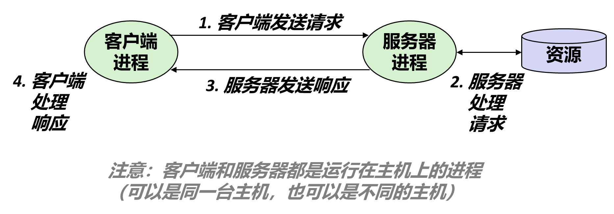
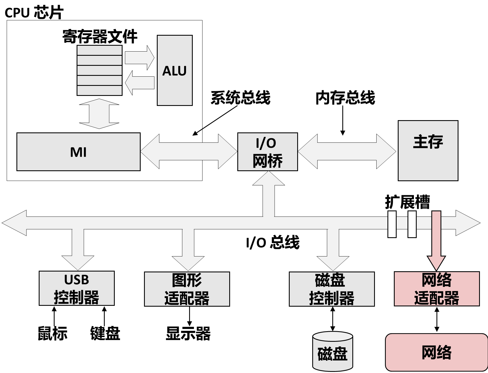
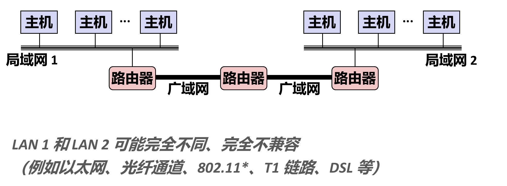
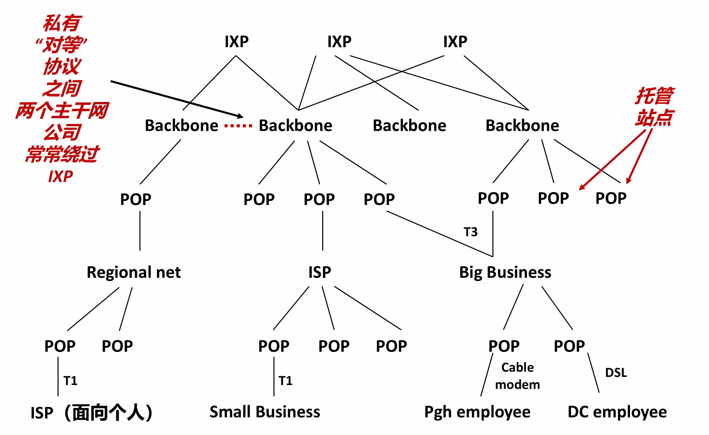

# 第十一章 网络编程（一）：客户端—服务器模型与网络基础

> 依据：CMU 15-213 第 21 讲（`21-netprog1_中文.pptx`，中译版在桌面课件目录）+ 《深入理解计算机系统》第 3 版第 11 章 §11.1–11.2 + 课堂录音《程序文件打开相关讲解》整理稿后半段（2026-10-28，第四~六节）。
> 上一章结尾留了一句话："网络应用更应该用 Unix I/O。"这一章回到同一套 fd / `read` / `write` 上，只是把"文件"换成了"连接"。本篇只讲开头三件事：网络应用怎么组织（C/S 与 P2P）、网络在硬件上是什么、网络按覆盖范围怎么分。

---

## 目录

- [[#1. 从文件描述符到套接字]]
- [[#2. 客户端—服务器模型]]
  - [[#2.1 一次事务：请求与响应]]
  - [[#2.2 服务器常开，客户端随用随关]]
  - [[#2.3 一对多，而且"分区"通常是逻辑的]]
  - [[#2.4 B/S 只是 C/S 的一层皮]]
- [[#3. P2P：角色被摊薄的那种网络]]
- [[#4. 从硬件看网络：网卡也是一个 I/O 设备]]
- [[#5. 网络的"打开"不叫 open]]
  - [[#5.1 一条连接要经过的五个调用]]
  - [[#5.2 为什么不能复用 open]]
- [[#6. 网络按覆盖范围分类]]
  - [[#6.1 SAN、LAN、WAN、PAN]]
  - [[#6.2 internet 与 Internet]]
  - [[#6.3 因特网是怎么长出来的]]
- [[#7. 待续：从集线器到套接字接口]]

---

## 1. 从文件描述符到套接字

课堂在转入网络之前先提了一句上一章的尾巴：系统级的程序本来就难写，一个进程里多个描述符同时读写会出各种问题——**换成网络编程，同样的问题全都在，而且更麻烦**，因为对端随时可能断、可能慢、可能只写了一半。

但别把网络编程当成另一个世界。它从头到尾只有一件事：**拿到一个文件描述符，然后 `read` / `write` / `close`**。变化的只是"怎么拿到这个 fd"——文件用 `open`，网络用 `socket` 加一串连接动作（§5）。教材把这句话写在最前面，第 11 章后面所有代码都是它的展开。

---

## 2. 客户端—服务器模型

教材的定义：一个网络应用由**一个服务器进程**和**一个或多个客户端进程**组成。服务器管理某种资源，并通过操作这个资源为客户端提供服务。课堂用自动售货机类比（课件 p2）：机器守在那儿管理商品，你投币选货、它掉出来——投币就是请求，掉货就是响应。

### 2.1 一次事务：请求与响应

客户端和服务器之间的一次完整交互叫**事务（transaction）**，固定四步：

1. 客户端向服务器发送**请求**；
2. 服务器收到请求、处理它（可能读写磁盘、查数据库、算一会儿）；
3. 服务器向客户端发送**响应**，并等待下一个请求；
4. 客户端收到响应。

最要紧的一条限定：**客户端和服务器是进程，不是机器**。同一台主机上完全可以同时跑这两个进程（浏览器和本机 Web 服务器就是这样），判断角色看两件事——谁管理资源、谁先发起请求。

### 2.2 服务器常开，客户端随用随关

服务器不知道请求什么时候来（课堂上那句"你凌晨三点起来打游戏，服务器还开着"），所以它必须一直跑着；客户端则是启动、用一会儿、关掉。

这条差异带来两个后果：

- **服务器的寿命长于任何单个客户端**，所以它必须能同时应付多个客户端，否则第一个连上的人就把整个服务独占了。
- **请求一定由客户端先发起**。课堂的打饭类比：你不开口，阿姨不会主动给你打饭。这直接决定了后面 socket 调用的分工——客户端主动 `connect`，服务器只能被动 `accept`（§5.1）。

### 2.3 一对多，而且"分区"通常是逻辑的

一个服务器进程服务多个客户端，是**多对一**的关系。所谓"分区"多半是**逻辑分区**，物理上可能还是同一台机器上的一组服务进程。

技术上怎么做到一对多、每个客户端一个 fd，是第 11 章后半（并发服务器）的内容，这里只需要记住结论：**监听的那个 fd 和每条连接用的 fd 不是同一个**。

### 2.4 B/S 只是 C/S 的一层皮

**B/S（browser-server）** 指浏览器当客户端，底层仍然是 C/S——浏览器是个通用客户端，不专为某个服务而写，而是笼统地去取"资源"。它在 Web 里的具体形态（URL 指向资源、请求就是"把那个资源给我"）要等讲 HTTP 才看得清，现在只要知道 B/S 不是第四种模型。

---

## 3. P2P：角色被摊薄的那种网络

**P2P（peer-to-peer）** 没有固定的客户端与服务器分工：每个节点既向别人要数据，也向别人提供数据。课堂的说法是"人人为我，我为人人"。

严格说它不是"没有服务器"，而是**服务器的角色被摊薄了**：索引与发现仍可能由某个中心节点做，但**内容不经它转发**——文件切成片段，中心节点只存一张"谁有哪几片"的目录，传输全在用户之间。

对写程序的人，它的意义只有一条：**"客户端"和"服务器"是进程在这次交互里扮演的角色，不是机器的属性**。判断依据始终是谁请求、谁提供，与部署在哪台机器上无关（§2.1）。

---

## 4. 从硬件看网络：网卡也是一个 I/O 设备

课件 p3 那张主机结构图把网络放在了它该在的位置上：网络适配器（**网卡**）和磁盘控制器、图形适配器、USB 控制器一样，都挂在 I/O 总线上，由 I/O 桥接器连到内存和 CPU。

物理介质两种形态：**有线**（RJ-45 水晶头 + 双绞线，每对线绞在一起以抵消干扰）与**无线**（WiFi 适配器，靠无线电波）。

结论只有一句，但它是后面所有内容的根据：**网络在操作系统眼里就是一块 I/O 设备**。往外发数据 = 往它写；从网上收数据 = 从它读。

---

## 5. 网络的"打开"不叫 open

既然是 I/O 设备，那第一步就该是"打开"。但网络没有 `open`，而是一串函数。

### 5.1 一条连接要经过的五个调用

| 谁调用 | 函数 | 作用 |
|---|---|---|
| 双方 | `socket()` | 创建一个通信端点，返回一个 fd（套接字描述符） |
| 客户端 | `connect()` | 主动连向服务器的地址 |
| 服务器 | `bind()` | 把这个 fd 绑定到某个 IP + 端口 |
| 服务器 | `listen()` | 声明"我开始等连接了"，fd 变成被动套接字 |
| 服务器 | `accept()` | 从已完成连接的队列里取出一个，返回**一个新的** fd |

连上之后，两边各有一个 fd，接下来的 `read` / `write` / `close` 与普通文件完全一样——这就是上一章那句"网络应用更应该用 Unix I/O"的落点。

注意 `accept` 返回的是**新 fd**：监听用的那个 fd 继续听，新 fd 专供这一条连接。它和 `dup` 不是一回事：`dup` 让两个描述符指向**同一个**打开文件表项，`accept` 造的是一个**新表项**（详见 [[01_系统级IO_UnixIO#13.5 归纳：四种情况一张表|第十章 §13.5]]）。这些调用在第 11 章后半会逐个展开，现在只要记住顺序：**socket → 客户端 connect / 服务器 bind+listen+accept**。

### 5.2 为什么不能复用 open

按"打开文件"的思路硬套，会发现四处对不上：

| 维度 | 打开文件 | 打开连接 |
|---|---|---|
| 定位对象 | 路径名 | IP 地址 + 端口（或域名） |
| 打开后状态 | 立刻可用 | 还没连上，要 `connect` 或 `accept` 才算通 |
| 传输语义 | 只有一种 | TCP / UDP / 原始套接字，必须先选 |
| 方向 | 读权限、写权限 | 双向字节流（全双工） |

历史原因也简单：Unix 的 `open` 语义在 1970 年代就定型了，TCP/IP 普及要到 1980 年代，BSD 套接字接口（1983）是后来加的，改不动 `open`，只能另造一套名字。但它的形状是**故意模仿文件**的——同样返回一个非负整数，同样用 `read` / `write` / `close`，这样网络就能直接复用已有的 I/O 机制。

一句话：**网络编程 = 换一种打开方式 + 原来的读写。**

---

## 6. 网络按覆盖范围分类

课件 p4 的定义值得照抄：网络是一个**按地理远近组织的、由盒子和连线构成的分层系统**。

### 6.1 SAN、LAN、WAN、PAN

| 缩写  | 全称                          | 覆盖范围           | 典型形态                        |
| --- | --------------------------- | -------------- | --------------------------- |
| SAN | System Area Network，系统区域网   | 一个机柜、一个机房、一个集群 | 集群内部互联（Quadrics、InfiniBand） |
| LAN | Local Area Network，局域网      | 一栋楼、一个园区       | 以太网、WiFi                    |
| WAN | Wide Area Network，广域网       | 一个国家、一个洲       | 运营商骨干、教育网主干                 |
| PAN | Personal Area Network，个人区域网 | 一个人身上          | 蓝牙耳机、手表、AI 眼镜               |

前三级是教材给的（课件 p4 的"分层系统"就是这三级），**PAN 是课堂补的**：手机、耳机、手表、眼镜用蓝牙或超宽带连成一个小网，人体本身就是一个 PAN 的边界。

界限是模糊的，别当成定量标准——课堂专门强调过它"没有完全定量的划分标准"，只是范围上的大致描述。

### 6.2 internet 与 Internet

这两个词只差一个大写字母，含义差得很远：

- **internet（小写）**：把多个网络用路由器连起来形成的**互联网络**，是描述性概念，`internetworking` 的缩写。你家里的内网、公司的专网，都是某个 internet。
- **Internet（大写）**：那个全球的、基于 TCP/IP 协议族的**因特网**，是专有名词。

关系一句话：**Internet 是现在最大的一个 internet，但不是唯一的一个。**

### 6.3 因特网是怎么长出来的

脉络一句话：1957 年苏联发射 Sputnik 刺激美国在次年成立 **ARPA**；1960 年代末 ARPANET 起步，要求少数关键节点互通、部分节点被毁后剩下的仍能通；此后从军方扩散到政府机构与高校，1990 年代完成商业化；中国 1994 年全功能接入，同样是高校（CERNET）先行。

（教材 §11.1 有一段旁注 *A Brief History of the Internet* 讲同一件事，可以对照看。）

---

## 7. 待续：从集线器到套接字接口

这一篇停在"网络是什么"这一层。按课堂的推进顺序，后面这些内容已经写进 [[02_从以太网到套接字接口]]，下表留作索引：

| 顺序 | 主题 | 要回答的问题 |
|---|---|---|
| ① | 集线器、MAC 地址、网桥 | 一个房间里几台机器怎么连？为什么网卡要有唯一地址？ |
| ② | 路由器、路由表 | 跨网络的数据包怎么找到路？路由表怎么更新？ |
| ③ | 协议与数据包、分层封装 | 不同网络差异那么大，靠什么抹平？ |
| ④ | TCP/IP 协议族、TCP 与 UDP | "可靠"和"不可靠"各是什么保证？ |
| ⑤ | 套接字接口、IP 地址与域名、字节序 | 程序员眼里互联网是什么样子？ |

对应课件 p4–p22（网络分层 → 以太网段 → 网桥 → 互联网络 → 协议封装 → 全球 IP 因特网 → IP 地址 / 域名 / DNS）。
