# 第十一章 网络编程（二）：从以太网到套接字接口

> 依据：CMU 15-213 第 21 讲（Network Programming Part 1，官方中英字幕已归档在 `原始材料/Lecture21_NetworkProg1_中英精校.ass`）+ `21-netprog1_中文.pptx` p4–p22 + 《深入理解计算机系统》第 3 版 §11.2–11.4。
> 上一篇停在"网络是什么"这一层：C/S 与 P2P、网卡、按覆盖范围分类。这一篇往下走一层，回答三个问题——一堆机器是怎么连成一个网的、不同网怎么拼成一个互联网、程序员看到的"连接"到底是什么东西。

---

## 目录

- [[#1. 网络是怎么一层层连起来的]]
  - [[#1.1 局域网与以太网段]]
  - [[#1.2 集线器：一个会广播的转发器]]
  - [[#1.3 网桥与交换机：按地址选择性转发]]
  - [[#1.4 路由器与互联网络]]
  - [[#1.5 三种设备的分工]]
- [[#2. 协议与封装]]
  - [[#2.1 协议至少要解决两件事]]
  - [[#2.2 数据包]]
  - [[#2.3 封装：一层套一层的信封]]
- [[#3. IP、UDP、TCP：保证的层级]]
  - [[#3.1 IP：尽力而为]]
  - [[#3.2 UDP：只加一层端口]]
  - [[#3.3 TCP：把不可靠变成可靠]]
- [[#4. IPv4 地址与字节序]]
  - [[#4.1 点分十进制]]
  - [[#4.2 网络字节序：为什么必须是大端]]
  - [[#4.3 IPv6]]
- [[#5. 域名与 DNS]]
  - [[#5.1 层次命名]]
  - [[#5.2 多对多映射]]
  - [[#5.3 DNS 被当成负载均衡器用]]
  - [[#5.4 nslookup 与 dig]]
- [[#6. 端口：一台机器上的多个服务]]
  - [[#6.1 端口是 16 位整数]]
  - [[#6.2 知名端口与临时端口]]
  - [[#6.3 四元组才是一条连接]]
- [[#7. 套接字接口]]
  - [[#7.1 sockaddr：一套通用的地址结构]]
  - [[#7.2 五个调用各自做什么]]
  - [[#7.3 监听 fd 与连接 fd 为什么要分开]]
  - [[#7.4 一次完整的事务]]
- [[#8. getaddrinfo：不要手填地址]]
  - [[#8.1 老接口的问题]]
  - [[#8.2 addrinfo 是一条链表]]
  - [[#8.3 反查：getnameinfo]]
- [[#9. 小结]]

---

## 1. 网络是怎么一层层连起来的

### 1.1 局域网与以太网段

**局域网（LAN，Local Area Network）** 是覆盖一栋楼、一个园区的网络，它由若干**以太网段（Ethernet segment）** 拼成。一个以太网段就是"一组主机，通过一台集线器或交换机连在一起"，段内的主机可以直接互相发帧。

支撑以太网的是**适配器（网卡，NIC）**：它负责把主机内存里的数据变成线上的电信号，反过来也把收到的信号还原成数据。每个适配器出厂时带一个 **MAC 地址**（48 位，6 字节），局域网内用它来标识"哪块网卡"。

这里要分清两套地址，后面所有内容都靠这个区分：

| 地址 | 长度 | 谁在用 | 作用范围 |
|---|---|---|---|
| MAC 地址 | 48 位 | 网卡、交换机 | **同一个以太网段内** |
| IP 地址 | 32 位（IPv4） | 主机、路由器 | **整个互联网** |

MAC 地址是"这块硬件的名字"，IP 地址是"这台主机在网络拓扑里的位置"。跨网段通信时，MAC 地址会被逐段改写，IP 地址始终不变——这是理解路由的前提。

### 1.2 集线器：一个会广播的转发器

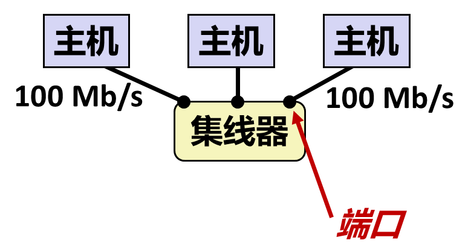

最原始的连接设备是**集线器（hub）**。它做的事简单到粗暴：从任何一个端口收到一位，就复制到**其他所有端口**。

后果是三条：

- 段内所有主机共享同一条通信信道，同一时刻只能有一台在发；
- 两台同时发就**冲突**，双方都得退避重发（CSMA/CD 就是这么来的）；
- 任何一台机器发出的数据，**同段所有机器都能收到**——这既是安全隐患（抓包即可窃听），也是"广播"这个机制的基础。

因为共享信道，集线器的规模上不去：主机一多，冲突概率飙升，有效带宽反而下降。这决定了它只能用在很小的范围。

### 1.3 网桥与交换机：按地址选择性转发

**网桥（bridge）** 换了个思路：不再无脑复制，而是看帧头里的 MAC 地址，只往"目标在那个方向"的端口转发。现代设备叫**交换机（switch）**，本质是带多个端口的网桥。

交换机还有一项能力叫**自学习**：它记录"哪个 MAC 地址出现在哪个端口上"，形成一张转发表。所以不需要人工配置，插上线跑一会儿表就建好了。

交换机把一个大冲突域切成若干个小的，每段内部仍然共享，段与段之间不再互相干扰。但它仍然工作在**同一个网络内**——转发表里只有 MAC 地址，它不知道"网络"这个概念。

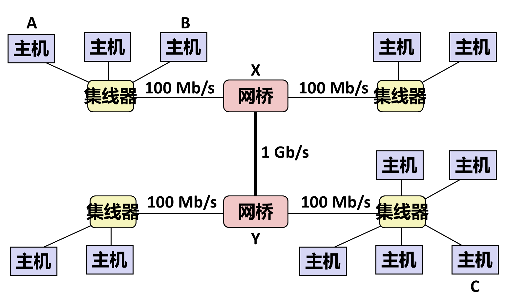

### 1.4 路由器与互联网络

要把**不同的网络**连起来，得用**路由器（router）**。它同时接在多个网络上，按 **IP 地址**决定往哪个口转发。

这里出现了本章最重要的一个词：**互联网络（internetwork，简称 internet）**——用路由器把多个不兼容的网络连成一个整体。小写的 internet 是通用概念，大写的 Internet 是其中最大的那个实例（[[01_网络编程概述#6.2 internet 与 Internet]]）。

路由器转发时做的事，比交换机多一层：

```
收到一个包 → 看目标 IP → 查路由表 → 决定下一跳 → 从对应端口发出
```

包在每一跳都会被重新封装成该段能传输的帧，**MAC 地址换成下一跳路由器的**，IP 地址原样不动。所以一路上变的是"信封上的收发件人（链路层）"，不变的是"信里写的最终地址（网络层）"。

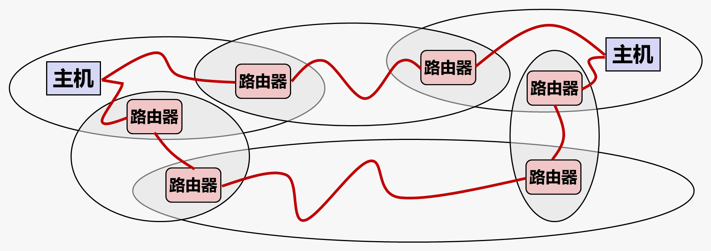

### 1.5 三种设备的分工

| 设备 | 依据什么转发 | 覆盖范围 | 一句话 |
|---|---|---|---|
| 集线器 | 不判断，全部广播 | 一个冲突域 | 物理层的中继器 |
| 交换机 / 网桥 | MAC 地址 | 一个局域网 | 把冲突域切小 |
| 路由器 | IP 地址 | 连接多个网络 | 把网络拼成互联网 |

这张表解释了为什么"网络是分层的"：每一层解决自己那一层的问题，上层的设备不需要知道下层怎么实现。

---

## 2. 协议与封装

### 2.1 协议至少要解决两件事

一堆由不同厂商制造、由不同机构管理的主机，凭什么能互相通信？靠**协议（protocol）**——一组双方都认的约定。教材给的定义很短，但要求不低：

- **命名机制（naming scheme）**：我怎么指定"要发给谁"。这就是 IP 地址；
- **投递机制（delivery mechanism）**：数据怎么从 A 走到 B。这就是路由与转发。

还要额外约定"出错怎么办""包丢了要不要重发""字节序谁在前"——这些都在后面的层里逐个出现。

### 2.2 数据包

协议不把整条消息一次性发出去，而是切成**数据包（packet）**，每个包通常一千多字节（以太网的 MTU 是 1500 字节）。

这样做的好处：一条长消息不必独占线路，多个会话的包可以交错传输；某个包丢了只重发那一个，不必重传整条消息。这和传统电话系统正好相反——电话是**面向连接**的，通话期间整条线路为你独占。

包的结构永远是"**头 + 负载**"：

```
┌────────────┬──────────────────────┐
│  header    │  payload（数据本身）  │
└────────────┴──────────────────────┘
```

头里放的是"这一层需要的信息"：目标地址、来源地址、长度、校验和、序号……

### 2.3 封装：一层套一层的信封

一个应用消息从发出到上线，要依次被加上好几层头，这叫**封装（encapsulation）**：

```
应用数据                    "GET /index.html HTTP/1.1"
  ↓ TCP 加头
TCP 段          [TCP头][应用数据]          端口、序号、校验和
  ↓ IP 加头
IP 数据报       [IP头][TCP头][应用数据]     源/目的 IP 地址
  ↓ 以太网加头
以太网帧  [帧头][IP头][TCP头][应用数据][帧尾] 源/目的 MAC
  ↓
物理线路上的比特流
```

接收端反过来一层层剥：网卡剥帧头 → 内核剥 IP 头 → 传输层剥 TCP 头 → 交付给应用。**每一层只关心自己的头，把剩下的当成不透明的载荷**——这就是分层最实际的收益：换掉链路层（换成 WiFi）不影响上面的 TCP/IP，因为中间那几层根本没看见过 WiFi 的帧长什么样。

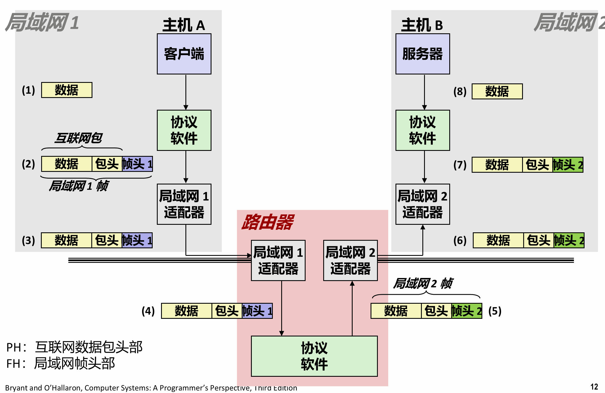

---

## 3. IP、UDP、TCP：保证的层级

### 3.1 IP：尽力而为

**IP（Internet Protocol）** 提供的是"主机到主机"的**不可靠数据报**投递。不可靠的含义在第 11 章第一篇之前的问答里已经展开过：不保证送达、不保证顺序、不保证不重复、不保证内容无误。链路上任何一处拥塞或干扰，路由器能做的只有一件事——**丢掉这个包**。

值得记的是这么设计的理由：如果每个中间设备都要保证可靠，它就得存数据、等确认、超时重传，成本和复杂度会摊到全网每一台路由器上。把这些推到**两端的主机**去做，中间的设备就可以做到极简、极快、极便宜。这就是常说的**端到端原则**——可靠性属于端点，不属于网络。

### 3.2 UDP：只加一层端口

**UDP（User Datagram Protocol）** 在 IP 上加的东西很少：主要是**端口号**，把"主机到主机"细化成"进程到进程"。它仍然不可靠。

它的用处是"宁可丢也不要等"：实时语音、视频、游戏状态同步。丢一帧画面没人察觉，等一次 200 ms 的重传反而毁了体验。

### 3.3 TCP：把不可靠变成可靠

**TCP（Transmission Control Protocol）** 承载了今天绝大部分流量。它在 IP 之上补齐了可靠性：

| 问题 | TCP 的处理 |
|---|---|
| 丢包 | 序号 + 确认 + 超时重传 |
| 乱序 | 接收端按序号重组 |
| 重复 | 按序号去重 |
| 发送方压垮接收方 | 流量控制（滑动窗口） |
| 压垮网络 | 拥塞控制 |

对应用来说，它提供的是一条**可靠的字节流**：你写进去多少字节、什么顺序，对面就读到多少字节、什么顺序。中间怎么切包、怎么重传、怎么重排，应用完全看不见——**这就是"套接字看起来像文件"的由来**。

---

## 4. IPv4 地址与字节序

### 4.1 点分十进制

IPv4 地址是 **32 位无符号整数**，习惯写成**点分十进制（dotted-decimal）**：四个 0–255 的十进制数，用点隔开。每个数正好是一个字节。

```
128.2.194.242   →   0x8002C2F2
 ↑   ↑   ↑   ↑
 最高字节              最低字节
```

0–255 这个范围不是随便定的，是因为每段就是一个字节。CMU 拥有 `128.2.0.0/16` 这一段，所以校园里的地址都以 `128.2` 开头。

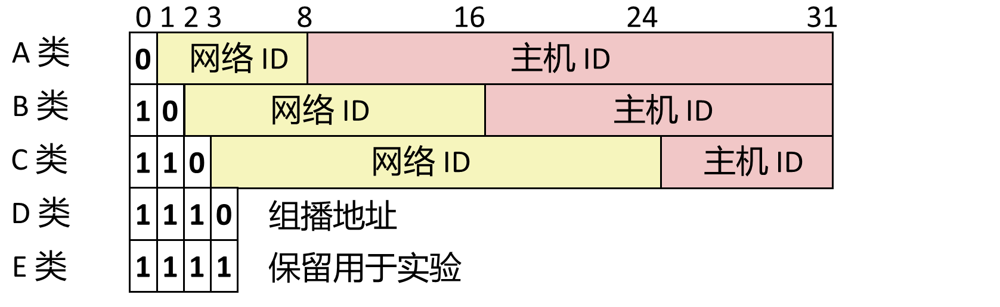

### 4.2 网络字节序：为什么必须是大端

同一个 32 位整数，不同机器往内存里放的方式可能相反：

- **小端（little-endian）**：低字节放低地址。x86 是这样；
- **大端（big-endian）**：高字节放低地址。

如果发送方按小端发、接收方按大端读，`0x8002C2F2` 会被读成 `0xF2C20280`，地址完全错。所以协议规定了统一的**网络字节序（network byte order）**，取的是**大端**。

不管你的机器是什么序，进出网络时都要转换。为此有一组固定函数：

| 函数 | 方向 | 作用 |
|---|---|---|
| `htons` | 主机 → 网络 | 16 位（端口） |
| `htonl` | 主机 → 网络 | 32 位（IPv4 地址） |
| `ntohs` | 网络 → 主机 | 16 位 |
| `ntohl` | 网络 → 主机 | 32 位 |

命名规则是 `h`=host、`n`=network、`s`=short(16)、`l`=long(32)。在小端机器上它们真的会做字节交换，在大端机器上则是空操作——**调用方不需要知道自己是哪种**，这正是这套函数存在的意义。

顺带一个事实：这套接口里**没有 64 位的版本**。要传 64 位整数得自己写或者绕开。

### 4.3 IPv6

32 位地址只有约 43 亿个，而今天手机、电脑、手表、家电都要地址。**IPv6** 把地址扩到 **128 位**，写法是八组十六进制数（`2001:0db8:85a3::8a2e:0370:7334`）。

IPv6 被称作"未来的技术"已经二十多年了，迟迟没有全面铺开，原因是过渡成本太高、而 IPv4 又被各种补丁（NAT、地址复用）硬撑了下来。写代码时要注意：**地址长度不再固定是 4 字节**，所以不能再用 `sizeof(struct sockaddr_in)` 这种写死的写法——这也是后面 `getaddrinfo` 存在的重要原因。

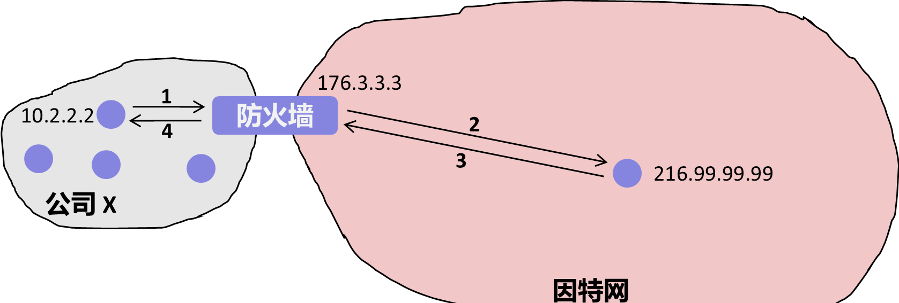

---

## 5. 域名与 DNS

### 5.1 层次命名

IP 地址难记，所以有了**域名（domain name）**：一串用点分隔的单词，比如 `www.cs.cmu.edu`。它是一套**层次命名系统**，从右往左逐级变具体：

```
        .（根）
        ├── edu        教育机构
        │   └── cmu    卡内基梅隆
        │       └── cs 计算机学院
        │           └── www   Web 服务器
        ├── com        商业机构
        ├── net        网络机构
        └── cn / de / jp …   国家与地区后缀
```

最右边那一级叫**一级域名（top-level domain）**。`.edu`、`.com`、`.net` 是通用后缀，`.cn`、`.de`、`.jp` 是国家与地区后缀。

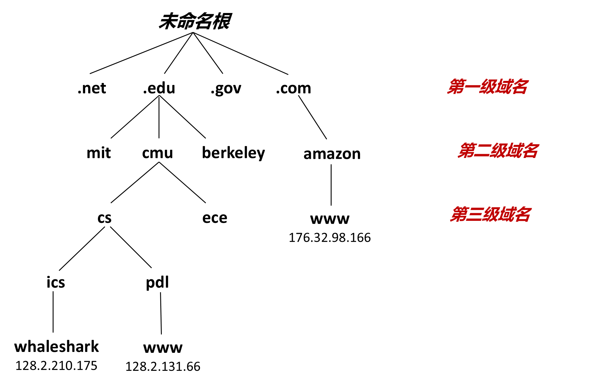

### 5.2 多对多映射

域名和 IP 不是一对一，而是**多对多**：

- 一个域名可以对应**多个 IP**（`twitter.com` 解析出四个地址）；
- 多个域名可以指向**同一个 IP**；
- 还有些域名在层级里存在，但**不指向任何主机**（只有子域才有地址）。

把域名翻成 IP 的系统叫 **DNS（Domain Name System）**：一个巨大的、分布式的数据库。唯一集中的部分只在最顶层——每个一级域名有一组权威服务器管着自己的那一段，`cmu.edu` 及以下由 CMU 自己维护。所以查 `www.cs.cmu.edu` 时，请求会一层层被转交到 CMU 自己的 DNS 服务器。

### 5.3 DNS 被当成负载均衡器用

既然一个域名能对应多个 IP，服务方就能拿它做文章：

- **多机分流**：一次解析返回四个地址，客户端通常按顺序试第一个（失败了再试下一个），压力自然摊到多台机器；
- **就近接入**：DNS 根据请求来源的地理位置返回不同的地址，把你引到最近的机房；
- **故障切换**：某台机器挂了，把它从解析结果里摘掉即可。

所以"访问 google.com"从来不是连到某台固定的机器，而是连到"DNS 此刻认为离你最近的那一台"。大型服务对 DNS 的更新是持续进行的。

### 5.4 nslookup 与 dig

查域名与 IP 的对应关系，用 `nslookup` 或 `dig`：

```
linux> nslookup www.cs.cmu.edu
Name:    WEB-LB.SRV.cmu.edu
Address: 128.2.194.242
```

输出里还能看出两件事：真正的规范名（canonical name）往往不是你以为的那个（`WEB-LB.SRV.cmu.edu` 里的 LB 就是 load balancer）；一个名字背后可能是别名套别名。

`localhost` 是个特例，永远指"本机"，地址固定为 **127.0.0.1**。开发时把客户端和服务器都跑在自己机器上、连 `localhost`，是最省事的调试方式。

---

## 6. 端口：一台机器上的多个服务

### 6.1 端口是 16 位整数

一台主机只有一个 IP 地址，但它同时可以跑 SSH、Web 服务器、邮件服务器。区分这些服务的，是**端口号（port）**：一个 16 位无符号整数，范围 0–65535。

于是"一个套接字"的完整标识是 **IP 地址 + 端口号**。IP 定位到机器，端口定位到机器上的哪个进程。

### 6.2 知名端口与临时端口

端口分两段用：

| 类型 | 范围 | 谁分配 | 例子 |
|---|---|---|---|
| 知名端口（well-known） | 0–1023 | IANA 统一分配，需特权 | 80 HTTP、443 HTTPS、22 SSH、25 SMTP、21 FTP |
| 临时端口（ephemeral） | 通常 32768–60999 | 内核在连接时动态分配 | 客户端每次连接用的那个 |

客户端不需要固定端口——它连出去时内核随手给一个，连接关了端口就收回。服务器必须用知名端口，否则客户端不知道往哪连。

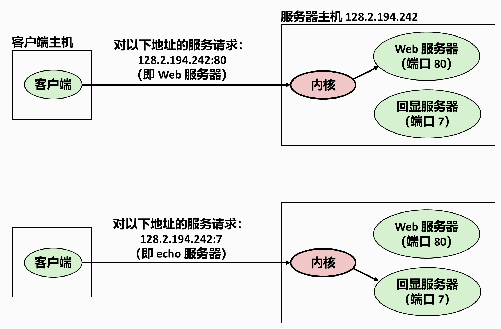

（临时端口的范围可以在 `/proc/sys/net/ipv4/ip_local_port_range` 里看到，不同系统不一样。）

### 6.3 四元组才是一条连接

一条 TCP 连接由**四个值**唯一确定：

```
（客户端 IP，客户端端口，服务器 IP，服务器端口）
```

所以一台服务器在 80 端口上可以同时服务成千上万个客户端——它们的客户端 IP 或端口各不相同，四元组互不冲突。反过来，同一个客户端连着同一个服务器的两个服务（比如同时开两个网页），端口不同，也是两条独立连接。

内核正是靠这个四元组，把到达的包分派给正确的进程。

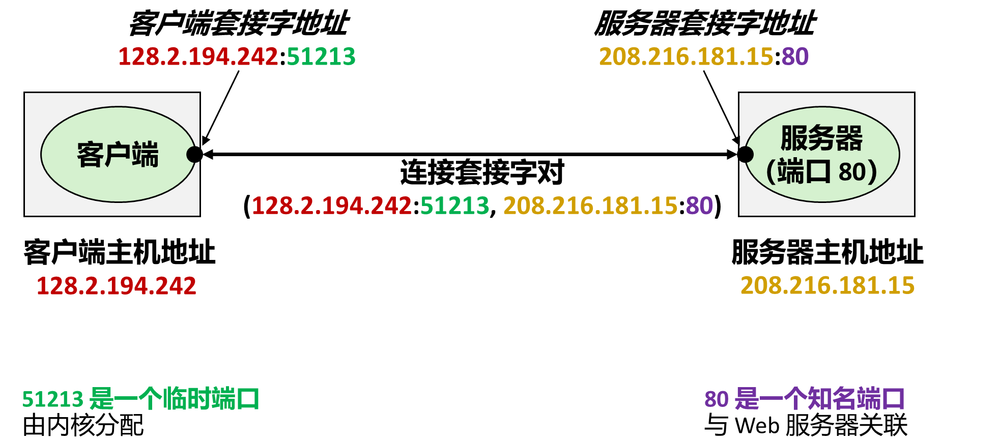

---

## 7. 套接字接口

IP、UDP、TCP 这套协议栈跑在**内核**里，应用程序碰不到。应用程序与内核之间只隔着一层接口——**套接字接口**，它由一组系统调用组成：用户代码调 `socket`、`connect`，内核替它建连接、发字节；数据到达时网卡发中断，内核收进来放进缓冲区，等用户代码 `read`。

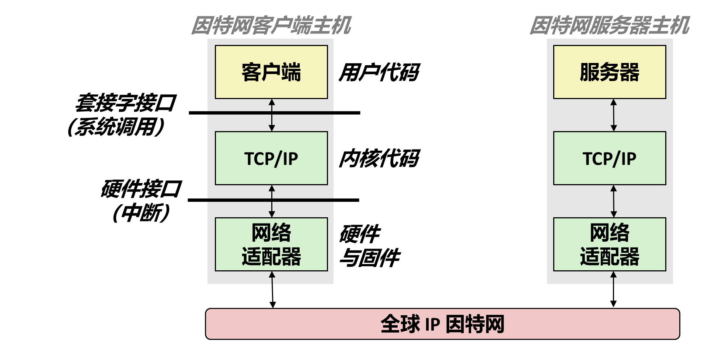

### 7.1 sockaddr：一套通用的地址结构

问题来了：IPv4 地址是 4 字节，IPv6 是 16 字节，还有别的协议族。如果每个函数都为每种地址写一个版本，接口会爆炸。解决办法是用一个**通用结构**：

```c
struct sockaddr {          /* 16 字节的"通用地址" */
    uint16_t sa_family;    /* 地址族：AF_INET / AF_INET6 … */
    char     sa_data[14];  /* 具体地址，按族解释 */
};
```

前 2 个字节说明"这是哪种地址"，剩下的按族解释。实际使用时填的是具体版本：

```c
struct sockaddr_in {              /* IPv4 专用 */
    uint16_t       sin_family;    /* AF_INET */
    uint16_t       sin_port;      /* 端口，必须是网络字节序 */
    struct in_addr sin_addr;      /* 32 位 IP 地址，网络字节序 */
    unsigned char  sin_zero[8];   /* 填充到 16 字节，不用 */
};
```

`sin_zero` 那 8 个字节纯粹是为了让 `sockaddr_in` 和 `sockaddr` 一样长（16 字节），这样函数接收 `struct sockaddr *` 时，传 `sockaddr_in` 的指针也能用。C 里没有继承，这是模拟"子类"的经典手法——**结构体前几个字段布局一致，就可以互相强转指针**。

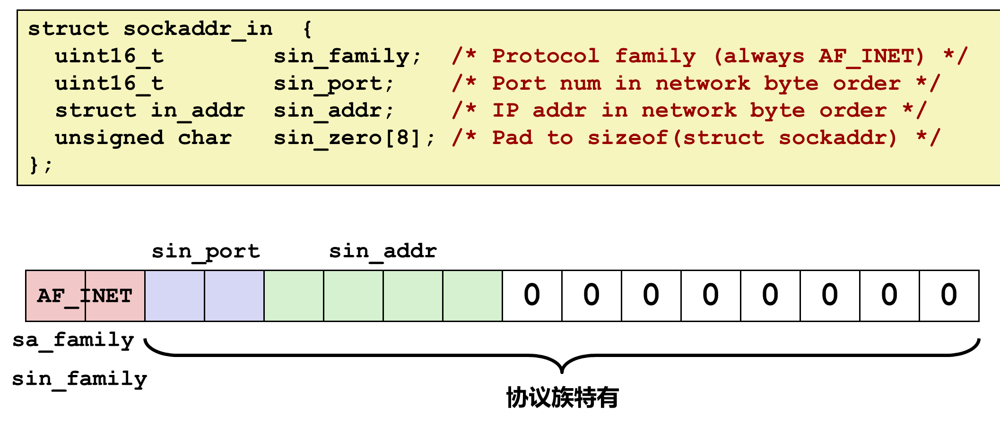

### 7.2 五个调用各自做什么

上一篇给出过一张总表（[[01_网络编程概述#5.1 一条连接要经过的五个调用]]），这里补每个调用的实际语义：

```c
int socket(int domain, int type, int protocol);
```

创建一个通信端点，返回**套接字描述符**（就是一个 fd）。`AF_INET` 表示 IPv4，`SOCK_STREAM` 表示 TCP（字节流），第三个参数通常填 0。注意：**这一步不碰网络，也不进内核的协议栈深处**，只是在进程里造出一个空的端点。

```c
int bind(int sockfd, const struct sockaddr *addr, socklen_t addrlen);
```

把 fd 绑定到"本机的某个 IP + 某个端口"。服务器必须做，客户端一般不做（内核会替它选临时端口）。

```c
int listen(int sockfd, int backlog);
```

把主动套接字转成**监听套接字**：告诉内核"这个 fd 用来等别人连进来"，`backlog` 是排队上限。`bind` 和 `listen` 的顺序不能颠倒。

```c
int accept(int listenfd, struct sockaddr *addr, socklen_t *addrlen);
```

**阻塞**等待一个连接到来；来了就返回一个**新的 fd**（连接描述符），后续所有读写都用这个新 fd。同时把对端的地址填进 `addr`。

```c
int connect(int sockfd, const struct sockaddr *addr, socklen_t addrlen);
```

客户端用：向指定地址发起连接。成功后 `sockfd` 就代表这条连接。

### 7.3 监听 fd 与连接 fd 为什么要分开

这是初学最容易糊涂的一处。服务器上有两种 fd，职责完全不同：

| | 监听 fd（listenfd） | 连接 fd（connfd） |
|---|---|---|
| 来源 | `socket()` 创建，`bind`+`listen` 后待命 | `accept()` 返回 |
| 数量 | 一个服务一个 | **每个客户端一个** |
| 用途 | 只用来 `accept` | 只用来 `read`/`write` |
| 关闭 | 服务停止时关 | 这个客户端断开时关 |

分开的原因就一句话：**服务器要同时服务多个客户端**。如果 `accept` 复用监听 fd，那这条连接一占用，就再也接不了新连接了。分成两个之后，监听 fd 永远空着等下一个，每条连接各占一个 connfd，彼此不干扰——这也是后面并发服务器（多进程/多线程/IO 多路复用）能成立的结构基础。

`accept` 造的是**新的打开文件表项**，不是 `dup` 那种"两个描述符指向同一个表项"。这一点在推描述符题时要分清（[[01_系统级IO_UnixIO#13.5 归纳：四种情况一张表|第十章 §13.5]]）。

### 7.4 一次完整的事务

把上面的调用串起来，就是一次标准事务：

```
服务器                                    客户端
─────────────────────────────────────────────────────────
socket()    → listenfd
bind()      绑定 IP:端口
listen()    转为监听
accept()    ← 阻塞等待 ────────────────  socket()   → fd
            ←──────────────────────────  connect()
            返回 connfd
read(connfd) ←────── "GET / HTTP/1.1" ────  write(fd, …)
write(connfd) ────── "HTTP/1.1 200 …" ───→  read(fd, …)
close(connfd) ←────── 客户端关闭 ────────  close(fd)
accept()    再次阻塞，等下一位
```

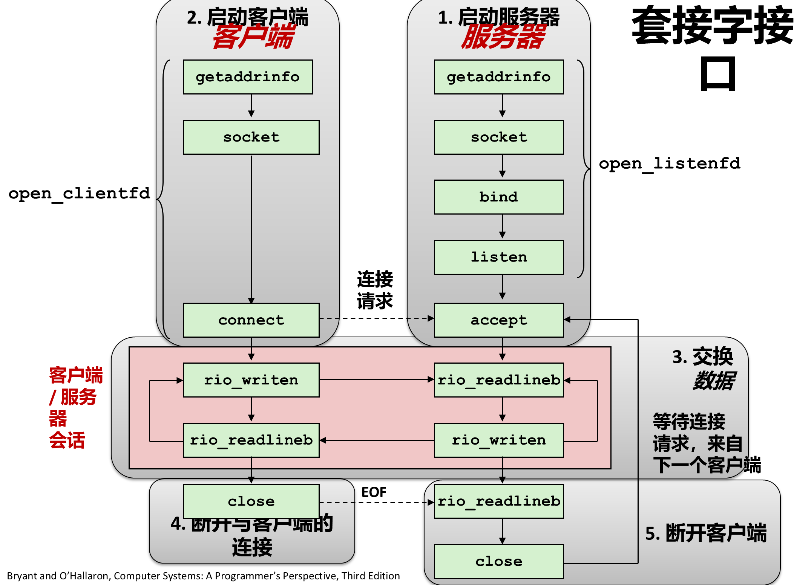

几个值得注意的细节：

- 客户端一 `close`，服务器端 `read` 就会返回 **0**（EOF），这就是它判断"对方走了"的方式——和第十章文件读到底的处理完全一样；
- 服务器处理完一个客户端后回到 `accept`，这种一次只服务一个连接的模型叫**迭代服务器（iterative server）**；要真正并发，得 `fork` 子进程或开线程，那是第 12 章的内容；
- 两边都是普通 fd，所有 I/O 用 `read`/`write`，来自上一章的 `rio_readn`/`rio_writen` 在这里正好派上用场（网络会短计数）。

---

## 8. getaddrinfo：不要手填地址

### 8.1 老接口的问题

早期写网络程序，得自己调 `gethostbyname` 把域名翻成 IP，再手工填 `sockaddr_in`。这套老接口有三个硬伤：

1. **只支持 IPv4**，写死在结构里；
2. **不可重入**：返回值指向一个静态缓冲区，多线程同时调用会互相覆盖；
3. 域名 → IP 与 IP → 域名的函数是两套，参数风格还不一致。

`getaddrinfo` 就是来替它们的：一套接口同时处理 IPv4/IPv6、返回值由调用方释放（线程安全）、并且直接把"该传给 `socket`/`connect`/`bind` 的参数"都准备好。

### 8.2 addrinfo 是一条链表

```c
int getaddrinfo(const char *host, const char *service,
                const struct addrinfo *hints, struct addrinfo **result);
```

- `host`：域名或点分十进制地址；
- `service`：端口号或服务名（`"http"` 等价于 80）；
- `hints`：告诉它你想要什么（`ai_family` 选 IPv4/IPv6，`ai_socktype` 选 TCP/UDP）；
- `result`：返回一条**链表**，因为一个名字可能对应多个地址。

链表节点长这样：

```c
struct addrinfo {
    int              ai_flags;
    int              ai_family;     /* AF_INET / AF_INET6 */
    int              ai_socktype;   /* SOCK_STREAM / SOCK_DGRAM */
    int              ai_protocol;
    size_t           ai_addrlen;    /* 地址长度，传给 socket 系列函数 */
    struct sockaddr *ai_addr;       /* 关键：已经填好的地址结构 */
    char            *ai_canonname;  /* 规范名 */
    struct addrinfo *ai_next;       /* 下一条 */
};
```

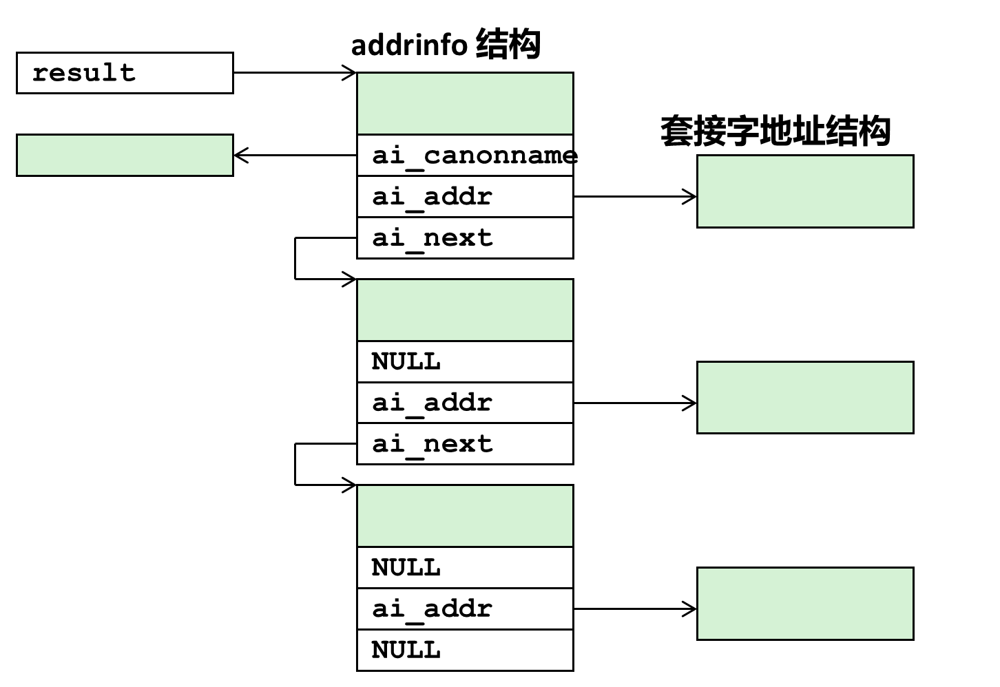

标准用法是**遍历链表、逐个尝试**：

```c
for (p = result; p; p = p->ai_next) {
    sockfd = socket(p->ai_family, p->ai_socktype, p->ai_protocol);
    if (sockfd < 0) continue;
    if (connect(sockfd, p->ai_addr, p->ai_addrlen) == 0) break;  /* 成功 */
    close(sockfd);
}
freeaddrinfo(result);   /* 必须释放，否则内存泄漏 */
```

三步要点：**用 `ai_addr` 而不是自己拼地址**；**失败就换下一条**（多 IP 主机的意义就在这）；**用完 `freeaddrinfo`**。

出错时它返回的是 `getaddrinfo` 自己的错误码（不是 `errno`），要用 `gai_strerror(code)` 翻译成文字。

### 8.3 反查：getnameinfo

反过来，手里有 `sockaddr` 想得到域名，用：

```c
int getnameinfo(const struct sockaddr *sa, socklen_t salen,
                char *host, size_t hostlen,
                char *serv, size_t servlen, int flags);
```

因为它也要兼容两种地址族，参数同样是"通用结构 + 长度"的形式。写一个简化版 `nslookup` 就用它。

---

## 9. 小结

这一篇把"网络"从硬件拉到了 API：

- **连接是分层的**：集线器广播、交换机按 MAC 转发、路由器按 IP 转发，一层解决一层的问题；
- **协议的核心是命名 + 投递**，为了灵活，消息被切成包，每层加上自己的头（封装）；
- **可靠性是端点的事**：IP 尽力而为，UDP 只加端口，TCP 补齐重传与排序；
- **两套地址不能混**：MAC 在段内、IP 在全球；网络字节序统一为大端；
- **DNS 把名字换成地址**，而且是多对多、还能当负载均衡用；
- **端口区分同一台机器上的不同服务**，四元组才唯一确定一条连接；
- **套接字 = 一个 fd**，`socket` 造端点、服务器 `bind`+`listen`+`accept`、客户端 `connect`，之后就是 `read`/`write`。

再往后是第 12 章：并发服务器（`fork`、线程、I/O 多路复用）与 Web 服务器，那里才会处理"同时来一千个连接"的问题。
