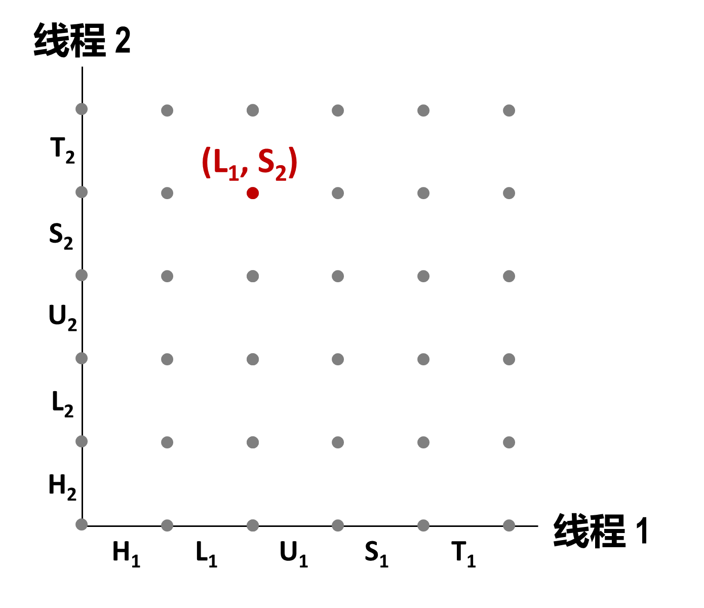
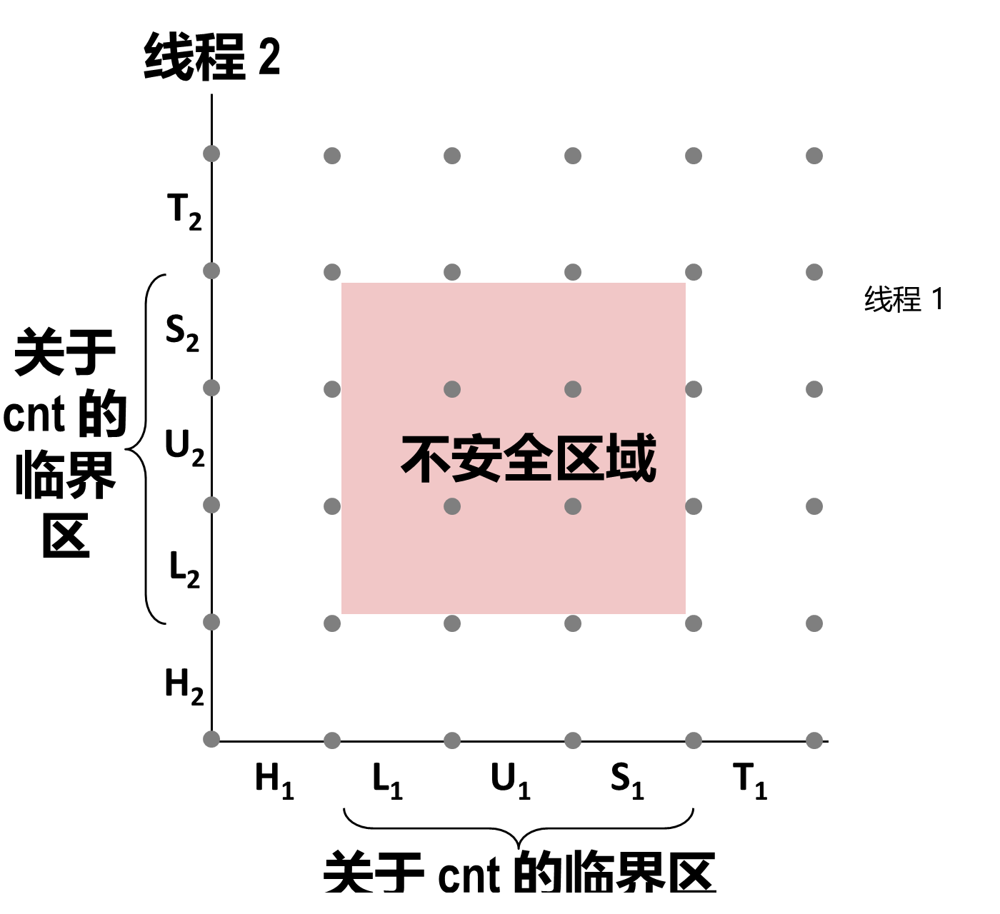
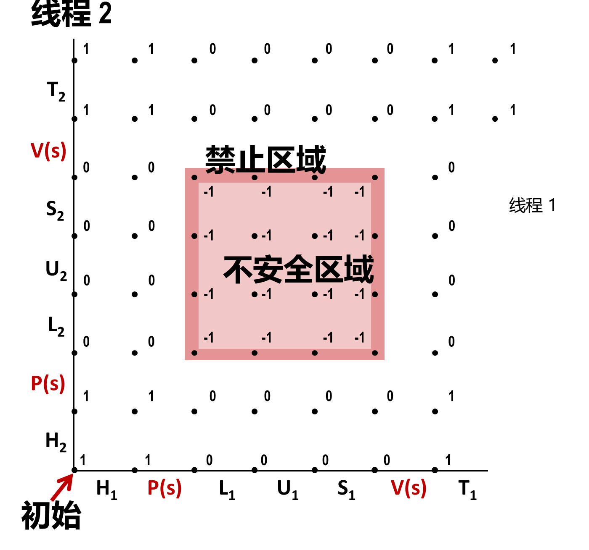

# 第十二章 并发编程：竞态与信号量

> 依据：CMU 15-213 第 24 讲（Synchronization: Basics，`24-sync-basic_中文.pptx` p8–p24）+ 《深入理解计算机系统》第 3 版第 12 章 §12.5.1 进度图、§12.5.2 信号量、§12.5.3 使用信号量来实现互斥（图 12-16 至图 12-22）+ 课堂录音《讲解线程与进程的区别》整理稿第七至十节（2026-11-18）。
> 上一篇判定出哪些变量被共享（见 [[02_线程内存模型与共享变量]]）；这一篇处理随之而来的问题：多条线程同时改一个共享变量，怎样保证结果可靠。信号量的另一类用途——调度共享资源——见 [[04_信号量的应用_生产者消费者与读者写者]]。

---

## 目录

- [[#目录]]
- [[#1. badcnt.c：两个线程各加一百万次]]
- [[#2. cnt++ 的三条机器指令]]
- [[#3. 交错为什么会让结果变小]]
- [[#4. 进度图：把交错画成轨迹]]
- [[#5. 临界区与不安全区域]]
- [[#6. 信号量：P 与 V]]
- [[#7. C 接口]]
- [[#8. goodcnt.c：用互斥锁修好它]]
- [[#9. 术语与不变式]]
- [[#10. 小结]]

---

## 1. badcnt.c：两个线程各加一百万次

```c
volatile long cnt = 0;      /* 全局共享计数器 */

int main(int argc, char **argv) {
    long niters;
    pthread_t tid1, tid2;

    niters = atoi(argv[1]);
    Pthread_create(&tid1, NULL, thread, &niters);
    Pthread_create(&tid2, NULL, thread, &niters);
    Pthread_join(tid1, NULL);
    Pthread_join(tid2, NULL);

    if (cnt != (2 * niters))            /* 检查结果 */
        printf("BOOM! cnt=%ld\n", cnt);
    else
        printf("OK cnt=%ld\n", cnt);
    exit(0);
}

void *thread(void *vargp) {
    long i, niters = *((long *)vargp);

    for (i = 0; i < niters; i++)
        cnt++;
    return NULL;
}
```

`./badcnt 10000` 期望 `cnt=20000`，屏幕上却可能打印 `BOOM! cnt=13051`，也可能打印 `OK cnt=20000`。**代码里没有随机数**：不确定性完全来自操作系统对线程的调度顺序。这种结果取决于调度决策的错误叫**竞态（race）**。

注意循环体只有一行 `cnt++`，看起来是一条不可分割的操作——这是全部问题的起点。

## 2. cnt++ 的三条机器指令

编译器把 `cnt++` 展开成三条指令（课件 p10 的 x86-64 汇编）：

```asm
movq  cnt(%rip), %rdx    ; L：load，把内存 cnt 读进寄存器
addq  $1, %rdx           ; U：update，在寄存器里加一
movq  %rdx, cnt(%rip)    ; S：store，把新值写回内存
```

加上循环头 `Hi` 和循环尾 `Ti`，一次自增的五步是：

```
H（head，进入循环） → L（读） → U（改） → S（写） → T（尾部，判断下一轮）
```

单线程里五步顺序固定；多线程里每条线程各自走自己的五步，唯一的约束是**同一条线程内部顺序不变**，两条线程之间可以任意交错。

`volatile` 在这里帮不上忙：它只保证每次都真的读内存（不把值缓存在寄存器里），并不保证 L-U-S 三步连在一起执行。原子性是另一回事。

## 3. 交错为什么会让结果变小

一次最小的错序：

| 时刻 | 线程 1 | 线程 2 | 内存中 cnt |
| --- | --- | --- | --- |
| 1 | L：读到 0 | | 0 |
| 2 | U：寄存器里变成 1 | | 0 |
| 3 | | L：也读到 0 | 0 |
| 4 | | U：寄存器里变成 1 | 0 |
| 5 | S：写回 1 | | 1 |
| 6 | | S：写回 1 | **1** |

两个线程都做了 +1，本该是 2，结果停在 1——线程 2 的写回**覆盖**了线程 1 的结果。把这一幕重复几千次，就得到 13051。

反过来说，如果线程 1 完整走完 `L1 U1 S1`，线程 2 再完整走自己的三步，结果就正确。所以错误不是必然的，而是「某些交错会出事」——这正是它难查的地方。

## 4. 进度图：把交错画成轨迹

把两条线程各自的五步画在两条坐标轴上（横轴线程 1，纵轴线程 2），就得到**进度图**：

- 每个点是一个执行状态 `(Inst1, Inst2)`，例如 `(L1, S2)`；
- 每条向右或向上的边是一步合法迁移；
- 一串从初始点出发的状态迁移叫一条**轨迹（trajectory）**——它描述某一次具体的并发执行过程。



单线程内部的顺序约束体现为「只能向右或向上」，不允许回头；两条线程的相对快慢体现为「先向右几步还是先向上几步」。于是「会不会出错」变成一个可以在图上判断的问题：轨迹有没有经过某块区域。

课件 p12–p15 给了三条示例轨迹（正确的一条、丢一次加法的一条、以及一段暂停在中间等你判断的轨迹），可以对照着画一遍。

## 5. 临界区与不安全区域

就共享变量 `cnt` 而言，**L、U、S 三步构成临界区**：这几条指令不该被交错执行。两条线程各自的临界区在进度图上叠出的那块矩形区域，就是**不安全区域**——轨迹一旦进入，两个线程可能同时处于「读了自己那份、还没写回」的状态，覆盖事故就有可能发生。



于是目标很明确：**让所有合法轨迹都绕开不安全区域**。程序员控制不了内核什么时候切换线程，但可以用同步原语把临界区围起来，使得任何轨迹都无法进入——教材把它表述为构造一个包住不安全区域的**禁止区域**。

## 6. 信号量：P 与 V

信号量由 Dijkstra 提出，是实现互斥的基础机制。教材定义为：**一个非负的全局整型同步变量 `s`，只能通过 P、V 两个操作改变**。

```text
P(s):
  若 s > 0：把 s 减 1，立即返回       ← 测试与自减是一个原子动作
  若 s = 0：挂起当前线程，直到 s 变非零且被 V 唤醒；
            唤醒后完成减 1，再返回

V(s):
  把 s 加 1                          ← 自增是原子动作
  若有线程阻塞在 s 上，恰好唤醒其中一个
```

**为什么 `s > 0` 时要「减 1 并立即返回」**：`s` 的值就是当前可用的许可数。`s > 0` 说明有空位，本次申请立刻成功，拿走一个许可（`s--`）后没有任何理由等待；`s == 0` 才说明许可被占光，线程必须挂起等待别人归还（V）。用停车场打比方：还有空位就直接取票进场，满位才排队。

**为什么必须用信号量而不能用普通整数**：如果自己写 `if (s > 0) s--;`，这个「判断 + 自减」本身又是三条机器指令，会重演 `cnt++` 的覆盖事故。P、V 的原子性由操作系统保证，这正是它们的价值。

> 注：课堂上用「P 以后 s 变负表示上锁失败、线程挂起」的传统操作系统口径讲解；教材与课件 p19 采用「信号量恒非负，s = 0 时阻塞」的定义（信号量不变式 `s >= 0`）。两种是不同实现口径，本篇以教材为准。

## 7. C 接口

```c
#include <semaphore.h>

int sem_init(sem_t *s, int pshared, unsigned int value);  /* s = value */
int sem_wait(sem_t *s);   /* P(s) */
int sem_post(sem_t *s);   /* V(s) */
```

`pshared` 传 0 表示信号量只在**同一进程的线程之间**共享，这是本章的用法。教材 `csapp.h` 另提供大写包装 `P()` / `V()`（分别包住 `sem_wait` / `sem_post`）和 `Sem_init()`，出错直接退出。

## 8. goodcnt.c：用互斥锁修好它

给 `cnt` 配一个初值 1 的信号量 `mutex`，把临界区围起来：

```c
volatile long cnt = 0;          /* 共享计数器 */
sem_t mutex;                    /* 保护 cnt 的信号量 */

Sem_init(&mutex, 0, 1);         /* mutex = 1 */

for (i = 0; i < niters; i++) {
    P(&mutex);                  /* 加锁 */
    cnt++;                      /* 临界区 */
    V(&mutex);                  /* 解锁 */
}
```

两个线程必须先抢锁：抢到的那个走完 L-U-S 才释放，另一个才进来。于是关于 `cnt` 的合法轨迹再也不会进入不安全区域，结果稳定为 20000。



代价也很明显：课件 p23 特意注明，goodcnt.c 比 badcnt.c **慢好几个数量级**。同步换来正确性，也换来性能损失——后面生产者—消费者一章把缓冲区切成小块，就是为了减少这种串行化的范围。

## 9. 术语与不变式

| 术语 | 含义 |
| --- | --- |
| 二元信号量 | 取值恒为 0 或 1 的信号量 |
| 互斥锁（mutex） | 用于实现互斥的二元信号量 |
| 计数信号量 | 用作可用资源集合的计数，取值可以大于 1 |
| 加锁 / 解锁 | P 操作 / V 操作作用于互斥锁 |
| 持有互斥锁 | 已加锁但尚未解锁 |

**信号量不变式 `s >= 0`**：教材译注强调，信号量不能为负；数值就是可用资源的数量。`s` 初值 1 对应「一次只准一个人进」，初值 N 对应「一次最多 N 个人进」。

## 10. 小结

- `cnt++` 在机器级是 L-U-S 三步，交错会覆盖彼此的写回，产生竞态；
- 进度图把交错画成轨迹，临界区叠出的不安全区域是事故来源；
- 信号量用原子 P/V 管理许可数：s > 0 时 P 减一立即返回，s = 0 时阻塞等 V 唤醒；
- 互斥锁是初值 1 的二元信号量，用 P/V 包住临界区即可修好 badcnt；
- `volatile` 不提供原子性；同步的正确性以性能为代价。

> **本节重点**：能对着 `badcnt.c` 说出 L-U-S 三步，能解释一次覆盖事故，能说清 P 为什么「非零就减一返回」——这三件事串起来就是同步的动机与机制。
