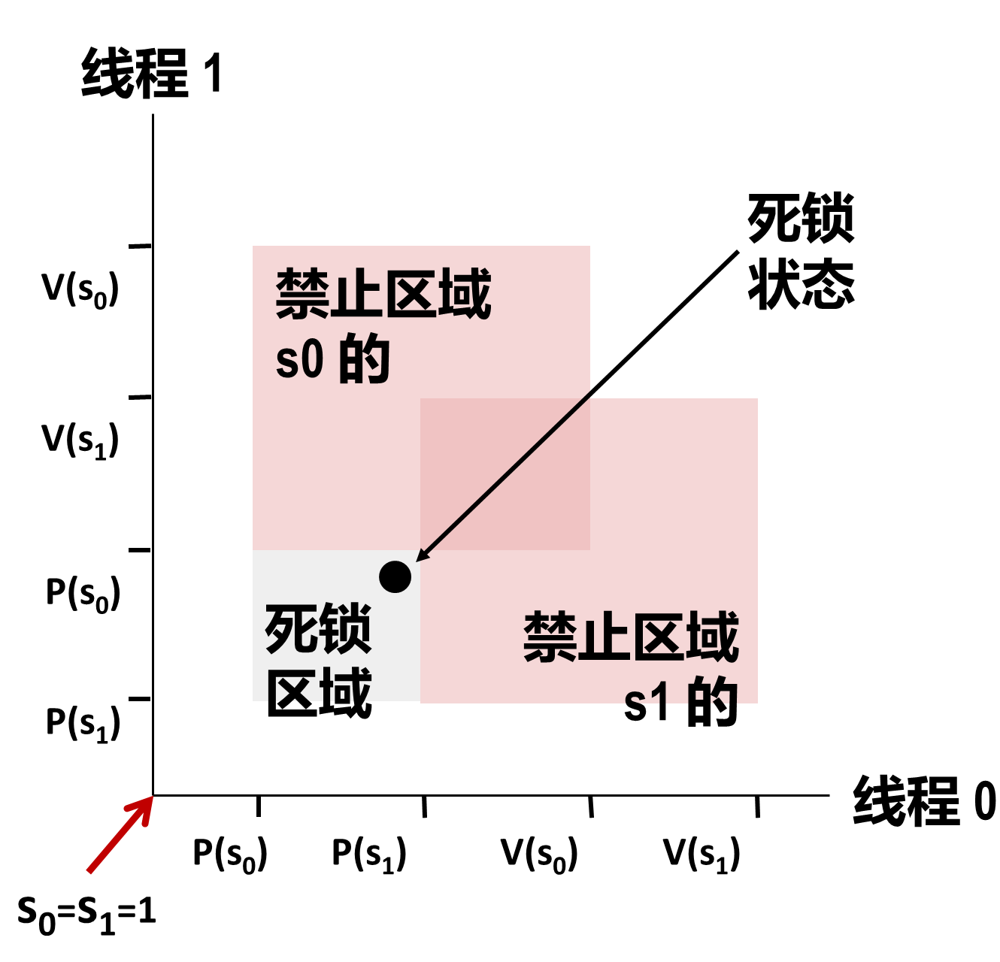

# 第十二章 并发编程：线程安全与死锁

> 依据：CMU 15-213 第 24 讲后半段与第 25 讲相关材料 + 《深入理解计算机系统》第 3 版第 12 章 §12.7 其他并发问题（§12.7.1 线程安全、§12.7.2 可重入性、§12.7.3 在线程化的程序中使用已存在的库函数、§12.7.4 竞争、§12.7.5 死锁，图 12-37 至图 12-45）+ 课堂录音《讲解线程与进程的区别》整理稿第十五、十六节（2026-11-18）。
> 前面几篇讲怎么主动用同步保护共享数据（见 [[02_线程内存模型与共享变量]]、[[03_竞态与信号量]]、[[04_信号量的应用_生产者消费者与读者写者]]）；这一篇讲不保护、保护错了会出什么问题，以及判断一个现成函数能不能在线程里直接用。

---

## 目录

- [[#目录]]
- [[#1. 线程安全的定义]]
- [[#2. 四类线程不安全函数]]
- [[#3. 第 2 类：跨越多次调用的状态]]
- [[#4. 第 3 类：返回静态区的指针]]
- [[#5. 可重入性与线程安全的关系]]
- [[#6. 库函数里的例外]]
- [[#7. 竞争：pthread_create 传参的陷阱]]
- [[#8. 死锁]]
- [[#9. 小结]]

---

## 1. 线程安全的定义

> 一个函数被称为**线程安全的（thread-safe）**，当且仅当被多个并发线程反复调用时，它一直产生正确的结果。否则就是线程不安全的。

这是函数级别的属性。前面 `cnt++` 的例子是**调用方**没保护共享变量；这里讨论的是**函数自身**在多线程下是否可靠，两类问题常常叠在一起。

## 2. 四类线程不安全函数

教材把线程不安全函数分成四个互不相交的类：

| 类别 | 特征 | 典型例子 | 修法 |
| --- | --- | --- | --- |
| 第 1 类 | 不保护共享变量 | 未上锁的全局计数器 | 在函数内部用 P/V 保护；调用方不用改 |
| 第 2 类 | 保持跨越多次调用的状态 | `rand` / `srand` | **只能重写**，让调用者传状态进来 |
| 第 3 类 | 返回指向静态变量的指针 | `ctime`、`gethostbyname` | 改签名让调用者传缓冲区，或用加锁—复制 |
| 第 4 类 | 调用线程不安全函数 | 依被调用者而定 | 视情况用锁保护调用位置 |

第 4 类要分开看：如果被调用的是第 2 类（依赖跨调用状态），调用者也无解；如果是第 1 类或第 3 类，只要用互斥锁保护调用位置和返回的共享数据，调用者仍然可以是线程安全的——`ctime_ts` 就是范例。

## 3. 第 2 类：跨越多次调用的状态

教材的伪随机数生成器：

```c
unsigned next_seed = 1;        /* 静态状态，全进程只有一份 */

unsigned rand(void) {
    next_seed = next_seed * 1103515245 + 12345;
    return (unsigned)(next_seed >> 16) % 32768;
}

void srand(unsigned new_seed) {
    next_seed = new_seed;
}
```

`rand` 的本次结果依赖上次调用留下的 `next_seed`，单线程里用同一个种子能得到可重复的序列；多线程调用时这个前提就没了。唯一的修法是**重写成可重入版本**，把状态改成调用者传进来的指针：

```c
int rand_r(unsigned int *nextp) {
    *nextp = *nextp * 1103515245 + 12345;
    return (unsigned int)(*nextp / 65536) % 32768;
}
```

因为状态在调用者手里，各线程传各自的变量即可。课堂还提到种子不要用裸时间戳：时间戳可推算，也可能溢出；实践中会混入 CPU 温度、内存使用率等系统状态。这部分属于课堂延伸，教材没有展开。

## 4. 第 3 类：返回静态区的指针

`ctime`、`localtime`、`gethostbyname`、`inet_ntoa` 把结果写进一块 `static` 缓冲区，然后返回它的地址。两个线程各调一次，后一次的结果会悄悄覆盖前一次——拿着指针的线程并不知道内容已经变了。

**修法一：改签名**。用 `_r` 版本让调用者提供缓冲区，例如 `ctime_r(timep, buf)`。共享数据被消除，但调用方和被调用方都要改。

**修法二：加锁—复制（lock-and-copy）**，用在老函数改不动时：

```c
char *ctime_ts(const time_t *timep, char *privatep) {
    char *sharedp;

    P(&mutex);                       /* 加锁 */
    sharedp = ctime(timep);          /* 调线程不安全的老函数 */
    strcpy(privatep, sharedp);       /* 趁锁还握着，复制到私有内存 */
    V(&mutex);                       /* 解锁 */
    return privatep;
}
```

三个要点：

- **锁必须罩住 `strcpy`**。若在 `ctime` 返回后、复制前就解锁，另一个线程可能挤进来改写静态区，你复制到的就是别人的结果；
- **`privatep` 由调用者申请和释放**。每次调用各用一块私有内存，不能退回静态数组，否则又变成共享；
- **所有调用点都得走包装并共用同一把锁**。若还有代码直接调 `ctime`，这层互斥就形同虚设。

加锁—复制也有局限：额外同步降低速度；对 `gethostbyname` 这类返回复杂结构的函数要做**深层复制**；对第 2 类那种依赖跨调用状态的函数完全无效。

## 5. 可重入性与线程安全的关系

**可重入函数（reentrant function）**的特点是被多个线程调用时**不引用任何共享数据**。它与线程安全不是同义词：

```text
所有函数
└── 线程安全函数
    └── 可重入函数        ← 真子集
└── 线程不安全函数
```

- 可重入 ⇒ 线程安全；线程安全 ⇏ 可重入（例如 `ctime_ts` 是线程安全的，但不是可重入的，因为它仍访问共享的静态区，靠锁保护）；
- 可重入函数通常更快，因为不需要同步；
- 把第 2 类线程不安全函数变安全，唯一办法就是重写成可重入的（`rand` → `rand_r`）。

两个更细的判据：

- **显式可重入**：所有参数传值（无指针），所有数据引用都是本地自动栈变量——无论如何调用都可断言可重入；
- **隐式可重入**：允许传指针，但调用者必须保证指向非共享数据（`rand_r` 就是）。可见可重入性有时是**调用者与被调用者共同的属性**。

> 注：课堂上把「可重入」当成线程安全的通俗判据来讲；教材强调它是真子集，反向不成立，本篇以教材为准。

## 6. 库函数里的例外

大多数 Linux 函数（包括标准 C 库中的 `malloc`、`free`、`realloc`、`printf`、`scanf`）都是线程安全的，少数例外如下：

| 线程不安全函数 | 类别 | Linux 线程安全版本 |
| --- | --- | --- |
| `rand` | 2 | `rand_r` |
| `strtok` | 2 | `strtok_r` |
| `asctime` | 3 | `asctime_r` |
| `ctime` | 3 | `ctime_r` |
| `gethostbyaddr` | 3 | `gethostbyaddr_r` |
| `gethostbyname` | 3 | `gethostbyname_r`；网络编程更推荐 `getaddrinfo` |
| `inet_ntoa` | 3 | 无；用 `inet_ntop` 代替 |
| `localtime` | 3 | `localtime_r` |

除 `rand` 和 `strtok` 外，其余基本都是第 3 类。可重入版本一律带 `_r` 后缀，优先使用。网络编程里 `gethostbyname` / `inet_ntoa` 已经弃用，第 11 章讲的 `getaddrinfo` / `getnameinfo` / `inet_ntop` 是可重入的替代品。

## 7. 竞争：pthread_create 传参的陷阱

§12.7.4 的「竞争」与第 3 篇的 `cnt++` 是同一类问题，但错在**调用方传参**。教材例子：主线程创建四个对等线程，把同一个栈变量 `i` 的地址传进去：

```c
for (i = 0; i < N; i++)
    Pthread_create(&tid[i], NULL, thread, &i);   /* 错误：四个线程都指向同一个 i */

void *thread(void *vargp) {
    int myid = *((int *)vargp);
    printf("Hello from thread %d\n", myid);
    return NULL;
}
```


主线程下一次循环改 `i`，与对等线程解引用 `vargp` 之间形成竞争：谁先谁后由内核调度决定，于是屏幕上会出现两个 `thread 3`。正确做法是为每个 ID 单独 `malloc` 一块内存，线程用完自己 `Free`：

```c
for (i = 0; i < N; i++) {
    int *ptr = Malloc(sizeof(int));
    *ptr = i;
    Pthread_create(&tid[i], NULL, thread, ptr);
}

void *thread(void *vargp) {
    int myid = *((int *)vargp);
    Free(vargp);                       /* 线程自己释放 */
    printf("Hello from thread %d\n", myid);
    return NULL;
}
```

**规则：多线程程序必须对任何可行的轨迹线都正确**，不能依赖「我觉得它会先跑到这里」。第 1 篇 §7.3 的传参坑讲的就是这件事，这里补上了教材的反例与修法。

## 8. 死锁

**死锁（deadlock）**：一组线程被阻塞，等待一个永远不会为真的条件。典型场景是两把锁、两个线程、加锁顺序相反：

- 线程 1 拿到 `s`，等待 `t`；
- 线程 2 拿到 `t`，等待 `s`；
- 两人都不会释放手里那把，谁也推进不了。



在进度图上，两个信号量的**禁止区域重叠**，重叠部分叫**死锁区域**：轨迹可以进去，但不可能出来，到了死锁状态 `d` 就再无合法迁移方向。每个线程都在等对方执行一个根本不会发生的 V 操作。

**注意**：死锁不总发生。有些轨迹绕开死锁区域，有些陷进去——所以程序跑 1000 次没事，第 1001 次才卡住；在一台机器上正常，换一台就死锁。错误常常不可复现。

> 规则（互斥锁加锁顺序）：给定所有互斥操作的一个**全序**，如果每个线程都按这个顺序获得互斥锁，并以相反顺序释放，程序就不会死锁。两个线程都先锁 `s` 再锁 `t`，死锁区域就消失了。

一个资源不会产生这种死锁；至少两个资源、并且加锁顺序不一致才可能。

## 9. 小结

- 线程安全是函数级属性，不安全函数分四类：不保护共享变量、跨调用状态、返回静态区指针、调用不安全函数；
- 第 2 类只能重写成可重入版本；第 3 类可以改签名或用加锁—复制包装；
- 可重入函数是线程安全函数的真子集，反向不成立；
- 优先用 `_r` 版本或 `getaddrinfo` 家族替代不安全的库函数；
- 给 `pthread_create` 传地址要当心主线程与对等线程之间的竞争；
- 死锁来自加锁顺序相反，遵守全序加锁、逆序解锁即可避免。

> **本节重点**：四类不安全函数的划分、加锁—复制为什么必须把复制也锁进去、互斥锁加锁顺序规则——这三处是这一节最容易考到的地方。
